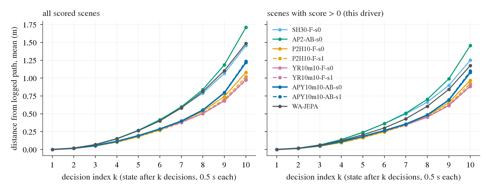

# AUD1-drift: which checkpoint drifts least per decision, for nuPlan submission two

2026-10-12. A descriptive read of stored rollouts only. No closed loop was rerun, the driver is unchanged, and nothing was committed or submitted.
Follows [aud1_private_gap.md](aud1_private_gap.md): the submitted `APY10m10-AB-s0` dropped from 0.935 / 1.13 m / 0.863 km on the public
suite to 0.640 / 2.29 m / 0.132 km on the private one. Question: among the stored candidates, which checkpoint's behaviour should transfer
best? The criteria are least drift growth per decision, lowest GT distance, fewest at-fault incidents, flattest per-log profile and fewest
hard-strata zeros. The public scene score is listed last and is not the objective. Numbers: [aud1/drift/](aud1/drift/). Code (uncommitted):
`scripts/aud1_drift_collect.py` (box) and `scripts/aud1_drift_report.py` (Mac). Box outputs: `$DATA_DIR/runs/alpasim/aud1_drift/`.

**Answer: `YR10m10-F-s0` is the recommended checkpoint for submission two.** It has the lowest drift growth (0.136 m per decision vs 0.171 for
the submitted APY10m10-AB-s0; the paired CI excludes 0) and the lowest GT distance (0.941 m vs 1.130 m, paired -0.189 [-0.250, -0.134]). It
also has a third of APY's zeros in near-stationary starts and the flattest per-vehicle profile. Its second seed reproduces every one of
these numbers. It costs 0.010 public scene score. Its at-fault rate cannot be separated from APY's. That rate is the metric that collapsed
most on the private suite (x6.5), so it is the main open point.

## Data and definitions

- **Rollouts.** All 1491 public scenes per candidate (1479 scored; the 12 route-fold scenes count as 0 in the score and are absent from both
  leaderboard metrics). Sources: `ot3/a` + `cf1/a` manifests (APY10m10-AB-s0/s1, P2H10-F-s0/s1, YR10m10-F-s0/s1, in the order
  `aud1_collect.py` uses) and `c0c` (SH30-F-s0, AP2-AB-s0, WA-JEPA reference fp32). The first run dir wins. Run-level numbers for APY-s0,
  P2H10-s0 and WA-JEPA reproduce aud1 exactly (0.935 / 1.130 m / 0.863 km and so on). YR10m10-F-s1 is extra: it was stored and is the seed
  check for the recommendation. It lacks pose rows for one scene (1478 of 1479).
- **Per decision.** The `rollout.asl` files are pruned on the box, so nothing here reads them. Decision index k = the ego state at
  t = 0.017 s + 0.5 s x k, i.e. after k executed decisions (k = 10 is the scene end, 5.017 s).
  - *Distance from the logged path* = the evaluator's own per-step `dist_to_gt_trajectory` from each rollout's `metrics.parquet`. This is
    the series whose maximum is the leaderboard's GT distance. It is the AABB centroid's distance to the whole logged path, **untruncated**
    (the 4 m cut is applied only at aggregation).
  - *Heading error* = simulated ego yaw (controller trace `controller/alpasim_controller_<rollout>.csv`, 10 Hz, rear axle; it matches the
    driver's `anchor` to the mm) minus the tangent of the logged rear-axle path at its nearest point. The logged path comes from the
    runtime's scene loader, `data_source.rig.trajectory`, which is identical to the asl's `ego_rig_recorded_ground_truth_trajectory` (checked
    on the one kept asl, max difference 0.0). Heading is left out for the 29 scenes whose logged car moves less than 5 m, where the tangent
    is undefined.
  - k = 1 is still log-replay (distance 0 and an identical heading floor of 0.70 deg mean for every driver; that floor is the ruler's
    noise, logged yaw against path tangent). The closed loop shows from k = 2.
- **Growth rate** = OLS slope of the per-k mean over k = 4..10, with a log-clustered bootstrap (44 logs, 4 000 draws). Paired differences
  to APY-s0 use the same draws. The curves are convex (they accelerate after k = 7), so the linear slope is a summary, not a model.
- **"No-zero" subset** = scenes the driver itself scored > 0. It separates steady drift from catastrophic exits.
- Run-level metrics as in aud1: GT distance = mean over clips of the truncated per-clip max; at-fault distance = sum(driven) / sum(at-fault
  flags) / 1000; at-fault rate = its inverse (incidents per km). CIs: log-clustered bootstrap, 10 000 draws.

## 1. Drift by decision index

What to look at: the bundle splits in two by k = 5. SH30, AP2 and WA-JEPA (top) drift faster than the lambda-10 family. Within that
family, APY (thick blue) peels away from YR10m10 (pink) and P2H10 (orange) from k = 8. Dashed lines are second seeds and lie on their
first seeds. The right panel (no zeros) keeps the same order, so the gap is steady drift, not just a few exits.

Also: [p90 distance](aud1/drift/drift_dist_p90.png), [mean |heading error|](aud1/drift/drift_head_mean.png),
[p90 |heading error|](aud1/drift/drift_head_p90.png), [share >= 4 m off by k](aud1/drift/drift_frac_ge4.png) (PDFs alongside). All k: `aud1/drift/drift_by_decision.csv`.

| driver | dist mean m, k = 4 / 7 / 10 | dist p90 m, k = 4 / 7 / 10 | abs heading mean deg, k = 4 / 7 / 10 | abs heading p90 deg, k = 10 | >= 4 m off by k = 7 / 10 |
|:--|--:|--:|--:|--:|--:|
| SH30-F-s0 | 0.15 / 0.59 / 1.46 | 0.34 / 1.36 / 3.85 | 2.01 / 4.40 / 6.06 | 13.5 | 0.3 % / 9.5 % |
| AP2-AB-s0 | 0.15 / 0.60 / 1.71 | 0.34 / 1.38 / 4.44 | 1.93 / 4.50 / 6.25 | 14.8 | 0.3 % / 11.9 % |
| P2H10-F-s0 | 0.10 / 0.39 / 1.08 | 0.25 / 0.95 / 3.09 | 1.40 / 2.99 / 4.66 | 11.2 | 0.0 % / 5.8 % |
| P2H10-F-s1 | 0.10 / 0.38 / 1.02 | 0.24 / 0.90 / 2.68 | 1.37 / 2.85 / 4.46 | 10.3 | 0.0 % / 5.5 % |
| YR10m10-F-s0 | 0.12 / 0.38 / **0.99** | 0.28 / 0.90 / 2.87 | 1.49 / 2.83 / 4.37 | 10.1 | 0.1 % / 6.0 % |
| YR10m10-F-s1 | 0.12 / 0.38 / 0.97 | 0.27 / 0.97 / 2.80 | 1.50 / 2.80 / 3.95 | 9.9 | 0.0 % / 5.3 % |
| APY10m10-AB-s0 (submitted) | 0.11 / 0.40 / 1.22 | 0.26 / 0.98 / 3.57 | 1.43 / 2.89 / 4.41 | 10.7 | 0.1 % / 8.2 % |
| APY10m10-AB-s1 | 0.11 / 0.40 / 1.23 | 0.25 / 0.96 / 3.59 | 1.44 / 2.85 / 4.44 | 11.4 | 0.1 % / 8.6 % |
| WA-JEPA | 0.15 / 0.58 / 1.49 | 0.37 / 1.39 / 4.19 | 1.82 / 3.53 / 4.74 | **8.0** | 1.6 % / 10.3 % |

Growth rates, k = 4..10 (`aud1/drift/drift_slopes.csv`):

| driver | distance m / decision, all [CI] | minus APY-s0 [CI] | no-zero [CI] | heading deg / decision, all [CI] | no-zero [CI] | no-zero minus APY-s0 [CI] |
|:--|--:|--:|--:|--:|--:|--:|
| SH30-F-s0 | 0.210 [0.190, 0.232] | +0.038 [+0.025, +0.052] | 0.177 [0.160, 0.196] | 0.675 [0.571, 0.772] | 0.491 [0.423, 0.559] | +0.145 [+0.086, +0.206] |
| AP2-AB-s0 | 0.248 [0.225, 0.273] | +0.078 [+0.065, +0.091] | 0.207 [0.190, 0.228] | 0.733 [0.607, 0.864] | 0.516 [0.452, 0.593] | +0.170 [+0.123, +0.223] |
| P2H10-F-s0 | 0.154 [0.138, 0.170] | -0.017 [-0.026, -0.008] | 0.136 [0.123, 0.151] | 0.543 [0.435, 0.648] | 0.431 [0.362, 0.499] | +0.085 [+0.033, +0.139] |
| P2H10-F-s1 | 0.145 [0.129, 0.160] | -0.026 [-0.037, -0.017] | 0.130 [0.117, 0.143] | 0.504 [0.412, 0.593] | 0.429 [0.357, 0.501] | +0.083 [+0.035, +0.135] |
| **YR10m10-F-s0** | **0.136** [0.117, 0.155] | **-0.035** [-0.045, -0.026] | **0.122** [0.106, 0.139] | 0.464 [0.366, 0.554] | 0.370 [0.297, 0.439] | +0.024 [-0.030, +0.078] |
| YR10m10-F-s1 | 0.134 [0.117, 0.151] | -0.037 [-0.046, -0.028] | 0.120 [0.105, 0.136] | 0.398 [0.302, 0.492] | 0.318 [0.248, 0.388] | -0.028 [-0.063, +0.006] |
| APY10m10-AB-s0 | 0.171 [0.152, 0.190] | - | 0.148 [0.132, 0.165] | 0.481 [0.386, 0.575] | 0.346 [0.280, 0.414] | - |
| APY10m10-AB-s1 | 0.173 [0.154, 0.194] | +0.002 [-0.002, +0.006] | 0.151 [0.136, 0.168] | 0.490 [0.396, 0.588] | 0.372 [0.303, 0.443] | +0.026 [-0.015, +0.070] |
| WA-JEPA | 0.218 [0.185, 0.248] | +0.047 [+0.025, +0.068] | 0.169 [0.144, 0.195] | 0.479 [0.350, 0.589] | **0.242** [0.181, 0.301] | -0.104 [-0.157, -0.052] |

(The "minus APY-s0" point values are differences of the point slopes. Their CIs are paired.)

Read:
- **Distance growth**: YR10m10 (both seeds) < P2H10 < APY10m10 < SH30 / WA-JEPA < AP2. Every gap to APY has a paired CI that excludes 0.
  The two seeds of every recipe agree to within 0.01 m / decision. The no-zero subset keeps the order, so it is drift, not exits.
- **Heading growth** ranks differently. APY and YR tie (no-zero: 0.35 vs 0.37 / 0.32 deg per decision). P2H10 is worse (+0.08, CI
  excludes 0), which is decision 213's yaw-row effect. The transfer anchor WA-JEPA has by far the flattest heading (0.24, p90 8.0 deg at
  k = 10 against 10-11 for ours) but not the flattest position drift. In position it is in the worse group.
- **Exits by k = 10**: 5.3-6.0 % of scenes are >= 4 m off for YR10m10 / P2H10, 8.2-8.6 % for APY and 9.5-11.9 % for the others. Almost
  nothing leaves before k = 7. If private scenes run longer than 10 decisions, these convex curves say the gap between recipes widens.

## 2. The leaderboard metrics on the 1491 public scenes

`aud1/drift/runlevel.csv`, `aud1/drift/paired_vs_apy_s0.csv`:

| driver | scene score [CI] | GT distance m [CI] | at-fault distance km [CI] | at-fault per km [CI] | at-fault events | zeros (coll / offroad / corridor) | km driven |
|:--|--:|--:|--:|--:|--:|--:|--:|
| SH30-F-s0 | 0.888 [0.868, 0.909] | 1.337 [1.231, 1.445] | 0.525 [0.401, 0.736] | 1.91 [1.36, 2.49] | 76 | 139 (32 / 44 / 55) | 39.9 |
| AP2-AB-s0 | 0.904 [0.883, 0.923] | 1.510 [1.399, 1.624] | 0.614 [0.471, 0.860] | 1.63 [1.16, 2.13] | 68 | 132 (32 / 36 / 54) | 41.7 |
| P2H10-F-s0 | 0.919 [0.901, 0.939] | 1.020 [0.931, 1.108] | 0.722 [0.517, 1.248] | 1.38 [0.80, 1.93] | 55 | 89 (12 / 43 / 25) | 39.7 |
| P2H10-F-s1 | 0.920 [0.903, 0.939] | 0.958 [0.875, 1.038] | 0.708 [0.517, 1.176] | 1.41 [0.85, 1.94] | 56 | 85 (10 / 46 / 17) | 39.7 |
| **YR10m10-F-s0** | 0.925 [0.908, 0.944] | **0.941** [0.833, 1.049] | 0.789 [0.556, 1.392] | 1.27 [0.72, 1.80] | 50 | 80 (7 / 43 / 20) | 39.5 |
| YR10m10-F-s1 | 0.925 [0.907, 0.945] | 0.929 [0.825, 1.028] | 0.794 [0.542, 1.538] | 1.26 [0.65, 1.85] | 50 | 77 (7 / 43 / 16) | 39.7 |
| APY10m10-AB-s0 (submitted) | 0.935 [0.919, 0.952] | 1.130 [1.023, 1.237] | **0.863** [0.639, 1.359] | **1.16** [0.74, 1.57] | 48 | 83 (10 / 38 / 25) | 41.4 |
| APY10m10-AB-s1 | 0.932 [0.914, 0.950] | 1.132 [1.029, 1.238] | 0.757 [0.559, 1.168] | 1.32 [0.86, 1.79] | 55 | 89 (14 / 41 / 25) | 41.6 |
| WA-JEPA | 0.895 [0.866, 0.922] | 1.193 [1.049, 1.323] | 0.531 [0.369, 0.850] | 1.88 [1.18, 2.71] | 75 | 146 (5 / 70 / 60) | 39.8 |

Paired against APY10m10-AB-s0 (log-clustered, same draws):

| driver | score | GT distance m | at-fault per km |
|:--|--:|--:|--:|
| P2H10-F-s0 | -0.016 [-0.026, -0.006] | -0.110 [-0.159, -0.064] | +0.23 [-0.04, +0.49] |
| P2H10-F-s1 | -0.015 [-0.025, -0.005] | -0.172 [-0.227, -0.122] | +0.25 [-0.02, +0.53] |
| YR10m10-F-s0 | -0.010 [-0.018, -0.001] | **-0.189 [-0.250, -0.134]** | +0.11 [-0.15, +0.35] |
| YR10m10-F-s1 | -0.010 [-0.021, +0.001] | -0.201 [-0.250, -0.153] | +0.10 [-0.22, +0.40] |
| APY10m10-AB-s1 | -0.003 [-0.012, +0.005] | +0.002 [-0.017, +0.021] | +0.16 [-0.08, +0.46] |
| SH30-F-s0 | -0.047 [-0.063, -0.031] | +0.207 [+0.145, +0.266] | +0.75 [+0.30, +1.27] |
| AP2-AB-s0 | -0.031 [-0.045, -0.019] | +0.380 [+0.325, +0.444] | +0.47 [+0.13, +0.90] |
| WA-JEPA | -0.040 [-0.063, -0.020] | +0.063 [-0.020, +0.140] | +0.73 [+0.08, +1.49] |

Read: GT distance separates the lambda-10 checkpoints clearly, and YR10m10 is the lowest with both seeds. The at-fault rate does not: 48-56
events per checkpoint, every lambda-10 CI spans 0, and APY's own second seed is +0.16 per km worse than its first. APY-s0's best at-fault
rate is within seed noise. The AP2-standard checkpoints (APY, AP2) drive about 4 % further, which is part of their at-fault-distance
advantage and part of their GT-distance cost.

## 3. Transfer proxies: flatness across vehicles, days and logs

`aud1/drift/transfer_spread.csv`, per group `aud1/drift/by_group.csv` (16 vehicles, 9 days, 44 logs):

| driver | vehicle score sd / worst | day score sd / worst | log score sd / worst | vehicle GT sd m | day GT sd m | leave-one-log-out range: score / GT m / at-fault km |
|:--|--:|--:|--:|--:|--:|--:|
| SH30-F-s0 | 0.067 / 0.755 | 0.049 / 0.843 | 0.076 / 0.710 | 0.41 | 0.22 | 0.008 / 0.052 / 0.063 |
| AP2-AB-s0 | 0.064 / 0.791 | 0.026 / 0.877 | 0.070 / 0.750 | 0.42 | 0.22 | 0.008 / 0.040 / 0.066 |
| P2H10-F-s0 | 0.048 / 0.864 | 0.037 / 0.863 | 0.057 / 0.777 | 0.44 | 0.17 | 0.009 / 0.039 / 0.130 |
| P2H10-F-s1 | 0.042 / 0.874 | 0.032 / 0.877 | 0.053 / 0.808 | 0.41 | 0.16 | 0.008 / 0.035 / 0.125 |
| YR10m10-F-s0 | **0.041 / 0.876** | 0.032 / 0.877 | **0.049 / 0.826** | 0.41 | 0.20 | 0.008 / 0.057 / 0.173 |
| YR10m10-F-s1 | 0.042 / 0.880 | 0.042 / 0.880 | 0.048 / 0.819 | 0.40 | 0.19 | 0.009 / 0.046 / 0.208 |
| APY10m10-AB-s0 | 0.043 / 0.857 | 0.032 / 0.903 | 0.056 / 0.786 | 0.45 | 0.21 | 0.006 / 0.037 / 0.139 |
| APY10m10-AB-s1 | 0.047 / 0.857 | 0.039 / 0.896 | 0.061 / 0.786 | 0.43 | 0.21 | 0.007 / 0.039 / 0.134 |
| WA-JEPA | 0.073 / 0.723 | 0.099 / 0.667 | 0.093 / 0.640 | 0.41 | 0.30 | 0.014 / 0.055 / 0.111 |

Read: the lambda-10 family is about equally flat (vehicle score sd 0.041-0.048). YR10m10 has the best worst vehicle and worst log, by
small margins. Leave-one-log-out moves any run-level score by at most 0.006-0.014, so no single public log carries any checkpoint's mean;
this proxy does not discriminate between candidates. A larger leave-one-log-out at-fault range for YR (0.17-0.21 km) only reflects its
larger at-fault distance (a ratio of few events). The transfer anchor WA-JEPA is the *least* flat here (day sd 0.099), yet it transferred
best. Per-log flatness on the public logs is therefore a weak transfer proxy.

## 4. Hard strata (`aud1/drift/hard_strata.csv`)

Strata from aud1 task 3 metadata (`aud1/per_scene.csv`): near-stationary = logged path < 5 m **and** start speed < 1 m/s (25 scenes);
route-first-point beside the ego = first route waypoint 0-20 m ahead (111 scenes).

| driver | near-stationary: score / zeros (collision) / at-fault events / driven vs log m | route beside: score / zeros (collision) / at-fault events / GT m |
|:--|--:|--:|
| SH30-F-s0 | 0.880 / 3 (3) / 3 / 6.2 vs 3.6 | 0.771 / 23 (1) / 7 / 3.03 |
| AP2-AB-s0 | 0.760 / 6 (5) / 5 / 7.7 vs 3.6 | 0.723 / 30 (1) / 6 / 3.35 |
| P2H10-F-s0 | 0.920 / 2 (2) / 2 / 6.0 vs 3.6 | 0.850 / 14 (1) / 8 / 2.71 |
| P2H10-F-s1 | 0.920 / 2 (2) / 2 / 5.6 vs 3.6 | 0.867 / 12 (1) / 8 / 2.59 |
| YR10m10-F-s0 | **0.920 / 2 (2)** / 2 / 5.9 vs 3.6 | 0.858 / 14 (2) / 8 / 2.71 |
| YR10m10-F-s1 | 0.920 / 2 (2) / 2 / 5.7 vs 3.6 | 0.828 / 16 (1) / 11 / 2.66 |
| APY10m10-AB-s0 | 0.760 / 6 (5) / 5 / 7.0 vs 3.6 | 0.835 / 18 (1) / 9 / 2.90 |
| APY10m10-AB-s1 | 0.720 / 7 (7) / 7 / 7.1 vs 3.6 | 0.808 / 21 (3) / 11 / 2.91 |
| WA-JEPA | 1.000 / 0 / 0 / 4.2 vs 3.6 | 0.746 / 27 (2) / 6 / 2.79 |

Read: the near-stationary weakness belongs to the AlpaSim input standard ("AB"). AP2-AB and both APY seeds pull off into stopped traffic
(5-7 at-fault collisions in 25 scenes); every non-AB checkpoint has 0-3. Queue and stop-line starts are aud1's leading guess for the
private at-fault collapse, and this is the clearest recipe-level difference in the whole read. Route-beside is hard for everyone; the
lambda-10 non-AB checkpoints are best there (12-16 zeros vs 18-21 for APY).

## 5. Summary

Ranks are among the eight of our checkpoints (1 = best; WA-JEPA shown, not ranked). Public score is listed last and is not used in the mean
rank (`aud1/drift/summary.csv`).

| driver | distance slope m/dec, all / no-zero | heading slope deg/dec, no-zero | GT distance m | at-fault per km | vehicle score sd | hard-strata zeros (25 + 111 scenes) | mean rank (excl. public) | public score (rank) |
|:--|--:|--:|--:|--:|--:|--:|--:|--:|
| **YR10m10-F-s0** | **0.136 / 0.122** | 0.370 | **0.941** | 1.27 | **0.041** | 16 | **2.6** | 0.925 (4) |
| YR10m10-F-s1 | 0.134 / 0.120 | 0.318 | 0.929 | 1.26 | 0.042 | 18 | 2.4 | 0.925 (3) |
| P2H10-F-s1 | 0.145 / 0.130 | 0.429 | 0.958 | 1.41 | 0.042 | 14 | 3.5 | 0.920 (5) |
| APY10m10-AB-s0 (submitted) | 0.171 / 0.148 | **0.346** | 1.130 | **1.16** | 0.043 | 24 | 3.5 | **0.935 (1)** |
| P2H10-F-s0 | 0.154 / 0.136 | 0.431 | 1.020 | 1.38 | 0.048 | 16 | 4.9 | 0.919 (6) |
| APY10m10-AB-s1 | 0.173 / 0.151 | 0.372 | 1.132 | 1.32 | 0.047 | 28 | 5.0 | 0.932 (2) |
| SH30-F-s0 | 0.210 / 0.177 | 0.491 | 1.337 | 1.91 | 0.067 | 26 | 6.6 | 0.888 (8) |
| AP2-AB-s0 | 0.248 / 0.207 | 0.516 | 1.510 | 1.63 | 0.064 | 36 | 7.4 | 0.904 (7) |
| WA-JEPA (anchor) | 0.218 / 0.169 | 0.242 | 1.193 | 1.88 | 0.073 | 27 | - | 0.895 |

(The mean rank also uses the leave-one-log-out score range, which does not discriminate; see section 3.)

**Recommendation for submission two: `YR10m10-F-s0`.** It is the only candidate that is best or tied-best on everything that is not the
public score:
- the lowest position-drift growth per decision, -0.035 m / decision against the submitted checkpoint, CI excluding 0, on all scenes and
  on non-zero scenes alike;
- the lowest GT distance, -0.19 m, CI excluding 0. GT distance is the leaderboard metric that doubled on the private suite;
- the fewest near-stationary collisions (2 vs 6);
- the flattest per-vehicle and per-log score.

Its second seed reproduces each of these, so the read is about the recipe, not a draw. Its heading growth ties APY's, so the yaw-rate rows
it shares with APY are kept, and only the AlpaSim input standard is dropped. That standard is what produces the stationary-start
collisions and the extra 0.19 m. The price is 0.010 public score, but the public score is what submission one over-selected on.
P2H10-F is the fallback (similar drift and strata, worse heading growth, no yaw rows). SH30 and AP2 are worse on every axis.
YR10m10-F-s0 is served by the unchanged `sh30` driver family (`SH30_TAG` / `JEV_TAG=YR10m10-F-s0`). Its image still has to go through
`docker/new_tag.sh` and the pre-submission audit and smoke. Nothing here built or tested it.

**Biggest uncertainty: whether any public-suite difference between these checkpoints predicts the private ordering.** The candidates
differ on the public suite by about 20 % in drift slope and 0.19 m in GT distance. The private collapse is 2x in GT distance and 6.5x in
at-fault rate, from behaviour the public scenes do not show (aud1 reading b). On the at-fault rate, the metric that collapsed most, the
public suite cannot separate YR10m10 from APY (paired +0.11 [-0.15, +0.35] per km; the seeds of one recipe differ by as much). Two more
things point the same way. WA-JEPA transferred best, yet it is mid-pack on position drift and the least flat per log; it is best only on
heading growth and stationary starts. And we do not know the private scenes' length. So the choice rests on direction, not magnitude: YR
removes the one recipe-level weakness that matches aud1's leading private hypothesis (moving off into stopped traffic) and drifts least.
Whether that is what failed privately is untested.

## What was run

- Box: `aud1_drift_collect.py` (CPU only, 32 processes, about 1 min, run twice; the second run added YR10m10-F-s1). It read stored
  `results-summary.json`, `metrics.parquet` and controller traces of 9 x 1491 rollouts, plus the logged paths of 1479 scenes from the
  scene loader. Output `$DATA_DIR/runs/alpasim/aud1_drift/{per_scene.csv, per_scene_k.parquet, coverage.json}`. No GPU, no pool job, no
  closed loop.
- Mac: `.venv/bin/python experiments/alpasim/scripts/aud1_drift_report.py tmp/aud1_drift experiments/alpasim/results/aud1 experiments/alpasim/results/aud1/drift`
  (inputs copied to `tmp/aud1_drift/`; the 12 MB per-decision tables are not committed).
- Caveats: SH30-F-s0 / AP2-AB-s0 come from C0 / C0b-era runs (the `ap2` driver path moved at tolerance level since, decision 254), the others
  from OT3 / CF1. Heading p90 and sd are sensitive to slow scenes where the logged tangent is noisy. Strata n are small (25 near-stationary
  scenes).
