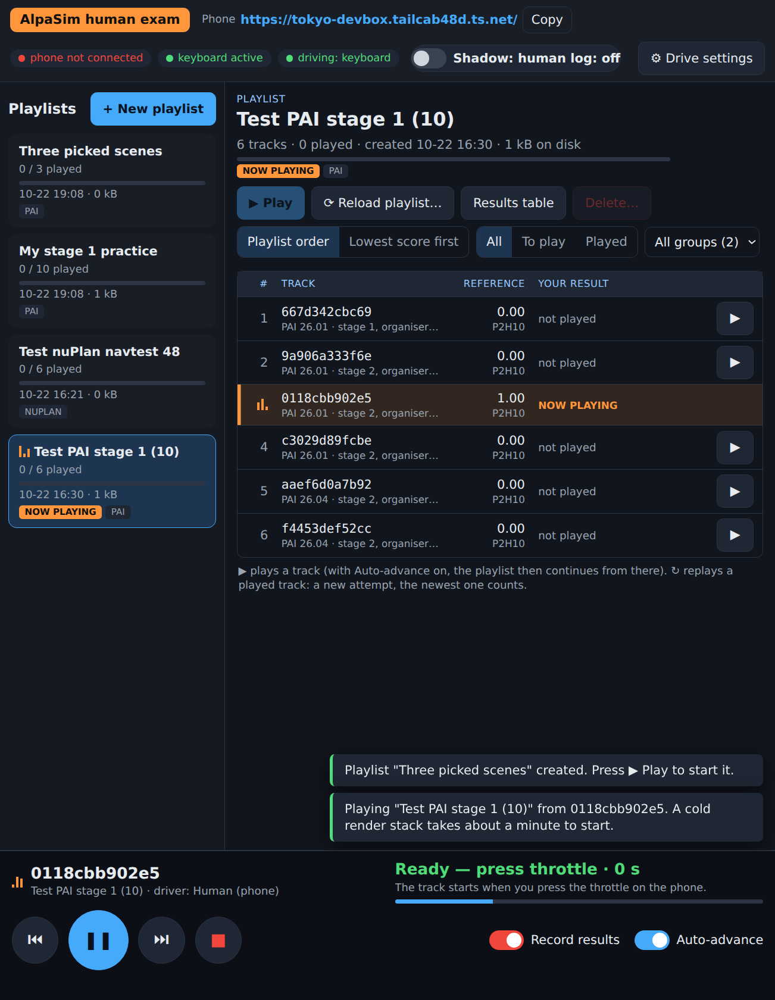
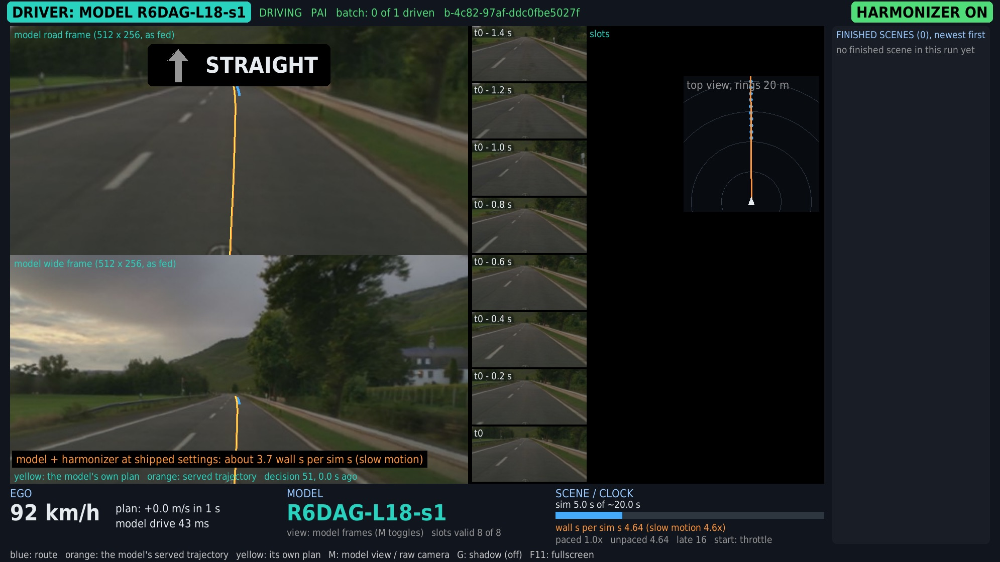
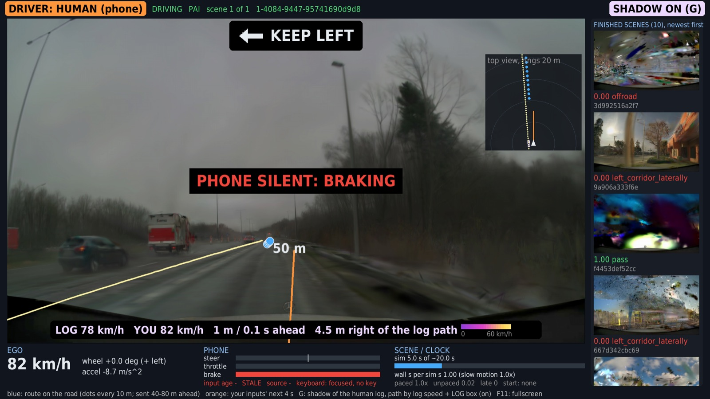

# alpasim_human: a person drives AlpaSim with the phone

status: live
decisions: none
index: user drove PAI stage 1 at real time: 0.275 vs P2H10 0.154, alpamayo1 0.438

**Question.** How does a human score on the AlpaSim scenes, driving the official closed loop by hand with the phone wheel?

**Conclusion.** On the 10 PAI stage-1 scenes, driven at real time with the front camera only, the user scored a mean of
0.275. On the same scenes our model P2H10-F-s0 scores 0.154, the organisers' alpamayo1 0.438 and the mean of their
reference subjects 0.198 (2 passes, 1 slow, 7 zeros: 4 left corridor, 3 off-road). One person, one attempt per scene,
first contact with the phone controls, so this is weak evidence. It is also not leaderboard-comparable: fast mode renders
only the front camera.

**Next.** The user stopped here (2026-10-13). Since 2026-10-14 the desktop icon "AlpaSim human exam" drives scene
sets from a panel (section "Desktop panel"). Still open: the nuPlan track (launcher written, never run) and gain tuning on
the phone.

**Read more.** [phone_wheel](../phone_wheel/README.md) covers the phone page, the daemon and wheel_client. The model
drivers and the stack are in [docs/alpasim.md](../../docs/alpasim.md), sections "Driver contract", "nuPlan track" and
"PAI track on the Tokyo box".

## How it works

- `lib/human_driver.py` is an `egodriver.EgodriverService`, the contract `pai_driver.py` / `sh30_driver.py` serve. Each `drive`
  call reads the latest ego pose (rig origin = rear axle) and |DynamicState velocity|. It then reads `WheelClient.state()`
  (non-blocking), turns it into a road-wheel angle and an acceleration, and rolls a kinematic bicycle 4 s ahead at 0.1 s.
  The result is 41 local-frame poses with absolute timestamps on the anchor's 0.1 s grid, from `now` on: the same shape
  and horizon the model drivers return (the LTF sample's `build_trajectory_from_plan` over a 4 s plan). The official
  nonlinear MPC tracks it on the simulator's vehicle model.
  - Steering: delta = s x min(0.55 rad, atan(L x 7 / v^2)). Full tilt is full lock at parking speed (4.7 m radius).
    Above about 4.4 m/s, full tilt means 7 m/s^2 of lateral acceleration, so the same thumb motion is sane at any speed.
    Phone +1 = right = a negative yaw rate in the rig frame.
  - Pedals: a = 3.0 t - 8.0 b - (0.25 + 0.0008 v^2). Full throttle is 3 m/s^2 (0-100 km/h in about 10 s), full brake
    8 m/s^2. Coasting slows the car by 0.25-0.6 m/s^2. Speed stays within 0-36 m/s; there is no reverse. Inputs are held
    over the 4 s horizon.
  - Gate (default since 2026-10-22, `HUMAN_TRACK_GATE=0` turns it off): the rolled-out plan goes through the model drivers'
    `track_ref` gate (-5 m/s^2, 10 m/s^3), so a hard brake no longer spins the car in the official MPC; full brake from 30 m/s
    now stops in about 81 m instead of 50 m ([results/brake_spin.md](results/brake_spin.md)).
  - Wheelbase L = 0.56 x ego box length, which gives 2.9-3.0 m. A stale phone (no frame for 0.3 s) gives brake 1, so the
    car stops at 8 m/s^2.
  - Start: the world is held inside the first `drive` at or after the forced log replay (PAI 1.7 s, nuPlan 0.5 s), which is
    where control passes to the driver. It stays held until the first throttle press (default `HUMAN_START=throttle`, the user's choice after the first two
    sessions: with click start the hand has to leave the phone at every scene change), for at most 240 s. `HUMAN_START=click`
    starts on a left click in the viewer (`<live>/start`), or on the first throttle press when no viewer heartbeat is found.
  - Pacing: after the start, a call sleeps so that sim time never runs ahead of wall time (`HUMAN_REALTIME`, default 1.0;
    0 = unpaced). The rule is the one in phone_wheel's `human_agent.py`.
  - Logs: `driver/drive.jsonl` has one `drive` record per call (phone input, applied angle / acceleration, speed, input
    age, stale, pose, sleep) and one `close` record per scene (sim s, wall per sim s, unpaced, stale calls, wait).
- `scripts/human_viewer.py` is the window "alpasim human drive (phone wheel)" on DISPLAY=:0. It shows:
  - the front camera exactly as the driver receives it (side cameras when they are rendered);
  - a top-down inset with the route waypoints (blue) and the 4 s plan from the phone (orange);
  - speed, the applied angle and acceleration, and the phone bars with input age and stale;
  - scene i of n, sim progress, wall s per sim s;
  - an orange "DRIVER: HUMAN (phone)" tag, and a status line: WAITING FOR PHONE / PHONE OK, PRESS THROTTLE TO START (or CLICK TO START) / DRIVING.
  It reads `<live>/state.json` and `front.jpg`; the driver writes them with an atomic rename.
- `scripts/human_stack.sh` (wrappers `human_pai.sh`, `human_nuplan.sh`) is modelled on `alpasim/scripts/pai_run.sh` and
  `alpasim/docker/smoke.sh`.
  - Driver: runs in the nuPlan submission image (`jev-alpasim:p2h10-f-s0-6f3d05d1`: grpc, alpasim_grpc, numpy) with
    `--network host` and the repo mounted read-only. That way it reaches the phone's UDP on loopback, and the compose
    services (host network) reach it at 127.0.0.1:6790. It needs no GPU.
  - Stack: the wizard runs inside `alpasim-base` (`run_method=NONE`), then `docker compose -p hum-<name> up`. Renderer and
    physics are pinned to card 0; the launcher refuses card 1 and stops if the compose file puts a service on another card.
    Baseport is 6700 (the PAI chain uses 6500). There is 1 concurrent rollout and 1 worker, so scenes run one at a time in one
    stack.
  - tmux `human`: windows `alpa-viewer` and `alpa-drive`. Files: STATUS, DONE / ERROR, log.txt, run.json, usage.jsonl
    (card VRAM).
- `scripts/human_results.py <run>` prints a per-scene table: score, why, progress, driven / GT m, sim s, wall per sim s,
  stale, wait. It gives the mean, with the models on the same scenes next to it. For PAI these are P2H10-F-s0 from
  `pai1/runs/a10_c4`, plus alpamayo1 and the organisers' reference mean from `pai_scenes_40.tsv`. For nuPlan they are
  SH30-F-s0 and AP2-AB-s0 from `native_ref`.
- `scripts/fake_wheel.py` stands in for the daemon's UDP fan-out on port 47801 (the real daemon stays on 47800). Its
  policy: throttle 0.3, steer 0 for 20 s, steer 0.15 for 10 s, repeat. Use it with `HUMAN_WHEEL_PORT=47801 HUMAN_START=throttle`.

## Drive (Tokyo)

```bash
# wheel daemon running (tmux wheel, phone_wheel README), phone on the page and centred
cd ~/mycode/jev-drive && git pull
bash experiments/alpasim_human/scripts/human_pai.sh /data/runs/alpasim_human/pai_$(date +%m%d-%H%M) /data/runs/alpasim/pai1/pai_scenes_40.tsv   # stage 1: 10 scenes
bash experiments/alpasim_human/scripts/human_nuplan.sh /data/runs/alpasim_human/nuplan_$(date +%m%d-%H%M) /data/runs/alpasim/scenes_navtest_full_part001_48.txt
# each scene: wait for "PHONE OK, PRESS THROTTLE TO START", press the throttle, drive; results: <out>/results.md
HUMAN_MODE=official bash experiments/alpasim_human/scripts/human_pai.sh ...   # the presets' cameras and eval as shipped
```

Stop a run with Ctrl-C in tmux `human:alpa-drive`; the trap takes the stack down. Only one `hum-*` stack runs at a time.

## Speed: fast mode is a human experience, not a leaderboard number

`HUMAN_MODE=fast` (the default) deviates from the official stack in these ways:
- Only the front camera is rendered (PAI `camera_front_wide_120fov`, nuPlan `CAM_F0`), at the preset's 1080 px and frame
  interval. The runtime accepts a single-camera rollout spec. The human needs only that camera.
- The eval video is off (PAI dev renders one by default).
- The driver is a human: there is no model, and the trajectory comes from the phone.

Scores from fast mode are therefore not comparable with leaderboard or model runs, which see all cameras. The scorer
itself is unchanged (the image scorer reads the front camera). `HUMAN_MODE=official` keeps the presets' camera sets and
eval as shipped. In both modes the PAI renderer is unharmonised by default, as on the public leaderboard (ec2 preset, as
`pai_run.sh`). `HUMAN_HARMONIZER=1` (PAI only; the panel's "Diffusion Harmonizer" checkbox) keeps the dev preset's
`--enable-harmonizer` and mounts the weights from `$NUREC/harmonizer`, as `pai_run.sh HARMONIZER=1`. With it the
stack's defaults change to the real-time setting below (`HUMAN_H` 288, `HUMAN_FI_MS` 200, `HUMAN_HARM_RES` "288 512"). `run.json`, `done/<scene>.json` and the results tables record it.
On nuPlan, gsplat is built for the card's own arch (sm_86), as `smoke.sh` does.

| Measured on Tokyo card 0, PAI | Cameras | Wall s per sim s after the start | Unpaced | Card 0 peak |
|---|---|--:|--:|--:|
| official (`HUMAN_MODE=official`), 2 scenes, fake wheel, unpaced | 6 x 1080 px, 10 Hz | 1.92, 1.73 | same | 6.0 GB |
| fast, user session 1 `pai_1013-2255`, 10 scenes, unpaced | front 1080 px, 10 Hz | 0.48-0.62 (mean 0.53) | same | 13.1 GB |
| fast, user session 2 `pai_1013-2305_rt`, 10 scenes, `HUMAN_REALTIME=1.0` | front 1080 px, 10 Hz | 1.00 (0 late re-anchors) | 0.52-0.66 | 13.1 GB |

- Front-only is about 3.5x faster than the 6-camera official set and faster than real time, so the driver paces it
  (`HUMAN_REALTIME`). The user drove session 1 before pacing existed, at 2x fast-forward.
- The 13 GB peak is the NRE keeping two scene backends (`nre_cache_size=2`).
- The user found front-only good enough and stopped the other lever measurements (lower render height, frame interval,
  NRE `--renderer nrend`, physics off). Those knobs exist (`HUMAN_H`, `HUMAN_FI_MS`, `HUMAN_NRE`, `HUMAN_PHYS`) but are
  not measured. JPEG quality is fixed at 95 in the runtime (`sensorsim_service.py`) and is not configurable.

**Harmonizer speed (2026-10-22, Tokyo card 1, scene 7a824ffa, fake wheel, unpaced, one scene per cell after the stack start).**
The harmonizer runs per rendered frame at its own resolution (`--harmonizer-resolution`, shipped 576 x 1024), whatever the
render height. So the render height does not move the speed; only the number of harmonized frames (frame interval) and the
harmonizer's resolution do. Card peak = `usage.jsonl` peak on the card (one stack on it).

| Harmonizer | Render px | Frame interval | Harmonizer px | Wall s per sim s | Card peak |
|---|---|--:|---|--:|--:|
| off | 1920 x 1080 | 100 ms | - | 0.45 | 4.8 GB |
| on | 1920 x 1080 | 100 ms | 576 x 1024 (shipped) | 3.68 | 7.3 GB |
| on | 1280 x 720 | 100 ms | 576 x 1024 | 3.64 | 7.2 GB |
| on | 960 x 540 | 100 ms | 576 x 1024 | 3.66 | 7.2 GB |
| on | 512 x 288 | 100 ms | 576 x 1024 | 3.67 | 7.2 GB |
| on | 1080 / 720 / 540 / 288 | 200 ms | 576 x 1024 | 1.94 / 1.93 / 1.92 / 1.95 | 7.2-8.8 GB |
| on | 512 x 288 | 100 ms | 320 x 576 | 1.50 | 8.5 GB |
| on | 512 x 288 | 100 ms | 288 x 512 | 1.27 | 11.8 GB |
| on | 960 x 540 | 100 ms | 384 x 672 | 1.78 | 9.3 GB |
| on | 960 x 540 | 100 ms | 288 x 512 | 1.29 | 9.2 GB |
| on, **default** | 512 x 288 | 200 ms | 288 x 512 | **0.75** | 9.2 GB |
| on | 960 x 540 | 200 ms | 288 x 512 | 0.72 | 9.2 GB |

- Per harmonized frame about 0.35 s at 576 x 1024 and 0.11 s at 288 x 512, on top of about 0.2 s per sim s for the rest.
  At 10 Hz no tested harmonizer resolution is real time. At 200 ms (5 Hz, the model drivers' 0.2 s slot clock: they use
  only every second 10 Hz frame) with 288 x 512 it is (0.72-0.75, below the 0.9 headroom mark).
- Default with the harmonizer: 512 x 288 render, 200 ms, 288 x 512 harmonizer. A 960 x 540 render at the same harmonizer
  setting costs the same (0.72), so "Render size" 540 is a free choice. Without the harmonizer the defaults stay 1080 px, 100 ms.
- `HUMAN_HARM_RES` passes the renderer's own `--harmonizer-resolution` flag (the image is unchanged); `HUMAN_HARM_RES=` keeps
  the shipped 576 x 1024. The harmonizer was trained at 576 x 1024, so the image at 288 x 512 is softer: judge it by eye.
- The panel's "Render size" choice (auto / 1080 / 720 / 540 / 288; auto = the defaults above) sets `HUMAN_H` of the resident
  stack; a change restarts the stack at the next hold point, like the harmonizer checkbox.

**Where the loading time goes** (session 2: 154 s of loading in a 496 s wall run; renderer log and driver times):
- Stack start (compose up to the first scene): 18-27 s.
- The first scene of each NuRec artifact revision (26.04, then 26.01): 45-59 s from load to first frame. The renderer
  log shows `NRend JIT: compiled ...` for that whole span: the CUDA driver's PTX JIT, cached in `/home/.nv/ComputeCache`
  inside the renderer container and lost with it.
- Every later scene: about 1 s from load to first frame, plus 4-5 s between scenes (runtime map load, NRE backend
  creation, physics artifact load). This is AlpaSim's own per-scene cost and is left as it is. One stack serves all
  scenes; compose is not restarted per scene.
- Fix: `HUMAN_JIT_CACHE=1` (the default) mounts `/data/cache/alpasim_human/jit` as the renderer's CUDA / torch JIT caches.
  Only the caches change, not the outputs. Measured on the same 2 scenes with the fake wheel: the first-scene loads went
  from 58.9 + 43.8 s (empty cache, run `test/jit_a`) to 19.2 + 29.2 s (warm cache, `test/jit_b`), about 54 s saved per
  launch. What is left is not traced.
- The window shows "LOADING NEXT SCENE (n/10)" between scenes.

## Results

Both sessions drove the 10 PAI stage-1 scenes (`pai_scenes_40.tsv`), front camera only, on 2026-10-13. Per-scene tables:
[results/pai_1013-2305_paced.md](results/pai_1013-2305_paced.md) and
[results/pai_1013-2255_unpaced.md](results/pai_1013-2255_unpaced.md).

| Session | Pacing | Human mean | Pass | Zeros (corridor / off-road / at-fault) | P2H10 (model) | alpamayo1 | Organisers' mean |
|---|---|--:|--:|---|--:|--:|--:|
| 2, `pai_1013-2305_rt` | real time (1.00) | 0.275 | 2 | 7 (4 / 3 / 0) | 0.154 | 0.438 | 0.198 |
| 1, `pai_1013-2255` | unpaced, 2x fast-forward | 0.270 | 2 | 7 (3 / 1 / 2) | 0.154 | 0.438 | 0.198 |

In session 2 the human passes 071d15c4, which the model zeros, and 5d794411, which the model passes too. The model scores
above zero only on 49597f01 (0.538), where the human leaves the corridor. Most of the human zeros come from leaving the
lateral corridor around the logged path, so a different line counts as a failure, not only a crash. Both sessions are one attempt per scene, made while the controls (gains, route cue) were still being changed.

Probes (2026-10-22, Tokyo card 1):
- [results/brake_spin.md](results/brake_spin.md): the hand mapping's step full brake spins the official MPC from 15 m/s (random
  direction; drift below the spin threshold); the track_ref gate removes it (MPC steer <= 0.002 rad), at the cost of braking distance.
- [results/render_lag.md](results/render_lag.md): the "shattered glass" when behind the log comes from the frame time, not the pose
  or the actors; figures [figs/render_lag_213dfdac.png](figs/render_lag_213dfdac.png), [figs/render_lag_071d15c4.png](figs/render_lag_071d15c4.png).

## Desktop panel (Tokyo): scene sets, resume, pause, scene list

Double-click "AlpaSim human exam" on the Tokyo desktop (`scripts/human_panel.sh`; install or refresh the icon with
`bash experiments/alpasim_human/scripts/human_panel.sh --install`). It is the twin of the "B2D human exam" panel
([phone_wheel](../phone_wheel/README.md), section "Desktop panel"): the same `lib/exam_panel.py` with the AlpaSim backend
`lib/alpasim_exam.py`. One panel at a time (lock `/data/runs/alpasim_human/.panel.lock`); it starts the wheel daemon (tmux
`wheel`) and the AlpaSim viewer (tmux `human:alpa-viewer`, restarted if closed) when they are missing. Since 2026-10-22 the
panel is the web page `lib/exam_web.py` (port 8770; `http://100.108.238.8:8770/` from a phone or the Mac over Tailscale;
`human_panel.sh --tk` = the old Tk window, `--restart` after a code update; details in phone_wheel's "Desktop panel").
New batch has two tabs: the scene sets, and a custom pick over `catalog()` (search, track / revision / R6DAG failure
filters, sortable columns: organisers' mean, R6DAG-s1 score and loss class, model; multi-select, "New batch from selection").



`figs/panel_web.png`: the web panel on the PAI stage-1 batch at the desktop size (1300 x 1800 screen px). Look at the
batch list (LOOP badge and orange bar on the loop's batch, driven bar, mean coloured green 1 / orange / red 0) and the scene
list grouped by revision with the group mean. `figs/panel_web_pick.png`: the custom pick tab.

- New batch: one set per filter over the scene table (`Scenes` in `lib/alpasim_exam.py`): PAI stage 1 (10), first 40, all 441
  (`fetch_all/all441.tsv`, only scenes whose `$NUREC/all-usdzs/<uuid>.usdz` is on disk; all 441 are on Tokyo), 26.01 (177) / 26.04
  (264), hard (organisers' mean <= 0.2, 270) / easy (>= 0.8, 4), R6DAG-s1 failures on PAI 281 (score < 1, 72) and one set per R6DAG
  loss class (decision 436: turn inside 7, other offroad 5, stop overshoot 19, drift 4, slow partial 8, rear-ended moving 13 /
  launch 8, at-fault collision 6, route turn 2), nuPlan navtest 48. R6DAG scores and classes: `results/model_ref_r6dag_281.tsv`
  (copied from `experiments/round7/results/loss_map.csv`); the model column shows R6DAG first, then P2H10, then alpamayo1.
  Custom pick: `catalog()` lists every scene, `new_batch("custom", ids)` makes a batch of any one-track id list.
  It writes `/data/runs/alpasim_human/exam_<track>_<stamp>/exam.json`, starts the loop, and the new batch appears at the top
  of the batch list.
- Batch list (since 2026-10-22, generic in `lib/exam_panel.py`): every `exam_*` batch, newest first, with set label, created
  time, driven / total, mean human score, disk size (`du`, the running batch re-measured every 60 s) and harmonizer (on / off /
  mixed over the driven scenes). Selecting a batch shows its scenes. "Continue this batch" restarts the loop on it (driven
  scenes are skipped; this replaces "Resume last"). "Delete this batch" asks for confirmation, naming the batch and its size,
  then removes the whole batch dir (root-owned stack leftovers through the alpasim-base image). It refuses while the loop runs on
  that batch. Nothing is deleted automatically. If the panel loop or a `human_pai.sh` / `human_nuplan.sh` stack
  from a terminal is running, the panel offers to stop it. If CARLA runs on card 0 (a B2D exam), the panel refuses to start
  and says so; it never stops the B2D side.
- Scene list: grouped by PAI artifact revision (26.01 / 26.04) or by nuPlan log segment, with the group's human mean and
  driven count; or sorted by score, low first. Columns: scene (last 12 characters of the clip id), stage and the organisers'
  mean, human score, model score with its source (`P2H10` = P2H10-F-s0 on that scene: PAI stage 1 from `pai1/runs/a10_c4`,
  nuPlan from `native_ref/P2H10-F-s0`; `a1` = the organisers' alpamayo1 where we have no P2H10 read, i.e. PAI stage 2),
  status (pass / failure reason and progress, or "skipped (Next item)"). "Official table" shows `results.md` of the run: the
  driven scenes with the human score, failure reason, progress, distance, and P2H10 / alpamayo1 / organisers' mean (PAI) or
  P2H10 / SH30-F-s0 (nuPlan), with means over the driven scenes.
- Drive side: `scripts/human_loop.py --run <dir>` in tmux `human:alpa-loop` (plain python3). It runs `human_stack.sh` in the
  foreground (`HUMAN_FG=1`), one stack per scene list, under `<run>/stacks/<run>-sNN/`. A stack costs about a minute to
  start and 4-5 s between scenes inside it, so with Playlist on a stack gets every unfinished scene and is only restarted
  when the order changes. AlpaSim picks the order inside a stack (clip-id order was observed), so the panel's order decides
  which scenes go in, not their sequence. Each scene loads and holds until the first throttle press. With Playlist off a
  stack gets one scene: a double-clicked one, or the next unfinished one when the throttle is pressed while the loop is idle.
- Resident stack (2026-10-22): the loop no longer starts a stack per scene list. `human_stack.sh` with `HUMAN_SERVE=1` runs
  renderer / physics / controller / the runtime in AlpaSim's shipped daemon mode (`wizard.run_mode=SERVER`, as
  `experiments/alpasim/scripts/queue_read.py`) plus the human driver, for every scene of the track (PAI 441, nuPlan 48), detached
  from the loop and named in `<live>/resident.json` (dirs under `/data/runs/alpasim_human/resident/`, containers `hres-*`).
  `scripts/human_feed.py` (in the driver image) sends one `simulate` request per scene; the loop decides the order itself.
  A new loop (New batch, Continue) reuses it when track, harmonizer, render size and card match. It stops after 20 min without a loop
  (`HUMAN_IDLE_S`), on a harmonizer, render size or track change (the renderer flag / scene set are fixed per process; the
  progress text says so). Rollout dirs move into `stacks/<run>-sNN/` when their request returns, so scoring and the gallery
  are unchanged.
- Measured on Tokyo card 1 (fake wheel, `HUMAN_REALTIME=0`, 2026-10-22), loop click to the scene's first frame:
  | case | before (stack per list) | resident |
  |---|--:|--:|
  | first start after the stack was down | 42-47 s (wizard 2-3 s, compose to first session 19-25 s, first frame +20 s) | about 43 s (ready after 19 s: wizard 3 s, services 15 s; first frame 24 s later) |
  | new batch / Continue | same as first start | 5.7-6.1 s |
  | restart item | ~55 s (new stack) | about 1 s (scene cached) |
  | next item -> following scene | ~10 s run-out + 4-5 s | 6.6 s |
  | play while a scene loads / is held | at least a new stack | the abort plus a 4-5 s load |
  | scene to scene | 4-5 s | 4-5 s (request on return) |
  The first two scenes of every renderer process take about 20 s more to their first frame (seen in old stacks and here); the
  resident pays it once. Aborted scenes end at once: under the resident the driver fails the aborted session's next drive call
  (`HUMAN_FAST_ABORT=1`, the runtime logs a CANCELLED rollout and continues), so Next / Restart / play-switch do not run out.
- Double-click (play): that scene is driven next. A scene that is loading or held (not started) gives way at once, unscored and
  not marked; a scene being driven finishes first.
- Next item: the current scene ends at once (`<live>/abort.json`); not counted, "skipped (Next item)", not offered again in this
  session. Restart item: the current scene ends and is requested again first. Stop: the current scene ends and the loop exits;
  the resident stays warm.
- Progress: while anything loads, the viewer shows "LOADING n s" with what is loading underneath (stack phase: driver, wizard,
  containers, waiting for renderer / runtime; then "renderer loading the scene"), and the panel's status line has the same text
  with the elapsed seconds (`<live>/launcher.json` state, msg, t0, batch).
- Pause: the driver reads `paused` from `control.json` (`HUMAN_CONTROL`): a held scene stays held (the throttle does not
  start it), a running one is held inside its drive call, so the world does not advance; pacing re-anchors on Resume.
  Paused time is logged per scene (`paused_s`). Without a stack, no stack starts. The start hold is 1800 s under the panel
  (`HUMAN_WAIT_MAX_S`; 240 s from a terminal), and paused time does not count towards it.
- Scoring: each finished rollout (`sim/rollouts/<scene>/<id>/_complete`) that was not skipped is scored by AlpaSim's own
  aggregation (`alpasim-aggregation` in `alpasim-base`, CPU, about 7 s) on a copy of its `metrics.parquet`
  (`<run>/scores/<rollout>/`), so scenes of a stack that was stopped early still count. The result goes to
  `done/<scene>.json` (latest attempt, attempt count) and `scores.jsonl` (all), then `results.md`. Checked on a copy of
  `pai_1013-2305_rt` with 3 scenes removed: the post-hoc scores equal the stack's own.
- Diffusion Harmonizer (checkbox, PAI only, off by default): the resident renders with or without it for its whole life
  (`HUMAN_HARMONIZER`). After a change, once no scene is being driven, the resident is stopped and a new one starts with the new
  setting (about a minute; the progress says "harmonizer on: restarting the render stack"); a loading or held scene is requested
  again. The status column says "harmonized" and "Official table" has a harmonizer column.
- Render size (select: auto / 1080 / 720 / 540 / 288 px height of the front camera, `HUMAN_H`): auto = the stack's default
  (1080 unharmonised, 288 with the harmonizer, section "Speed"). Fixed per resident stack like the harmonizer: a change restarts
  it at the next hold point. `done/<scene>.json` records it ("render").
- Phone address and input: the panel's top line shows the phone page URL (from `tailscale status --json`, Copy button) and
  the live input status (phone connected / last frame, keyboard active, which source drives); phone_wheel README.
- Shadow: human log (checkbox, off by default; viewer hotkey G, the last change wins): display only, it never touches control.
  With it on, the viewer shows the recorded human drive of the scene: its path ahead on the road and in the inset, coloured by the
  log's speed (violet slow, magenta, yellow fast; legend 0-60 km/h), a wireframe box labelled LOG where the log car is at the
  current sim time, and a readout "LOG x km/h  YOU y km/h  n m / n s behind (ahead)  n m left (right) of the log path".
  Source: the stack sets `runtime.simulation_config.send_recording_ground_truth=true` (`HUMAN_GT=1`, default; the runtime ships
  it off). The runtime then calls `submit_recording_ground_truth` every step with the scene's recorded ego trajectory
  (`unbound.gt_ego_trajectory`, PAI: 202 poses at 20 Hz over 20 s) in the rig frame of the step; the driver turns it into
  state.json "shadow". Scoring is unchanged. Time with the shadow on is logged per scene (`shadow_s` in the close record,
  `done/<scene>.json`, status column, results.md), because a drive with the log in view is not a blind attempt.
  Checked offline: `scripts/replay_asl.py` replays a finished `rollout.asl` through the driver's own gRPC methods, with a GT
  message built from the asl's `RolloutMetadata.ego_rig_recorded_ground_truth_trajectory` (the same object the runtime sends).
  On the user's 10 scenes of 2026-10-22, during the forced log replay (first 1.7 s) the gap and the lateral offset are 0.0, so
  frames and timestamps line up. Not yet checked on a live stack with the flag on.
- Viewer layout (2026-10-22): derived from the window's aspect. In 16:9 fullscreen (F11, or the window manager) the camera image
  fills the height, the readout is one compact strip under it with a one-line legend, and the right column is the scene gallery:
  every finished scene of the loop's batch, newest first, as the last front frame before it closed (the driver saves
  `stacks/<stack>/driver/thumbs/<rollout>.jpg`, 480 px, at close_session) with score and why; the mouse wheel scrolls it. The
  blue route keeps its 10 m dots but labels only the nearest visible one.
- Viewer: shows "PAUSED: resume on the panel", "SKIPPING THIS SCENE" and a green "HARMONIZER ON" tag. The top line shows "batch: n of m driven".
  With the viewer window focused the keyboard drives too (arrows / WASD, Space; phone_wheel README).
- Test without a GPU: `scripts/fake_stack.py` stands in for `human_stack.sh` (`HUMAN_STACK_SCRIPT=...`). It writes the same
  files, honours pause and skip, and copies real `metrics.parquet` files of an earlier run, so scoring is real.

### Model mode: a checkpoint drives the same scenes (2026-10-22)

The panel's "Driver" select: "Human (phone)", the current tags (marked from decisions.md "现状": NTV0-L18-s0 = PAI p1021a, the lead
family R8K-L18-s2 / R6DAG-L18-s1, RSG-L18-s0, nuPlan JTN-L18-s1), then every other checkpoint under `/data/runs/op_parity/runs/` (not
the TB-, ONP- or AP* tags). The chosen checkpoint drives the batch's scenes in the same resident stack and viewer.

- How: `lib/human_driver.py` stays the stack's driver and delegates. Before each request the loop writes `<live>/driver.json` (scene,
  tag, address); a session of that scene forwards start_session, the camera / egomotion / route submissions, drive and close_session
  to the model driver and returns its trajectory unchanged (no phone, no `HUMAN_TRACK_GATE`). Pacing to real time (after the model
  call), pause, Next / Restart, the live view, shadow, thumbnails and scoring are the human path's. The scene starts by itself at the
  hold point. AlpaSim's daemon can also take a driver address per request (`SimulationRequest.available_drivers`), but then the live view,
  pacing and the fast abort would be lost, so it is not used.
- The model driver (`scripts/model_driver.sh`, container `<prefix>-model`, port 6791, same card): the driver of a submission image
  with the tag's checkpoint mounted, and the image's baked serving switches. PAI uses the p1021a image
  (`jev-alpasim:ntv0-l18-s0-0d417ee4-pai-vc1.0-lead-acc-gap0.7_2.7`: `pai_driver.py`, JEV_VCONT 1.0, JEV_LEAD, JEV_ACC, JEV_GAP 0.7,2.7,
  JEV_TRACK gate). nuPlan uses the native JTN-L18-s1 image (`jev-alpasim:jtn-l18-s1-ba3ef44d`: `sh30_driver.py`, every switch off). Any
  sh30-family tag gets that track's served configuration (`HUMAN_MODEL_ENV` adds `-e` flags). It starts in about 22 s, the first time
  model mode is used in a loop and when the tag changes. It stops when the driver goes back to human or the loop exits.
- Stack: model mode renders the front camera as the preset does, whatever the "Render size" is: 1080 px (auto unharmonised is
  1080 already). On PAI it also keeps the 10 Hz frame interval and the shipped harmonizer resolution when the harmonizer is on, and it
  uses the submissions' steering weight (`controller.gains.rel_front_steering_angle_weight=10`, `HUMAN_MODEL_WIZ`). These are fixed per
  resident stack. On PAI, switching between human and model therefore restarts the stack once (about a minute). On nuPlan it restarts
  only when the render size is not auto. Switching between two tags never restarts it. With the Harmonizer on, model mode therefore
  runs at the shipped settings (1080 px, 100 ms, harmonizer 576 x 1024), not the human's real-time defaults. That is 3.7 wall s per sim
  s for the render alone and 4.4-4.6 with the model on a 3090: slow motion, fine for watching. The viewer and the panel status say so.
- A driver change takes effect at the next hold point: a loading scene is requested again with the new driver, and a scene being
  driven finishes first.
- Model view (viewer, default in model mode; M toggles the raw front camera): `lib/model_view.py` wraps the image's own driver and
  writes what the policy was fed at each decision. It shows the openpilot road and wide model frames of the newest slot (512 x 256 each;
  PAI: from the rendered 10 Hz frames through the session's f-theta maps; nuPlan: the slots that `sh30_core` synthesises from the 2 Hz
  keyframes) and the decision's 8 slots on their 0.2 s clock (oldest at the top; dark = invalid). The route (blue), the served trajectory
  (orange) and the model's own plan before any serving switch (yellow) are drawn in each frame. The tag reads "DRIVER: MODEL <tag>" in
  teal. The view updates at the decision rate (PAI 10 Hz, nuPlan 2 Hz). It is display only: the hook copies the arrays after the
  model's call and a separate thread encodes them.
- Scores: a model attempt goes to `done/<scene>@<tag>.json` (`"driver": <tag>`), a human attempt to `done/<scene>.json` (`"driver":
  "human"`). The human score column, the batch means and "Official table"'s human rows read only the human files. The item status
  appends "model <tag> <score> <why>", "Official table" has a separate "Model drives" table with a mean per tag, and the gallery
  labels model drives "MODEL <tag>". Playlist order in model mode skips the scenes that tag has already driven.
- These reads are for watching, not leaderboard numbers. They run at real-time pacing, front camera only, with one rollout and
  scores from the post-hoc aggregation. A model's local-read scores come from `pai_eval.sh` / `pai_box.sh`.
- Deferred: a human takeover (disengage by a pedal press).
- Checked on Tokyo card 1 (2026-10-22, probe prefix `hmt`, its own live dir and ports, scratch runs under `/data/tmp/hm_runs`):
  | case | result | stored read of the same scene |
  |---|---|---|
  | PAI 478d6ec4, NTV0-L18-s0, unharmonised | 0.9028 slow, twice (deterministic); 199 inferences, 0 errors, model drive 35-43 ms; wall / sim 1.20-1.22 (the model call makes the 0.1 s step slower than real time) | 0.9028 (p1021a image smoke, containerised and native) |
  | nuPlan 82cd1227, JTN-L18-s1 | 0.753 slow | 0.746 (`native_ref/JTN-L18-s1-native`) |
  | nuPlan 6fed9368, JTN-L18-s1, switched from a held human scene | the held scene ended unscored, the model service listened 24 s later, then 0.935 slow, wall / sim 1.01 | 0.934 |
  | PAI 478d6ec4, R6DAG-L18-s1, Harmonizer on, switched from a held human scene | stack restarted with 1080 px / 100 ms / shipped harmonizer resolution / steering weight 10; 0.895 slow, 200 frames at 1920 x 1080, 0 input errors, wall / sim 4.4 | - |
  Model drives landed in `done/<scene>@<tag>.json`; the human (fake wheel) attempt of 82cd1227 stayed in `done/<scene>.json`.
  The comparison is a sanity check, not identity: the stored reads ran all cameras and other stacks.
  R6DAG-L18-s1 and R8K-L18-s2 were copied from the GPU box to Tokyo for this (sha256 checked against the box).



`figs/viewer_model_mode.jpg`: the viewer in model mode (Xvfb, 3840 x 2160) on R6DAG-L18-s1 driving PAI 478d6ec4 with the
Harmonizer on, sim 5 s. Look at the teal "DRIVER: MODEL" tag, the road and wide model frames as the model was fed them with the
served trajectory (orange) over its own plan (yellow), the 8 slots on the right and the slow-motion note.



`figs/viewer_16x9_shadow.jpg`: the viewer at 3840x2160 (Xvfb) on a replay of the user's 2026-10-22 drive of 49597f01 at sim 5 s,
shadow on. Look at the yellow log path (78 km/h) left of the orange plan, the readout under the image (4.5 m right of the log
path), the single "50 m" route label and the gallery on the right. "PHONE SILENT" is the replay (no phone attached).


`figs/panel_alpasim.png`: the panel on a demo run of PAI all 40 (rendered off-screen on Xvfb; human scores from the
fake-stack test, which replays the user's session-2 rollouts, so they are not a new drive). Look at the model column: `P2H10` on
the 10 stage-1 scenes and `a1` (alpamayo1) on the 30 stage-2 scenes; the bold group rows carry the human mean and the driven
count; the skipped scene shows "skipped (Next item)"; the highlighted row is the loop's current scene.

**Checked end to end on Tokyo card 0 (2026-10-14 00:19-00:33, fake wheel on port 47801, test live dir, runs
`/data/runs/alpasim_human/test/panel_e2e` and `panel_e2e_pause`):**
- Loop start to the first scene driving: 46-49 s (stack start plus the JIT-cached first scene). Restart item: the new stack's
  scene was driving 55 s after the click. Inside a stack, the next scene was held 5 s after the previous one closed.
- AlpaSim ran the 2-scene list in clip-id order (5d794411 before 7a824ffa), not in list order. The runtime keeps scene ids in
  a set, so the loop gives played and restarted scenes a stack of their own and treats the playlist order as a set.
- Next item on a running scene: the driver logged "skipped by the panel", braked to 0 m/s, and the rollout ran out in 11.9 s
  of wall time (0.66 wall s per sim s). It was not scored and was marked "skipped (Next item)". The other scene was scored by
  the post-hoc aggregation (0.0, off-road, with the fake wheel's straight-then-turn policy).
- Pause at sim 4.8 s: sim time stayed at 4.8 s for 8 s and resumed at real time; the close record has `paused_s` 8.1. Wall s
  per sim s now excludes paused time; that fix came after this run and has not been rerun.
- Stop and restart took the stack down: no `hum-*` containers were left, and card 0 was back at 49 MiB.
- Stub tests with `fake_stack.py` (no GPU) covered play at a hold point, a failing stack (no relaunch until a double-click),
  Playlist off (one-scene stacks), and next / restart at a scene boundary (ignored).

Not checked with the panel: a real phone, the panel window driving a real stack (the loop was driven through `control.json`,
which is what the panel writes), the nuPlan track (`human_nuplan.sh` itself has never run), and the viewer's new PAUSED /
SKIPPING banners on screen.

## Open

Verified end to end on Tokyo card 0:
- PAI official mode (fake wheel, 2 scenes) and PAI fast mode (two user sessions of 10 scenes): results-summary.json, the
  results table and the live dir all worked.
- The viewer appeared on the monitor (screenshots), and the projected route overlay was checked on a snapshot.
- Click start (the user's sessions), throttle start (fake wheel), and pacing at 1.00.

Not verified:
- The desktop panel with the user's phone on a real stack (section "Desktop panel" lists what was checked).
- **nuPlan: `human_nuplan.sh` was never run** (the user stopped all runs first). Its wizard overrides follow
  `docker/smoke.sh`; the single-camera override, the MTGS renderer at baseport 6700, the gsplat JIT in a fresh container
  (196 s natively, possibly per launch without the cache) and the 0.5 s hold are all unchecked.
- The stale-phone brake path and `HUMAN_START=none`.
- Whether the warm JIT cache also covers the nuPlan renderer.
- The route projection for the pinhole (nuPlan) camera.
- Steering / pedal gains have not been tuned with the user. The route arrives only 40-80 m ahead (`route_start_offset_m: 40`
  in the preset), so the blue line starts there and the banner is the early cue.

<!-- files:begin -->
## Files

- `human_driver.py` (lib): A human with the phone wheel as an …
- `human_stack.sh` (scripts): A human drives AlpaSim with the phone …
- `human_pai.sh` (scripts): PAI track by hand, Tokyo card 0
- `human_nuplan.sh` (scripts): nuPlan track by hand, Tokyo card 0
- `human_viewer.py` (scripts): Window for the human AlpaSim driver …
- `human_results.py` (scripts): Per-scene table of a human AlpaSim run
- `fake_wheel.py` (scripts): Stand-in for the phone wheel daemon's …
- `alpasim_exam.py` (lib): AlpaSim backend of the exam panel
- `human_loop.py` (scripts): long-lived drive loop of the desktop panel
- `human_panel.py` / `human_panel.sh` (scripts): the panel and its desktop entry
- `fake_stack.py` (scripts): stand-in for a resident human_stack.sh in loop tests
- `human_feed.py` (scripts): one simulate request per scene to the resident stack's runtime daemon
- `replay_asl.py` (scripts): replays finished rollouts through the driver (shadow, thumbs, viewer tests without a GPU)
- `model_driver.sh` (scripts): model mode: one checkpoint served by a submission image's driver beside the stack
- `model_view.py` (lib): model mode: the served driver wrapped so the viewer sees the model frames it fed the policy
- `README.md` (experiments/phone_wheel): the phone as steering wheel and pedals
- `alpasim.md` (docs): AlpaSim E2E Closed Loop Challenge 2026

[results/](results/) 2 result files · [figs/](figs/) 1 figure · [lib/](lib/) 2 libraries · [scripts/](scripts/) 10 entry points
<!-- files:end -->
