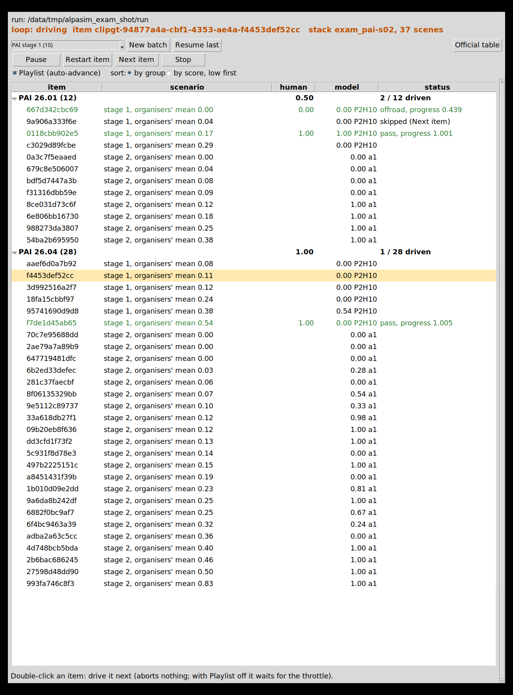

# alpasim_human: a person drives AlpaSim with the phone

status: live
decisions: none
index: user drove PAI stage 1 at real time: 0.275 vs P2H10 0.154, alpamayo1 0.438

**Question.** How does a human score on the AlpaSim scenes, driving the official closed loop by hand with the phone wheel?

**Conclusion.** On the 10 PAI stage-1 scenes, driven at real time with the front camera only, the user scored a mean of
0.275. On the same scenes our model P2H10-F-s0 scores 0.154, the organisers' alpamayo1 0.438 and the mean of their
reference subjects 0.198 (2 passes, 1 slow, 7 zeros: 4 left corridor, 3 off-road). One person, one attempt per scene,
first contact with the phone controls, so this is weak evidence. It is also not leaderboard-comparable: fast mode renders
only the front camera.

**Next.** The user stopped here (2026-10-13). Still open: the nuPlan track (launcher written, never run), a JIT-warm
launch, and gain tuning on the phone.

**Read more.** [phone_wheel](../phone_wheel/README.md) covers the phone page, the daemon and wheel_client. The model
drivers and the stack are in [docs/alpasim.md](../../docs/alpasim.md), sections "Driver contract", "nuPlan track" and
"PAI track on the Tokyo box".

## How it works

- `lib/human_driver.py` is an `egodriver.EgodriverService`, the contract `pai_driver.py` / `sh30_driver.py` serve. Each `drive`
  call reads the latest ego pose (rig origin = rear axle) and |DynamicState velocity|. It then reads `WheelClient.state()`
  (non-blocking), turns it into a road-wheel angle and an acceleration, and rolls a kinematic bicycle 4 s ahead at 0.1 s.
  The result is 41 local-frame poses with absolute timestamps on the anchor's 0.1 s grid, from `now` on: the same shape
  and horizon the model drivers return (the LTF sample's `build_trajectory_from_plan` over a 4 s plan). The official
  nonlinear MPC tracks it on the simulator's vehicle model.
  - Steering: delta = s x min(0.55 rad, atan(L x 7 / v^2)). Full tilt is full lock at parking speed (4.7 m radius).
    Above about 4.4 m/s, full tilt means 7 m/s^2 of lateral acceleration, so the same thumb motion is sane at any speed.
    Phone +1 = right = a negative yaw rate in the rig frame.
  - Pedals: a = 3.0 t - 8.0 b - (0.25 + 0.0008 v^2). Full throttle is 3 m/s^2 (0-100 km/h in about 10 s), full brake
    8 m/s^2. Coasting slows the car by 0.25-0.6 m/s^2. Speed stays within 0-36 m/s; there is no reverse. Inputs are held
    over the 4 s horizon.
  - Wheelbase L = 0.56 x ego box length, which gives 2.9-3.0 m. A stale phone (no frame for 0.3 s) gives brake 1, so the
    car stops at 8 m/s^2.
  - Start: the world is held inside the first `drive` at or after the forced log replay (PAI 1.7 s, nuPlan 0.5 s), which is
    where control passes to the driver. It stays held until the first throttle press (default `HUMAN_START=throttle`, the user's choice after the first two
    sessions: with click start the hand has to leave the phone at every scene change), for at most 240 s. `HUMAN_START=click`
    starts on a left click in the viewer (`<live>/start`), or on the first throttle press when no viewer heartbeat is found.
  - Pacing: after the start, a call sleeps so that sim time never runs ahead of wall time (`HUMAN_REALTIME`, default 1.0;
    0 = unpaced). The rule is the one in phone_wheel's `human_agent.py`.
  - Logs: `driver/drive.jsonl` has one `drive` record per call (phone input, applied angle / acceleration, speed, input
    age, stale, pose, sleep) and one `close` record per scene (sim s, wall per sim s, unpaced, stale calls, wait).
- `scripts/human_viewer.py` is the window "alpasim human drive (phone wheel)" on DISPLAY=:0. It shows:
  - the front camera exactly as the driver receives it (side cameras when they are rendered);
  - a top-down inset with the route waypoints (blue) and the 4 s plan from the phone (orange);
  - speed, the applied angle and acceleration, and the phone bars with input age and stale;
  - scene i of n, sim progress, wall s per sim s;
  - an orange "DRIVER: HUMAN (phone)" tag, and a status line: WAITING FOR PHONE / PHONE OK, PRESS THROTTLE TO START (or CLICK TO START) / DRIVING.
  It reads `<live>/state.json` and `front.jpg`; the driver writes them with an atomic rename.
- `scripts/human_stack.sh` (wrappers `human_pai.sh`, `human_nuplan.sh`) is modelled on `alpasim/scripts/pai_run.sh` and
  `alpasim/docker/smoke.sh`.
  - Driver: runs in the nuPlan submission image (`jev-alpasim:p2h10-f-s0-6f3d05d1`: grpc, alpasim_grpc, numpy) with
    `--network host` and the repo mounted read-only. That way it reaches the phone's UDP on loopback, and the compose
    services (host network) reach it at 127.0.0.1:6790. It needs no GPU.
  - Stack: the wizard runs inside `alpasim-base` (`run_method=NONE`), then `docker compose -p hum-<name> up`. Renderer and
    physics are pinned to card 0; the launcher refuses card 1 and stops if the compose file puts a service on another card.
    Baseport is 6700 (the PAI chain uses 6500). There is 1 concurrent rollout and 1 worker, so scenes run one at a time in one
    stack.
  - tmux `human`: windows `alpa-viewer` and `alpa-drive`. Files: STATUS, DONE / ERROR, log.txt, run.json, usage.jsonl
    (card VRAM).
- `scripts/human_results.py <run>` prints a per-scene table: score, why, progress, driven / GT m, sim s, wall per sim s,
  stale, wait. It gives the mean, with the models on the same scenes next to it. For PAI these are P2H10-F-s0 from
  `pai1/runs/a10_c4`, plus alpamayo1 and the organisers' reference mean from `pai_scenes_40.tsv`. For nuPlan they are
  SH30-F-s0 and AP2-AB-s0 from `native_ref`.
- `scripts/fake_wheel.py` stands in for the daemon's UDP fan-out on port 47801 (the real daemon stays on 47800). Its
  policy: throttle 0.3, steer 0 for 20 s, steer 0.15 for 10 s, repeat. Use it with `HUMAN_WHEEL_PORT=47801 HUMAN_START=throttle`.

## Drive (Tokyo)

```bash
# wheel daemon running (tmux wheel, phone_wheel README), phone on the page and centred
cd ~/mycode/jev-drive && git pull
bash experiments/alpasim_human/scripts/human_pai.sh /data/runs/alpasim_human/pai_$(date +%m%d-%H%M) /data/runs/alpasim/pai1/pai_scenes_40.tsv   # stage 1: 10 scenes
bash experiments/alpasim_human/scripts/human_nuplan.sh /data/runs/alpasim_human/nuplan_$(date +%m%d-%H%M) /data/runs/alpasim/scenes_navtest_full_part001_48.txt
# each scene: wait for "PHONE OK, PRESS THROTTLE TO START", press the throttle, drive; results: <out>/results.md
HUMAN_MODE=official bash experiments/alpasim_human/scripts/human_pai.sh ...   # the presets' cameras and eval as shipped
```

Stop a run with Ctrl-C in tmux `human:alpa-drive`; the trap takes the stack down. Only one `hum-*` stack runs at a time.

## Speed: fast mode is a human experience, not a leaderboard number

`HUMAN_MODE=fast` (the default) deviates from the official stack in these ways:
- Only the front camera is rendered (PAI `camera_front_wide_120fov`, nuPlan `CAM_F0`), at the preset's 1080 px and frame
  interval. The runtime accepts a single-camera rollout spec. The human needs only that camera.
- The eval video is off (PAI dev renders one by default).
- The driver is a human: there is no model, and the trajectory comes from the phone.

Scores from fast mode are therefore not comparable with leaderboard or model runs, which see all cameras. The scorer
itself is unchanged (the image scorer reads the front camera). `HUMAN_MODE=official` keeps the presets' camera sets and
eval as shipped. In both modes the PAI renderer is unharmonised, as on the public leaderboard (ec2 preset, as `pai_run.sh`).
On nuPlan, gsplat is built for the card's own arch (sm_86), as `smoke.sh` does.

| Measured on Tokyo card 0, PAI | Cameras | Wall s per sim s after the start | Unpaced | Card 0 peak |
|---|---|--:|--:|--:|
| official (`HUMAN_MODE=official`), 2 scenes, fake wheel, unpaced | 6 x 1080 px, 10 Hz | 1.92, 1.73 | same | 6.0 GB |
| fast, user session 1 `pai_1013-2255`, 10 scenes, unpaced | front 1080 px, 10 Hz | 0.48-0.62 (mean 0.53) | same | 13.1 GB |
| fast, user session 2 `pai_1013-2305_rt`, 10 scenes, `HUMAN_REALTIME=1.0` | front 1080 px, 10 Hz | 1.00 (0 late re-anchors) | 0.52-0.66 | 13.1 GB |

- Front-only is about 3.5x faster than the 6-camera official set and faster than real time, so the driver paces it
  (`HUMAN_REALTIME`). The user drove session 1 before pacing existed, at 2x fast-forward.
- The 13 GB peak is the NRE keeping two scene backends (`nre_cache_size=2`).
- The user found front-only good enough and stopped the other lever measurements (lower render height, frame interval,
  NRE `--renderer nrend`, physics off). Those knobs exist (`HUMAN_H`, `HUMAN_FI_MS`, `HUMAN_NRE`, `HUMAN_PHYS`) but are
  not measured. JPEG quality is fixed at 95 in the runtime (`sensorsim_service.py`) and is not configurable.

**Where the loading time goes** (session 2: 154 s of loading in a 496 s wall run; renderer log and driver times):
- Stack start (compose up to the first scene): 18-27 s.
- The first scene of each NuRec artifact revision (26.04, then 26.01): 45-59 s from load to first frame. The renderer
  log shows `NRend JIT: compiled ...` for that whole span: the CUDA driver's PTX JIT, cached in `/home/.nv/ComputeCache`
  inside the renderer container and lost with it.
- Every later scene: about 1 s from load to first frame, plus 4-5 s between scenes (runtime map load, NRE backend
  creation, physics artifact load). This is AlpaSim's own per-scene cost and is left as it is. One stack serves all
  scenes; compose is not restarted per scene.
- Fix: `HUMAN_JIT_CACHE=1` (the default) mounts `/data/cache/alpasim_human/jit` as the renderer's CUDA / torch JIT caches.
  Only the caches change, not the outputs. Measured on the same 2 scenes with the fake wheel: the first-scene loads went
  from 58.9 + 43.8 s (empty cache, run `test/jit_a`) to 19.2 + 29.2 s (warm cache, `test/jit_b`), about 54 s saved per
  launch. What is left is not traced.
- The window shows "LOADING NEXT SCENE (n/10)" between scenes.

## Results

Both sessions drove the 10 PAI stage-1 scenes (`pai_scenes_40.tsv`), front camera only, on 2026-10-13. Per-scene tables:
[results/pai_1013-2305_paced.md](results/pai_1013-2305_paced.md) and
[results/pai_1013-2255_unpaced.md](results/pai_1013-2255_unpaced.md).

| Session | Pacing | Human mean | Pass | Zeros (corridor / off-road / at-fault) | P2H10 (model) | alpamayo1 | Organisers' mean |
|---|---|--:|--:|---|--:|--:|--:|
| 2, `pai_1013-2305_rt` | real time (1.00) | 0.275 | 2 | 7 (4 / 3 / 0) | 0.154 | 0.438 | 0.198 |
| 1, `pai_1013-2255` | unpaced, 2x fast-forward | 0.270 | 2 | 7 (3 / 1 / 2) | 0.154 | 0.438 | 0.198 |

In session 2 the human passes 071d15c4, which the model zeros, and 5d794411, which the model passes too. The model scores
above zero only on 49597f01 (0.538), where the human leaves the corridor. Most of the human zeros come from leaving the
lateral corridor around the logged path, so a different line counts as a failure, not only a crash. Both sessions are one attempt per scene, made while the controls (gains, route cue) were still being changed.

## Desktop panel (Tokyo): scene sets, resume, pause, scene list

Double-click "AlpaSim human exam" on the Tokyo desktop (`scripts/human_panel.sh`; install or refresh the icon with
`bash experiments/alpasim_human/scripts/human_panel.sh --install`). It is the twin of the "B2D human exam" panel
([phone_wheel](../phone_wheel/README.md), section "Desktop panel"): the same `lib/exam_panel.py` with the AlpaSim backend
`lib/alpasim_exam.py`. One panel at a time (lock `/data/runs/alpasim_human/.panel.lock`); it starts the wheel daemon (tmux
`wheel`) and the AlpaSim viewer (tmux `human:alpa-viewer`, restarted if closed) when they are missing.

- New batch: PAI stage 1 (10), PAI all 40 (`pai_scenes_40.tsv`) or nuPlan navtest 48 (`scenes_navtest_full_part001_48.txt`).
  It writes `/data/runs/alpasim_human/exam_<track>_<stamp>/exam.json` and starts the loop. Resume last: restart the loop
  on the latest `exam_*` run; driven scenes are skipped. If the panel loop or a `human_pai.sh` / `human_nuplan.sh` stack
  from a terminal is running, the panel offers to stop it. If CARLA runs on card 0 (a B2D exam), the panel refuses to start
  and says so; it never stops the B2D side.
- Scene list: grouped by PAI artifact revision (26.01 / 26.04) or by nuPlan log segment, with the group's human mean and
  driven count; or sorted by score, low first. Columns: scene (last 12 characters of the clip id), stage and the organisers'
  mean, human score, model score with its source (`P2H10` = P2H10-F-s0 on that scene: PAI stage 1 from `pai1/runs/a10_c4`,
  nuPlan from `native_ref/P2H10-F-s0`; `a1` = the organisers' alpamayo1 where we have no P2H10 read, i.e. PAI stage 2),
  status (pass / failure reason and progress, or "skipped (Next item)"). "Official table" shows `results.md` of the run: the
  driven scenes with the human score, failure reason, progress, distance, and P2H10 / alpamayo1 / organisers' mean (PAI) or
  P2H10 / SH30-F-s0 (nuPlan), with means over the driven scenes.
- Drive side: `scripts/human_loop.py --run <dir>` in tmux `human:alpa-loop` (plain python3). It runs `human_stack.sh` in the
  foreground (`HUMAN_FG=1`), one stack per scene list, under `<run>/stacks/<run>-sNN/`. A stack costs about a minute to
  start and 4-5 s between scenes inside it, so with Playlist on a stack gets every unfinished scene in the panel's order and
  is only restarted when the order changes. Each scene loads and holds until the first throttle press. With Playlist off a
  stack gets one scene: a double-clicked one, or the next unfinished one when the throttle is pressed while the loop is idle.
- Double-click (play): that scene is driven next. The running scene is not aborted; at the next hold point (the following
  scene loaded and waiting for the throttle, nothing of it scored) the stack is stopped and a new one starts with the
  chosen scene first.
- Next item: the driver skips the current scene: hold released, no pacing, full brake (`<live>/abort.json`). The rollout runs
  out at the stack's own speed, about 10 s; it is not counted and the scene is not offered again in this session. Restart
  item: the stack is stopped at once and a new one starts with the same scene. Between two scenes (one closed, the next
  loading) Next and Restart do nothing. Stop: the stack is taken down (`docker compose down`, driver container removed)
  and the loop exits.
- Pause: the driver reads `paused` from `control.json` (`HUMAN_CONTROL`): a held scene stays held (the throttle does not
  start it), a running one is held inside its drive call, so the world does not advance; pacing re-anchors on Resume.
  Paused time is logged per scene (`paused_s`). Without a stack, no stack starts. The start hold is 1800 s under the panel
  (`HUMAN_WAIT_MAX_S`; 240 s from a terminal), and paused time does not count towards it.
- Scoring: each finished rollout (`sim/rollouts/<scene>/<id>/_complete`) that was not skipped is scored by AlpaSim's own
  aggregation (`alpasim-aggregation` in `alpasim-base`, CPU, about 7 s) on a copy of its `metrics.parquet`
  (`<run>/scores/<rollout>/`), so scenes of a stack that was stopped early still count. The result goes to
  `done/<scene>.json` (latest attempt, attempt count) and `scores.jsonl` (all), then `results.md`. Checked on a copy of
  `pai_1013-2305_rt` with 3 scenes removed: the post-hoc scores equal the stack's own.
- Viewer: shows "PAUSED: resume on the panel" and "SKIPPING THIS SCENE". Scene i of n counts within the current stack.
- Test without a GPU: `scripts/fake_stack.py` stands in for `human_stack.sh` (`HUMAN_STACK_SCRIPT=...`). It writes the same
  files, honours pause and skip, and copies real `metrics.parquet` files of an earlier run, so scoring is real.



`figs/panel_alpasim.png`: the panel on a demo run of PAI all 40 (rendered off-screen on Xvfb; human scores from the
fake-stack test, which replays the user's session-2 rollouts, so they are not a new drive). Look at the model column: `P2H10` on
the 10 stage-1 scenes and `a1` (alpamayo1) on the 30 stage-2 scenes; the bold group rows carry the human mean and the driven
count; the skipped scene shows "skipped (Next item)"; the highlighted row is the loop's current scene.

E2E_PLACEHOLDER

## Open

Verified end to end on Tokyo card 0:
- PAI official mode (fake wheel, 2 scenes) and PAI fast mode (two user sessions of 10 scenes): results-summary.json, the
  results table and the live dir all worked.
- The viewer appeared on the monitor (screenshots), and the projected route overlay was checked on a snapshot.
- Click start (the user's sessions), throttle start (fake wheel), and pacing at 1.00.

Not verified:
- **nuPlan: `human_nuplan.sh` was never run** (the user stopped all runs first). Its wizard overrides follow
  `docker/smoke.sh`; the single-camera override, the MTGS renderer at baseport 6700, the gsplat JIT in a fresh container
  (196 s natively, possibly per launch without the cache) and the 0.5 s hold are all unchecked.
- The stale-phone brake path and `HUMAN_START=none`.
- Whether the warm JIT cache also covers the nuPlan renderer.
- The route projection for the pinhole (nuPlan) camera.
- Steering / pedal gains have not been tuned with the user. The route arrives only 40-80 m ahead (`route_start_offset_m: 40`
  in the preset), so the blue line starts there and the banner is the early cue.

<!-- files:begin -->
## Files

- `human_driver.py` (lib): A human with the phone wheel as an …
- `human_stack.sh` (scripts): A human drives AlpaSim with the phone …
- `human_pai.sh` (scripts): PAI track by hand, Tokyo card 0
- `human_nuplan.sh` (scripts): nuPlan track by hand, Tokyo card 0
- `human_viewer.py` (scripts): Window for the human AlpaSim driver …
- `human_results.py` (scripts): Per-scene table of a human AlpaSim run
- `fake_wheel.py` (scripts): Stand-in for the phone wheel daemon's …
- `README.md` (experiments/phone_wheel): the phone as steering wheel and pedals
- `alpasim.md` (docs): AlpaSim E2E Closed Loop Challenge 2026

[results/](results/) 2 result files · [lib/](lib/) 1 library · [scripts/](scripts/) 6 entry points
<!-- files:end -->
