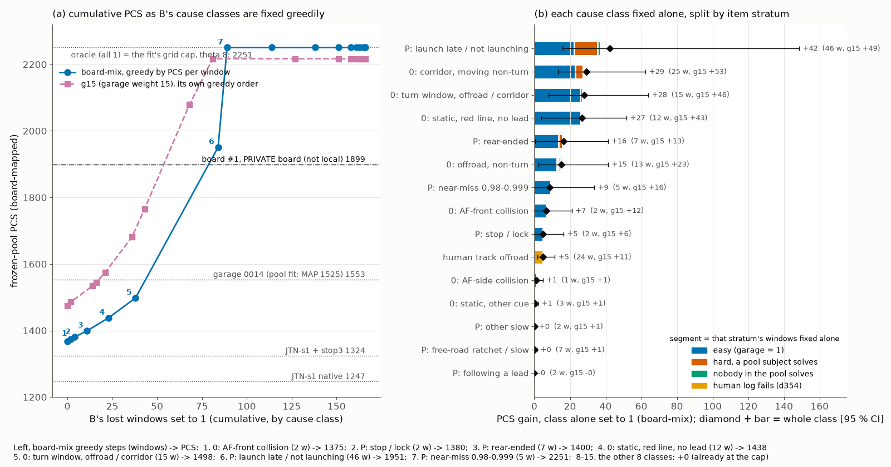

# EASY-ITEMS-B: where full-length B's remaining PCS is (2026-10-19)

Diagnostic, CPU only, no training and no new rollouts. Subject: full-length B `STANDFMX-L18-s0` (STAND + FREE-M on on1_JTX,
[stand_b/README.md](../../defect_fix/results/stand_b/README.md), d389), native arena held read, scored against the 2 106 frozen board-mix items
(d382; g15 = garage weight 15 alongside). Code: `scripts/easy_items.py subject` (tables, [easy_items_B.json](easy_items_B.json), per-window
classes in [easy_items/misses_STANDFMX.csv.gz](easy_items/misses_STANDFMX.csv.gz)) and `scripts/easy_items.py fig`. Inputs: the window table
[arena_windows_full.csv.gz](../../defect_fix/results/stand_b/arena_windows_full.csv.gz), and B's per-decision table from the box
(`runs/defect_fix/stand_b/ext_full`, the native_gap extract of the same 18 chunks). No new dump was needed.

## Reading

- **The remaining PCS is on the 48 easy items B still misses: 36 zeros and 12 partials, 42 mean-score points.** Easy means garage 0014 = 1.
  B on the easy items alone is +882 board-mix / +742 g15, which hits the cap. Everything off the easy set together is worth only
  +34 / +61: the 79 hard-but-solvable items +25 / +43, the 15 that no pool subject solves +4 / +7, and the 24 where the human log itself
  fails +5 / +11.
- **The user's premise is right about the counts, but those wins pay almost nothing.** B beats garage on 464 items (+333 points) and loses
  on 72 (51 points), so the mean is well above garage's. But 442 of the 464 wins are on items where garage < 1, and those have
  discrimination a of median 0.09. Giving every win back costs only -51 / -98 PCS. Of the 72 losses, 48 are on easy items with median a of
  1.54, and fixing just those 48 hits the cap.
- **Per window:** setting one of B's easy misses to 1 is worth median +2.4 PCS; setting one of its hard-item misses to 1 is worth +0.1 to
  +0.2.
- **The 2266 "oracle" is not a real ceiling.** With all 2 106 items at 1, the log-posterior still rises at the fit's grid edge (theta = 8).
  Both 2266 (pcs_local, theta 8.1) and 2251 (here) are that edge mapped through the 6-anchor line. Any response vector with no miss above
  a of about 0.6 runs to the same edge. Above about 1 600 the map is extrapolated past the highest anchor (garage, theta about 3.5).
  The board's private #1 at 1899 shows that values up there do occur.
- **Non-additivity.** At high ability, every non-1 response pulls the ability down by a slope of about its a, whether it is a 0 or a 0.99.
  Each exact 1 pulls up less and less. B's 48 easy misses carry a total a of 70.6 (zeros 58.0, partials 12.6). Its 118 other misses carry
  15.6 together.
  - Fixing only the zeros leaves the 12 high-a partials, and fixing only the partials leaves the 36 high-a zeros. Either way the ability
    stays braked: zeros -> 1 gives +180 (1548), partials -> 1 gives +116 (1484).
  - Fixing B's misses in order of a: board-mix crosses garage (1525-1553) after 35 windows and the board's #1 (1899) after 44. It reaches
    the cap after 49. All 49 of those are easy items except #48 (a 0.65, hard-solvable).
  - Under g15 the same crossings come after 7-10 and 35 windows.
- **What B already took from JTN-s1 native (1247):**
  - easy misses 181 -> 48;
  - static red-line zeros 84 -> 12;
  - ratchet partials 75 -> 7, now worth +0.
- **What is left, by cause** (easy windows only; g15 in brackets):
  - easy turn-window lateral zeros: 10 windows, +26 [+42];
  - easy static red-line zeros: 10 windows, +26 [+42];
  - easy moving-window corridor zeros: 8 windows, +23 [+40];
  - easy launch partials: 6 windows, +22 [+21];
  - easy offroad zeros: 5 windows, +13 [+19];
  - one easy rear-end: +14 [+10];
  - 3 easy near-misses: +9 [+16];
  - 2 easy AF-front zeros: +7 [+12];
  - 2 easy stop / lock partials: +5 [+6].
- **The moving zeros are mostly overspeed.** The median ego / human speed ratio is 1.31 on corridor zeros (17 / 25 are braking windows,
  where the human slows and B runs on), 1.15 on turn zeros and 1.19 on AF-front zeros. This is B's k = 9 overshoot of 1.129 (d389). JTN-s1
  + stop3 scores 1 on 7 / 8 of the easy corridor zeros and on 10 / 10 of the easy red-line zeros.

What to look at in the figure:
- **Left:** the board-mix curve stays below garage until the static red-line and turn zeros are fixed (step 5, 1498). It jumps past the
  board's #1 only when the launch partials go (step 6, 1951), and it reaches the grid cap with the 5 near-misses. Those last items are the
  final high-a brakes.
- **Right:** in every class worth more than +5, nearly all of the value is the blue (easy) segment. Orange (hard, solvable) adds
  something only in the launch class.
- Also committed: `figs/easy_items_B.pdf`.

## 1. Item strata

Strata are first-match:
- **d:** the human track is itself offroad (d354; `arena_resid` on RSG + stop3's offroad zeros, 26 items);
- **a:** easy, garage = 1;
- **b:** garage < 1 but one of the 8 board-mix pool subjects scores 1;
- **c:** no pool subject scores 1.

"PCS fix" sets B to 1 on that stratum alone. CIs are log-clustered bootstraps (2 000 draws), with the items fixed.

| stratum | items | B zeros | B partials | B lost points | garage lost | JTN-s1 lost | median a | PCS fix board-mix [CI] | PCS fix g15 [CI] |
|:--|--:|--:|--:|--:|--:|--:|--:|--:|--:|
| a: easy (garage = 1) | 1 564 | 36 | 12 | 42.0 | 0.0 | 114.7 | 2.22 | **+882 [+536, +924]** (cap) | **+742 [+642, +797]** (cap) |
| a-strict: garage, LTF, DD all = 1 | 923 | 6 | 7 | 9.1 | 0.0 | 28.1 | 3.21 | +38 [+13, +102] | +63 [+20, +168] |
| b: garage < 1, some pool subject = 1 | 488 | 27 | 52 | 56.5 | 366.7 | 74.9 | 0.10 | +25 [+11, +70] | +43 [+21, +123] |
| c: no pool subject = 1 | 28 | 8 | 7 | 11.2 | 22.6 | 11.7 | 0.11 | +4 [+1, +10] | +7 [+2, +18] |
| (c, but some stored read of ours = 1) | 17 | 3 | 2 | 3.9 | 12.3 | 5.5 | 0.14 | +3 [0, +9] | +4 [-1, +13] |
| d: human track offroad | 26 | 23 | 1 | 23.4 | 26.0 | 23.4 | 0.14 | +5 [+2, +12] | +11 [+4, +24] |
| all | 2 106 | 94 | 72 | 133.1 | 415.2 | 224.7 | 1.79 | +882 (cap) | +742 (cap) |

- Base: B scores 1368 board-mix / 1475 g15, with mean 0.9368.
- References, scored the same way (MAP under the frozen items): JTN-s1 1247 / 1317, JTN-s1 + stop3 1324 / 1433, garage 1525 / 1536.
  Garage's fitted pool value is 1553 / 1554.
- The cap is 2251 board-mix and 2217 g15 (theta = 8).
- The strict-easy set has a lower ceiling than the easy set because B's high-a misses that matter sit outside it.
- d has 26 items. B scores 1 on 2 of them, so the cause table below counts 24.

## 2. Premise: does B already beat garage on the hard items?

Wins are items where B > garage; losses are items where garage > B.

| | items | points | median a | by stratum | by cell |
|:--|--:|--:|--:|:--|:--|
| B > garage | 464 | +333.0 | 0.09 | b 442, c 19, d 3 | braking 99, turn 98, other 88, launch 85, static-free 55, static-lead 28, cruise 11 |
| garage > B | 72 | -50.9 | 1.08 | a 48, b 22, c 2 | launch 25, braking 17, turn 11, static-free 10, other 9 |
| tie | 1 570 | | | | |

For comparison, JTN-s1 native has 437 wins (+311 points) and 202 losses (-121 points).

| counterfactual | board-mix [CI] | g15 [CI] |
|:--|--:|--:|
| give back every win (B takes garage's score where it is better) | **-51 [-85, -33]** | **-98 [-154, -70]** |
| take garage's score on every loss = max(B, garage) everywhere | +882 [+815, +927] (cap) | +742 [+656, +798] (cap) |
| the same on the 48 easy losses only (= garage on every easy item, B elsewhere) | +882 [+536, +924] (cap) | +742 [+642, +797] (cap) |

- **Marginal value of a single window** (board-mix, at B's ability):
  - giving back one win costs median -0.13 PCS (-0.11 to -0.21 by cell);
  - fixing one easy miss is worth median +2.36 PCS;
  - fixing one stratum-b miss is worth +0.12, and one c or d miss +0.21.
- **Why wins pay little:** a win is almost always on an item that garage, LTF and DD fail, because that is how B can beat garage at all.
  In the board-mix pool, those items have a near 0.1. Garage's 30 rows set the item parameters, so they say almost nothing about ability.

## 3. Cause classes

**B's 166 non-1 items.** Classes are first-match:
1. d (human offroad);
2. zeros by arena type (AF-front, AF-side, static corridor split by d372's cue, turn-window lateral, offroad, moving corridor);
3. rear-hit partials;
4. near-miss (0.98-0.999);
5. launch (stratum launch, v0 < 1, or type no-launch / creep);
6. d384's per-decision rule: stop / lock, following a lead (>= 50 % of moving decisions with a lead < 25 m), free-road ratchet (last
   same-station speed ratio < 0.9), other.

The same rules are applied to JTN-s1 native, using its own decision table from the same extract. JTN-s1 + stop3 uses the arena types plus
native's sub-causes, as in easy_items.md.

"Fix" sets that subject's class to 1. Each subject is priced at its own base.

| cause | B windows (0 / partial) | B strata a / b / c / d | B speed ratio (median v / v_h) | B fix board-mix [CI] | B fix g15 | of which easy only (bm / g15) | JTN-s1 windows, fix bm | JTN-s1 + stop3 windows, fix bm |
|:--|--:|:--|--:|--:|--:|--:|--:|--:|
| P: launch late / not launching | 46 (0 / 46) | 6 / 36 / 4 / 0 | 0.75 | **+42 [+16, +149]** | +49 | +22 / +21 | 41, +3 | 66, +14 |
| 0: corridor, moving, non-turn | 25 (25 / 0) | 8 / 13 / 4 / 0 | **1.31** | **+29 [+13, +62]** | +53 | +23 / +40 | 18, +6 | 6, +1 |
| 0: turn window, offroad / corridor | 15 (15 / 0) | 10 / 2 / 3 / 0 | 1.15 | **+28 [+8, +64]** | +46 | +26 / +42 | 12, +6 | 12, +11 |
| 0: static, red line, no lead | 12 (12 / 0) | 10 / 2 / 0 / 0 | - | **+27 [+4, +52]** | +43 | +26 / +42 | 84, +57 | 0 |
| P: rear-ended | 7 (0 / 7) | 1 / 5 / 1 / 0 | - | +16 [+1, +41] | +13 | +14 / +10 | 11, +3 | 18, +14 |
| 0: offroad, non-turn | 13 (13 / 0) | 5 / 7 / 1 / 0 | 1.04 | +15 [+2, +41] | +23 | +13 / +19 | 21, +6 | 15, +7 |
| P: near-miss 0.98-0.999 | 5 (0 / 5) | 3 / 1 / 1 / 0 | 0.74 | +9 [-1, +34] | +16 | +9 / +16 | 18, +5 | 17, +10 |
| 0: AF-front collision (overspeed) | 2 (2 / 0) | 2 / 0 / 0 / 0 | 1.19 | +7 [0, +21] | +12 | +7 / +12 | 0 | 0 |
| P: stop / lock | 2 (0 / 2) | 2 / 0 / 0 / 0 | 0.45 | +5 [0, +16] | +6 | +5 / +6 | 5, +3 | 5, +6 |
| unsolvable: human track offroad | 24 (23 / 1) | 0 / 0 / 0 / 24 | 1.03 | +5 [+2, +12] | +11 | - | 24, +2 | 24, +3 |
| 0: AF-side collision | 1 (1 / 0) | 1 / 0 / 0 / 0 | 0.90 | +1 [0, +5] | +1 | +1 / +1 | 4, +2 | 1, +1 |
| 0: static, other cue | 3 (3 / 0) | 0 / 3 / 0 / 0 | - | +1 [0, +2] | +1 | - | 31, +16 | 0 |
| P: free-road ratchet / slow | 7 (0 / 7) | 0 / 7 / 0 / 0 | 0.72 | +0 [-1, +1] | +1 | - | **75, +30** | **76, +80** |
| P: following a lead | 2 (0 / 2) | 0 / 1 / 1 / 0 | 0.83 | 0 | 0 | - | 12, +1 | 12, +3 |
| P: other slow | 2 (0 / 2) | 0 / 2 / 0 / 0 | - | +0 | +1 | - | 2, 0 | 9, +6 |
| all zeros -> 1 | 94 | | | +180 [+100, +468] | +408 | | | |
| all partials -> 1 | 72 | | | +116 [+64, +570] | +131 | | | |

- **JTN-s1 + stop3:**
  - It has no static zeros, because the hold takes them.
  - Its ratchet (76 windows, +80 / +113) is the class that B removed without a hold.
  - Its 66 launch partials are the hold's cost (d382).
- **On the 48 easy misses, the stored candidates already score 1 on many of them.** JTN-s1 native scores 1 on 14 / 48, and JTN-s1 + stop3
  on 24 / 48. By class:
  - static red-line zeros: stop3 10 / 10;
  - moving corridor zeros: native 4 / 8, stop3 7 / 8;
  - AF-front zeros: both 2 / 2;
  - turn lateral zeros: native 3 / 10, stop3 2 / 10;
  - launch partials: native 1 / 6, stop3 0 / 6.
- **The new easy zeros are B's own overspeed.** These are the corridor, AF-front and part of the offroad zeros. The remaining red-line zeros
  are the part of STAND that has not landed.
- **The easy launch partials and the rear-end are launch-timing losses**: no-launch or creep, with a speed ratio of 0.42 on the 6.
- **Overspeed / AF-front, as the brief asked for it, is not one row.** It is the 2 AF-front zeros plus the moving corridor zeros with ratio
  > 1 (moving corridor median 1.31; 17 / 25 are braking windows).
- **Turns:** the turn-cell lateral zeros are a row of their own. Turn-cell partials are labelled by their mechanism (4 of B's partials
  sit in turn cells: 2 ratchet, 1 near-miss, 1 following a lead).

## 4. Non-additivity and the curve

Greedy order: at each step, fix the class with the highest PCS gain per window, given everything fixed before.

| step | class fixed (windows) | board-mix PCS | mean | | g15 step | class | g15 PCS |
|--:|:--|--:|--:|:--|--:|:--|--:|
| 0 | as read | 1368 | 0.9368 | | 0 | as read | 1475 |
| 1 | 0: AF-front (2) | 1375 | 0.9377 | | 1 | 0: AF-front (2) | 1486 |
| 2 | P: stop / lock (2) | 1380 | 0.9379 | | 2 | 0: static red line (12) | 1534 |
| 3 | P: rear-ended (7) | 1400 | 0.9407 | | 3 | P: stop / lock (2) | 1545 |
| 4 | 0: static red line (12) | 1438 | 0.9464 | | 4 | P: near-miss (5) | 1574 |
| 5 | 0: turn lateral (15) | 1498 | 0.9535 | | 5 | 0: turn lateral (15) | 1681 |
| 6 | P: launch (46) | **1951** | 0.9681 | | 6 | P: rear-ended (7) | 1765 |
| 7 | P: near-miss (5) | 2251 (cap) | 0.9681 | | 7 | 0: corridor moving (25) | 2079 |
| 8-15 | the other 8 classes | 2251 | -> 1.0 | | 8 | 0: offroad (13) | 2217 (cap) |

- **Where the references fall:**
  - garage's 1553 (board-mix) falls between steps 5 and 6;
  - under g15, garage (1536 MAP) is passed at step 3;
  - the board's private #1 (1899) is passed at step 6 (board-mix) or step 5 (g15).
- **Window-level curve, ordered by a** ([easy_items_B.json](easy_items_B.json) `by_a`):
  - Board-mix: the first 34 (all easy, a 1.3-3.3) add about +4-5 PCS each (1368 -> 1522). The last 14 easy ones (a 0.6-1.25: the rear-end,
    launch partials, near-misses, stop / lock) carry the jump: 35 -> 1614, 39 -> 1771, 44 -> 1955, 49 -> cap.
  - Any order shows the same thing. While high-a misses remain, each one fixed is worth a few PCS. When the last few go, the ability has no
    brake left and runs to the cap.
- **A model that matched garage on every easy item and kept B elsewhere** would sit at the cap (+882 / +742). That is because B already beats
  garage on 464 other items. Matching garage on only part of the easy set is priced by the a-ordered curve above.
- **Leave-one-out:** start from all-1 and leave only one class unfixed.
  - Board-mix: launch partials alone hold B to 1794 and the rear-end alone to 1830. Every other class alone stays at about the cap.
  - g15: every class alone stays at the cap.
  - Read this as: what is left matters only as a set. No single class is the bottleneck.

## 5. Against JTN-s1 native (1247) and JTN-s1 + stop3 (1324)

| | JTN-s1 native | JTN-s1 + stop3 | B |
|:--|--:|--:|--:|
| frozen PCS board-mix / g15 | 1247 / 1317 | 1324 / 1433 | **1368 / 1475** |
| easy misses (zeros / partials) | 181 (105 / 76) | 97 (12 / 85) | **48 (36 / 12)** |
| static red-line zeros | 84 | 0 | 12 |
| free-road ratchet partials | 75 | 76 | **7** |
| moving corridor + turn + offroad zeros | 51 | 33 | 53 |
| AF-front zeros | 0 | 0 | 2 |
| launch partials | 41 | 66 | 46 |

- B took most of native's two levers (d387): the red line (84 -> 12) and the ratchet (75 -> 7).
- Launch partials went 41 -> 46. At B's higher ability they are now worth +42 rather than native's +3.
- What it gave back is lateral and overspeed zeros: moving corridor zeros 18 -> 25, with AF-front 0 -> 2.

## Limits

- **1 seed.** B's s1 replicate is running (supplement 19.8).
- **Garage stands in for the strong pool**, and the garage weight in board-mix is not identified (±100 PCS, d382).
- **The cause rules are d384's heuristic thresholds.** The cue labels are d372's census.
- **Stratum d is a lower bound.** Human-offroad windows were checked only where RSG + stop3 went offroad. Also, 3 of the 26 have a census
  `hum_score` of 1, which conflicts.
- **PCS above about 1 600 is extrapolated** past the highest anchor, and the cap is the fit's theta grid edge, not a property of the board.
- **Bug fix in this commit:** `slow_rescore.Frozen.pcs` now caps the parabolic refinement at one grid step. Before, it returned up to 4721
  for all-1. Interior maxima are unchanged.
  - This means easy_items.md's "all 181 misses +1480 (prior-bounded)" was the same grid-edge artifact.
  - Its single-class rows are unaffected.
