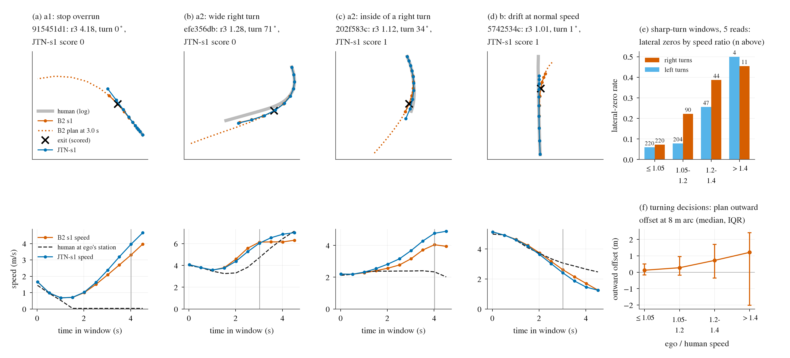

# LAT-ZERO: why B2 still gets lateral zeros on easy windows (2026-10-20)

This is a diagnostic. It ran on CPU only, with no training and no new rollouts. The rule was pre-registered in
[plans/2026-10-20-lat-zero-prereg.md](../plans/2026-10-20-lat-zero-prereg.md), before any class count was read.

**Subject.** The nuPlan candidate B2 is `STANDFMXH-L18-s1`, with `STANDFMXH-L18-s0` as the replicate.

**Windows.** Every easy window (garage = 1) that decision 393 classed as one of three lateral zeros: turn offroad / corridor, moving corridor, or straight offroad. That gives 20 windows on s1 and 19 on s0, 23 distinct windows in all.

**Inputs.** All of them are stored data:
- the per-decision tables of the B2 reads (`ext_full_H{,_s1}`), with JTN-L18-s1 on the same windows;
- the per-step scorer metrics;
- the human tracks (`stand_b/ext_full_H_s1/hum.pkl`);
- garage's per-step metrics.

**Script.** [scripts/lat_zero.py](../scripts/lat_zero.py), with the subcommands `table`, `geom`, `price` and `fig`. Outputs:
- per-window table: [lat_zero/windows.csv](lat_zero/windows.csv);
- counts and prices: [lat_zero.json](lat_zero.json);
- figure: [figs/lat_zero.png](figs/lat_zero.png).

**Data census.** [scripts/lat_zero_data.py](../scripts/lat_zero_data.py), run on the box CPUs.

## Reading

**By the pre-registered rule, 16 / 15 of the 20 / 19 windows are (a), overspeed. Only 1 / 1 is (b), a path error at normal speed. 3 / 3 are (c).**
The labels mean:
- **(a)** the ego runs at 1.05 x the human's speed or more, at the same station, in the 3 s before the exit, and the human slows down by at least 10 % or the path bends by at least 0.02 rad/m;
- **(b)** a path error at normal speed;
- **(c)** something else.

Class (a) holds two different mechanisms. The split below was written after the counts and is descriptive only:

- **a1, stop overrun: 6 / 4 windows, every one of them in the "moving corridor" class.**
  - The human brakes to a stop within 1-2 s, with no lead: 3 at a red light at the line, 2 with no light, 1 with a light of unknown state.
  - The ego slows to 0.3-1.4 m/s and then accelerates through the human's stopping point.
  - The scorer counts the distance beyond the end of the human track as lateral, so the result is a corridor zero with a 4-6 m "offset".
  - These are the red-line roll-outs of decision 393, entered from a moving start. On s1, 30 of the 43 pre-exit decisions fall in STAND-R's rolling-row domain: the human stands for the rest of the window and the ego is at 0.5-3 m/s, while plans run 6-18 m. 3 more are in STAND's own domain. 9 come while the human is still braking, most of them in 6a025729, a late stop.
  - JTN-s1 + stop3 scores 1 on all 6, and JTN-s1 natively on 2.
- **a2, speed in a sharp turn: 9 / 9 windows.**
  - These are the turn class, plus 6f27563e, which the scorer files as straight offroad.
  - All of them are right turns of 28-99 deg at R ~ 7-10 m, with the human at 2-4 m/s.
  - The ego runs at 1.1-1.65 x the human (median r3 1.20) and accelerates out of the turn early, while the human holds speed. The human slow-down is about 0, so these are (a) through curvature, not through braking.
  - 8 of the 9 exit on the outside of the turn. 202f583c exits on the inside. In 202f583c and 87705868 the plan curves 1.4-2.4 x more than the human's path.
  - The command matches the turn: cmd = 2 (right) at every decision. The route command is not misaligned. The route memory is not dumped. Reading A of route_follow found that held arena turns sit in its uncovered first 40 m.
- **a3, other slow-down or mild bend: 1 / 2 windows.**
  - 140b583b: an 11 deg bend that the plan over-curves.
  - e3b2544f (s0 only): the human slows by 30 % and the ego drives at 1.5 x.
- **b: 5742534c (s1) and 59a15f34 (s0).**
  - 5742534c is a drift at normal speed.
  - 59a15f34 is a 71 deg under-turn at r3 0.99.
  - Each fails on one seed only, and JTN-s1 passes both.
- **c: 3 / 3 windows.**
  - d3df525f and da2c511a are "human track marginal": the ego is within 0.45-0.5 m of the human track when it is scored offroad.
  - c971597d is a no-launch progress zero (0.0001) that decision 393's classifier filed under corridor.

**Speed is the cause in the sharp turns, but not by itself. The plan's shape scales with speed.** Panels (e) and (f) of the figure show it:
- **Execution is not the problem.** The car follows the plan: the lateral error at 1 s is 2-3 cm, for every read.
- **The plan bends wider when the ego is fast.** Over all turning decisions of the 5 reads on held windows (42 974 decisions), the plan's outward offset from the human path at an equal 8 m of arc rises with the speed ratio:
  - 0.11 m at r <= 1.05;
  - 0.3 m at 1.05-1.2;
  - 0.7 m at 1.2-1.4;
  - 1.2 m above 1.4.
- **Speed predicts lateral zeros in sharp turns.** In the windows that turn at least 45 deg within 20 m (172 windows x 5 reads), the lateral-zero rate is:

  | speed ratio | right turns | left turns |
  |:--|--:|--:|
  | <= 1.05 | 7 % | 6 % |
  | 1.05-1.2 | 22 % | 8 % |
  | 1.2-1.4 | 39 % | 26 % |
  | > 1.4 | 45 % | 50 % |

- **Speed alone does not force the exit.** Up to B2's exit, garage covers 0.8-1.5 x the human's distance on the a2 windows (median 1.21, against B2's 1.26). It still passes, staying within 0.3-2 m of the path; in 3 of the 9 a2 windows garage is as fast as B2 or faster.
- **This is not FREE-M.** JTN-s1 (no FREE-M) drives the same a2 windows at the same speed ratio (median 1.2 against 1.2) and fails 7 of the 9. Over all 172 sharp-turn windows, the B2 and JTN reads have almost the same median ratio (1.06 against 1.03) and the same number of lateral zeros (21-22 against 19-22). The habit belongs to the base model: it accelerates out of tight right turns before the human does and plans wider when it is fast. Lowering the FREE-M dose again will not remove it.

**Two levers. By window count the turn lever covers more of the lateral group, but STAND-R is worth more PCS and is already registered.**

| lever (single class fixed to 1, B2 s1 / s0) | windows | board-mix PCS [CI] | g15 |
|:--|--:|--:|--:|
| whole lateral group (ceiling) | 20 / 19 | +80 [+30, +234] / +54 | +178 / +100 |
| TURN-CAP on a2 (ceiling) | 9 / 9 | +27 [+6, +70] / +21 [+6, +45] | +49 / +34 |
| TURN-CAP on a2, expected (fix probability from the zero-rate ratio, about 5.9 windows) | 5.9 / 5.9 | +17 [+11, +23] / +13 [+9, +18] | +30 / +21 |
| STAND-R target: a1 + the easy static red-line zeros | 15 / 14 | +53 [+27, +107] / +36 [+10, +70] | +109 / +61 |
| a1 alone | 6 / 4 | +19 [+7, +47] / +9 [+2, +21] | +37 / +15 |
| a (all), b, c | 16, 1, 3 / 15, 1, 3 | +59 / +43; +6 / +3; +7 / +6 | |

The expected TURN-CAP row is the mean over 400 draws, with the 10-90 % range of the draws in brackets.

- **The lever with the most lateral windows is TURN-CAP.** It would be a one-sided upper term on moving S rows (ego >= 2 m/s) where the human's path turns at least 45 deg within 20 m: it penalises a plan whose 4 s arc runs beyond about 1.05 x the human's reachable arc s_ref. It is the mirror of FREE-M, restricted to turns.
  - It targets the 9 a2 windows: 098f5c53, 202f583c, 3f805a18, 476b54f9, 6f27563e, 87705868, 9e7c5a46, efe356db, f2305669, and 41a358be on s0.
  - Expected gain is about +17 / +30 PCS (s1) and +13 / +21 (s0). This assumes that matching the human's speed lowers each window's zero risk to the 7 % base rate. That assumption is observational: sharper turns could drive both the speed ratio and the zeros.
  - **Collateral.** The term never asks for less than the human's arc. Progress is clipped at 0.8 of the human arc, so it cannot create progress partials on its own. 16 of B2 s1's 36 passed easy sharp-turn windows run above 1.05 (1 above 1.2); that is where the term would act.
  - The real risk is the known leak along the low-speed axis (decisions 352 / 353 / 365). The row restriction (moving, turning) and a pilot guard on launch, waiting and the slow-window counts must cover it.
- **STAND-R covers the a1 windows without extra cost.** It is already registered as NR1 supplement 20. Its rolling rows (human standing, ego at 0.5-3 m/s) are exactly a1's pre-exit state. Its gate counts only the static red-line windows, so a1 adds 6 / 4 windows to its target: as a set, +53 / +109 on s1.
  - By PCS it is the larger single lever.
  - Its read should also report the a1 windows: 0e1354a0, 137b5adc, 6a025729, 80575aa7, 915451d1, 9c205ae2.

**Existing data has enough examples of both situations.** The census counts rows (sampled at 2 Hz) and units. A unit is a log for nuPlan, a clip for PAI, and a scene for HUGSIM; for the pools it is the pool's coarse log column, which has only 28 values.
- T is a sharp turn: at least 45 deg within 20 m.
- S is a brake to a stop with no lead within 30 m.
- The failing state is the ego faster than 1.05 x the human in a sharp right turn.

| data | T right (rows / units) | T left | S, no lead |
|:--|--:|--:|--:|
| nuPlan trainval census (658 206 frames, 1 250 logs) | 7 525 / 671 | 6 669 / 531 | 5 595 / 714 |
| of which NR1TV trainer rows | 911 / 232 | 715 / 249 | 627 / 125 |
| on1_JT S rows | 2 743 / 22 | 2 684 / 19 | 834 / 21 |
| on1_JTX S rows | 3 242 / 23 | 3 114 / 21 | 1 262 / 23 |
| NAVSIM navtest | 510 / 69 | 690 / 66 | 60 / 29 |
| PAI 281 | 150 / 24 | 117 / 21 | 130 / 35 |
| HUGSIM (82 scenes) | 64 / 13 | 90 / 14 | no lead data |

- **On-policy failing state:** 540 rows in on1_JTX (534 of them with the human at 6 m/s or less in the turn) and 470 in on1_JT. These are the rows TURN-CAP would act on: about 0.4 % of on1_JTX's S rows. They are spread over 20-23 of the 28 log units.
- **STAND-R's rolling domain:** 3 568 rows in on1_JTX and 976 in on1_JT, matching supplement 20.
- **Where the training data should come from.** PAI, navtest and HUGSIM carry only tens to hundreds of sharp right turns each, so the on-policy pool and nuPlan trainval are where the data is.

## Per-window table

The values are from B2 s1 where s1 fails and from s0 otherwise.
- **r3:** ego / human speed at the same station, median over the 3 s before the exit.
- **Plan / human curvature:** plan heading change over the plan's first 2 s of arc, against the human's heading change over the same arc.
- **Plan outward at 2 s:** the plan's 2 s point, measured relative to the ego's current offset, toward the exit side.
- **Distance ratios:** distance driven up to B2's exit, divided by the human's arc over the same time.

| window | cause (d393) | seeds failing | class s1 / s0 | exit s | exit offset m | r3 | human slow-down | turn deg | plan / human curvature | plan outward at 2 s m | JTN-s1 score / ratio | B2 / JTN / garage distance ratio | garage max lat m |
|:--|:--|:--|:--|--:|--:|--:|--:|--:|--:|--:|--:|--:|--:|
| 098f5c53 | turn | s0,s1 | a2 / a2 | 4.0 | 1.33 | 1.21 | 0.01 | 85 | 0.92 | 1.29 | 0 / 1.19 | 1.26 / 1.20 / 1.05 | 1.89 |
| 0e1354a0 | moving corridor | s0,s1 | a1 / a1 | 5.0 | 5.06 | 4.30 | 0.97 | 0 | - | 4.37 | 0 / 6.40 | 8.16 / 11.04 / 5.91 | 3.48 |
| 137b5adc | moving corridor | s0,s1 | a1 / a1 | 4.0 | 5.63 | 4.17 | 0.99 | 0 | - | 4.89 | 0 / 7.27 | 11.57 / 12.63 / 5.09 | 2.84 |
| 140b583b | straight offroad | s0,s1 | a3 / a3 | 4.5 | 1.55 | 1.27 | 0.19 | 11 | 1.87 | 1.86 | 1 / 1.20 | 1.24 / 1.17 / 0.98 | 1.13 |
| 202f583c | turn | s0,s1 | a2 / a2 | 4.0 | 1.20 | 1.12 | 0.13 | 34 | 1.41 | 1.02 | 1 / 1.42 | 1.25 / 1.40 / 1.02 | 0.31 |
| 3f805a18 | turn | s0,s1 | a2 / a2 | 3.5 | 2.03 | 1.30 | -0.00 | 99 | 0.82 | 3.26 | 0 / 1.23 | 1.54 / 1.49 / 0.82 | 2.02 |
| 41a358be | turn | s0 | passes / a2 | 4.5 | 3.85 | 1.18 | 0.01 | 28 | 0.82 | 2.76 | 0 / 1.18 | 1.18 / 1.18 / 1.11 | 3.61 |
| 476b54f9 | turn | s0,s1 | a2 / a2 | 3.0 | 1.31 | 1.14 | -0.01 | 66 | 0.79 | 1.51 | 0 / 1.11 | 1.21 / 1.17 / 1.05 | 1.40 |
| 5742534c | straight offroad | s1 | b: drift / passes | 3.0 | 0.68 | 1.01 | 0.50 | 1 | - | 0.77 | 1 / 0.99 | 0.99 / 0.96 / 0.87 | 0.26 |
| 59a15f34 | straight offroad | s0 | passes / b: under-turn | 2.5 | 0.98 | 0.99 | 0.20 | 71 | 0.78 | 0.56 | 1 / 0.98 | 1.05 / 1.05 / 0.98 | 0.43 |
| 6a025729 | moving corridor | s0,s1 | a1 / a1 | 5.0 | 4.98 | 7.25 | 0.98 | 1 | - | 4.09 | 1 / 5.84 | 1.76 / 1.60 / 0.81 | 0.03 |
| 6f27563e | straight offroad | s0,s1 | a2 / a2 | 5.0 | 1.38 | 1.20 | -0.04 | 45 | 1.27 | 2.87 | 0 / 1.26 | 1.40 / 1.45 / 1.54 | 1.63 |
| 80575aa7 | moving corridor | s1 | a1 / passes | 4.5 | 5.26 | 5.39 | 0.99 | 0 | - | 4.72 | 1 / 2.88 | 4.68 / 2.43 / 1.26 | 0.50 |
| 87705868 | turn | s1 | a2 / passes | 5.0 | 2.56 | 1.12 | 0.01 | 38 | 2.43 | 1.70 | 1 / 0.96 | 1.09 / 0.95 / 1.21 | 1.11 |
| 915451d1 | moving corridor | s0,s1 | a1 / a1 | 4.0 | 4.77 | 4.18 | 0.98 | 0 | - | 4.55 | 0 / 6.67 | 9.94 / 11.18 / 0.30 | 0.04 |
| 9c205ae2 | moving corridor | s1 | a1 / passes | 5.0 | 4.37 | 3.41 | 1.00 | 0 | - | 3.60 | 0 / 3.52 | 9.13 / 9.35 / 0.62 | 0.14 |
| 9e7c5a46 | turn | s0,s1 | a2 / a2 | 2.5 | 0.93 | 1.65 | -0.00 | 55 | 0.93 | 1.90 | 0 / 1.58 | 1.90 / 1.85 / 1.37 | 0.41 |
| c971597d | moving corridor | s0,s1 | c: no-launch / c: no-launch | - | - | - | - | - | - | - | 1 / 0.68 | - / - / - | - |
| d3df525f | straight offroad | s0,s1 | c: human track marginal / c: human track marginal | 3.5 | 0.45 | 0.97 | 0.23 | 0 | 1.63 | 0.32 | 0 / 0.93 | 0.96 / 0.91 / 0.89 | 0.19 |
| da2c511a | straight offroad | s0,s1 | c: human track marginal / c: human track marginal | 3.0 | 0.48 | 1.05 | 0.16 | 13 | 0.96 | 0.41 | 0 / 1.03 | 1.10 / 1.08 / 0.97 | 1.19 |
| e3b2544f | moving corridor | s0 | passes / a3 | 5.0 | 4.01 | 1.49 | 0.30 | 9 | -1.44 | 6.17 | 1 / 1.55 | 1.93 / 1.95 / 0.92 | 1.32 |
| efe356db | turn | s0,s1 | a2 / a2 | 3.0 | 1.27 | 1.28 | 0.07 | 71 | 0.99 | 1.46 | 0 / 1.24 | 1.39 / 1.34 / 1.31 | 0.68 |
| f2305669 | turn | s0,s1 | a2 / a2 | 4.0 | 1.90 | 1.12 | 0.13 | 45 | 0.86 | 1.12 | 0 / 1.02 | 1.09 / 1.00 / 1.24 | 0.59 |

## Figure

[figs/lat_zero.png](figs/lat_zero.png) ([pdf](figs/lat_zero.pdf)). Columns (a)-(d) are four representative B2 s1 windows. The top row is the BEV: the human log in grey, B2's executed path in orange, JTN-s1 in blue, the B2 plan 1 s before the exit dotted, and the scored exit as an x. The bottom row is speed: B2, JTN-s1, and the human at the ego's station, dashed.

What to look at in each panel:
- **(a)** The human stops after 1.5 s. Both models roll on and accelerate past the stop.
- **(b)** A wide right turn. The ego accelerates from 3.6 to 6.1 m/s mid-turn while the human holds 3.3 m/s.
- **(c)** The inside of a right turn: the plan curves more than the human's path.
- **(d)** The single path error at normal speed.
- **(e)** The lateral-zero rate in sharp turns by speed ratio, with right turns in orange.
- **(f)** The plan's outward offset at an equal 8 m of arc, rising with the speed ratio.

## Caveats

- **The thresholds are heuristic.** They were pre-registered, but the split into a1 / a2 / a3 was written after the counts.
- **The turn lever's value rests on an observational ratio.** No rollout was run at human speed. Selection can inflate the expected value: sharper turns are both faster relative to the human and more often fail.
- **Garage has no decision dump.** Its comparison uses distance and lateral offset from the per-step metrics only.
- **The census misses some turns.** Its 4 s horizon misses turns that start late at speed. The pool's log units are coarse (28).
