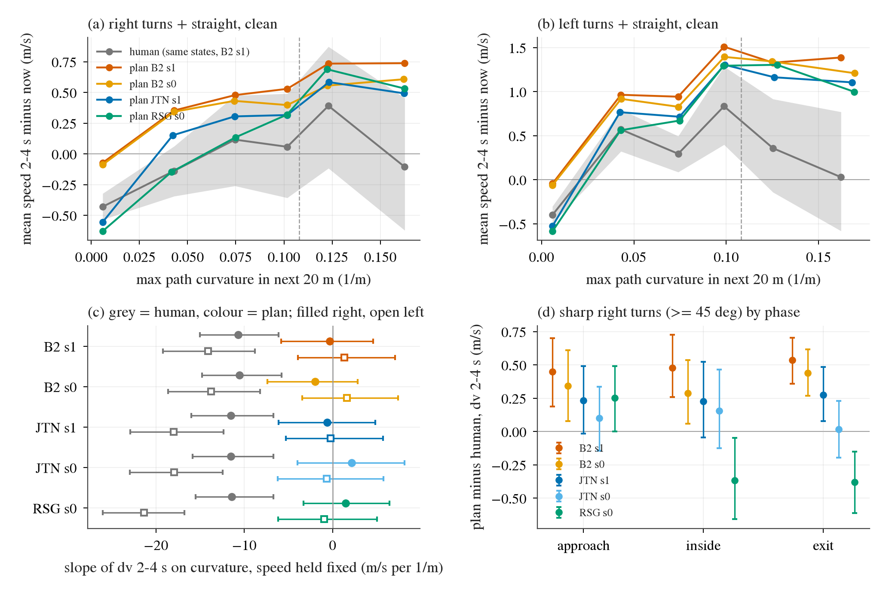

# PLAN-SPEED-CURV: does the plan's speed react to the curvature ahead the way the human's does? (2026-10-20)

This is a diagnostic: CPU only, stored reads, no training, no rollouts, 0 GPU. The design and the decision rule were pre-registered in
[plans/2026-10-20-plan-speed-curv-prereg.md](../plans/2026-10-20-plan-speed-curv-prereg.md) (commit 9488bc6c) before any slope was computed.
The hypothesis comes from d310 / d395: the base model's longitudinal output does not read the geometry ahead, so it speeds up early in tight
right turns.

**Data.**
- Decisions: the native held arena reads of B2 (`STANDFMXH-L18-s1`, s0 replicate), JTN-L18-s1 / s0 and RSG-L18-s0, from the archived dumps
  `tmp/easy_items_B2/ext_full_H{_s1}` (d395 / d397's loaders).
- Human: the window's 5.5 s track is too short for a 4 s future late in a window. The full nuPlan ego log around each held window
  (start - 10 s .. + 30 s) was exported on the box and moved into the window frame by a rigid fit onto `hum.pkl`; median residual 0.000 m,
  no window dropped. The ego's station on the full log matches the 5.5 s track's station (median difference 0.00 m).
- Unit: a decision with k >= 2, ego >= 2 m/s, before the scored exit, and >= 4 s of human log after the human passed the ego's station.
  1 594 windows; per read about 7 500 decisions, of which about 6 400 are **clean** (no lead within 30 m, the human does not brake below 1 m/s
  within 4 s). Turns: |heading change over the next 20 m| >= 15 deg, about 800 right and 1 140 left clean decisions per read.
- Curvature ahead `kmax`: the max curvature of the logged path over the next 20 m on the trainer's 1 m gpath (d397's definition, tight = 0.108 /m).
- Response: **dv24** = mean plan speed over 2-4 s minus the ego's current speed; the human's dv24_h = his mean speed over 2-4 s after he was at
  the ego's station minus his speed there. dv02 and the 4 s arc are secondary.

**Script.** [scripts/plan_speed_curv.py](../scripts/plan_speed_curv.py): `logs` (box), `feat`, `stats`, `fig` (Mac). Outputs:
[plan_speed_curv.json](plan_speed_curv.json), [plan_speed_curv/slopes.csv](plan_speed_curv/slopes.csv),
[bins.csv](plan_speed_curv/bins.csv), [phase.csv](plan_speed_curv/phase.csv), [failpass.csv](plan_speed_curv/failpass.csv).

## Reading

**Primary rule (raw slope of dv24 on kmax inside turns): right turns cannot be judged, left turns "do not react" for every read.**
The raw human slope inside right turns is not negative: tight-turn decisions are slow ones, and slow drivers speed up, so the raw
regression mixes curvature with speed. The pre-registered precondition (human slope CI below 0) fails on the right side for all five reads.

| clean, dv24 vs kmax (m/s per 1/m) | right: plan | right: human | right verdict | left: plan | left: human | left ratio | left verdict |
|:--|--:|--:|:--|--:|--:|--:|:--|
| B2 s1 | +5.9 [+1.4, +10.2] | +1.7 [-2.5, +5.9] | not judged | +2.2 [-2.1, +6.7] | -6.7 [-11.4, -1.7] | -0.34 | does not react |
| B2 s0 | +4.6 [0.0, +8.8] | +1.6 [-2.6, +5.9] | not judged | +2.1 [-1.9, +6.8] | -6.5 [-10.9, -1.6] | -0.32 | does not react |
| JTN s1 | +5.7 [+0.5, +10.4] | +0.6 [-4.2, +5.3] | not judged | +2.6 [-1.8, +7.5] | -8.7 [-13.3, -4.0] | -0.30 | does not react |
| JTN s0 | +7.7 [+2.7, +12.9] | +0.7 [-3.7, +5.6] | not judged | +1.5 [-3.0, +6.6] | -8.9 [-13.5, -4.1] | -0.17 | does not react |
| RSG s0 | +9.2 [+4.5, +13.6] | +0.8 [-3.4, +5.2] | not judged | +4.3 [-0.8, +9.9] | -11.8 [-16.3, -7.3] | -0.37 | does not react |

95 % CIs: 2 000 window-clustered bootstrap draws. The plan's raw slope is positive on both sides for every read; on the right side its CI
excludes 0 for four of five reads (B2 s0 touches 0): the tighter the road ahead, the more the plan accelerates.

**Speed held fixed (pre-registered robustness: the current speed as a covariate), the contrast is clean on both sides.** The human's
2-4 s speed change falls with curvature ahead at every read; the plan's is flat.

| clean, dv24 on kmax + speed | right: plan | right: human | right ratio | left: plan | left: human | left ratio |
|:--|--:|--:|--:|--:|--:|--:|
| B2 s1 | -0.3 [-5.8, +4.6] | **-10.7** [-15.0, -6.1] | 0.03 | +1.3 [-3.9, +7.1] | **-14.1** [-19.2, -8.8] | -0.09 |
| B2 s0 | -2.0 [-7.4, +2.8] | **-10.5** [-14.8, -5.8] | 0.19 | +1.6 [-3.4, +7.4] | **-13.8** [-18.6, -8.2] | -0.12 |
| JTN s1 | -0.6 [-6.1, +4.8] | **-11.5** [-16.0, -6.7] | 0.05 | -0.2 [-5.3, +5.7] | **-18.0** [-22.9, -12.4] | 0.01 |
| JTN s0 | +2.2 [-4.0, +8.2] | **-11.5** [-15.9, -6.7] | -0.19 | -0.7 [-6.2, +5.8] | **-17.9** [-23.0, -12.5] | 0.04 |
| RSG s0 | +1.5 [-3.3, +6.4] | **-11.4** [-15.5, -6.7] | -0.13 | -0.9 [-6.2, +5.0] | **-21.4** [-26.0, -16.8] | 0.04 |

Every plan slope has a CI that includes 0 and a ratio below 0.25: under the pre-registered thresholds, every read on both sides
"does not react". This row is the pre-registered robustness check, not the primary rule.

**Binned (panels a, b): the human brakes in the tightest bin, the plan does not.** dv24 in the clean set (turn side + straight):

| kmax bin (1/m) | 0-0.03 | 0.03-0.06 | 0.06-0.09 | 0.09-0.108 | 0.108-0.15 | 0.15-0.25 |
|:--|--:|--:|--:|--:|--:|--:|
| right, human (B2 s1 states) | -0.43 | -0.14 | +0.12 | +0.06 | +0.39 | **-0.11** |
| right, B2 s1 / s0 plan | -0.07 / -0.09 | +0.35 / +0.34 | +0.48 / +0.43 | +0.53 / +0.40 | +0.74 / +0.56 | **+0.74 / +0.61** |
| right, JTN s1 / RSG plan | -0.56 / -0.63 | +0.15 / -0.15 | +0.31 / +0.14 | +0.32 / +0.32 | +0.58 / +0.69 | **+0.49 / +0.53** |
| left, human | -0.40 | +0.57 | +0.30 | +0.84 | +0.36 | **+0.03** |
| left, B2 s1 / s0 plan | -0.05 / -0.06 | +0.97 / +0.92 | +0.94 / +0.83 | +1.51 / +1.40 | +1.33 / +1.34 | **+1.39 / +1.21** |

- Below 0.1 /m both rise together (slow, accelerating states).
- Above 0.15 /m (R < 6.7 m) the human holds speed: -0.1 / 0.0 m/s. The plans keep accelerating: +0.5 to +0.7 m/s right, +1.0 to +1.4 m/s left.
- B2 also has a general +0.35 m/s offset over the human on straights, which JTN and RSG do not have (-0.16 to -0.30). That offset is the
  FREE-M arc term's footprint, and it sits on top of the shared curvature-blindness.

**Phase in sharp turns (total >= 45 deg over -20 .. +20 m; plan - human dv24, m/s; panel d).**

| right turns | approach | inside | exit |
|:--|--:|--:|--:|
| B2 s1 | **+0.45** [+0.19, +0.70] | **+0.48** [+0.26, +0.73] | **+0.54** [+0.36, +0.70] |
| B2 s0 | **+0.34** [+0.08, +0.61] | **+0.29** [+0.06, +0.54] | **+0.44** [+0.27, +0.62] |
| JTN s1 | +0.23 [-0.01, +0.49] | +0.23 [-0.04, +0.52] | **+0.28** [+0.08, +0.49] |
| JTN s0 | +0.10 [-0.14, +0.34] | +0.16 [-0.12, +0.47] | +0.02 [-0.19, +0.23] |
| RSG s0 | **+0.25** [0.00, +0.49] | **-0.37** [-0.66, -0.05] | **-0.38** [-0.61, -0.15] |

- On right approach the human slows (-0.23 m/s), while every plan holds or adds speed (B2 +0.22 / +0.08). The ego's speed there equals the
  human's (4.2 vs 4.3 m/s), so this is the plan's choice, not a different state.
- B2 is ahead of the human in every phase, not only on the exit. Left turns look the same for B2 (+0.6 / +0.5 / +0.9).
- RSG speeds up on approach too, but stays slower than the human inside and on the exit. So the "early acceleration out" that d395 saw is B2's
  (and partly JTN's); the shared trait is not braking on approach.

**Failing vs passing sharp turns (d397's set, tight decisions only, kmax >= 0.108).**

| read | plan dv24 fail / pass | human dv24 fail / pass | plan - human fail / pass |
|:--|--:|--:|--:|
| B2 s1 | 1.56 / 1.24 | 0.56 / 0.50 | **+1.00 / +0.74** |
| B2 s0 | 1.10 / 1.19 | 0.23 / 0.56 | +0.88 / +0.63 |
| JTN s1 | 1.13 / 1.25 | 0.18 / 0.70 | +0.95 / +0.55 |
| JTN s0 | 1.15 / 1.17 | 0.17 / 0.63 | +0.98 / +0.55 |
| RSG s0 | 1.25 / 1.09 | 0.30 / 0.63 | +0.95 / +0.46 |

Failing windows are the 3-1 s pre-exit decisions of 14-17 windows; passing windows contribute 37-42 windows. In the failing turns the human
accelerates less, because they are tighter (median kmax 0.16-0.17 vs 0.13). The plan accelerates the same in both. The plan does not see the
difference that the human responds to, which is what d397's "base rate on tight turns" looks like on the speed axis.

## Figure

[figs/plan_speed_curv.png](figs/plan_speed_curv.png) (PDF stays local). What to look at in each panel:
- **(a, b)** Binned dv24 vs curvature ahead. Grey is the human with its 95 % band. Right of the dashed tight line the human curve
  bends down, and every plan stays up.
- **(c)** The slope with speed held fixed. The grey human markers sit at -10 to -21 with CIs clear of 0; every coloured plan marker straddles 0.
- **(d)** Plan minus human in sharp right turns by phase. B2 is above 0 in all three phases; RSG drops below 0 once inside the turn.

## Verdict

**The hypothesis holds in the speed-adjusted form, for all three models and both seeds:** conditional on its current speed, the plan's
2-4 s speed change does not depend on the curvature of the next 20 m. Plan slope ratios are -0.19 .. +0.19, all CIs include 0, while the
human's are -10 .. -21 m/s per 1/m. It is a shared trait of the base, not of FREE-M / B2. The pre-registered primary (raw slope) is
"does not react" on the left and not judgeable on the right, because the raw human slope is confounded by speed. The binned curves
show where the gap is: above about 0.15 /m the human stops accelerating, and the plans do not.

What the model does read is the speed level: the 4 s arc slope ratio is 0.65-0.67 for B2, 0.41-0.61 for JTN and 0.34-0.39 for RSG. So it enters
turns slower than on straights, through its own state, but does not modulate within the turn by how tight the turn is.

**Implication for a training term (proposal only, nothing launched).**
- A curvature-gated longitudinal hinge is the direct fix. On moving S rows with kmax >= 0.15 /m within 20 m, penalise the plan's 2-4 s speed
  above the human's reachable 2-4 s speed from the same station (+ about 0.3 m/s, one-sided, along the heading only). That is TURN-CAP
  gated by the road's tightness instead of the turn angle.
- Descriptive fire rates on B2's stored plans (a dv24 - dv24_h > 0.3 m/s proxy):
  - K 0.15: about 0.5 % of passing decisions (1.2-1.4 % of passing windows), 10-11 of 21-22 failing sharp windows hit.
  - K 0.108: about 1.8 %, too much.
- It is cheap in the d396 / d401 budget sense only at K 0.15. Two cautions:
  - (i) d397 found garage passes with apex speed 1.09-1.15 x the human through its line, so speed is not sufficient. This term targets
    only the speed half and is expected to help less than the lateral line.
  - (ii) It acts mostly on turns B2 already passes, as every tight-turn term has.
- Recommended only as an added part of a future line term (not alone), with its own pre-registration and the usual launch / slow-window guards.

## Caveats

- The lead filter uses the ego's lead at the decision. The human's lead at his own time may differ, so the clean set is not perfectly
  lead-free for the human.
- The human starts from his own speed (v_h), the plan from the ego's. The ratio compares sensitivity to curvature, not speed level.
- The raw linear slope was a poor pre-registered primary for the right side, because the human's dv24 vs curvature is non-monotone.
  The speed-adjusted row and the bins were pre-registered as secondary and are read here as the substantive result. The fire-rate numbers
  in the implication are post hoc.
- The failing / passing split rests on 14-17 failing windows per read.
