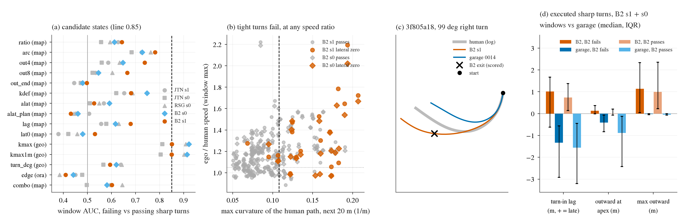

# TURN-SEP: what separates B2's failing sharp turns from the ones it passes (2026-10-20)

This is a diagnostic: CPU only, stored reads, no training, no rollouts, 0 GPU. The candidates and the success line were
pre-registered in [plans/2026-10-20-turn-sep-prereg.md](../plans/2026-10-20-turn-sep-prereg.md) (commit 2e805e31) before any
value was computed. It answers the open question of decision 396: TURN-CAP's speed-ratio cap fired on 5.9 % of B2's passing
decisions, because B2 is faster than the human in most sharp turns and passes most of them.

**Data.**
- Windows: d395's sharp-turn held windows, where the human path turns at least 45 deg within 20 m.
- Labels: **fail** is a lateral zero; **pass** is a score of 1. B2 s1 has 19 fail and 143 pass windows; B2 s0 has 21 and 135.
- Decisions: k >= 2, ego at 2 m/s or more, and the human path turning at least 15 deg over the next 20 m (the "turn domain").
  - Fail windows: the decisions 3 s to 1 s before the scored exit (69 / 77).
  - Pass windows: every domain decision (765 / 729).
- Window score: the maximum over the eligible decisions.
- Fire-rate denominator: every k >= 2 decision of the held windows that B2 scores 1. That is 16 272 on s1 and 16 208 on s0, the same denominator as d396 G3.
- Other reads: JTN-L18-s1 / s0 and RSG-L18-s0 on the same windows, as description.
- Garage 0014 has no plan dump. Its executed path comes from the read's 10 Hz controller traces, which share the window frame
  with B2's (checked to the cm).

**Script.** [scripts/turn_sep.py](../scripts/turn_sep.py) has six subcommands:
- `traces` (box): pulls the executed controller traces;
- `pool` (box): counts the term's domain in on1_JTX;
- `feat`, `auc`, `garage`, `fig` (Mac): compute the states, the AUCs, the garage comparison and the figure.

Outputs: [turn_sep.json](turn_sep.json), [turn_sep/auc.csv](turn_sep/auc.csv), [turn_sep/garage.csv](turn_sep/garage.csv) and
[turn_sep/term_fire.json](turn_sep/term_fire.json).

## Reading

**No state of B2's own driving separates its failing sharp turns from the ones it passes. The turn's tightness does: the maximum
curvature of the human path over the next 20 m.**
- Tightness passes the pre-registered line on both seeds: window AUC 0.85 on s1 and 0.92 on s0, and 0.81-0.91 on the three other reads.
- The best policy state is the plan / human arc ratio, at 0.78 / 0.73.
- Speed ratio, outward offset, curvature deficit, turn-in lag and lateral acceleration all score 0.5-0.75. A leave-one-window-out
  logistic regression on all ten map-free states scores 0.60 / 0.58 and is worse than its best single input.
- The map oracle (`min_distance_to_lane_boundary_m`) is unusable in intersections. It reads exactly 0 on 37 % of the
  turn-domain decisions, so as a feature it carries nothing (AUC 0.41-0.44).

| candidate | kind | window AUC s1 / s0 | decision AUC s1 / s0 | JTN s1 / JTN s0 / RSG | 1 % threshold (s1) | fail windows hit s1 / s0 | a2 targets hit (s1) | passes |
|:--|:--|--:|--:|--:|--:|--:|--:|:--|
| speed ratio (d396) | plan / ego | 0.64 / 0.61 | 0.70 / 0.64 | 0.63 / 0.56 / 0.59 | 1.20 | 58 % / 52 % | 6 | no |
| plan / human arc | plan | 0.78 / 0.73 | 0.77 / 0.69 | 0.73 / 0.68 / 0.76 | 1.33 | 68 % / 62 % | 4 | no |
| plan outward at 4 m arc | plan | 0.74 / 0.65 | 0.69 / 0.58 | 0.59 / 0.56 / 0.63 | 0.39 m | 79 % / 71 % | 8 | no (AUC) |
| plan outward at 8 m arc | plan | 0.67 / 0.55 | 0.69 / 0.58 | 0.53 / 0.52 / 0.60 | 1.04 m | 79 % / 67 % | 8 | no |
| plan outward at 4 s | plan | 0.50 / 0.48 | 0.62 / 0.58 | 0.45 / 0.47 / 0.48 | 7.1 m | 47 % / 43 % | 4 | no |
| curvature deficit (8 m) | plan | 0.68 / 0.75 | 0.62 / 0.61 | 0.65 / 0.62 / 0.69 | 0.10 rad | 68 % / 76 % | 6 | no |
| v^2 x path curvature | ego + path | 0.53 / 0.59 | 0.52 / 0.59 | 0.57 / 0.51 / 0.55 | 2.6 m/s^2 | 42 % / 57 % | 2 | no |
| plan's own lateral acceleration | plan | 0.43 / 0.46 | 0.45 / 0.47 | 0.51 / 0.46 / 0.44 | 2.4 m/s^2 | 16 % / 29 % | 2 | no |
| turn-in lag | plan | 0.68 / 0.62 | 0.67 / 0.61 | 0.56 / 0.58 / 0.63 | 1.5 m | 42 % / 48 % | 2 | no |
| ego outward offset now | ego | 0.53 / 0.48 | 0.52 / 0.48 | 0.38 / 0.42 / 0.46 | 0.28 m | 42 % / 38 % | 3 | no |
| logistic on all ten (LOWO) | plan + ego | 0.60 / 0.58 | 0.64 / 0.57 | 0.60 / 0.50 / 0.65 | | 53 % / 43 % | 4 | no |
| **max path curvature, next 20 m** | road | **0.85 / 0.92** | 0.86 / 0.89 | 0.85 / 0.81 / 0.91 | 0.107 /m | 84 % / 95 % | 7 | **yes** |
| **same, trainer's 1 m path** | road | **0.85 / 0.91** | 0.85 / 0.88 | 0.85 / 0.81 / 0.90 | 0.108 /m | 79 % / 90 % | 6 | **yes** |
| turn angle | road | 0.59 / 0.62 | 0.59 / 0.62 | 0.64 / 0.57 / 0.64 | 57 deg | 63 % / 71 % | 5 | no |
| lane-boundary distance (oracle) | map | 0.41 / 0.44 | 0.47 / 0.50 | 0.45 / 0.48 / 0.38 | | 0 / 0 | 0 | no |

How to read the table:
- The 1 % threshold is the value at which the candidate fires on 1 % of B2 s1's passing held decisions. s0 uses s1's threshold, and fires there on 0.8-1.2 %.
- "a2 targets hit" counts out of 9. 202f583c is a 34 deg turn, outside the sharp set, so it is never eligible.
- The secondary span (the full 3 s before the exit) gives the same ranking: speed ratio 0.70, arc 0.75, curvature 0.84 on s1.

**Within tight turns (curvature >= 0.107 /m, R <= 9.3 m) nothing separates either.** The tight turns hold 16 of 19 failing and 38 of
143 passing windows on s1, and 20 of 21 and 32 of 135 on s0.
- Inside that set, the policy states give window AUC of 0.47-0.72 on s1 and 0.38-0.66 on s0.
- The speed ratio is 0.57 / 0.49. On s0 the median ratio is 1.19 in the failing tight turns and 1.22 in the passing ones.
- So the sharp-turn zeros are a base rate on tight turns, about 30-40 % of B2's tight turns end in a zero. They are not a distinct
  failing state of B2's plan. Panel (b) shows it: failing windows sit right of the curvature line at every speed ratio from 0.95 to 2.2.

**What garage does differently: it turns in early and drives inside the human's line, and it never runs wide.** The comparison
uses the executed paths up to B2's exit time, with medians over the sharp set; [turn_sep/garage.csv](turn_sep/garage.csv) has every window.

| executed, sharp windows (s1; s0 in brackets) | B2 where B2 fails | garage there | B2 where B2 passes | garage there |
|:--|--:|--:|--:|--:|
| speed ratio at entry (t = 1 s) | 1.02 (1.03) | 1.03 (1.03) | 1.01 (1.01) | 1.01 (1.01) |
| speed ratio at the apex | 1.28 (1.31) | **1.09 (1.15)** | 1.10 (1.09) | 1.01 (1.01) |
| turn-in lag vs human, m (+ = later) | +1.33 (+0.97) | **-1.33 (-1.19)** | +0.67 (+0.81) | -1.58 (-1.56) |
| outward offset at the apex, m | +0.15 (+0.12) | **-0.65 (-0.26)** | -0.01 (-0.01) | -0.88 (-0.87) |
| max outward offset, m | +1.15 (+1.11) | **-0.03 (-0.02)** | +0.86 (+1.09) | -0.05 (-0.05) |

- **Garage's line.** Garage reaches half of the human's heading change 1.2-1.6 m of station *earlier* than the human. It sits 0.3-0.9 m inside the human path at the apex and never goes outside it: its max outward offset is at most 0.08 m on all 8 a2 targets in the sharp set. The exception is 41a358be (s0's tenth a2 window), at 2.4-3.2 m.
- **B2's line.** B2 turns in 0.7-1.3 m *later* than the human and runs about 1 m wide. It does this in the turns it passes too (max outward +0.86 / +1.09 m). Wide roads absorb it; tight ones do not.
- **Speed.** Both enter at the human's speed. B2 then accelerates through the apex (1.28-1.31 x where it fails), against garage's 1.09-1.15 x.
- **Speed is not the decisive difference.** On the a2 windows garage's apex ratio is 1.06-1.27, overlapping B2's 1.0-1.76. Garage passes because of its line, not its speed.
- **The difference is behavioural, not a different state.** Garage is inside on every sharp turn, while B2 is wide on every sharp turn and fails where the road is tight. That is why no plan-side state in B2's own reads picks out the failures.

## Figure

[figs/turn_sep.png](figs/turn_sep.png). What to look at in each panel:
- **(a)** The window AUC of every candidate on five reads. Only the two path-curvature rows cross the dashed 0.85 line.
- **(b)** B2's sharp windows, with the path's max curvature on the x axis against the window-max speed ratio on the y axis. The lateral zeros (orange) cluster right of 0.108 /m at every speed ratio, and passing turns at the same ratios sit left of it.
- **(c)** 3f805a18, a 99 deg right turn. B2 (orange) runs wide of the human (grey) and exits. Garage (blue) cuts inside.
- **(d)** Executed turn-in lag and outward offsets. B2 is late and wide whether it fails or passes. Garage is early and inside.

## Verdict

**The pre-registered line is met only by the road state, path tightness.** It is map-free and computable at training time from
the logged path (`gpath`). No state of B2's own plan or speed reaches 0.85, so the speed-ratio TURN-CAP of d396 stays closed.

What remains is a lever restricted to tight turns. It is honest about what it is: it acts on every tight turn, failing or passing (about 60-70 % of
its passing-window decisions fire too). The ≤ 1 % budget holds because tight turns are rare, about 1 % of passing decisions, not
because the term finds the failures. Garage shows which way the term should push: toward an earlier, inside line, not mainly toward a lower speed.

**Draft (not launched):** NR1 supplement 22 DRAFT, [TIGHT-IN](../../defect_fix/plans/2026-10-20-nr1-supp22-tightin-DRAFT.md). It acts on moving S rows whose logged
path has a max curvature of at least 0.108 /m within 20 m. It has two one-sided parts: a penalty on the plan running outward of the logged path by more than 0.2 m, and d396's arc cap at K 1.05.

Its estimated fire rate on passing decisions, on stored plans ([turn_sep/term_fire.json](turn_sep/term_fire.json)), is:

| read | fire on passing decisions | windows | fail windows hit | targets |
|:--|--:|--:|--:|--:|
| B2 s1 | 0.77 % | 2.0 % | 15 / 19 | 6 / 9 |
| B2 s0 | 0.72 % | 1.8 % | 18 / 21 | |
| JTN / RSG | 0.86-0.97 % | | | |

Pool domain: on1_JTX has 3 502 S rows, 2.7 % of S and 1.2 % of the JTX00 draw, from 24 logs, 2 066 of them right turns.
The stored served plans run outward by more than 0.2 m on 1 273 of them.

The expected gain is unmeasured. d395's observational price for the a2 class is +17 / +30 (board-mix / g15). The risk lies on the 38 passing tight turns.

## Caveats

- **The human track is 5.5 s long.** Late in a window, "next 20 m" is clamped at its end. The trainer's `gpath` reaches 70 m, so curvature there can only be equal or larger, and the pool share may differ.
- **Tightness says where B2 fails, not what to change.** The draft's direction (inside line, no wide exit) comes from garage's executed paths, which carry no plans. Whether training B2's plans inside fixes the exits needs the registered pilot.
- **Small numbers.** There are 19-21 failing windows per seed, and the a2 targets inside the sharp set number 8. The thresholds were set on s1 and transfer to s0 at the same rate.
