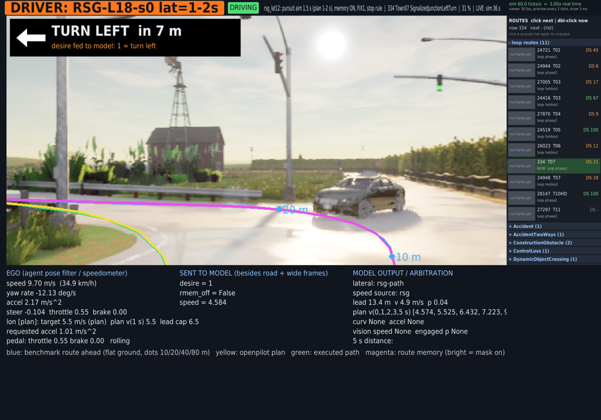
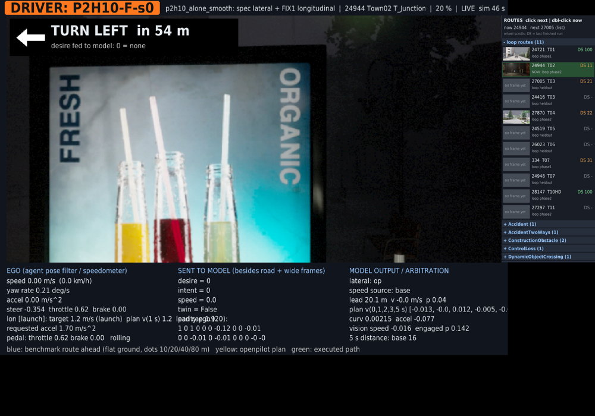
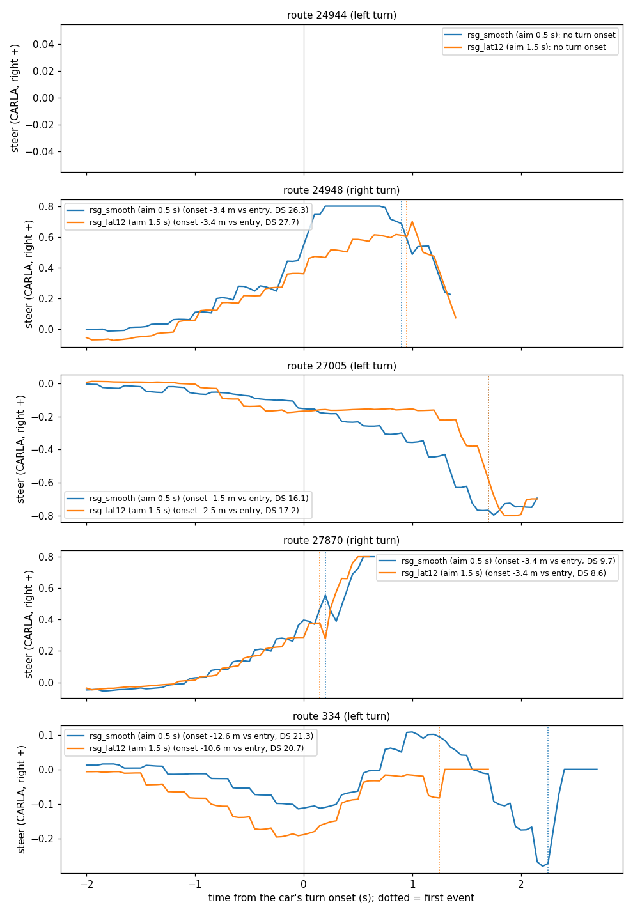
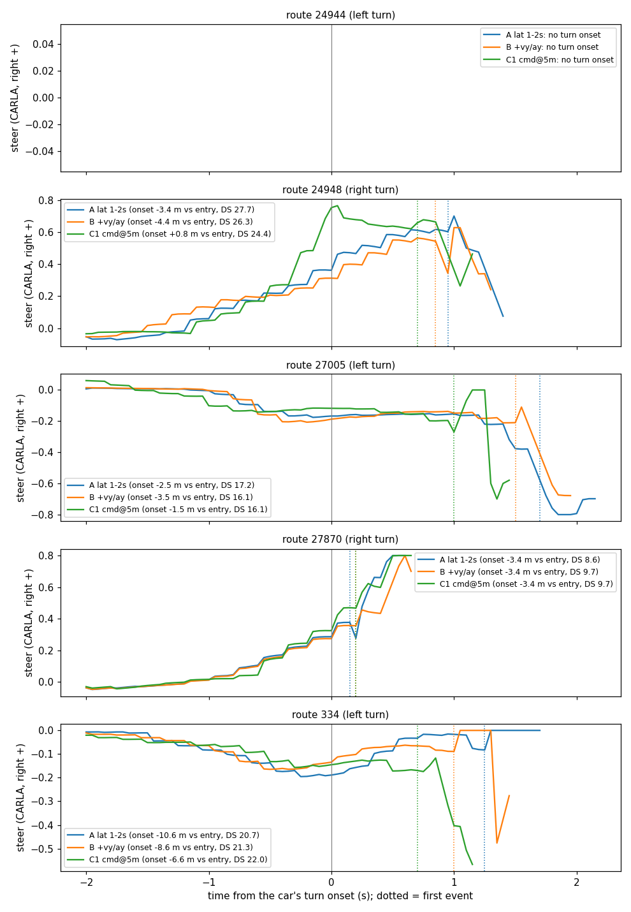

# b2d_monitor: watch and probe models in first-person Bench2Drive

status: live
decisions: 288
index: Tokyo B2D monitor; RSG memory moves left-turn onset, L/R flip is the lever

**Question.** Can we watch and probe our models in a first-person Bench2Drive loop on the Tokyo monitor (shipped Cinque, P2H10-F-s0,
RSG-L18-s0 with route memory) and next to them a human on the phone wheel ([phone_wheel](../phone_wheel/README.md))?

**Conclusion.** Yes, as a tool: the loop drives all three on the monitor with the model's own warped wide frame, the route / plan /
executed path / route-memory overlays and a `phase` tag; RSG got a new B2D serving path (15-16 ms per decision). Read on 5 turn
routes (1 seed, stop at first event, weak): the route memory changes left turns (27005 onset -1.5 vs -8.5 m), not right turns, and
every turn route still collides; the early inside turn is not the executor horizon, vy / ay or the memory geometry, the 18-20 m L/R
command flip is the main onset lever (flip at 5 m: ~4 m later on 334 and 24948); RSG starts only through the d140 resume rule or the
15 s timer, shipped Cinque at 5.8 s via the FIX1 port, which also finishes 24721 in 1449 vs 2053-2100 ticks (decision 288, draft).
RSG on B2D is closed by the user; the monitor stays live as a tool.

**Next.** The user drives the 11 loop routes with the phone wheel so the human sits next to the models on the same exam.

**Read more.** [results/stage1_cinque.md](results/stage1_cinque.md) (shipped Cinque, FIX1 port, warm-up),
[results/rsg_b2d.md](results/rsg_b2d.md) (RSG serving, memory ON / OFF, arms A / B / C1 / C2, start delay, server speed-up),
[docs/tokyo-box.md](../../docs/tokyo-box.md) (display, CARLA on Tokyo), [phone_wheel](../phone_wheel/README.md).

<!-- files:begin -->
## Files

- `op_arb_viz_agent.py` (lib): Monitor view for the op_arb openpilot …
- `rsg_pack.py` (lib): CARLA openpilot road / wide renders -> …
- `rsg_server.py` (scripts): B2D policy server for an SH30-family …
- `viz_loop.py` (scripts): one b2d_run Runner per route on one …
- `b2d_viewer.py` (scripts): One input mosaic + chase camera, with …
- `loop.sh` (scripts): Route loop for the monitor
- `env.sh` (scripts): Shared environment of the monitor …
- `rsg_turns.py` (scripts): Turn-onset read of B2D route attempts
- `rsg_b2d.md` (results): RSG-L18-s0 in the Bench2Drive loop
- `stage1_cinque.md` (results): shipped Cinque driving Bench2Drive on …

[results/](results/) 2 result files · [figs/](figs/) 4 figures · [lib/](lib/) 2 library · [scripts/](scripts/) 16 entry points
<!-- files:end -->

## What it is

- `lib/op_arb_viz_agent.py`: `lib/op_arb_agent.OpArbAgent` unchanged plus (1) a non-blocking live preview (`scripts/drive_runtime/preview`,
  every tick) of the wide camera exactly as warped for the model (512 x 256 geometry, 2x pixels) with the route / plan / executed-path /
  route-memory polylines and every input sent to the model; (2) `lon_smooth`: the B2D port of AlpaSim FIX1 longitudinal serving
  (decision 226; class docstring); (3) `rsg`: the RSG-L18-s0 client (arms B / C switches `ego_vy`, `cmd_mode`); (4) `stop_on`: end
  the route at the first collision / off-route event (evaluation only, simulator truth; `<attempt>/stop_event.json`).
- `scripts/rsg_server.py` (envs/op-train): B2D policy server for SH30 + ROUTE-MEM checkpoints (sh30_core.Core, per-slot token cache,
  compiled, an exactness check against `pai_core.plan` every 50th full decision); `lib/rsg_pack.py` packs the CARLA renders into the
  family's (2, 6, 128, 256) model frames (numpy, Python 3.8 and 3.11).
- `scripts/viz_loop.py` + `scripts/loop.sh`: one route per `b2d_run` Runner on one kept windowed CARLA server; routes grouped by town;
  `scripts/pyhook/sitecustomize.py` keeps the loaded map when the next route is on the same town.
- `scripts/b2d_viewer.py` + `viewer.sh`: the monitor window (openpilot layout, top bar, route picker). `scripts/b2d_viewer.py` at the repo
  root is the original and stays as it is.
- `scripts/server.sh` (op_arb_server for Cinque or an arm ONNX, then `op_warm.py`), `bias.sh` (op_parity bias server), `rsg_server.sh`,
  `openpilot-python.sh` (envs/openpilot with tfv6's CUDA libs), `run_test.sh` (off-screen, port 2100), `run_routes.sh` (one-shot windowed).
- Readers: `scripts/rsg_turns.py <run dir>...` (turn onset vs junction entry, plan aim and miss, first event, DS),
  `scripts/steer_plot.py <out.png> <label>=<run dir>...` (steer vs time around the onset, one line per arm).
- `cfg/`: `op_alone` (openpilot alone, op_arb longitudinal), `op_alone_smooth` (+ FIX1 port, stop rule), `p2h10_alone_smooth`,
  `rsg_smooth` / `rsg_smooth_rmemoff` (aim 0.5 s, memory ON / OFF), `rsg_lat12` (arm A: P7 aim 1.5 s via `P7_la15.json`),
  `rsg_lat12_vy` (B), `rsg_lat12_c1` (C1: L/R within 5 m), `rsg_lat12_c2` (C2: command S). Sockets are relative to the monitor dir,
  `controller_config` to the repo root; the agent writes the resolved config to `<mon dir>/cfg-resolved/`.

Paths: everything runs from the repo root; `scripts/env.sh` needs `DATA_DIR` and sets the monitor dir `B2D_MON_DIR` (default
`$DATA_DIR/runs/b2d_monitor`: `live/`, `srv/`, `runs/`, `carla-logs/`, `cfg-resolved/`), the card `MON_GPU` (default 0; on Tokyo card 1
is not ours), `DISPLAY` (:0) and `XAUTHORITY` (from the running Xwayland's `-auth`, docs/tokyo-box.md). Runs before the landing
(2026-10-13) are in `$DATA_DIR/runs/tokyo_b2d_viz/runs/`.

## Relaunch (Tokyo, tmux `jev`, one server family at a time on card 0)

```bash
cd ~/mycode/jev-drive; M=experiments/b2d_monitor/scripts; C=experiments/b2d_monitor/cfg; D=DATA_DIR=/data
# viewer (leave it running; it shows whatever loop publishes to $B2D_MON_DIR/live)
tmux new-window -d -t jev -n viewer "$D bash $M/viewer.sh; exec bash"
# shipped Cinque (openpilot alone, FIX1 longitudinal)
tmux new-window -d -t jev -n server "$D bash $M/server.sh; exec bash"              # 20 warm-up plans, then "server op warm"
tmux new-window -d -t jev -n loop "$D VIZ_MODEL='Cinque shipped' VIZ_CONFIG=op_alone_smooth bash $M/loop.sh '' $C/op_alone_smooth.json; exec bash"
# P2H10-F-s0 (arm ONNX + bias server)
tmux new-window -d -t jev -n server-p2h10 "$D bash $M/server.sh op-p2h10 /data/runs/op_parity/hugsim/onnx/pp-P2H10-F-s0.onnx; exec bash"
tmux new-window -d -t jev -n bias "$D bash $M/bias.sh; exec bash"
tmux new-window -d -t jev -n loop "$D VIZ_MODEL=P2H10-F-s0 VIZ_CONFIG=p2h10_alone_smooth bash $M/loop.sh '' $C/p2h10_alone_smooth.json; exec bash"
# RSG-L18-s0 (rsg_smooth = aim 0.5 s, rsg_lat12 = aim 1.5 s; _vy / _c1 / _c2 = arms B / C1 / C2; rsg_smooth_rmemoff = memory OFF)
tmux new-window -d -t jev -n rsg-server "$D bash $M/rsg_server.sh; exec bash"      # ready after ~30-80 s (compile warm-up)
tmux new-window -d -t jev -n loop "$D VIZ_REUSE_WORLD=0 VIZ_MODEL=RSG-L18-s0 VIZ_CONFIG=rsg_lat12 bash $M/loop.sh '' $C/rsg_lat12.json; exec bash"
# off-screen single runs (port 2100): MAX_TICKS=2400 bash $M/run_test.sh <out> <ids> experiments/b2d_monitor/lib/op_arb_viz_agent.py <cfg>
```

`loop.sh [ids] [cfg]`: empty ids = the 11-route mix 24721, 24944, 27005, 24416, 27870, 24519, 26023, 334, 24948, 28147, 27297 (val XML,
outside Town12/13, short; listed by town in `results/stage1_cinque.md`). Stop a loop with Ctrl-C in its pane (the runner kills its
CARLA process group; `tmux kill-window` does the same through SIGHUP); check with `ps -eo pid,args | grep "[b]2d_run"`. Output:
`$B2D_MON_DIR/runs/loop-<MMDD-HHMM>-p<n>/` (one dir per pass over the list).

**Scored runs: `VIZ_REUSE_WORLD=0`.** The default (1) keeps the loaded CARLA world when the next route is on the same map (saves the
map load; destroys the stale actors and does what the leaderboard does after `load_world`), which is not the leaderboard as shipped.
Any number that goes into a table runs with `VIZ_REUSE_WORLD=0` (every RSG run in `results/rsg_b2d.md` did).

## Route picker protocol (viewer -> loop)

Files in `$B2D_MON_DIR/live/`:
- `request.json` `{"queue": [{"route": "<id>", "mode": "next" | "now", "ts": <unix s>}, ...]}`: written **only by the viewer** (click a
  route = append `next`, double click = `now`, click a queued row again = unqueue). The loop never writes it.
- `consumed.json` `{"ts": [...]}`: written only by the loop, the `ts` of every entry it took (last 200); the viewer drops those from its
  queue.
- `loop.json` `{route, town, why, out, next, ids, queue, state, t}`: written by the loop when it starts a route (`state` loading /
  stopped); the picker shows "now" / "next" from it.
Order of the next route: the newest pending `now` (it aborts the running route like Ctrl-C, SIGINT to the route's group, and keeps
CARLA), else the oldest pending entry on the current town, else the oldest entry, else the next id of the list.

## The `phase` field

The agent publishes `state["phase"]`, drawn as the coloured tag in the viewer's top bar:
`WARM-UP <s> s left` (the warm-up: 5 s for Cinque / P2H10, `rsg.warm_s` = 2 s for RSG) | `DRIVING` (speed >= 0.3 m/s) |
`STOPPED: <reason>`: `lead inside the following distance`, `the model's plan holds (adapter launch pending, driver resume in N s,
timer in N s)`, `the plan stops`, `lead MPC`, `starting (<mode>)`, `stop latch (plan asked to stop)`. `LOADING` is the viewer's own
(no fresh state: map loading or between routes). Use it to tell a model that will not move (RSG at standstill) from a stalled loop.

## Figures



`figs/viewer_rsg_334_left.png`: the monitor during RSG-L18-s0 arm A on route 334 (left turn in 7 m, desire 1 fed). Look at the
yellow plan and the green executed path: they already curve left inside the blue route / magenta route memory, which still run
straight to the junction: the early inside turn of `results/rsg_b2d.md`. Top bar: model, `phase` = DRIVING, config, route, progress;
right: the picker with the last DS per route.



`figs/viewer_p2h10_24944_picker.png`: P2H10-F-s0 on 24944 (before `phase` existed). Look at the bottom left: `lon [launch]` with
throttle 0.62 while the model's plan speed is ~0: the FIX1 (c2) ramp starts a model that does not ask to move; bottom middle: the
fed `parity_ego` row.



`figs/steer_lat12_vs_t4.png`: steer vs time from the car's turn onset per route, aim 0.5 s (t4, `rsg-on-t4`) vs 1.5 s (arm A).
Look at the ramps from ~2 s before the onset, nearly the same in both arms, and the onsets in the legends (-12.6 vs -10.6 m on 334, equal
on the right turns): the longer aim only softens the steer after the onset; it does not move the early turn.



`figs/steer_A_B_C1_C2.png`: the same for arms A, B (+ vy / ay) and C1 (L/R within 5 m); C2 is not drawn (the plotting script then
had three colours; fixed since). Look at 334 and 24948: only C1 moves the onset (legend), B lies on A.
