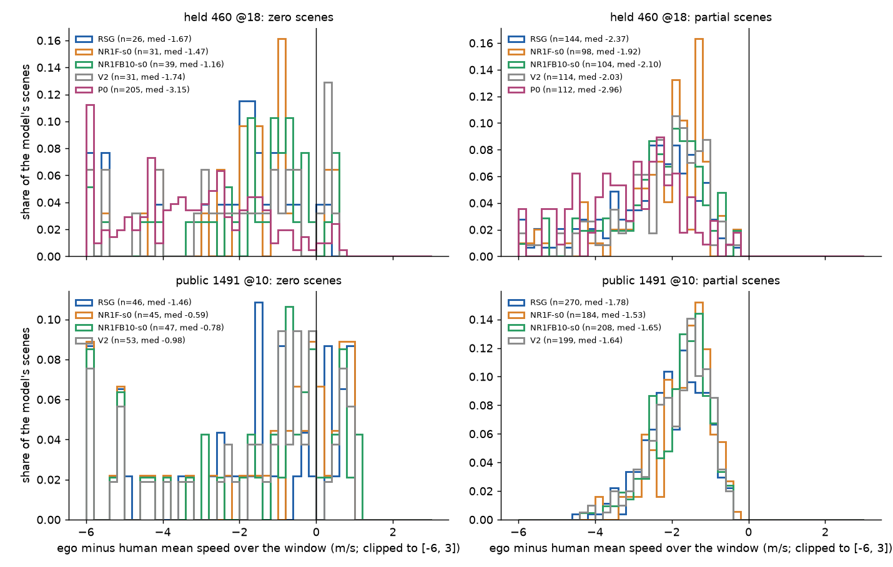

# Zero overlap and speed relative to the human: NR1F / NR1FB10 against the older models (stored reads)

Descriptive follow-up to [decision 346](../../../research/decisions/346.md); no prereg line. Script: `scripts/df_zero.py` (definitions in its header); rows `results/zero_rows.csv.gz` (one per read, tag, scene and repeat). Held 460 @18 and public 1491 @10, one read per tag unless stated.

## Reading (written by hand from the tables below, 2026-10-17)

- **Reads are deterministic.** RSG-L18-s0's held 460 was read three times (route_mem read, the 10-16 re-read at a later code revision, the onpol_long roll):
  the same 34 zeros every time, 0 of 460 scenes flip. So a single-shot read is not sim noise; the noise unit is the training seed: NR1F s0 / s1 differ on
  10 of 460 held scenes (35 zeros shared), NR1FB10 s0 / s1 on 13 (41 shared); public 8 / 10 of 1491 (53 shared each).
- **Mostly the same errors as before.** Held: of NR1F's 39 / 41 zeros, 28 / 29 are RSG's too (8 of them route-fail, the same for every model), 9 / 8 are
  V2's or V2AC's but not RSG's (inherited from the V2 base), only 2 / 4 are new, 1 seed-consistent (3502b309, offroad in a turn). Public: 44 / 44 shared with
  RSG, 13 / 11 V2-lineage, 0 / 2 new, none seed-consistent. Against every older model (P0, YR, APY included) NR1F has no new held zero at all.
- **NR1FB10 (waiting base) does add errors.** Held: 8 / 9 new zeros per seed, 5 of them seed-consistent (d91f0c28 and e14f1ffb AF-front, 1b183271
  corridor at a launch, 7272f8ee and 320446ec offroad); public 3 / 2 new, 1 seed-consistent (0854af02 offroad).
- **Classes that grew (held, against RSG 4 AF-front / 17 offroad / 5 corridor):** NR1F offroad 19-20; NR1FB10 AF-front 9 / 6 and corridor 12 / 11, offroad
  17 / 22. The zeros a new model has and RSG does not are lateral and front contacts: NR1F held offroad 8-9 of 11-12, NR1FB10 held offroad 7-10, corridor 5-6,
  AF-front 5 of 19-20; public offroad 7-12, corridor 3-6. On public, at-fault front contacts fell (RSG 6, NR1F 1) and corridor rose (7 -> 12-13).
  Non-zero rear-ended scenes fell (held RSG 31 -> 22-23).
- **Speed.** On scenes below 1.0 every L18 model is slower than the human (median ego-minus-human -1.5 to -2.1 m/s, arc ratio about 0.64); this is partly
  selection (without a contact only lack of progress costs score). Paired on the union of non-1.0 scenes, the new chains are *faster* than RSG, not slower:
  held NR1F +0.61 / +0.66 m/s [CI lower bounds 0.43 / 0.47], NR1FB10 +0.43 / +0.52, V2 +0.35; public NR1F +0.23 / +0.25, NR1FB10 +0.13 / +0.18, V2 +0.14.
  The waiting base costs NR1FB10 about 0.1-0.2 m/s against NR1F; P0 is 1.45 m/s slower than RSG. The longitudinal gap to the human is not closed by any of them.
- **Answer:** NR1F's deficit against RSG is V2's old lateral zeros (offroad / corridor), not a new failure mode; NR1FB10 adds a small set of
  seed-consistent new front-contact and lateral zeros on held. P0 has no public 1491 read, so it is reference on held only.

## 1. Run-to-run flip rate (same checkpoint, read twice)

| read | tag | reads compared | common scenes | zeros (a / b) | zero in exactly one | flip rate per scene | zeros shared / union |
|---|---|---|--:|--:|--:|--:|--:|
| held | RSG | 1 vs 2 (`runs/route_mem/read/RSG-L18-s0-re1016/c0`) | 460 | 34 / 34 | 0 | 0.000 | 34 / 34 |
| held | RSG | 1 vs 3 (`runs/onpol_long/roll/RSG-L18-s0-held/c0`) | 460 | 34 / 34 | 0 | 0.000 | 34 / 34 |

## 2. Zeros of each new model against the older ones

shared RSG = also zero for RSG; V2-not-RSG = zero for V2 or V2AC but not RSG; new (L18) = zero for none of RSG / V2 / V2AC; new (any) = additionally not zero for P0 (held only), YR or APY. Seed-consistent = zero for both seeds of the chain. The route-fail zeros (8 held, 12 public: the map route generation fails before any driving, the same scenes for every model) sit inside every model's zeros and inside 'shared RSG'.

| read | model | scenes | zeros | shared RSG | V2-not-RSG | new (L18) | new (any) | seed-consistent | of them new (L18) |
|---|---|--:|--:|--:|--:|--:|--:|--:|--:|
| held | NR1F-s0 | 460 | 39 | 28 | 9 | 2 | 0 | 35 | 1 |
| held | NR1F-s1 | 460 | 41 | 29 | 8 | 4 | 0 | 35 | 1 |
| held | NR1FB10-s0 | 460 | 47 | 28 | 11 | 8 | 0 | 41 | 5 |
| held | NR1FB10-s1 | 460 | 48 | 28 | 11 | 9 | 0 | 41 | 5 |
| pub | NR1F-s0 | 1491 | 57 | 44 | 13 | 0 | 0 | 53 | 0 |
| pub | NR1F-s1 | 1491 | 57 | 44 | 11 | 2 | 1 | 53 | 0 |
| pub | NR1FB10-s0 | 1491 | 59 | 41 | 15 | 3 | 1 | 53 | 1 |
| pub | NR1FB10-s1 | 1491 | 57 | 43 | 12 | 2 | 0 | 53 | 1 |

Older models' zeros on the same reads: held RSG 34/460, V2 39/460, V2AC 39/460, P0 213/460, YR 82/460, APY 89/460; pub RSG 58/1491, V2 65/1491, V2AC 63/1491, YR 80/1491, APY 83/1491

- held NR1F: seed-consistent new zeros 1: 3502b309 (offroad/offroad, turn)
- held NR1FB10: seed-consistent new zeros 5: d91f0c28 (AF-front/AF-front, other), 1b183271 (corridor/corridor, launch), e14f1ffb (AF-front/AF-front, other), 7272f8ee (offroad/offroad, other), 320446ec (offroad/offroad, other)
- pub NR1F: seed-consistent new zeros 0
- pub NR1FB10: seed-consistent new zeros 1: 0854af02 (offroad/offroad, braking)

## 3a. Zero and partial classes, held

| model | scenes | zeros | AF-front | AF-side | AF-rear | offroad | corridor | route-fail | zero-other | partial rear-hit | partial hit | partial no-launch | partial creep | partial slow |
|---|--:|--:|--:|--:|--:|--:|--:|--:|--:|--:|--:|--:|--:|--:|
| RSG | 460 | 34 | 4 | 0 | 0 | 17 | 5 | 8 | 0 | 31 | 0 | 0 | 1 | 103 |
| V2 | 460 | 39 | 6 | 1 | 0 | 16 | 8 | 8 | 0 | 26 | 0 | 0 | 0 | 78 |
| V2AC | 460 | 39 | 4 | 0 | 0 | 17 | 10 | 8 | 0 | 25 | 0 | 0 | 0 | 64 |
| NR1F-s0 | 460 | 39 | 4 | 1 | 0 | 19 | 7 | 8 | 0 | 23 | 0 | 0 | 0 | 64 |
| NR1F-s1 | 460 | 41 | 5 | 0 | 0 | 20 | 8 | 8 | 0 | 23 | 0 | 0 | 0 | 60 |
| NR1FB10-s0 | 460 | 47 | 9 | 1 | 0 | 17 | 12 | 8 | 0 | 23 | 0 | 0 | 0 | 73 |
| NR1FB10-s1 | 460 | 48 | 6 | 1 | 0 | 22 | 11 | 8 | 0 | 22 | 0 | 0 | 0 | 62 |
| P0 | 460 | 213 | 20 | 4 | 0 | 98 | 83 | 8 | 0 | 53 | 0 | 13 | 2 | 39 |
| YR | 460 | 82 | 9 | 1 | 0 | 33 | 31 | 8 | 0 | 33 | 0 | 0 | 0 | 86 |
| APY | 460 | 89 | 13 | 1 | 0 | 31 | 36 | 8 | 0 | 13 | 0 | 0 | 0 | 59 |

Class of the zeros new to each new model (held; new = zero for none of RSG / V2 / V2AC):

- NR1F-s0: offroad 2; strata braking 1, turn 1
- NR1F-s1: offroad 2, AF-front 1, corridor 1; strata launch 2, other 1, turn 1
- NR1FB10-s0: AF-front 3, corridor 3, offroad 2; strata other 5, launch 3
- NR1FB10-s1: offroad 4, AF-front 3, corridor 2; strata other 4, launch 2, turn 2, braking 1

## 3b. Zero and partial classes, pub

| model | scenes | zeros | AF-front | AF-side | AF-rear | offroad | corridor | route-fail | zero-other | partial rear-hit | partial hit | partial no-launch | partial creep | partial slow |
|---|--:|--:|--:|--:|--:|--:|--:|--:|--:|--:|--:|--:|--:|--:|
| RSG | 1491 | 58 | 6 | 2 | 0 | 31 | 7 | 12 | 0 | 16 | 0 | 0 | 5 | 207 |
| V2 | 1491 | 65 | 3 | 2 | 0 | 36 | 12 | 12 | 0 | 15 | 0 | 4 | 2 | 150 |
| V2AC | 1491 | 63 | 5 | 1 | 0 | 33 | 12 | 12 | 0 | 15 | 0 | 4 | 2 | 145 |
| NR1F-s0 | 1491 | 57 | 1 | 1 | 0 | 31 | 12 | 12 | 0 | 14 | 0 | 4 | 2 | 141 |
| NR1F-s1 | 1491 | 57 | 1 | 0 | 0 | 31 | 13 | 12 | 0 | 16 | 0 | 4 | 3 | 133 |
| NR1FB10-s0 | 1491 | 59 | 3 | 1 | 0 | 34 | 9 | 12 | 0 | 16 | 0 | 2 | 4 | 157 |
| NR1FB10-s1 | 1491 | 57 | 2 | 0 | 0 | 34 | 9 | 12 | 0 | 16 | 0 | 3 | 2 | 145 |
| YR | 1491 | 80 | 5 | 2 | 0 | 43 | 18 | 12 | 0 | 18 | 0 | 0 | 2 | 204 |
| APY | 1491 | 83 | 9 | 1 | 0 | 38 | 23 | 12 | 0 | 7 | 0 | 0 | 0 | 112 |

Class of the zeros new to each new model (pub; new = zero for none of RSG / V2 / V2AC):

- NR1F-s0: none; strata -
- NR1F-s1: corridor 1, offroad 1; strata launch 1, other 1
- NR1FB10-s0: corridor 1, offroad 1, AF-front 1; strata turn 1, braking 1, launch 1
- NR1FB10-s1: corridor 1, offroad 1; strata turn 1, braking 1

## 4. Zeros by stratum

| read | stratum | scenes | RSG | V2 | V2AC | NR1F-s0 | NR1F-s1 | NR1FB10-s0 | NR1FB10-s1 | P0 | YR | APY |
|---|---|--:|--:|--:|--:|--:|--:|--:|--:|--:|--:|--:|
| held | static | 0 | - | - | - | - | - | - | - | - | - | - |
| held | launch | 81 | 12 | 11 | 11 | 11 | 13 | 15 | 12 | 28 | 24 | 29 |
| held | braking | 98 | 6 | 6 | 7 | 6 | 6 | 7 | 8 | 40 | 15 | 15 |
| held | turn | 81 | 4 | 7 | 7 | 8 | 8 | 6 | 9 | 72 | 20 | 18 |
| held | cruise | 50 | 1 | 2 | 2 | 2 | 1 | 2 | 2 | 9 | 4 | 2 |
| held | other | 150 | 11 | 13 | 12 | 12 | 13 | 17 | 17 | 64 | 19 | 25 |
| pub | static | 1 | 1 | 0 | 0 | 0 | 0 | 0 | 1 | - | 1 | 1 |
| pub | launch | 244 | 9 | 13 | 13 | 11 | 12 | 13 | 11 | - | 10 | 19 |
| pub | braking | 343 | 9 | 8 | 8 | 8 | 8 | 6 | 7 | - | 18 | 13 |
| pub | turn | 241 | 18 | 21 | 19 | 15 | 14 | 17 | 14 | - | 26 | 23 |
| pub | cruise | 165 | 2 | 2 | 2 | 2 | 2 | 2 | 2 | - | 3 | 4 |
| pub | other | 497 | 19 | 21 | 21 | 21 | 21 | 21 | 22 | - | 22 | 23 |

## 5. Speed relative to the human on scenes that do not score 1.0

dv = (ego arc - human arc) / T in m/s (negative = slower than the human); ratio = ego arc / human arc (human arc > 5 m). Per model over its own non-1.0 scenes, split by zero / partial; quantiles q10 / q25 / median / q75 / q90. Route-fail zeros (no rollout) are left out. Selection caveat: a scene without a contact scores below 1.0 only through progress, so partial scenes are slower than the human by construction; the paired rows against RSG (union of both models' non-1.0 scenes) are the comparison.

### held

| model | split | scenes | slower / faster than human | dv quantiles (m/s) | ratio quantiles |
|---|---|--:|--:|---|---|
| RSG | all < 1.0 | 170 | 168 / 2 | -4.69 / -3.33 / -2.30 / -1.58 / -1.09 | 0.42 / 0.53 / 0.63 / 0.69 / 0.74 |
| RSG | zero | 26 | 24 / 2 | -5.52 / -2.49 / -1.67 / -1.09 / -0.57 | 0.10 / 0.40 / 0.54 / 0.65 / 0.80 |
| RSG | partial | 144 | 144 / 0 | -4.53 / -3.46 / -2.37 / -1.70 / -1.20 | 0.46 / 0.56 / 0.64 / 0.69 / 0.74 |
| NR1F-s0 | all < 1.0 | 129 | 125 / 4 | -4.30 / -2.70 / -1.88 / -1.33 / -0.85 | 0.42 / 0.55 / 0.65 / 0.72 / 0.77 |
| NR1F-s0 | zero | 31 | 27 / 4 | -4.43 / -2.48 / -1.47 / -0.84 / +0.20 | 0.11 / 0.40 / 0.59 / 0.72 / 1.08 |
| NR1F-s0 | partial | 98 | 98 / 0 | -4.17 / -2.72 / -1.92 / -1.38 / -1.16 | 0.50 / 0.59 / 0.66 / 0.72 / 0.75 |
| NR1F-s1 | all < 1.0 | 119 | 115 / 4 | -4.12 / -2.58 / -1.91 / -1.28 / -0.81 | 0.40 / 0.55 / 0.65 / 0.71 / 0.76 |
| NR1F-s1 | zero | 33 | 29 / 4 | -3.78 / -2.42 / -1.30 / -0.77 / +0.15 | 0.13 / 0.39 / 0.62 / 0.77 / 1.06 |
| NR1F-s1 | partial | 86 | 86 / 0 | -4.14 / -2.69 / -2.07 / -1.51 / -1.15 | 0.50 / 0.59 / 0.65 / 0.70 / 0.74 |
| NR1FB10-s0 | all < 1.0 | 143 | 139 / 4 | -4.17 / -2.79 / -1.95 / -1.28 / -0.68 | 0.40 / 0.54 / 0.65 / 0.73 / 0.78 |
| NR1FB10-s0 | zero | 39 | 35 / 4 | -4.41 / -2.56 / -1.16 / -0.65 / +0.01 | 0.22 / 0.40 / 0.62 / 0.81 / 1.01 |
| NR1FB10-s0 | partial | 104 | 104 / 0 | -4.08 / -2.82 / -2.10 / -1.56 / -1.09 | 0.47 / 0.58 / 0.66 / 0.72 / 0.75 |
| NR1FB10-s1 | all < 1.0 | 131 | 127 / 4 | -4.05 / -2.79 / -1.95 / -1.19 / -0.75 | 0.38 / 0.53 / 0.64 / 0.72 / 0.78 |
| NR1FB10-s1 | zero | 40 | 36 / 4 | -4.41 / -2.40 / -1.69 / -0.77 / -0.16 | 0.23 / 0.40 / 0.58 / 0.79 / 0.94 |
| NR1FB10-s1 | partial | 91 | 91 / 0 | -4.03 / -2.86 / -2.03 / -1.51 / -1.05 | 0.46 / 0.57 / 0.64 / 0.72 / 0.75 |
| V2 | all < 1.0 | 145 | 139 / 6 | -4.29 / -2.89 / -1.97 / -1.33 / -0.84 | 0.40 / 0.54 / 0.65 / 0.71 / 0.77 |
| V2 | zero | 31 | 25 / 6 | -5.44 / -3.05 / -1.74 / -0.61 / +0.26 | 0.11 / 0.35 / 0.48 / 0.78 / 1.11 |
| V2 | partial | 114 | 114 / 0 | -4.13 / -2.88 / -2.03 / -1.47 / -1.09 | 0.50 / 0.59 / 0.66 / 0.71 / 0.74 |
| P0 | all < 1.0 | 317 | 307 / 10 | -5.46 / -4.35 / -3.04 / -1.99 / -1.18 | 0.02 / 0.20 / 0.34 / 0.60 / 0.74 |
| P0 | zero | 205 | 195 / 10 | -5.89 / -4.44 / -3.15 / -1.84 / -0.89 | 0.18 / 0.22 / 0.33 / 0.56 / 0.76 |
| P0 | partial | 112 | 112 / 0 | -5.01 / -3.93 / -2.96 / -2.18 / -1.52 | 0.00 / 0.01 / 0.43 / 0.65 / 0.73 |

By stratum (held, median dv m/s over the model's non-1.0 scenes, n in brackets):

| stratum | RSG | NR1F-s0 | NR1F-s1 | NR1FB10-s0 | NR1FB10-s1 | V2 | P0 |
|---|--:|--:|--:|--:|--:|--:|--:|
| static | - | - | - | - | - | - | - |
| launch | -1.37 (26) | -1.34 (24) | -1.34 (22) | -1.29 (25) | -1.37 (25) | -1.27 (23) | -3.08 (75) |
| braking | -1.92 (36) | -1.70 (30) | -1.78 (27) | -1.68 (32) | -1.64 (30) | -1.87 (34) | -1.51 (50) |
| turn | -2.38 (36) | -1.78 (20) | -1.85 (19) | -1.98 (22) | -1.99 (23) | -2.02 (28) | -4.21 (77) |
| cruise | -3.36 (15) | -2.99 (14) | -3.70 (11) | -2.57 (16) | -3.25 (10) | -2.97 (16) | -3.22 (22) |
| other | -2.61 (57) | -2.26 (41) | -2.20 (40) | -2.37 (48) | -2.32 (43) | -2.36 (44) | -2.89 (93) |

Paired against RSG (held): scenes where RSG or the model scores below 1.0; model minus RSG, session-clustered 95 % CI.

| model | scenes | dv diff (m/s) | ratio diff | model slower than RSG / faster (by > 0.2 m/s) |
|---|--:|---|---|--:|
| NR1F-s0 | 193 | 0.614 [0.428, 0.911] | 0.074 [0.047, 0.122] | 36 / 105 |
| NR1F-s1 | 191 | 0.664 [0.469, 1.001] | 0.080 [0.051, 0.131] | 34 / 109 |
| NR1FB10-s0 | 203 | 0.432 [0.246, 0.707] | 0.045 [0.017, 0.086] | 51 / 101 |
| NR1FB10-s1 | 196 | 0.523 [0.318, 0.854] | 0.059 [0.028, 0.110] | 45 / 109 |
| V2 | 194 | 0.354 [0.195, 0.560] | 0.040 [0.018, 0.073] | 42 / 92 |
| P0 | 349 | -1.454 [-1.748, -1.104] | -0.326 [-0.370, -0.269] | 265 / 71 |

### pub

| model | split | scenes | slower / faster than human | dv quantiles (m/s) | ratio quantiles |
|---|---|--:|--:|---|---|
| RSG | all < 1.0 | 316 | 304 / 12 | -3.10 / -2.40 / -1.77 / -1.25 / -0.83 | 0.43 / 0.58 / 0.67 / 0.72 / 0.75 |
| RSG | zero | 46 | 34 / 12 | -5.20 / -3.51 / -1.46 / +0.14 / +0.70 | 0.18 / 0.33 / 0.66 / 0.91 / 1.46 |
| RSG | partial | 270 | 270 / 0 | -2.82 / -2.33 / -1.78 / -1.28 / -0.96 | 0.49 / 0.59 / 0.67 / 0.71 / 0.74 |
| NR1F-s0 | all < 1.0 | 229 | 215 / 14 | -2.84 / -2.14 / -1.45 / -1.04 / -0.45 | 0.36 / 0.54 / 0.64 / 0.71 / 0.77 |
| NR1F-s0 | zero | 45 | 31 / 14 | -5.21 / -3.30 / -0.59 / +0.19 / +0.75 | 0.18 / 0.30 / 0.76 / 1.06 / 1.47 |
| NR1F-s0 | partial | 184 | 184 / 0 | -2.69 / -2.12 / -1.53 / -1.16 / -0.86 | 0.43 / 0.54 / 0.64 / 0.70 / 0.72 |
| NR1F-s1 | all < 1.0 | 221 | 206 / 15 | -2.96 / -2.13 / -1.44 / -1.04 / -0.48 | 0.36 / 0.54 / 0.64 / 0.70 / 0.76 |
| NR1F-s1 | zero | 45 | 30 / 15 | -5.21 / -3.30 / -0.71 / +0.34 / +0.81 | 0.18 / 0.30 / 0.73 / 1.06 / 1.55 |
| NR1F-s1 | partial | 176 | 176 / 0 | -2.63 / -2.09 / -1.53 / -1.18 / -0.89 | 0.44 / 0.55 / 0.64 / 0.69 / 0.72 |
| NR1FB10-s0 | all < 1.0 | 255 | 244 / 11 | -2.98 / -2.26 / -1.59 / -1.11 / -0.61 | 0.41 / 0.55 / 0.65 / 0.71 / 0.75 |
| NR1FB10-s0 | zero | 47 | 36 / 11 | -5.19 / -3.10 / -0.78 / -0.07 / +0.70 | 0.18 / 0.35 / 0.74 / 0.95 / 1.37 |
| NR1FB10-s0 | partial | 208 | 208 / 0 | -2.74 / -2.19 / -1.65 / -1.27 / -0.94 | 0.45 / 0.56 / 0.64 / 0.70 / 0.73 |
| NR1FB10-s1 | all < 1.0 | 238 | 227 / 11 | -3.04 / -2.13 / -1.53 / -1.08 / -0.58 | 0.39 / 0.54 / 0.65 / 0.71 / 0.76 |
| NR1FB10-s1 | zero | 45 | 34 / 11 | -5.21 / -3.30 / -0.88 / -0.09 / +0.72 | 0.18 / 0.30 / 0.71 / 0.92 / 1.42 |
| NR1FB10-s1 | partial | 193 | 193 / 0 | -2.69 / -2.05 / -1.55 / -1.23 / -0.92 | 0.45 / 0.56 / 0.64 / 0.70 / 0.73 |
| V2 | all < 1.0 | 252 | 242 / 10 | -3.07 / -2.27 / -1.57 / -1.09 / -0.57 | 0.39 / 0.55 / 0.65 / 0.72 / 0.76 |
| V2 | zero | 53 | 43 / 10 | -5.15 / -2.57 / -0.98 / -0.11 / +0.70 | 0.19 / 0.45 / 0.73 / 0.93 / 1.28 |
| V2 | partial | 199 | 199 / 0 | -2.81 / -2.27 / -1.64 / -1.22 / -0.88 | 0.45 / 0.55 / 0.64 / 0.70 / 0.73 |

By stratum (pub, median dv m/s over the model's non-1.0 scenes, n in brackets):

| stratum | RSG | NR1F-s0 | NR1F-s1 | NR1FB10-s0 | NR1FB10-s1 | V2 | P0 |
|---|--:|--:|--:|--:|--:|--:|--:|
| static | +0.38 (1) | - | - | - | +0.34 (1) | - | - |
| launch | -1.16 (55) | -1.12 (68) | -1.08 (69) | -1.17 (64) | -1.18 (64) | -1.14 (62) | - |
| braking | -1.69 (88) | -1.38 (39) | -1.28 (37) | -1.56 (45) | -1.41 (42) | -1.50 (46) | - |
| turn | -2.11 (59) | -1.52 (40) | -1.58 (39) | -1.61 (41) | -1.58 (38) | -1.68 (53) | - |
| cruise | -2.79 (19) | -2.57 (13) | -2.61 (11) | -2.49 (15) | -2.56 (12) | -2.61 (15) | - |
| other | -2.17 (94) | -1.91 (69) | -2.00 (65) | -1.91 (90) | -1.83 (81) | -1.99 (76) | - |

Paired against RSG (pub): scenes where RSG or the model scores below 1.0; model minus RSG, session-clustered 95 % CI.

| model | scenes | dv diff (m/s) | ratio diff | model slower than RSG / faster (by > 0.2 m/s) |
|---|--:|---|---|--:|
| NR1F-s0 | 374 | 0.237 [0.187, 0.290] | 0.027 [0.015, 0.040] | 67 / 173 |
| NR1F-s1 | 368 | 0.254 [0.193, 0.317] | 0.029 [0.014, 0.044] | 64 / 170 |
| NR1FB10-s0 | 384 | 0.131 [0.080, 0.181] | 0.012 [-0.005, 0.026] | 95 / 151 |
| NR1FB10-s1 | 374 | 0.190 [0.129, 0.249] | 0.023 [0.005, 0.039] | 77 / 174 |
| V2 | 375 | 0.140 [0.091, 0.189] | 0.014 [0.001, 0.027] | 71 / 149 |

## Figure

`figs/zo_speed_hist.png`: per model, the histogram of ego-minus-human mean speed over the scenes that do not score 1.0 (rows: held / public; columns: zero / partial; each curve normalised to its own scene count, n in the legend). What to look at: where the mass sits relative to 0 (left = slower than the human) and whether NR1F / NR1FB10 shift left of RSG on partial scenes (the longitudinal loss) or on zero scenes (a zero while slow is usually rear-ended or corridor after stalling).

