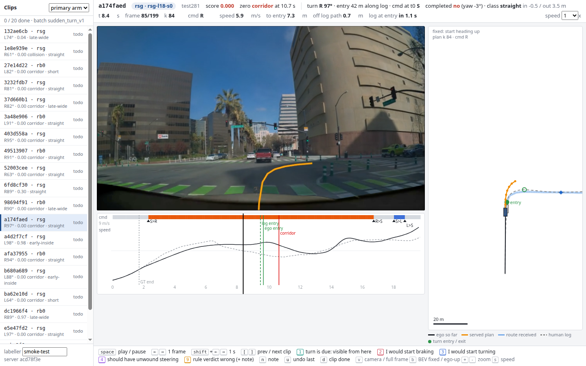

# human_label: expert key-press labels on PAI clips

status: live
decisions: none
index: keyboard labelling page for PAI clips; batch 1 = 20 sudden-turn scenes, 62 rollouts

**Question.** From the policy's own front-camera render in the AlpaSim PAI closed loop, at what distance can an expert driver tell that a
turn / a deceleration is due, and do our rule-based turn verdicts (completed, straight / late-wide / early-inside) match what he sees?
The labels audit the rules and measure observability; they are not policy training labels.

**Conclusion.** Tooling, no labels yet. Batch 1 (`sudden_turn_v1`) is packed and served: 20 scenes, 62 rollouts (primary RSG-L18-s0 on
14 test281 scenes, RB0-F-s0 on 6 train160 scenes; secondary rbsg2, rsgpai, ys0).

**Next.** The user labels batch 1 on the box page; then labels against the verdicts, the command flip time and the log's entry time.

**Read more.** `research/turning-school-checks.md` section 1 (turn scene, command lit at t = 0, entry);
`experiments/route_follow/scripts/rf_pai281.py` (completion proxy); `experiments/route_follow/scripts/rf_pai_follow.py` (events, frames).



What to look at in the figure: left the model's front camera (AlpaSim's camera panel cropped out of its eval video; `v` shows the whole
eval frame with AlpaSim's own BEV and metric table), under it the timeline (command band S grey / L blue / R orange with flip
markers, ego speed solid, human log speed dashed, force-GT end, log and ego entry times, zero event, label ticks), right the BEV
(ego so far, the served 8-pose plan of the current decision, route received so far, human log path dashed with the human's car at the
same time, turn entry / exit), header the verdicts and the live distance to entry.

<!-- files:begin -->
## Files

- `hl_pack.py` (scripts): select PAI closed-loop clips and write …
- `hl_server.py` (scripts): serves the labelling page, one pack and …
- `app.js` (web): 
- `index.html` (web): 
- `hl_serve.sh` (scripts): start hl_server.py in tmux session …
- `hl_pack.sh` (scripts): hl_pack.py inside alpasim-base:0.89.0
- `hl_shot.py` (scripts): Headless-Chrome smoke of the labelling …
- `manifest_b1.json` (results): 
- `labels_b1.jsonl` (results): 

[results/](results/) 2 result files · [figs/](figs/) 0 figures · [scripts/](scripts/) 5 entry points
<!-- files:end -->

## Selection (batch 1, `sudden_turn_v1`)

Recomputed in `hl_pack.py` from each scene's logged ego track (`ds.rig.trajectory`, the scene loader built from the run's
`generated-user-config-0.yaml`, same as turning-school-checks; it reproduces that note's 43 turn scenes of train160 + test281 non-exam):

- **turn scene**: the log's yaw over its first 20.2 s, at 1 m of arc, changes >= 60 deg inside some 30 m window; 60 <= |angle| <= 125
  (3 U-turns > 125 excluded). Left / right by sign.
- **entry**: in the first 30 m window that reaches 60 deg, the first point whose yaw departs 5 deg from the window start (arc from the
  log start, and the log's arrival time); **exit**: where the change first reaches 90 % of the angle.
- **sudden**: decision 0's command is not the turn's (S, or once the opposite side) OR the entry is >= 15 m from the start.
  Decision 0 is inside force-GT, so its command is arm-independent (all arms agree on all 20 scenes).
- **pool**: train160 + test281 minus exam147 and exam_turn26 (test281 holds all 147 exam scenes; 294 scenes left).

The strict rule gave 20 scenes, so the "entry >= 15 m alone" relaxation was not needed. 15 scenes are unlit at t = 0 (14 S, 1 the
opposite side: b680a689, a left turn with R lit) and all 15 also have entry >= 15 m; 5 are lit at t = 0 but far (132ae6cb 21 m,
37d660b1 20 m, 403d558a 33 m, 3232fdb7 86 m, 1e8e939e 97 m).

| | count |
|:--|--:|
| scenes (train160 / test281) | 20 (6 / 14) |
| rollouts (rsg / rb0 / rbsg2 / rsgpai / ys0) | 62 (14 / 6 / 14 / 14 / 14) |
| primary left / right | 7 / 13 |
| primary outcome: scored / corridor / collision | 4 / 15 / 1 |
| all rollouts: scored / corridor / collision / offroad | 14 / 40 / 7 / 1 |
| primary completed (rf_pai281 proxy) | 3 / 20 |
| primary class: straight / late-wide / early-inside / short | 12 / 4 / 2 / 2 |

rb0 is the only arm with train160 rollouts (`/data/runs/route_night/roll/rb0` + `rb0_retry`); RSG-L18-s0 was only read on 281.
The human log path comes from the scene loader for every scene (no asl needed, nothing missing).

## Rule verdicts in each clip

- `completed`: rf_pai281's proxy, score > 0 and the rollout's own yaw (controller CSV, until the first zero event) turned >= 60 deg
  the turn's way.
- `cls` (rf_follow-style, against the human log path, no map): the ego tracked on the log path (stations, lateral left +) in
  [entry - 10, exit + 10] m before the zero event: `short` never reached entry - 5 m; `straight` heading reached < 25 % of the turn;
  `early-inside` inside offset > 1 m and larger than the outside one; `late-wide` outside offset > 1 m; `on-path` completed with
  both offsets <= 1 m; else `partial`.
- `d_ent` (per 0.1 s): entry station minus the ego's station on the log path (m, > 0 before the entry). After a crash the projection
  can jump (b680a689 rsgpai / ys0 cross the entry station only after their collision).

## Pack and clip JSON

`hl_pack.sh <pack dir>` (Tokyo, alpasim-base:0.89.0, CPU, ~10 s) writes `manifest.json` (rule, counts, arms, camera crop, one row
per clip), `clips/<id>.json` (~65 KB), `video/<id>.mp4` (AlpaSim's eval video, 10 fps, remuxed `+faststart`, ~3 MB) and an
empty `labels.jsonl`; batch 1 = 193 MB. Clip id = `<scene 8 hex>-<arm>`. Time base: t = 0 at decision 0 (`now` of k 0);
video frame i shows sim time `video.t_first + i / video.fps`, t_first = -0.1 s (checked against the eval video's burned-in
`Time:` stamp and, per clip, against the controller CSV's last row; every clip's last frame equals its last controller row).

Clip JSON: `id scene arm tag rollout split primary batch score kind zflag t_zero t_rear cmd0 handoff (1.7 s)`;
`turn {dir ang ent_s ext_s ent_xy ext_xy t_log_ent t_log_ext t_ego_ent}`; `verdict {completed yaw_net cls frac max_in max_out}`;
`metrics` (AlpaSim summary); `video {fps n t_first w h}`; `ego {t x y yaw vx wz s lat d_ent}` (10 Hz, decision-0 anchor then
controller rows; scene-local frame shared by anchors, controller and log); `log {t x y yaw v s}` (human log, 10 Hz);
`route` (merged route polyline from every route message, rmem's merge rule); `decisions [{k t cmd v plan (8 x [x y yaw] at
0.5 .. 4 s, scene frame) route0 n_route (route points received by then)}]`; `flips [{t k frm to}]`.

## Label log (`<pack>/labels.jsonl`, append-only)

One JSON object per key press, fsynced; nothing is deleted. Label record:
`{id, type: "label", clip, scene, arm, tag, rollout, key, value, t, frame, k, d_entry, speed, cmd, note, labeller, wall, commit, batch}`
with key / value `1 observable` (the turn is visibly due from here), `2 brake` (I would start braking here), `3 turn` (I would start
turning here), `4 unwind` (the car should have unwound the steering here), `9 verdict_wrong` (rule verdict wrong for this clip, with
note), `n note`, `d done`; `t` sim time (s, t = 0 at decision 0), `k` the decision in force, `d_entry` m along the human log path to
the entry, `speed` ego m/s, `cmd` the decision's command, `commit` the server's git commit. Undo record:
`{id, type: "undo", ref: <label id>, clip, key, labeller, wall, commit, batch}`. Active labels = labels not referenced by an undo;
a clip is done while it has an active `d`. `results/labels_b1.jsonl` is the committed copy (empty until the user labels; copy it
back from the box: `scp autodl:/root/autodl-tmp/ujs/runs/human_label/b1/labels.jsonl experiments/human_label/results/labels_b1.jsonl`).

## Page keys

space play / pause, left / right one frame, shift + left / right one second, `[` `]` previous / next clip, `1 2 3 4` labels at
the current frame, `9` verdict wrong + one-line note, `n` note, `u` undo the clip's last label, `d` done (again: undo done), `v`
camera / whole eval frame, `b` BEV fixed (start heading up) / ego-up, `+ -` BEV zoom, `s` playback speed (0.5 / 1 / 2). Click or
drag the timeline to scrub; click a label chip to jump to it. Reload restores the clip, its frame and all labels. The sidebar lists
the primary arm per scene (selector: all arms).

## Run it

```bash
# 1. pack (Tokyo, CPU; reads the run roots, writes /data/runs/human_label/b1)
ssh ujs@100.108.238.8 'cd ~/mycode/jev-drive && experiments/human_label/scripts/hl_pack.sh /data/runs/human_label/b1'
# 2. pack -> box (from Tokyo; never overwrite the box's live labels.jsonl)
ssh ujs@100.108.238.8 'rsync -aP --partial-dir=.rsync-partial --exclude labels.jsonl /data/runs/human_label/b1/ autodl:/root/autodl-tmp/ujs/runs/human_label/b1/'
# 3. box server (primary; public https://u1141567-hgym-6c9b2ad7.weste.seetacloud.com:8443 -> 127.0.0.1:6006)
ssh autodl 'cd ~/data/jev-drive && experiments/human_label/scripts/hl_serve.sh $DATA_DIR/runs/human_label/b1 6006 $DATA_DIR/envs/garage/bin/python'
# 4. Tokyo server (tailnet: https://tokyo-devbox.tailcab48d.ts.net/label/)
ssh ujs@100.108.238.8 'cd ~/mycode/jev-drive && experiments/human_label/scripts/hl_serve.sh /data/runs/human_label/b1 8790 /data/envs/wheel/bin/python'
ssh ujs@100.108.238.8 'tailscale serve --bg --set-path /label http://127.0.0.1:8790'      # once; the root (phone wheel) is untouched
```

The password is `LABEL_PASSWORD` in `<pack>/../.env` (box `$DATA_DIR/runs/human_label/.env`, Tokyo `/data/runs/human_label/.env`,
mode 600, never committed); the login cookie lasts 30 days and is an HMAC of the password, so changing it logs everyone out.
Logs: `<pack>/../server.log`. Each server writes its own `labels.jsonl`; the box is the one to label on.
Smoke (Tokyo, headless Chrome; key presses write labels, so point it at a scratch pack, see `hl_shot.py`):
`/data/envs/wheel/bin/python experiments/human_label/scripts/hl_shot.py --url http://127.0.0.1:8790/ --password-file /data/runs/human_label/.env --out /tmp/shot.png --clip a174faed-rsg --frame 85`.
