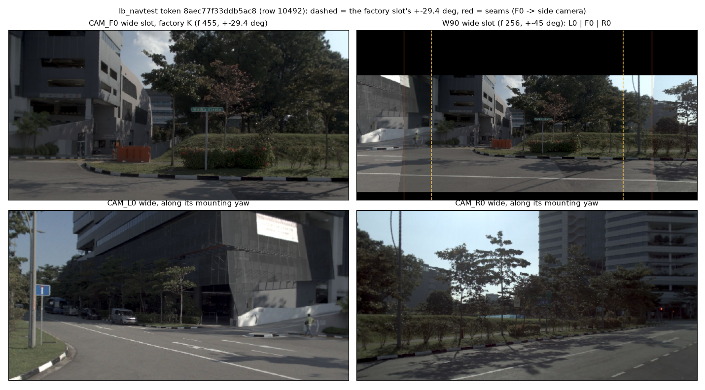

# Pixels (executor 2): caches, checks, keep set, slot pairs

Code: `experiments/vis_train/scripts/vt_px.py` (new `--t0` / `--root`; the full protocol and outputs unchanged), `scripts/je_keep.py`, `scripts/je_slots.py`.
Box root `$DATA_DIR/runs/junction_eyes/`; disk left 872 GB (was 988 GB at the start).

## 1. t0 image pairs (J_nav, navtest)
`px/<data>/frames-t0.npy`, (N, 2, 2, 6, 128, 256) uint8, [prev, cur] x [road, wide], 786 432 bytes per row, rows in the `tab.npz` order of
`$DATA_DIR/runs/op_parity/cache/<data>`. Rendering decodes only the key frame(s) the t0 pair needs (for the t0 pair: the t0 key) and warps
only the needed time, so it is byte-identical to frames 6:8 of the full 8-frame row (see check). Render speed: navtest 12 146 rows in 16 s on 70 cores.

| data | rows | size |
|:--|--:|--:|
| `lb_navtest` | 12 146 | 9.6 GB |
| `navtrain_full.s{0..11}of12` | 103 288 (8 607 each) | 81 GB (all of navtrain) |

**All navtrain tokens were rendered**, not only a J_nav subset: the straight filler pool (25.9 k tokens with jdist > 60 m and turn40 < 10 deg) is
smaller than the 77.4 k candidates, so J_nav is nearly all of navtrain. Executor 1 selects rows by the row index of `labels/rp_real` /
`step0/rows/J_nav.parquet` (`tok_file` shard + `tok_row`), the same order.

`vt_px.py check --t0` (frozen encoder on the stored pairs against `front.npy[:, 7]` of `<data>@warp`; `--pixels n` re-renders n rows through the
original full path and compares the t0 bytes):

| data | rows checked | mean abs diff | max abs diff | front rms | full-path pixel rows differing |
|:--|--:|--:|--:|--:|--:|
| lb_navtest | 512 | 2.7e-4 | 0.031 | 1.71 | 0 of 48 |
| each of 12 navtrain shards | 256 | 0.0 (bit-equal) | 0.0 | 1.68-1.69 | 0 of 16 |

Raw: `results/pixels/check-t0-*.json`.

## 2. Keep set and teacher cache
See [keep_set.md](keep_set.md). 13 431 rows / 20 391 frames / 60 segments held out; teacher cache of all heads (18 452 outputs) per frame.

## 3. Slot pairs of AlpaSim decisions
Layout (N, 2, 2, 6, 128, 256) = the t0 encoding pair (slot 6, slot 7) (`on_rows.make_front`: prev of slot 7 = slot 6). Files in `slots/`.

| set | status | file | check |
|:--|:--|:--|:--|
| held-452 (8 129 rows, `held452.parquet` order) | done, 6.4 GB | `slots/held452_pairs.npy` | taken straight from the dumps' `cur`; 500 rows through `pp_prep.encoder` vs the cached slot-7 token of `road_probe/tok/held`: mean abs diff 0.0, max 0.0 |
| zero-98 (457 rows, `zero98.parquet` order) | done, 0.36 GB | `slots/zero98_pairs.npy` (+ `.ok.npy`) | stored driver messages replayed through `sh30_driver.Driver` (exact path), pair captured from `Core.plan`; vs `road_probe/tok/zero` slot-7 tokens: mean abs 8.8e-4, max 0.031 (fp16 noise), 457 of 457 |
| J_on (33 899 rows, `J_on.parquet` rid order) | done, **reconstructed slot pairs**, 26.7 GB, all rows ok | `slots/jon_pairs.npy` + `slots/jon_pairs.ok.npy` | validation below; accepted by the coordinator |

### J_on: the dumps have no frames
The onpol_long roll dumps had `cur` stripped after tokenizing (`experiments/onpol_long/scripts/ol_chain.sh strip`); only the t0 JPEG, ego, mu, poses
remain. G-dump as written ("npz has all 8 slots") cannot pass. Reconstruction (coordinator decision): rerun the driver's synthesis on the JPEGs of
decisions k-3 .. k (`sh30_core.pack_fast` -> `stack_keys` -> `lattice_gpu`) with the ego history from the dump's `ego` vector (poses exact, newest
velocity exact, older body velocities estimated from the poses: chord, or forward-only), cold rows with fewer keys handled as the driver does.

Validation on 600 random held-452 decisions (cur and JPEG both exist; `results/pixels/validate*.json`):

| quantity | chord velocities | forward-only velocities |
|:--|--:|--:|
| slot 7 pixels: mean abs diff / share of bytes differing | 9.0e-4 / 0.03 % | same |
| slot 6 pixels: mean abs / share differing / max | 0.044 / 3.7 % / 57 | 0.038 / 2.9 % / 81 |
| token (slot 6, slot 7 pair) mean abs diff vs tokens of `cur` | **8.5e-3** | **8.0e-3** |
| token max abs / per-row max p50 / p99 | 4.4 / 0.098 / 1.42 | 5.3 / 0.059 / 2.46 |
| fp16 noise floor of the encoder (same pixels, other batch) mean / max | 8.5e-4 / 0.031 | same |
| token rms | 1.69 | |

Slot 7 is the t0 key and reproduces; slot 6 is a warp along an estimated ego track and differs in 3-4 % of bytes. The token difference is about 10x the fp16 noise floor (0.5 % of the token rms) with a heavy tail, so the reconstruction is **not within fp16
noise**. Decision (coordinator): **accept, chord-velocity variant, no re-roll**. J_on is a training and probe-fit row set only; the three read sets reproduce
(held-452 exact, zero-98 fp16 noise, navtest-16 from the pixel path). All 33 899 J_on rows were reconstructed (`jon_pairs.ok.npy` all True). The G-dump
rule was replaced by the held-452 validation above (cur exists there); `step0/gdump.json` records held-452 pass (exact), zero-98 pass (fp16 noise) and
J_on "reconstructed slot pairs, accepted by coordinator" with these numbers. Any use of the J_on pairs must be worded "reconstructed slot pairs".

### G-dump, direct comparison on J_on (500 reconstructed pairs)
500 reconstructed J_on pairs (one per scene, 343 from `on1_L18YS`, 157 from `on1_L18Y`) through `pp_prep.encoder` against d275's `on1_{L18Y,L18YS}@warp/front.npy`
slot-7 token of the same rows (`results/pixels/jon_direct.json`):

| quantity | direct (J_on, 500 rows) | proxy (held-452, 600 rows) |
|:--|--:|--:|
| token mean abs diff | 7.5e-3 | 8.5e-3 |
| per-row max, p50 / p99 | 0.085 / 1.27 | 0.098 / 1.42 |
| token max abs | 2.14 | 4.43 |
| token rms | 1.67 | 1.69 |
| fp16 floor (mean / max) | 7.7e-4 / 0.031 | 8.5e-4 / 0.031 |
| rows whose per-row max exceeds 10x the floor max (0.31) | 11.4 % | - |
| rows whose mean abs exceeds 10x the floor mean | 28.2 % | - |

The direct numbers agree with the held-452 proxy; the reconstruction is not within fp16 noise (accepted by the coordinator). `step0/gdump.json` carries both.

## 4. Field-of-view arms: the 90 deg wide slot (L-W90) and three views (L-3V) (executor 2b)
Code: `scripts/je_w90.py` (`coverage`, `build`, `keep`, `link3v`, `check`); `jevdrive/op_interp.warp_view` (one view of `warp_frame`, optional K;
`warp_frame`'s bytes unchanged). All 103 288 navtrain rows (J_nav is nearly all of navtrain, see section 1) and all 12 146 navtest rows; rows in
the order of `px/<data>/frames-t0.npy`. Disk left after this section: 789 GB.

What to look at: the W90 frame (top right) holds the F0 frame's scene between the dashed lines (+-29.4 deg), the side cameras beyond the red
seams (about +-36 deg); the black bands above and below are the same for every row. The bottom row is the 3V input (L0 / R0 along their
mounting yaws, +-55 deg).

### 4.1 W90 wide slot
| file | shape | size |
|:--|:--|--:|
| `px90/<data>/w90-t0.npy`, data = `navtrain_full.s{0..11}of12`, `lb_navtest` | (N, 2, 6, 128, 256) uint8 = [prev, cur] wide frames | 393 216 B / row; 38.8 GB navtrain + 4.5 GB navtest |
| `px90/mask.npy` | (128, 256) bool, True = seen (block grid of the 256 x 512 luma) | |
| `px90/coverage.json` | per calibration: picks, seams, camera yaws and reach | |
| `keep_w90/frames.npy` | (20391, 2, 6, 128, 256) uint8: road = `keep/frames.npy`'s, wide = W90 | 8.0 GB |
| `keep_w90/{rows.npz, teacher_*, selection.json, ...}` | links to `keep/` (the teacher stays the factory model on the 58.7 deg frames) | |

- Frame: `frames.wide_K(256)` (focal 256, principal point (256, 151.8)), +-45 deg. cur = the t0 keys of CAM_F0 / L0 / R0 reprojected by pure
  rotation (parallax ignored), nearest sampling of libjpeg YCbCr and 2 x 2 chroma mean (`navsim_zs.OpenpilotMaps`' sampling): CAM_F0 wherever
  it sees, else the side camera that sees the ray nearest its axis. prev = cur warped to the ego pose 0.2 s earlier with the F0 cache's
  road-plane warp at the same K (`warp_view`, CAM_F0's position), as protocol W's t0 pair. Then the mask: black (Y 0, Cb Cr 128) outside it.
- Mask: the block rows that all 20 calibrations of navtrain + navtest see across the full width = luma rows 68..243, 68.8 % of the rows
  (elevation -19.7 to +18.2 deg); the same for every row. (77.1 % of the blocks are seen under every calibration; the corners outside the band
  are blacked out too, so the slot is one horizontal band.)
- Coverage: the three views reach -89.2 / +89.7 deg on the horizon (>= +-82.4 deg), no gap; mounting yaws L0 +54.7..55.4, R0 -54.9..-55.5 deg;
  CAM_F0 sees +-36.0 deg. Seams (F0 -> side camera) at 34.1-38.1 deg either side depending on the calibration.
- Keep rows: comma's wide camera (openpilot's pinhole model, focal 567) warped with `get_warp_matrix(rpy_calib, cam_K, True, model_K=wide_K(256))`
  (je_keep's decode and warp path), then the same mask. The rows' road frames, fidx, teacher are keep/'s. Check: the factory-K warp of the
  first frame of every window from the same decode = `keep/frames.npy`'s wide bytes, 58 of 58.

Checks (`results/pixels/check-w90.json`; 256 random rows per data dir, 13 dirs = 3 328 rows):

| check | result |
|:--|:--|
| (a) the renderer at the factory K with CAM_F0 only = the F0 t0 cache's wide slot | cur 3 328 / 3 328 byte-equal, prev 3 328 / 3 328 |
| (b) stored W90 = a fresh render | 3 328 / 3 328 |
| (d) W90 pixels inside +-29.4 deg not from CAM_F0 | 0 |
| (c) central +-29.4 deg: W90 luma resampled (bilinear) back to the factory K vs the F0 wide luma, mean abs / p99 / max (98.8 % of the factory frame lies inside the band) | cur 4.30-4.54 / 36-39 / 190-222; prev 4.82-5.18 / 42-47 / 227-255 |
| floor: the F0 wide luma to K 256 (area) and back (bilinear) | 4.13-4.36 |
| reference: another row's frame | 52-63 |
| (e) seams: mean luma step across the seam column vs neighbouring columns (4-12 px away), band rows | 10.7-12.8 vs 6.9-7.3 (ratio 1.55-1.77) |

Reading: the centre is CAM_F0 itself (a, d); its difference to the F0 frame after the resampling round trip (4.4) is the resolution loss of
focal 256 vs 455 (floor 4.2), not a misalignment (a wrong row: 52-63); the large maxima are single pixels at sharp edges (nearest sampling). The seams are continuous in geometry (no gap, no
jump at the horizon in the figure) but show a 1.6-1.8x luma step from the cameras' exposure / white balance and the mounting offset
(parallax of near objects); not corrected.

### 4.2 3V: CAM_L0 / CAM_R0 t0 pairs
The side cache of lane VT arm W (`vt_side.py build`, 2026-10-11) already covers every navtrain and navtest row with this semantics (per camera:
the t0 key along its mounting yaw, and that key warped to the pose 0.2 s earlier). Not re-rendered: hard-linked (same inode, no extra disk;
survives a clean-up of the vis_train path) by `je_w90.py link3v`.

| file | shape | size |
|:--|:--|--:|
| `px_side/<data>/side_t0.npy` (hard link of `runs/vis_train/px_side/<data>/side_t0.npy`) | (N, 2, 2, 2, 6, 128, 256) uint8 = [CAM_L0, CAM_R0] x [prev, cur] x [road, wide] | 1.57 MB / row; 162 GB navtrain + 19 GB navtest |
| `px_side/<data>/meta.npz` | names, cam_t, yaw, pose (lib/side_store.py) | |

F0 view = `px/<data>/frames-t0.npy` (not duplicated). Checks (same 3 328 rows): side names = tab.npz names (13 / 13 dirs); the CAM_F0 view
rendered through vt_side's pairing (key along the ego axis, `warp_frame` in the yaw-0 frame) = the F0 t0 cache bytes, 3 328 / 3 328; side cur
= a fresh render 3 328 / 3 328, side prev = a fresh warp 3 328 / 3 328.

### 4.3 Loading (experiments/junction_eyes/lib/je_data.py)
- L-W90, J_nav / navtest rows: road slot from `px/<data>/frames-t0.npy[r, :, 0]`, wide slot from `px90/<data>/w90-t0.npy[r]` (same r). Keep rows:
  `KeepStore(RUN / "keep_w90")`.
- L-3V: F0 pair from `px/<data>/frames-t0.npy`; L0 / R0 pairs `PairStore(px_side/<data>/side_t0.npy, view=0 | 1)`.
