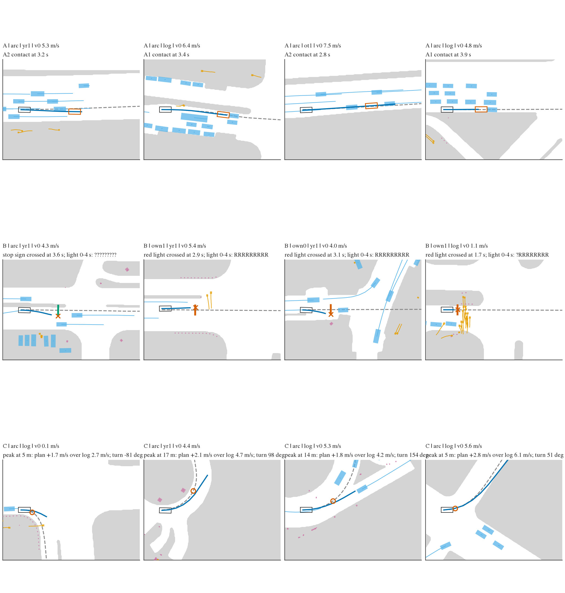

# LONG-PROBE: is the longitudinal consequence of the student's own plan readable at inference time?

2026-10-11. Registered in [plans/2026-10-11-long-probe-prereg.md](../plans/2026-10-11-long-probe-prereg.md) (pushed as f082cc32 before any
model output was read). Code: [lib/lc.py](../lib/lc.py) (labels, route geometry), [lib/lc_head.py](../lib/lc_head.py) (ladder head on BODY1
S0's modules), [scripts/lc_ctx.py](../scripts/lc_ctx.py), [lc_rows.py](../scripts/lc_rows.py), [lc_native.py](../scripts/lc_native.py),
[lc_train.py](../scripts/lc_train.py), [lc_read.py](../scripts/lc_read.py), [lc_ood.py](../scripts/lc_ood.py), [lc_pai.py](../scripts/lc_pai.py),
chains [lc_chain.sh](../scripts/lc_chain.sh), [lc_ood_chain.sh](../scripts/lc_ood_chain.sh). Tables: `results/read/*.csv`, `read/tables.md`.
Box: `$DATA_DIR/runs/long_contact/`.

**Verdicts by the registered lines** (prereg section 6; verdict population P1 = the own plan and its arc re-timings on hold logs, score =
mean of two seeds' logits, best non-privileged rung against blind with the paired log-cluster CI):

- **A, vehicle ahead in the own lane: PARTIAL.** Best non-privileged rung nat 0.987 [0.982, 0.991], +0.033 [+0.023, +0.044] over blind
  0.953; carried equally by the frozen vision tokens (+0.031) and by openpilot's native outputs alone (+0.030), which are redundant
  (+0.002 for both); the gain sits in launches below 2 m/s (blind 0.746, vision 0.981).
- **B, mandatory stop passed: READABLE.** vis 0.969 [0.949, 0.984], +0.056 [+0.021, +0.093] over blind 0.912; the native outputs do not
  add (nat 0.952).
- **C, turn entered faster than the logged driver: NOT READABLE by the gain clause, because it is readable without perception.** vis 0.991
  [0.985, 0.996], +0.007 [+0.002, +0.014] over blind 0.984; the plan's own peak lateral acceleration alone scores 0.946.
- On P0 (the own plan only, S0's exact population, positives in 6-9 hold logs): A READABLE (vis 0.990 [0.979, 0.993], +0.102
  [+0.055, +0.158] over blind 0.888), B PARTIAL (vis 0.937 [0.853, 0.982], +0.153 [-0.004, +0.384]), C NOT READABLE (vis 0.965
  [0.905, 0.997], +0.016 [-0.039, +0.064] over blind 0.949).

**How to read the gain clause here (prereg addendum 1).** The longitudinal blind floors (P1: A 0.953, B 0.912, C 0.984) are far above the
lateral one (agent contact 0.833 on P1, 0.779 on P0, the 0.744-0.770 the lines were written against). A logistic on the plan's own speed
profile and v0 / a0 (K4) already reaches 0.926 (A), 0.867 (B), 0.922 (C), against 0.748 for the lateral agent label. These consequences are
largely encoded in the ego history and the plan's own speed profile, so the registered "+0.05 over blind" separates "vision adds
information beyond kinematics" from "the label is already predictable from kinematics". It does not separate readable from unreadable:
every class is read at >= 0.97 by a non-privileged rung on P1, and the privileged ceiling is 0.999-1.000.

## 1. The ladder (P1, registered)

Hold logs (`navsim/body1-hold-logs`, 121 logs, 25 658 states of the log / ot1 / yr1 families), query slots 0, 1 (own plan) and 16-19 (its
arc re-timings). AUC, ties at half; 95% percentile log-cluster bootstrap, 10 000 resamples, seed 0. Two-seed score; per seed in brackets.

| label | positives (logs) | blind | vis | nat | priv (oracle) | blind_nat (descriptive) | best non-priv - blind | nat - vis | verdict |
|---|---|---|---|---|---|---|---|---|---|
| A vehicle ahead in own lane | 1 905 (65) | 0.953 [0.940, 0.967] (0.948 / 0.948) | 0.984 [0.977, 0.990] (0.983 / 0.981) | **0.987** [0.982, 0.991] (0.985 / 0.984) | 1.000 [0.999, 1.000] | 0.983 [0.978, 0.989] | nat +0.033 [+0.023, +0.044] | +0.002 [+0.000, +0.006] | **PARTIAL** |
| B stop passed | 397 (24) | 0.912 [0.874, 0.948] (0.903 / 0.907) | **0.969** [0.949, 0.984] (0.953 / 0.970) | 0.952 [0.924, 0.977] (0.952 / 0.942) | 0.999 [0.997, 1.000] | 0.953 [0.925, 0.980] | vis +0.056 [+0.021, +0.093] | -0.017 [-0.041, +0.008] | **READABLE** |
| C fast turn entry | 1 909 (73) | 0.984 [0.977, 0.990] (0.983 / 0.982) | **0.991** [0.985, 0.996] (0.991 / 0.989) | 0.991 [0.982, 0.995] (0.990 / 0.989) | 1.000 [1.000, 1.000] | 0.987 [0.974, 0.994] | vis +0.007 [+0.002, +0.014] | -0.000 [-0.003, +0.001] | **NOT READABLE** |
| agent contact (S0 label, positive control) | 4 854 (98) | 0.833 [0.812, 0.853] | 0.919 [0.903, 0.932] | 0.922 [0.905, 0.935] | 0.993 [0.991, 0.995] | 0.909 [0.889, 0.925] | +0.089 [+0.072, +0.106] | +0.003 [-0.003, +0.010] | |
| boundary (S0 label, positive control) | 4 468 (94) | 0.820 [0.796, 0.840] | 0.978 [0.970, 0.984] | 0.974 [0.965, 0.982] | 0.985 [0.978, 0.990] | 0.962 [0.951, 0.972] | | | |

## 2. The own plan alone (P0, S0's G1 population; judged by the same lines, positives in few logs)

| label | positives (logs) | blind | vis | nat | priv | blind_nat | best - blind | verdict |
|---|---|---|---|---|---|---|---|---|
| A | 85 (7) | 0.888 [0.830, 0.932] | **0.990** [0.979, 0.993] | 0.989 [0.970, 0.995] | 1.000 [1.000, 1.000] | 0.986 [0.968, 0.992] | vis +0.102 [+0.055, +0.158] | **READABLE** |
| B | 36 (6) | 0.784 [0.534, 0.946] | **0.937** [0.853, 0.982] | 0.868 [0.711, 0.965] | 0.998 [0.995, 1.000] | 0.847 [0.699, 0.990] | vis +0.153 [-0.004, +0.384] | **PARTIAL** |
| C | 111 (9) | 0.949 [0.916, 0.984] | **0.965** [0.905, 0.997] | 0.961 [0.888, 0.997] | 1.000 [0.999, 1.000] | 0.934 [0.807, 0.997] | vis +0.016 [-0.039, +0.064] | **NOT READABLE** |
| agent contact (S0) | 911 (64) | 0.779 [0.740, 0.810] | 0.900 [0.864, 0.927] | 0.902 [0.864, 0.930] | 0.995 [0.992, 0.997] | 0.893 [0.857, 0.918] | +0.123 [+0.088, +0.157] | |
| boundary (S0) | 1 090 (82) | 0.785 [0.747, 0.817] | 0.977 [0.968, 0.984] | 0.972 [0.962, 0.981] | 0.985 [0.975, 0.991] | 0.960 [0.946, 0.970] | | |

A's own-plan positives sit in 7 logs (74 of 85 in three), B's in 6, C's in 9: the P0 intervals are as wide as they look and B's
P0 gain interval includes 0.

## 3. What carries A (PARTIAL), and where (descriptive, P1)

| read | A | B | C |
|---|---|---|---|
| vision over blind (vis - blind) | +0.031 [+0.021, +0.041] | +0.056 [+0.021, +0.093] | +0.007 [+0.002, +0.014] |
| native outputs without vision (blind_nat - blind) | +0.030 [+0.020, +0.041] | +0.041 [+0.001, +0.074] | +0.003 [-0.008, +0.012] |
| native outputs on top of vision (nat - vis) | +0.002 [+0.000, +0.006] | -0.017 [-0.041, +0.008] | -0.000 [-0.003, +0.001] |
| vision on top of native outputs (nat - blind_nat) | +0.003 [+0.002, +0.005] | -0.001 [-0.024, +0.020] | +0.004 [+0.002, +0.008] |

For A the vision tokens and openpilot's own lead / meta / action outputs carry the same information: either alone closes about two
thirds of the blind-to-oracle gap (0.953 -> 0.983-0.984 of 1.000), together they add +0.002-0.003. By speed band (blind / vis / nat): < 2 m/s
0.746 / 0.981 / 0.991 (38 positives, 14 logs), 2-5 m/s 0.954 / 0.982 / 0.981, 5-10 m/s 0.956 / 0.985 / 0.988, >= 10 m/s 0.930 / 0.978 /
0.984. By sub-class: A1 stopped vehicle 0.954 / 0.983 / 0.985 (1 064), A2 moving 0.952 / 0.986 / 0.988 (841). The perception gain for A is
in the launch band, decision 252's "should not launch" mechanism, where the kinematics carry nothing; at speed the plan's own speed profile
already ranks most contacts. B: decision-relevant states (an eligible stop line within 60 m): blind 0.853, vis 0.943, nat 0.929; red light
0.898 / 0.960 / 0.936 (273), stop sign 0.943 / 0.987 / 0.987 (124). C: turn peak within 60 m: 0.968 / 0.981 / 0.980. Full strata:
`read/strata.csv`, `read/tables.md`.

## 4. Kinematic floor and the hard subset (prereg addendum 1, descriptive)

Kinematic baselines fitted on the training logs' own + arc rows, read on hold (2 000 resamples). H = states not decelerating at t0
(a0 >= 0) whose logged driver drops at least 1 m/s below v0 within 8 s: the slowdown is coming and the ego kinematics do not show it
(2 342 of 25 658 hold states).

| score | A, P1 | A, P1 & H | B, P1 | B, P1 & H | C, P1 | C, P1 & H | agent contact, P1 | agent, P1 & H |
|---|---|---|---|---|---|---|---|---|
| positives (logs) | 1 905 (65) | 139 | 397 (24) | 65 | 1 909 (73) | 307 | 4 854 (98) | 498 |
| K1 v0 | 0.588 | 0.446 | 0.533 | 0.601 | 0.562 | 0.607 | 0.550 | 0.413 |
| K2 a0 | 0.718 | 0.704 | 0.599 | 0.731 | 0.587 | 0.492 | 0.605 | 0.494 |
| K3 v0 + a0 | 0.721 | 0.671 | 0.608 | 0.752 | 0.615 | 0.575 | 0.613 | 0.457 |
| K4 plan speed profile + v0 + a0 | 0.926 | 0.878 | 0.867 | 0.930 | 0.922 | 0.873 | 0.748 | 0.679 |
| K5 K4 + plan curvature | 0.926 | 0.873 | 0.883 | 0.946 | **0.969** | 0.947 | 0.755 | 0.684 |
| single plan quantity | arc 0.627 | 0.572 | min speed 0.467 | 0.506 | max v^2 kappa **0.946** | 0.913 | | |
| rung blind | 0.953 | 0.915 | 0.912 | 0.959 | 0.984 | 0.968 | 0.833 | 0.789 |
| rung vis | 0.984 | **0.982** | 0.969 | **0.991** | 0.991 | 0.986 | 0.919 | 0.927 |
| rung nat | 0.987 | **0.985** | 0.952 | 0.989 | 0.991 | 0.989 | 0.922 | 0.940 |
| rung blind_nat | 0.983 | 0.984 | 0.953 | 0.991 | 0.987 | 0.985 | 0.909 | 0.920 |
| rung priv | 1.000 | 1.000 | 0.999 | 0.999 | 1.000 | 1.000 | 0.993 | 0.995 |

- v0 and a0 alone carry little (0.53-0.72); the plan's own speed profile carries most of the blind floor (K4 0.87-0.93), and for C the
  plan's own curvature makes it near-deterministic (K5 0.969; the single quantity "plan max v^2 kappa" 0.946, just under the registered
  0.95 mark for "near-deterministic function of the plan").
- In H, where no kinematic cue exists, the gain of vision over blind for A grows from +0.031 to +0.067 (0.915 -> 0.982) and native outputs
  do the same (0.985); for B blind is already 0.959 there (the plan keeps its speed into a coming stop) and vision adds +0.032; for C +0.018.
- The lateral label behaves the other way: its kinematic floor is low (K4 0.748, blind 0.833) and vision adds +0.086.
- In P0 & H the positives are A 17, B 0, C 31 (`read/kin.csv`); too few to read B.

## 5. Positive control and the lateral split

S0's own three checkpoints re-read through this code reproduce `s0_gate.md` exactly: own-plan agent contact 0.9055 [0.8677, 0.9344]
(0.905 [0.868, 0.934]), boundary 0.9782 [0.9690, 0.9853] (0.978 [0.969, 0.985]), per seed 0.898 / 0.892, blind 0.770 / 0.779. The ladder
heads' own lateral outputs (trained jointly with A / B / C) read agent contact at 0.900 / 0.902 (vis / nat, P0) and boundary at 0.977 /
0.972: the joint training did not cost the lateral read.

Lateral agent-contact read split by contact type (positives of that type against the same no-contact negatives; 2 000 resamples):

| population | contact type | positives (logs) | S0 (two seeds) | S0 blind | ladder vis, lateral head | ladder vis, A head |
|---|---|---|---|---|---|---|
| P0 | A-type: vehicle ahead in the own lane | 85 (7) | 0.946 [0.908, 0.973] | 0.757 [0.637, 0.859] | 0.933 [0.877, 0.959] | 0.990 [0.978, 0.994] |
| P0 | other vehicle contact (lateral, go-around, drift, cut-in, crossing) | 677 (58) | 0.906 [0.862, 0.941] | 0.774 [0.728, 0.816] | 0.900 [0.858, 0.935] | 0.820 [0.767, 0.865] |
| P0 | pedestrian, cyclist, generic object | 149 (24) | 0.879 [0.831, 0.926] | 0.759 [0.688, 0.818] | 0.881 [0.833, 0.923] | 0.828 [0.764, 0.881] |
| P1 | A-type | 1 905 (65) | 0.961 [0.944, 0.974] | 0.912 [0.883, 0.938] | 0.962 [0.948, 0.975] | 0.984 [0.977, 0.990] |
| P1 | other vehicle contact | 2 344 (82) | 0.901 [0.873, 0.923] | 0.771 [0.735, 0.800] | 0.896 [0.870, 0.918] | 0.814 [0.788, 0.839] |
| P1 | pedestrian, cyclist, generic object | 605 (39) | 0.858 [0.813, 0.904] | 0.757 [0.714, 0.801] | 0.870 [0.832, 0.906] | 0.807 [0.759, 0.849] |

S0's lateral head already ranks its A-type positives better than its lateral siblings (0.946 against 0.906 on P0); a head trained on the A
label lifts them to 0.990 and is correspondingly worse on the lateral contacts it was not trained for (0.820). S0's agent logit used
directly as a score for the A label (all A negatives): 0.961 (P1), 0.946 (P0); for B 0.731 / 0.585, for C 0.671 / 0.658: the lateral
head says nothing about stop lines or turn speed.

## 6. Out-of-distribution rows (decisions where the policy did fail; descriptive)

**Decision 220's nuPlan decisions** (`lc_ood.py`; the served tokens, ego vector and plan of the BODY1 G2 dumps; the serving student's native
outputs recomputed on the dumped tokens, which reproduce the dumped plan slice to one fp16 step: 0.0625 / 0.109 / 0.125 for the s0 / s1 /
control sets, the other student is off by 19). Class (i) "straight into an in-path object" = 4 rollouts in 2 scenes (both "lead stopped"),
29 positive decisions against g2's 1 827 clean control decisions; `swv1_bc.read_auc` unchanged (speed-matched weights, log clusters,
1 000 resamples).

| score | class (i), 4 rollouts | all 22 collision rollouts |
|---|---|---|
| A head, blind (two seeds) | 0.766 [0.711, 0.821] | 0.516 [0.406, 0.634] |
| A head, vis | 0.724 [0.515, 0.892] (seeds 0.551 / 0.820) | 0.672 [0.505, 0.841] |
| A head, nat | 0.873 [0.704, 0.972] (seeds 0.616 / 0.931) | 0.721 [0.583, 0.887] |
| S0 agent head (two seeds; decision 223's G2 score) | **0.917** [0.826, 0.984] | **0.885** [0.774, 0.969] |

First flag before the impact at the hold-log P1 2% threshold: scene 39cbed62 vis 1.0-1.5 s, nat 1.5-2.0 s, blind never; scene b5b8d206
never by any rung (7 decisions in the last 8 s). On these AlpaSim decisions the A head transfers worse than S0's lateral head, and its two
seeds disagree; four rollouts in two scenes cannot carry more than that.

**LOWDIAG's PAI rollouts** (`lc_pai.py`; seed 0, `P2H10-F-s0` served with the lead path, the 32 failing scenes whose driver messages were
kept; replayed open loop through the real PAI driver, which reproduces every served plan exactly; 10 Hz real-frame slots, the protocol of
decision 252, so the tokens are off the warp protocol the heads were trained on). Threshold = the hold-log P1 2% point per label and rung.

| unit (LOWDIAG flags) | label | first flag before the event, s: blind / vis / nat | decisions flagged in the last 8 s: blind / vis / nat |
|---|---|---|---|
| 1c7e2423 overrun, reason unknown (L5) | B | - / 4.8 / 4.8 | 0 / 34 / 39 of 80 |
| 21626256 red-light overrun (L5) | B | 5.0 / 4.2 / 4.5 | 5 / 43 / 38 of 54 |
| 9e3fd12d red-light overrun (L5) | B | - / 4.4 / 6.3 | 0 / 44 / 64 of 80 |
| b0fa4732 red-light overrun (L5) | B | - / 2.9 / 2.2 | 0 / 24 / 23 of 77 |
| 7a824ffa overrun at a give-way T-junction (L5; no stop line or light, outside B) | B | - / - / - | 0 / 0 / 0 of 61 |
| 1d6e30bc fast turn entry (L2) | C | - / 4.3 / 2.2 | 0 / 24 / 3 of 76 |
| 7a824ffa fast entry (L2) | C | 6.0 / - / 5.6 | 3 / 0 / 4 of 61 |
| 1c7e2423 fast entry (L2, also the overrun) | C | - / - / - | 0 / 0 / 0 of 80 |
| 59e085d7 stop sign passed at 15.2 m/s (L2) | C | - / - / - | 0 / 0 / 0 of 71 |
| 3a48e906, 96da4f1a (L2; the turn was never attempted, outside C) | C | - ; 0.3 / 0.2 / 0.3 | 0 ; 3 / 2 / 3 |
| 0ee89cab lead contact (L1; lateral in fact, pai.md) | A | - / 1.0 / 1.2 | 0 / 6 / 10 of 80 |
| a28b6685 lead contact (L1; lateral in fact) | A | - / - / - | 0 / 0 / 0 of 41 |

Flag rate on the decisions of the other replayed scenes (all of them failing scenes, so a pessimistic reference for a false-alarm rate):
B blind 1.3% / vis 6.6% / nat 8.9%; C 1.5% / 7.7% / 3.1%; A 0.5% / 1.8% / 3.9% (`read/ood/pai_flags.csv`).

What it says: with vision the B head flags all four overruns at a stop line or light (three red lights, one of unknown reason; stoplbl.md)
2.2-6.3 s ahead, blind flags one; the fifth overrun is at a give-way T-junction with no line or light to read, not a B event by its
definition. C flags one or two of the three genuine fast entries
(1d6e30bc 4.3 s ahead with vision; 7a824ffa 5.6-6.0 s ahead with blind / nat but not vision); the two units that never attempted their
turn are route failures, not C. No class A event exists in this seed (both L1 contacts are lateral; COL1's three class (i) PAI collisions
ran under an earlier serving configuration and their driver messages are not in this store). Single seed, 4-6 units per class: lead times
are case reports, not rates.

## 7. Costs

GPU, one card at a time through the pool (peak 4-8 GB VRAM per job, the tokens in host memory): native outputs 4 min; smokes 2 min;
pilots 20 min; ten full runs 134 min (blind 6-10 min, vis / nat / priv 16-23 min at 9-13 it/s on shared cards); hold predictions 2 min;
OOD 10 min. Total about 2.9 card-hours (budget 10; the ladder was not cut). CPU: context labels 3 runs of under a minute on 32 workers,
row labels 2 runs of 7 min on 36 workers, privileged inputs, survey, figures, kinematic baselines and reports a few minutes each. Wall
clock from the first box command to the last read: 12:30-16:08 CST. Disk: 6.0 GB under `$DATA_DIR/runs/long_contact/` (context 0.2,
row labels 0.1, privileged inputs 1.2, native outputs 1.8, checkpoints, predictions, PAI dumps).

## 8. Limits

- P1 is mostly the arc re-timings (the own plan's path at c x its speed, c ~ U(0.5, 1.5)), not plans the student made; the own plan alone
  (P0) has its positives in 6-9 hold logs. The own plans are in-sample for the adapter (BODY1's convention).
- Open loop on logged states; the logged agents do not react; the labels use hindsight (the logged light states, recorded on 51.7% of
  frames and without yellow; the logged driver's stops and turn speeds as the reference for "mandatory" and "too fast").
- The blind floors are high, so the registered gain clause measures what perception adds beyond kinematics (section 4).
- The hard subset is small (2 342 hold states; A 139, B 65, C 307 positives on P1).
- OOD: four nuPlan collision rollouts in two scenes; one PAI seed, four or fewer units per class, no class A event, frames off the trained
  protocol.

## Labels (prereg section 3)

Per (state, query) row of BODY1's row units; the hindsight route of every navtrain token (the logged ego's next 30 s, plus 30 m straight)
with the map's stop lines and the logged light states (`lc_ctx.py`; the map access and connector matching are decision 238's), the logged
boxes with their motion (BODY1 `sweep.py`).

- **A** = the own sweep contacts a vehicle that is in the route lane ahead at t0 (centre within 1.5 m of the route, ahead of the ego front,
  aligned or stopped) after t = 0, and the same arc-length profile driven along the route contacts it too (the speed profile, not the path,
  reaches it). Negative = no counted agent contact. Sub-classes A1 (object stopped at contact) / A2 (moving).
- **B** = the own plan's front bumper passes an eligible stop line while the stop is mandatory: red at the keyframe nearest the crossing
  (light lines the logged driver stops at, crosses on a known non-red state, or never reaches), or a stop sign the logged driver stops at,
  passed without slowing below 0.5 m/s.
- **C** = the own plan reaches the curvature peak of the first >= 45 deg route turn within 4 s, heading within 30 deg of the route there, at
  >= 1.5 m/s and >= 1.25 x the logged driver's speed at the peak; negative = not reached in 4 s or <= +0.5 m/s; the band between has no label.

Hold-log positives, own plan (slots 0, 1): A 85 rows in 7 logs, B 36 in 6, C 111 in 9; own plan plus its arc re-timings (slots 0, 1,
16-19, the registered population P1): A 1 905, B 397, C 1 909 rows in 24-73 logs (`survey/counts.csv`). Training rows (all 24 queries, fit
logs): A 24 584, B 8 928, C 19 260.

Twelve label positives drawn at random from training logs, one log each (`figs/labels.csv`). Blue: the query; dashed grey: the hindsight
route; vermillion box (A): the ego at the first contact; bars (B): eligible stop lines (vermillion = red in the window, green = stop sign or
not red), cross = the front bumper at the crossing; circle (C): the curvature peak. Look at the B panels: three of the four are red-light
crossings by the student's own plan (own0 / own1), one creeping into a crosswalk with pedestrians on red. An earlier draw (before any model
output) showed two label faults that were fixed before registration (prereg section 3, "看图后的两处修改").

## Deviations from the brief and the prereg

1. The registered verdict population is P1 = the own plan and its arc re-timings, not the own plan alone: own-plan positives on hold logs
   sit in 6-9 logs (A: 74 of 85 in 3 logs). Fixed in the prereg before any read, with P0 (own plan only, S0's exact population) judged by
   the same lines and reported next to it.
2. The vision tokens live in host memory and are gathered per batch (`lc_train.py --host 1`): S0 held all 57 GB on the card, and on
   2026-10-11 no card of the shared box had that free. Same tensors, same recipe; the batch indices come from a CPU generator instead of S0's
   CUDA one.
3. The brief cites decision 207 for `nc_slow`; that read is decision 203 (207 is the path-timing swap).
4. Context gate at 0.25 m: the cache's logged futures were built from float32 global coordinates (measured max 0.165 m, p99.9 0.110 m).
5. Decision 252 exists twice in research/decisions.md (LONG-ORACLE and PAI_KEYWARP); the LONG-ORACLE text survives only in git (675ff763).
   Not fixed here.
