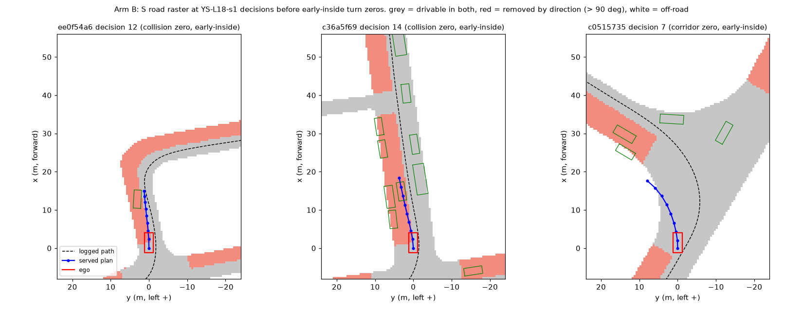
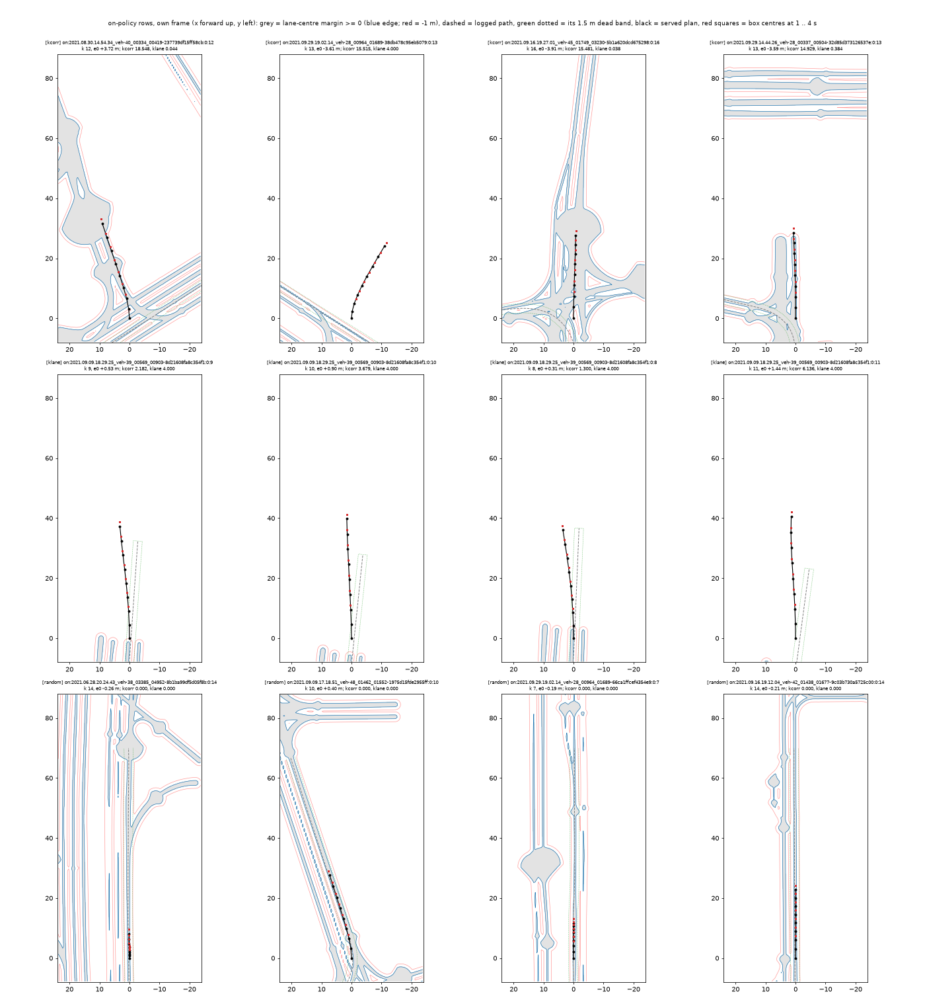

# onpol_long: closed-loop training at 18 decisions, round 1

status: live
decisions: 264, 269, 270, 271, 274 (inputs 259, 262)
index: S-only rows at 18 decisions on YR10m10-F: 0.838 vs base 0.785, zeros 44 vs 74; S + corridor not adopted

**Question.** At 18 decisions (token + 8 s) in local AlpaSim nuPlan, do on-policy rows of the base's own rollouts on the 1031 train scenes,
carrying only consequence hinges on the model's own plan (S: swept footprint against vehicles, road-and-lane raster; K: 1.5 m dead band to
the logged path; C: lane-centre offset if it passes its label gate), give fewer zeros than the same continued training without rows
(ON-NONE) on the 460 held scenes, with at-fault zeros and GT distance not worse?

**Conclusion.** On the YR10m10-F-s0 base, on-policy rows at 18 decisions carrying only the S hinges (`YS-L18`, Amendment 3) are
adopted: on 452 held scenes 0.838 against the base's 0.785 (+0.053 [+0.024, +0.082]), zeros 44 against 74, at-fault zeros 23.5 against 43,
GT distance 1.36 against 1.50 m, both seeds alike (decision 264). Adding the corridor hinge K (the registered round-1 arm `SKC`) is not
adopted on either base (P2H10S-F strongly negative: offroad zeros 79 against 24; YR10m10-F fails the at-fault gate). On P2H10S-F the
S-only arm is flat against the base (-0.0075). The same continued training without rows loses to the base on both (-0.092 Y, -0.028 P).

A second on-policy round (rows from `YS-L18`'s own rollouts, from `YS-L18-s1`) does not pass the registered round gate: it is no better
than its own no-row control and slightly worse than round 1 (zeros 50.5 against 43), so the loop stops at round 1 and "more rounds help"
is recorded as negative for this setting.

**Next.** Arm B' with the rear-axle oncoming hinge: not adopted, YSO25 closest (Amendment 17, decision 281). Arm B (Amendment 13, decision 274) is void; arm B' (Amendment 14, decision 276) and arm B / B' on zeros_mech's lane rule (Amendment 15, decision 277) stopped at their label gates: footprint hinges on oncoming lanes fire on normal driving. PAI transfer read on the Tokyo box (Amendments 1, 4, 5). `YS2G-L18` passed the
public-mean guardrail of the last-slot rule (Amendment 10, decision 269); the candidate-scoring line stopped at its feasibility gate (Amendment 12, decision 270). Ego-status dropout (Amendment 11) does not cut the drift: it removes the open-loop reliance and drift rises (decision 271).

**Read more.** [plans/2026-10-12-ol1-prereg.md](plans/2026-10-12-ol1-prereg.md); the plan: [research/next-round/closed-loop.md](../../research/next-round/closed-loop.md);
the row and trainer code it reuses unedited: [../onpol_nuplan/README.md](../onpol_nuplan/README.md); the 18-decision driver path:
[../alpasim_long/README.md](../alpasim_long/README.md).

## Arm B' with the rear-axle oncoming hinge (Amendment 17; held 452 at 18 decisions, cards 1-5)

[results/read/report_YSB2.md](results/read/report_YSB2.md) (last section), `report_YSO25.json`, `report_YSO50.json`, `lines_YSO.json`.

| | mean score | zeros | collision / offroad / corridor zeros | at-fault zeros | GT distance (m) | early-inside across | late-outside kerb | oncoming 2 s before |
|:--|--:|--:|:--|--:|--:|--:|--:|:--|
| `YSO25-L18` (lam 2.5) s0 / s1 | 0.858 (0.858 / 0.859) | 37.5 | 5.5 / 17.0 / 16.0 | 22.5 | 1.306 | 2.5 | 7.5 | 0.171 (7 / 41) |
| `YSO50-L18` (lam 5) | 0.847 | 44.0 | 5.0 / 19.5 / 21.0 | 24.5 | 1.349 | 2.0 | 10.5 | 0.122 (6 / 49) |
| control `YS2G-L18` | 0.847 | 41.5 | 7.0 / 15.0 / 19.5 | 22.0 | 1.276 | 5.5 | 7.5 | 0.226 (12 / 53) |

Neither adopted (decision 281): GT distance, the selection quantity, is above `YS2G` for both (`YSO25` +0.030 [-0.022, +0.079] m). `YSO25` meets lines 1, 2, 4,
misses 3 by one event and 5 by 0.03 m, with the best mean score and fewest zeros of the topic; `YSO50` pushes plans to the kerb again.
Timings: training 6.7 min, read 8.1 min per chunk (max 10.0), report 1 min.

## Oncoming hinge variants (Amendment 16, label study, no training)

Point-based checks pass the label bar where footprint checks did not (served plan / human path): rear axle 0.072 / 0.021, box centre 0.075 / 0.021, footprint
with 1.0 m allowed depth 0.083 / 0.023 (0.5 m depth 0.130 / 0.054 fails); all active on 8-9 of the 11 across-traffic early-inside events two decisions ahead;
on turning rows the human path is still active on about 0.12. Table in [results/read/report_YSB2.md](results/read/report_YSB2.md) (third section). Waiting for the user's choice.

## Arm B' and arm B redone on zeros_mech's lane rule (Amendment 15): stopped at the label gates

[results/read/report_YSB2.md](results/read/report_YSB2.md) (second section), `onc_stats_L18YS_zm.json`; `scripts/ol_zmonc.py`. The rule is right on points (the human's own rear
axle is oncoming on 0.0048 of rows), but footprint hinges on it fire on normal driving: oncoming hinge 0.227 of served plans (line 0.10), road minus oncoming
cells 0.374 (line 0.16); the human's own box touches the region at t0 on 0.128 of rows. No training ran (decision 277). Decision 274 (arm B) is void; its
note: its high activity was not mainly mask error (84 % of its removed cells are oncoming by this rule).

## Arm B': separate oncoming hinge (Amendment 14): stopped at the label gate

[results/read/report_YSB2.md](results/read/report_YSB2.md), `onc_stats_L18YS.json`; `lib/ol_onc.py`, `scripts/ol_dirraster.py onc`, `scripts/ol_zm.py`. The undirected road raster
is back (road hinge active on 0.122 of served plans), but the oncoming channel is active on 0.207 of rows (registered stop line 0.10), so no training
ran (decision 276). About half of that is the car's own t0 position near the logged path: the oncoming region's geometry (nearest-point lane heading,
whole roadblocks) marks part of where the human drove as oncoming, and arm B's raster had the same geometry. A rebuild on the evaluator's lane polygons and
centre-line yaw (zeros_mech's rule), without the roadblock layer, would need a new amendment.

## Arm B: directional road raster (Amendment 13; VOID, decision 274; round 2b's recipe with the S road raster directional; held 452 at 18 decisions, cards 1-5)

[results/read/report_YSB.md](results/read/report_YSB.md) (lines, label statistics, stage timings, the paired read), `lines_YSB.json`, `dir_stats_L18YS.json`;
`scripts/ol_dirraster.py`, `on_train.py --on-road`. 
`figs/armb_dir_raster_turns.png`: grey kept, red removed by direction; check that the removed area is the oncoming carriageway and the served plan enters it.

| | mean score | zeros | collision / offroad / corridor zeros | at-fault zeros | GT distance (m) | early-inside across-traffic turn zeros | late-outside kerb-side | oncoming 2 s before (corridor + collision zeros) |
|:--|--:|--:|:--|--:|--:|--:|--:|:--|
| `YSB-L18` s0 / s1 | 0.829 (0.835 / 0.824) | 53.0 | 8.5 / 23.0 / 23.0 | 31.5 | 1.400 | 3.0 | 10.5 | 0.13 (8 / 60) |
| control `YS2G-L18` | 0.847 | 41.5 | 7.0 / 15.0 / 19.5 | 22.0 | 1.276 | 5.5 | 7.5 | 0.23 (12 / 53) |
| `YS-L18` (s0 re-read off card 0) | 0.838 | 44.0 | 9.0 / 14.5 / 22.0 | 23.5 | 1.357 | 10.5 | 6.0 | 0.31 (18 / 59) |

- `YSB` - `YS2G`: -0.018 [-0.042, +0.002], zeros +11.5 [+1.8, +22.7], at-fault +9.5 [-0.5, +19.5], GT +0.124 [+0.013, +0.232] m. Registered lines: 1 (early-inside
  across) and 3 (oncoming share < 0.17) met; 2 (kerb-side late-outside), 4 (zeros <= 41.5) and 5 (GT not above YS2G) not: **not adopted** (decision 274).
- Every pool row changes (the centre line between the directions becomes a road edge); the served plan's road hinge goes from active on 0.12 to 0.28 of the rows.
  The mechanism moved the way d268 predicted, and the price is offroad and kerb-side failures. Straight corridor zeros past the log end 3 against 4.5 (artefact).
- Timings: labels 0.7 min, training 6.7 min per seed, held read 7.3-9.1 min per 77-scene chunk (two per card), report 0.7 min; submit to report about 27 min.

## Ego-status shortcut ablation (Amendment 11; YS-L18's recipe + ego-status dropout; held 452 at 18 decisions, every read on cards 1-5)

[results/read/report_YSED.md](results/read/report_YSED.md), [report_YSEX.md](results/read/report_YSEX.md), [ego_drift.md](results/read/ego_drift.md) (slopes with
log-clustered CIs, open-loop reliance; `ego_reliance.json`). `YS-L18-s0` and `YR10m10-F-s0` re-read off card 0 for this comparison (0.8345 / 45 zeros and
0.7866 / 73, against their stored card-0 reads 0.835 / 45 and 0.785 / 74). The ego status = vx, vy, ax, ay and the 4 history poses of the adapter's ego
vector (`present` and the command kept); `YSED` zeroes it on half the rows in training, `YSEX` everywhere, also when served.

| | mean score | zeros | collision / offroad / corridor zeros | at-fault zeros | GT distance (m) | drift slope (m / decision) | dev ADE intact / ego zeroed (m) |
|:--|--:|--:|:--|--:|--:|:--|:--|
| `YSED-L18` (p 0.5) s0 / s1 | 0.841 (0.832 / 0.851) | 54.5 | 10.5 / 14.0 / 31.0 | 24.5 | 1.576 | 0.119 [0.091, 0.150] | 0.541 / 0.610 |
| `YSEX-L18` (removed) s0 / s1 | 0.842 (0.846 / 0.838) | 60.0 | 9.5 / 17.5 / 35.0 | 27.0 | 1.562 | 0.119 [0.090, 0.157] | 0.605 / 0.605 |
| control `YS-L18` | 0.838 | 44.0 | 9.0 / 14.5 / 22.0 | 23.5 | 1.357 | 0.096 [0.072, 0.123] | 0.529 / 2.147 |
| base `YR10m10-F` s0 (s0 + s1 for the slope) | 0.787 | 73 | 8 / 33 / 36 | 41 | 1.492 | 0.134 [0.095, 0.180] | 0.540 / 2.003 |

| a - b (log-clustered 95 % CI) | mean score | zeros | at-fault zeros | GT distance (m) | drift slope |
|:--|:--|:--|:--|:--|:--|
| `YSED` - `YS-L18` | +0.003 [-0.013, +0.020] | +10.5 [+3.8, +18.4] | +1.0 [-3.1, +5.3] | +0.220 [+0.135, +0.309] | +0.023 [+0.007, +0.037] |
| `YSEX` - `YS-L18` | +0.005 [-0.018, +0.027] | +16.0 [+7.2, +26.1] | +3.5 [-1.7, +8.2] | +0.205 [+0.114, +0.307] | +0.023 [+0.001, +0.048] |
| `YS-L18` - base | +0.051 [+0.022, +0.080] | -29.0 [-42.6, -15.7] | -17.5 [-27.1, -6.7] | -0.135 [-0.262, -0.010] | -0.038 [-0.062, -0.016] |

- Line 1 (arm interesting = drift slope and corridor zeros below `YS-L18`, at-fault zeros not above): **neither arm**; both drift faster, have 9-13 more corridor
  zeros and 0.2 m more GT distance; the mean score does not move.
- Line 2 (diagnostic): (a) the base relies on the ego status, both seeds: dev ADE 0.54 -> 1.96 / 2.05 m with it zeroed (reliance +1.42 / +1.51 m, almost all
  longitudinal: plan shift 1.83 m along, 0.27 m across). (b) Spearman of reliance against drift slope over the six registered checkpoints -0.54 (registered >= 0.6),
  and `YSED` cut its reliance by 96 % (+1.62 -> +0.07 m) while its slope **rose** (+0.023 [+0.007, +0.037]). By the registered rule the claim "the ego-status
  shortcut causes the drift" is **refuted** for this setting (decision 271). The on-policy S rows themselves raise the reliance a little (YS 1.62 against YR 1.46)
  while cutting the drift.
- Caveat: a zeroed ego status is the vector of a standing car, so the dropout also teaches "treat as stopped and read the images"; the removed arm `YSEX` (no
  ambiguity at serving) gives the same slope.

## Last-slot guardrail for `YS2G-L18` (Amendment 10; all 1491 public scenes at 10 decisions, cards 1-5)

[results/read/confirm_g10.md](results/read/confirm_g10.md) (1479 scenes with a rollout, 136 logs; base = the stored 2026-10-09 rollouts; `YS-L18`'s read of Amendment 5 reused).

| | mean score | zeros | collision / offroad / corridor zeros | at-fault zeros | GT distance (m) | at-fault distance (km) [CI] |
|:--|--:|--:|:--|--:|--:|:--|
| `YS2G-L18` s0 / s1 | 0.9511 (0.9515 / 0.9506) | 43 (43 / 43) | 9.5 / 24 / 10 | 33.5 | 0.885 | 1.180 [0.799, 1.944] |
| `YS-L18` s0 / s1 | 0.9450 | 47.5 | 10.5 / 22.5 / 14.5 | 33 | 0.904 | 1.194 [0.821, 1.972] |
| base `YR10m10-F-s0` | 0.9323 | 68 | 7 / 43 / 20 | 50 | 0.941 | 0.789 [0.576, 1.162] |

| a - b (log-clustered 95 % CI) | mean score | zeros | at-fault zeros | GT distance (m) | at-fault distance (km) |
|:--|:--|:--|:--|:--|:--|
| `YS2G-L18` - base | +0.0188 [+0.0092, +0.0291] | -25.0 [-39.8, -11.1] | -16.5 [-28.6, -4.9] | -0.055 [-0.096, -0.019] | +0.391 [+0.109, +0.968] |
| `YS2G-L18` - `YS-L18` | +0.0060 [+0.0018, +0.0103] | -4.5 [-10.7, +1.6] | +0.5 [-5.0, +5.8] | -0.018 [-0.036, -0.001] | -0.014 [-0.257, +0.245] |

Registered line (each seed not more than 0.02 below the base, seed-mean GT distance lower): **passed** (decision 269). At-fault distance = total km driven /
at-fault incidents (AUD1's definition; added after the organiser confirmed the private suite is 10 decisions, decision 265), comparable in kind to the private
leaderboard column (YR private 0.80 / 0.529 km / 1.733 m; local YR 0.932 / 0.789 km / 0.941 m). With the held read
(decision 264: GT -0.22 m, zeros -32.5) `YS2G-L18` meets plan.md 3.3 (8)'s replacement rule on both lengths; using it is the user's call.

## Candidate-scoring feasibility (Amendment 12; no new rollouts; `YS-L18-s1`'s 43 held zero events)

[results/read/scorer_feasibility.md](results/read/scorer_feasibility.md) (per event), `scorer_feasibility.json`; `scripts/ol_scorer.py`. The stored driver messages
were replayed through the real driver (gpu synthesis, compiled passes; 5 of 253 window decisions off by more than one fp16 ulp / 0.03 m, dropped),
labels from `on_rows.geo_one` on the replay, 283 candidates per decision (p0, 31 local variants, 256 navtrain k-means futures of the speed bin), d223's
two-seed contact head unretrained.

| gate | result | line |
|:--|:--|:--|
| recoverable: a safe (no contact, on the road-and-lane raster, within 4 m of the logged path) and progressing (>= 0.8 x p0) candidate at or before the onset (E1 alarm, else the event decision) | 42 / 43 (p0 itself unsafe at that decision in 34) | >= 60 %: pass |
| rankable: the head's pick (lowest risk with own arc >= 0.8 x p0's) is safe and progressing and below p0 | 10 / 42 = 0.24 | >= 50 %: **fail** |

Candidate-level AUC of the head on its own channel: off-raster 0.897 (median per decision 0.943), collision 0.680 (0.727), corridor 0.733 (no corridor
channel; risk = max of the two). The pick's risk is below p0's in 42 / 42 but it is safe in only 10: mostly vocabulary trajectories the head scores near 0
that leave the corridor or touch a vehicle. **The line stops** (decision 270); the `YSEX` reads were released (they had been parked on card 9 by the
user's hold). Reading: in the 2 s before nearly every failure some trajectory would have been safe over the next 4 s (open loop, non-reactive traffic), but
the frozen-token head does not say which; collision and corridor are what it misses.

## Round 2 (Amendment 5; rows from `YS-L18` s0 + s1 rollouts, from `YS-L18-s1`, full schedule)

[results/read/report_YS2_prev.md](results/read/report_YS2_prev.md) (against round 1, `YS-L18-s1`), [report_YS2_base.md](results/read/report_YS2_base.md)
(against the base). Pool `on1_L18YS`: 34 788 rows from 2042 rollouts, gates pass ([results/gates/gates_L18YS.md](results/gates/gates_L18YS.md)).

| | mean score | zeros | collision / offroad / corridor zeros | at-fault zeros | GT distance (m) |
|:--|--:|--:|:--|--:|--:|
| `YS2-L18` (S rows of round-1 rollouts) s0 / s1 | 0.833 (0.838 / 0.827) | 50.5 | 7.5 / 23.0 / 22.0 | 30.5 | 1.396 |
| `YS2NONE-L18` (same continuation, no rows) | 0.824 | 51.5 | 6.0 / 23.5 / 25.5 | 29.5 | 1.370 |
| round 1 `YS-L18-s1` (the start) | 0.841 | 43 | 9 / 15 / 21 | 24 | 1.346 |
| base `YR10m10-F-s0` | 0.785 | 74 | 10 / 33 / 35 | 43 | 1.495 |

- Round gate (closed-loop.md section 6, line 3; against `YS-L18-s1`): zeros 50.5 against 43, at-fault zeros 30.5 against 24, GT 1.396
  against 1.346 m: **not passed**. By the registered rule the loop stops at round 1, "more rounds help" is negative here, round 3 is not run.
- Against its own control: +0.009 [-0.016, +0.033], zeros -1.0 [-13.0, +11.1], at-fault +1.0: the second round's rows add nothing measurable;
  the continuation itself costs round 1 a little (`YS2NONE` - `YS-L18-s1` -0.017 [-0.043, +0.007]). Against the base `YS2` is still +0.048.
- `YS2-L18-s0`'s read ran on card 0 (Amendment 7).

## Round 2b (Amendment 8; round-2 rows, gentle schedule, from `YS-L18-s1`; reads on cards 1-5)

[results/read/report_YS2G_prev.md](results/read/report_YS2G_prev.md) (against `YS-L18-s1`), [report_YS2G_base.md](results/read/report_YS2G_base.md).

| | mean score | zeros | collision / offroad / corridor zeros | at-fault zeros | GT distance (m) |
|:--|--:|--:|:--|--:|--:|
| `YS2G-L18` s0 / s1 | 0.847 (0.843 / 0.851) | 41.5 (43 / 40) | 7.0 / 15.0 / 19.5 | 22.0 | 1.276 |
| `YS2GNONE-L18` (no rows, gentle) | 0.826 | 48.5 | 12.5 / 16.5 / 21.0 | 29.0 | 1.310 |
| round 1 `YS-L18-s1` (the start) | 0.841 | 43 | 9 / 15 / 21 | 24 | 1.346 |

- Round gate (against `YS-L18-s1`): zeros 41.5 against 43, at-fault zeros 22.0 against 24, GT 1.276 against 1.346 m: **passed**, narrowly:
  paired differences +0.007 [-0.007, +0.020], zeros -1.5 [-7.4, +4.4], at-fault -2.0 [-8.7, +4.5], GT -0.070 [-0.136, -0.006]; seed 0 has 43
  zeros, as many as the start. Against its own control +0.021 [+0.007, +0.035], zeros -7.0; against the base `YR10m10-F-s0` +0.063 [+0.035,
  +0.091], zeros -32.5, at-fault -21.0, GT -0.22 m, fixed / broken 40 / 6: the best checkpoint of this topic on held.
- The gentle control drifts down a little from its start (-0.015 [-0.026, -0.002]), less than round 2's full-schedule control (-0.017, wider CI).

## Round 1b: gentle continuation (Amendment 6; Y family, same rows, lr x 0.1, no warm-up restart, 2 500 steps)

[results/read/report_YSG_base.md](results/read/report_YSG_base.md) (against the base), [report_YSG_ys.md](results/read/report_YSG_ys.md) (against `YS-L18`, seed mean).

| | mean score | zeros | collision / offroad / corridor zeros | at-fault zeros | GT distance (m) |
|:--|--:|--:|:--|--:|--:|
| `YSG-L18` (S rows, gentle) s0 / s1 | 0.829 (0.829 / 0.828) | 51.5 | 8.5 / 22.0 / 23.5 | 30.5 | 1.300 |
| `YNONEG-L18` (no rows, gentle) | 0.774 | 78.0 | 9.0 / 37.0 / 35.5 | 46.0 | 1.454 |
| `YS-L18` (round 1, full schedule) | 0.838 | 44.0 | 9.0 / 14.5 / 22.0 | 23.5 | 1.357 |
| base `YR10m10-F-s0` | 0.785 | 74 | 10 / 33 / 35 | 43 | 1.495 |

- Control line (registered): `YNONEG` - base -0.0106 [-0.0266, +0.0053], zeros +4.0 [-3.8, +12.1]: the CI includes 0, **holds**. The gentle schedule
  stops the continuation from hurting the base (the full schedule cost -0.092). Dev ADE stays at the base's (0.539 -> 0.537-0.539).
- `YSG` against `YS-L18` (registered: preferred for round 3 only if not worse on any of four): mean score -0.009 [-0.030, +0.011], zeros +7.5
  [-2.4, +17.4], at-fault zeros +7.0 [-2.1, +15.8], GT distance -0.057 [-0.132, +0.024]: worse on three of four, **not preferred**; round 3
  keeps `YS-L18`'s schedule. Against the base `YSG` is still +0.044 [+0.019, +0.069], zeros -22.5, and against its own control +0.054.
- Reading: with the gentle schedule the rows' effect is about 80 % of `YS-L18`'s gain over the base (+0.044 against +0.053) with the
  continuation itself near zero, so most of `YS-L18`'s gain is the rows, not a lucky continuation; the full schedule's loss on ON-NONE
  (-0.092) did not carry into `YS-L18`.

## S-only arms (Amendment 3; same pools, same schedule, no K)

[results/read/report_YS.md](results/read/report_YS.md), [report_PS.md](results/read/report_PS.md).

| family | | mean score | zeros | collision / offroad / corridor zeros | at-fault zeros | GT distance (m) |
|:--|:--|--:|--:|:--|--:|--:|
| Y | `YS-L18` s0 / s1 | 0.838 (0.835 / 0.841) | 44.0 (45 / 43) | 9.0 / 14.5 / 22.0 | 23.5 | 1.357 |
| Y | ON-NONE `YNONE-L18` | 0.693 | 120.0 | 23.5 / 56.0 / 51.5 | 79.5 | 1.746 |
| Y | base `YR10m10-F-s0` | 0.785 | 74 | 10 / 33 / 35 | 43 | 1.495 |
| P | `PS-L18` s0 / s1 | 0.791 (0.793 / 0.790) | 66.0 | 15.0 / 21.5 / 31.0 | 36.0 | 1.430 |
| P | ON-NONE `PNONE-L18` | 0.771 | 81.0 | 11.5 / 24.0 / 47.0 | 35.5 | 1.674 |
| P | base `P2H10S-F-s0` | 0.799 | 68 | 8 / 24 / 39 | 32 | 1.588 |

| a - b (log-clustered 95 % CI) | mean score | zeros | at-fault zeros | GT distance (m) | fixed / broken (null max) |
|:--|:--|:--|:--|:--|:--|
| `YS-L18` - ON-NONE | +0.145 [+0.119, +0.173] | -76.0 [-89.9, -63.5] | -56.0 [-69.8, -43.1] | -0.389 [-0.509, -0.272] | 52 / 5 (8) |
| `YS-L18` - base | +0.053 [+0.024, +0.082] | -30.0 [-43.5, -16.7] | -19.5 [-28.8, -9.3] | -0.138 [-0.266, -0.014] | 38 / 10 |
| `PS-L18` - ON-NONE | +0.021 [-0.010, +0.053] | -15.0 [-30.2, -0.9] | +0.5 [-11.5, +10.9] | -0.245 [-0.370, -0.111] | 28 / 19 (1) |
| `PS-L18` - base | -0.008 [-0.044, +0.025] | -2.0 [-17.6, +14.5] | +4.0 [-4.8, +12.3] | -0.158 [-0.274, -0.020] | 25 / 25 |

Confirmation reads (Amendment 5; [results/read/confirm.md](results/read/confirm.md)), against `YR10m10-F-s0`:

| scene set | `YS-L18-s0` - base | `YS-L18-s1` - base | zeros base / s0 / s1 | at-fault zeros base / s0 / s1 |
|:--|:--|:--|:--|:--|
| all 1491 public at 10 decisions (1479 with a rollout; base = stored 2026-10-09 rollouts) | +0.0125 [+0.0033, +0.0226] | +0.0131 [+0.0036, +0.0227] | 68 / 47 / 48 | 50 / 30 / 36 |
| train 1031 at 18 decisions (the scenes that supplied the rows: guardrail only) | +0.0591 [+0.0381, +0.0819] | +0.0495 [+0.0298, +0.0714] | 168 / 99 / 114 | 102 / 58 / 63 |

The public-mean guardrail (not more than 0.02 below the base on all 1491 at 10 decisions) holds for both seeds: 0.945 against 0.932,
GT distance -0.04 m.

Registered line: `YS-L18` adopted (and CL-1 as written met); `PS-L18` not (at-fault zeros 36 against 35.5). So on these rows K is what
broke the round-1 arms: S alone on the same rows is the best checkpoint of the night on the YR base and neutral on the P2H10S base.

Why ON-NONE loses to the base (descriptive): the continuation repeats the base's whole schedule from its end point (fresh AdamW, lr 3e-5
backbone / 3e-4 adapter, 300 warm-up steps back to full rate, cosine over 10 000 steps): a second full training on the same data, not a
fine-tune. It lowers open-loop dev ADE (0.539 -> 0.524 Y, 0.545 -> 0.529 P) and loses closed loop at 18 decisions. In round 1 (decision
259, 10 decisions) the same continuation on P2H10S matched its control (-0.004); at 18 decisions P's loss sits in decisions 11-17 (first
at-fault step at k <= 10: ON-NONE 15 / 14 against the base 14 / 16) while Y's already shows early (35 / 35 against 21 / 16). What I would
change (not launched): continue at a tenth of the rate (3e-6 / 3e-5), no warm-up restart, 2 000-3 000 steps, so that the on-policy rows
move the plan without re-fitting the imitation data; read ON-NONE first to show it stays at the base.

## Round 1 as registered (S + K): held 460 at 18 decisions (2026-10-12 morning; 452 scenes after 8 route-fold scenes, two training seeds from the s0 base)

[results/read/report_P.md](results/read/report_P.md), [results/read/report_Y.md](results/read/report_Y.md) (per-scene csv and json beside them).

| family | | mean score | zeros | collision / offroad / corridor zeros | at-fault zeros | GT distance (m) | drift slope (m / decision) |
|:--|:--|--:|--:|:--|--:|--:|--:|
| P | arm `PSKC-L18` (S + K) | 0.590 | 118.0 | 18.5 / 79.0 / 22.0 | 97.5 | 1.292 | 0.093 |
| P | ON-NONE `PNONE-L18` | 0.771 | 81.0 | 11.5 / 24.0 / 47.0 | 35.5 | 1.674 | 0.177 |
| P | base `P2H10S-F-s0` | 0.799 | 68 | 8 / 24 / 39 | 32 | 1.588 | 0.150 |
| Y | arm `YSKC-L18` (S + K) | 0.694 | 96.0 | 18.0 / 62.0 / 17.0 | 80.0 | 1.243 | 0.081 |
| Y | ON-NONE `YNONE-L18` | 0.693 | 120.0 | 23.5 / 56.0 / 51.5 | 79.5 | 1.746 | 0.191 |
| Y | base `YR10m10-F-s0` | 0.785 | 74 | 10 / 33 / 35 | 43 | 1.495 | 0.142 |

| a - b (log-clustered 95 % CI) | mean score | zeros | at-fault zeros | GT distance (m) | fixed / broken (null max) |
|:--|:--|:--|:--|:--|:--|
| P arm - ON-NONE | -0.181 [-0.217, -0.137] | +37.0 [+16.0, +54.5] | +62.0 [+38.7, +86.7] | -0.383 [-0.590, -0.190] | 24 / 51 (1) |
| P ON-NONE - base | -0.028 [-0.050, -0.011] | +13.0 [+4.8, +22.9] | +3.5 [-3.2, +11.6] | +0.087 [+0.012, +0.163] | 11 / 18 |
| Y arm - ON-NONE | +0.001 [-0.044, +0.052] | -24.0 [-47.9, -2.5] | +0.5 [-21.5, +21.4] | -0.503 [-0.660, -0.358] | 41 / 33 (8) |
| Y ON-NONE - base | -0.092 [-0.127, -0.060] | +46.0 [+30.8, +62.6] | +36.5 [+21.4, +53.1] | +0.252 [+0.116, +0.392] | 15 / 38 |

Registered adoption line (fewer zeros, at-fault zeros not above, GT distance not larger, all against ON-NONE): P fails the first two, Y
fails the hard gate (80 against 79.5). CL-1 as written: not met on either. Descriptive: the arms drive less (P 35 m against 46 m, Y 40 against
44) and their extra at-fault events start early (first at-fault step at decision <= 10: P 52 / 65 against 15 / 14). On the arms' own held
rollouts the corridor hinge K fires on the served plan about as often as for ON-NONE and the base (P 0.30 against 0.26 / 0.25, Y 0.27
against 0.30 / 0.24; [results/read/mech_P.md](results/read/mech_P.md), [mech_Y.md](results/read/mech_Y.md)): the fit to the pool rows
(K's training value 0.22 -> 0.03) did not carry to held states. Dev ADE after 10 000 steps: arms 0.545-0.548 against ON-NONE 0.524-0.529.

Pools and gates ([results/gates/](results/gates/)): `on1_L18Y` / `on1_L18P` 17 306 / 17 325 rows from 18 352 decisions each; R1 0.9991
(one ulp), interpreted control 100 / 100, wrong seed 0.016; R2 after Amendment 2 (one train rollout without time alignment dropped) actors
within 0.5 m 0.99998, ego <= 0.018 m. K fires on 21.9 % / 21.7 % of the served plans and 0.6 % of the logged futures; C on 58 % / 61 % and
46 % (dropped).  `figs/bev_kc_L18{Y,P}.png`: rows where K or C is largest and random rows;
check that the logged path (dashed), its 1.5 m band and the lane-centre band (grey) sit on the served plan's road. Frame dumps: `cur`
removed after the tokens (35.1 -> 5.6 GB per family), JPEG / plan / ego kept.

## Which card each simulator job ran on (Amendment 7)

Card 0 has ECC on and renders 1-2 grey levels differently from cards 1-5 (pipeline lane, `results/pipeline_profile.md`). Before Amendment 7
the pool placed jobs freely. Held reads on card 0: the base `YR10m10-F-s0` at 18 decisions (alpasim_long `al-h18`), `YS-L18-s0`,
`YNONE-L18-s0`, `YNONE-L18-s1`, `PSKC-L18-s1`; every other held read of this topic ran on cards 1-5 (`YS-L18-s1` card 1, `YSG-L18-s0 / -s1`
cards 2 / 3, `YNONEG` 5 / 2, `PS-L18` 2 / 3, `PNONE` 5 / 4, `YSKC` 1 / 3, `PSKC-L18-s0` 2). Rollout chunks on card 0: `YR10m10` c0,
`P2H10S` c4, `YS-L18-s0` c2, `YS-L18-s1` c4 / c5. From round 3 on, rollouts and reads use cards 1-5 only (`OL_SIM_GPUS`).

## Chain

```bash
bash experiments/onpol_long/scripts/ol_chain.sh submit-roll <base tag> <after ids>        # 6 rollout jobs (cl fanout), 18 decisions, frame dump
bash experiments/onpol_long/scripts/ol_chain.sh submit-rest <base tag> Y|P <rollout ids> <after ids for ON-NONE>
#   geo (on_rows.py geo + ol_labels.py build) -> tok (on_rows.py tok + ol_labels.py gate) -> strip (drop dump frames) ;
#   tok -> train <F>SKC-L18-s{0,1} -> read1 ; train <F>NONE-L18-s{0,1} -> read1 ; all reads -> report (ol_report.py)
```

Faster rounds (same programs, same per-scene results; [results/pipeline_profile.md](results/pipeline_profile.md)): `ol_fast.sh submit-round <init>
<arm>` queues one Y-recipe round with rollouts in 12 jobs and each held read in 6 (two simulator stacks per card), the K / C label build beside
the tokens instead of before them, and the arm's path one priority step above the controls: critical path ~45-50 min against 95-110 for
`ol_chain.sh` (estimate until the first ol_fast round is timed). `OL_DRY=1` prints the submissions.

State on the box: `$DATA_DIR/runs/onpol_long/{roll,rows,read,report,pool}`, job ids in `jobs.txt`; pools `runs/op_parity/cache/on1_L18{Y,P}`,
rows `runs/onpol_nuplan/rows/L18{Y,P}` (on_rows.py's own locations).

<!-- files:begin -->
## Files

- `2026-10-12-ol1-prereg.md` (plans): ONPOL-LONG 第 1 轮：18 决策闭环 on-policy 行 + …
- `ol_chain.sh` (scripts): on-policy rows at 18 decisions, hinge …
- `ol_labels.py` (scripts): ONPOL-LONG labels K and C on an …
- `ol_kc.py` (lib): ONPOL-LONG on-policy terms K and C on …
- `ol_report.py` (scripts): ONPOL-LONG round 1 read-out
- `on_rows.py` (experiments/onpol_nuplan/scripts): finished on-policy rollouts -> one …
- `on_train.py` (experiments/onpol_nuplan/scripts): with the S flags, plus a start from an …
- `long_read.py` (experiments/alpasim_long/scripts): per-scene and per-decision metrics of …
- `closed-loop.md` (research/next-round): 闭环训练：全长、全部公开 scene、用模拟器的后果信号监督（计划稿）

[results/](results/) 14 result files · [figs/](figs/) 2 figures · [plans/](plans/) 1 live plans · [lib/](lib/) 1 library · [scripts/](scripts/) 5 entry points
<!-- files:end -->
