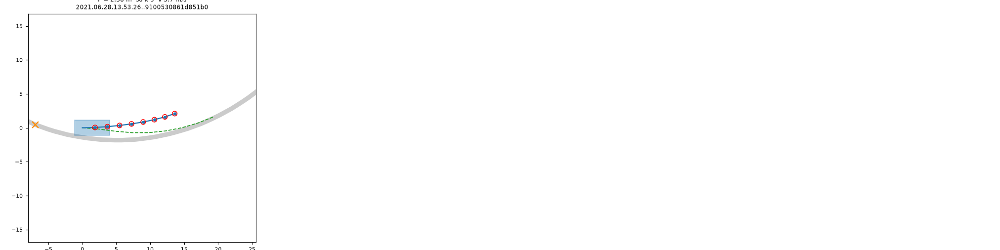

# ONPOL-NUPLAN, self-consequence L: gates (2026-10-11)

Code: `lib/on_lon.py` (loss, `timing_only`, label builder), `scripts/on_ctx.py` (scene context), `scripts/on_lon_pack.py` (pack + pool gate),
`scripts/on_lon_gates.py` (gates i - iii). Definitions and every deviation from the prereg / design.md: the docstring of `lib/on_lon.py`.
All numbers below are in the json files of this directory; nothing here is a training result.

## Context (`lon_ctx.json`)

1491 of 1491 scenes labelled from 136 NAVSIM test logs. Route origin 2 s before the scene token, 261 m grid, 24 light keyframes, 8 line
slots (no scene uses all 8). Logged keyframes against the route: lateral max 0.18 m, arc p99.9 0.31 m; two scenes with a folded route
(a log that stands still: 0.47 m and 2.55 m), dropped by the packer. 12 scenes have a 1 s frame gap inside the window, so rows are aligned
by timestamp. Largest reach needed (arc at the last decision + 4 s at the logged speed + 40 m) 212 m. Lines: 843 traffic-light lines,
384 eligible, 254 of them red somewhere in 11.5 s; 297 stop-sign lines (17 eligible; masked in B, they only close P). Turns of >= 45 deg:
586 scenes, 583 eligible.

## (i) `timing_only` (`lon_grad.json`): pass

4000 synthetic rows with every item active on 1283 to 1897 of them, float64. Values equal the unprojected ones bit for bit (also float32).
Cross-heading gradient at most 7e-18 per item against an along-heading gradient of 0.12 to 0.27 (the unprojected gradient has a
cross-heading part of 0.03 to 0.12); yaw gradient exactly 0; the kept gradient equals the along-heading part of the unprojected one
(3e-17) and a central finite difference along the heading (300 active rows per item, all within 1e-4, max 3e-10). Float32 as the trainer
runs it: cross-heading 7e-9 against 0.46, yaw 0, finite; a standing plan (all poses at the origin) gives a finite gradient.

## (ii) Operators against `lc.py` / `sweep.py` (`lon_kat.json`): pass

On identical inputs (2000 random routes of 131 and 261 vertices, 764 000 points each) the torch projection equals `lc.project` exactly
(arc and lateral offset, 0.0); dense interpolation and front point 3e-5 m, speed 1.5e-4 m/s, plan arc 1.7e-4 m (float32 rounding).
End to end (torch dense -> torch projection against numpy dense -> numpy projection) 0.03 to 0.06 % of points differ by more than 1 mm,
up to 0.05 m in arc: the projection is discontinuous where a point is equidistant from two route segments, and the inputs differ by
rounding. Within 3.5 m of the route the largest difference is 0.7 mm.

## (iii) Label agreement with LONG-PROBE on navtrain (`lon_navtrain.json`): pass

Shards 2 and 3, log / ot1 / yr1 states (40 440 states, 80 880 rows with the stored `P2H10-F` s0 / s1 own plans), every state's route and
boxes re-expressed in the state's own frame (the path a pool row takes).

| label = 1 | rows | hinge > 0 | share | line |
|:--|--:|--:|--:|--:|
| A (`a_lab`), A hinge at margin 0 | 267 | 259 | 0.970 | 0.95 |
| B red light (`b_lab`, kind 2), B hinge at the line itself | 81 | 81 | 1.000 | 0.95 |
| C (`c_lab`), C hinge as trained | 154 | 154 | 1.000 | 0.95 |

Descriptive, the hinges as trained (on-policy margins) on the same rows:

| item | active, all rows | active, label negative | mean when active | the logged driver's own future as the plan (17 216 log states): active / mean |
|:--|--:|--:|--:|:--|
| A | 1.52 % | 1.17 % | 0.26 m | 0.52 % / 0.10 m |
| B | 0.20 % | 0.08 % | 0.20 m | 0.20 % / 0.10 m |
| C | 0.80 % | 0.34 % | 0.13 m/s | 0.03 % / 0.31 m/s |

The fixed on-policy margins are not log-consistent: the logged driver itself closes to under 2 m (or under its current gap - 0.5 m) behind
a lead in 0.5 % of states and stops within the last metre before a red line in 0.2 %, by about 0.1 m each. On navtrain log states B is
active as often on the logged future as on the model's own plan.

## (iv) Activation on the pool (`lon_pool-<rows name>.json`)

Smoke only so far (`smoke10`: 10 scenes, 100 rows, `P2H10S-F-s0`); the 0.2 % rule cannot be read on 100 rows.
Join checks on these rows: the log's travel D against `on_rows.py`'s own within 8 mm, the arc ahead of the log within 4 cm, the row
pose against the logged pose at decisions 0 and 1 within 3 mm, the row's log time by frame index against `t_log_us` within 0.5 ms.

| item | rows with context | active on the served plan | on the imitation target |
|:--|:--|--:|--:|
| A | 55 % have an eligible lead | 0 of 100 | 0 |
| B | 20 % a light line ahead, 10 % red in the window | 0 of 100 | 0 |
| C | 60 % of rows are in a scene with an eligible turn | 0 of 100 | 0 |
| P | 3 % open (18 % by design.md's rule) | 3 of 100 (one scene), mean 2.06 m (8 of 100, 1.51 m by design.md's rule) | 0 |

What to look at: each panel is one row in its own frame (x forward). Grey band = the route, blue = the served plan from the ego box,
green dashed = the imitation target, red circles = the plan poses P charges (the plan is shorter than 0.95 x the log's travel - 0.5 m),
grey boxes = actors at the row's time with their 4 s tracks (red = A-eligible), orange cross = the turn peak. With the strict rule only
one scene of the ten has P rows: an empty curve where the served plan is both shorter than the log's travel and drifting off the route.
Under design.md's rule P was also active on a row whose plan leaves the route towards a vehicle 3 m beside it (the reason for the strict
rule: no actor within 4.5 m of the route ahead).
