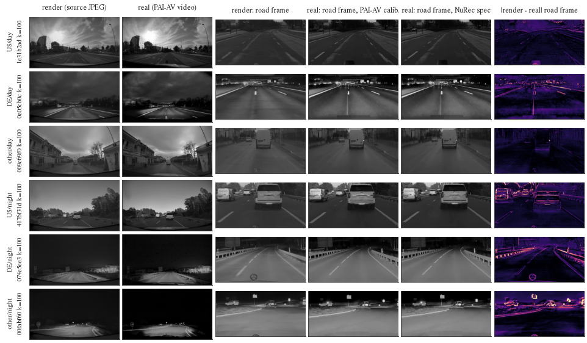

# pai_av: real PAI-AV clips as a PAI training source

status: live
decisions: 394
index: REAL-GAP: real vs render plan distance 0.90 m vs 0.35 m checkpoint yardstick; pilot only

**Question.** Can real PAI-AV clips (nvidia/PhysicalAI-Autonomous-Vehicles) train the PAI-track model? This means mapping NuRec scenes to clips,
excluding the exam, sorting clips into behaviour classes (`scripts/pav.py`), and checking that real footage looks like the render to our model
before any camera download at scale (REAL-GAP).

**Conclusion.** REAL-GAP: on 50 test281 clips (700 decisions) the driver's f-theta conversion lines up real and render frames to 0.1 deg, and the clocks agree exactly.
NTV0-L18-s0 on real frames plans 0.90 m [0.73, 1.09] away from its render plan, against 0.35 m for a checkpoint change, and its ADE to the human
gets worse by +0.41 m [+0.22, +0.62] (+16 %), mostly at night. The frozen tokens carry the same content (probes transfer, CKA 0.90), so this is pilot-scale
download only, not the full ~1 TB (decision 394).

**Next.** Waiting on the main session: a pilot download (2-4k non-exam clips, front-wide only, ~30-55 GB) and one joint arm with an early PAI 281 gate.

**Read more.** [plans/2026-10-20-realgap-prereg.md](plans/2026-10-20-realgap-prereg.md) (reading rules fixed before the results),
[results/realgap.md](results/realgap.md) (all tables).

## REAL-GAP (2026-10-20, decision 394)

**Measurement only. No real frame of a test281 clip enters any training row or training cache.** The probes fitted on exam tokens are
read-outs and are not kept. The exam sample is split `physical_ai_av/realgap-exam50` and the real-only sample is `physical_ai_av/realgap-nonexam50`
(PAI-AV train split, outside curated-val). Both are stratified by country group x day / night ([results/real_sample.csv](results/real_sample.csv)).

**Data.** `pav_real.py fetch` reads `camera_front_wide_120fov` (mp4 + timestamps) and egomotion one zip member at a time by HTTP range request; it never
fetches a chunk zip. It also reads the two calibration parquets of each chunk. The 100 clips take 1.31 GB on disk under `$DATA_DIR/datasets/physical_ai_av/real_sample/`
(~13.4 MB per clip), and the transfer was ~1 MB/s from the box. The fetch has a hard stop at 3 GB.

**Pipeline.**
- Render: the 50 exam scenes are replayed along the human log (`onp_log_driver.py` through `pai_box.sh`). NTV0-L18-s0 is fed, and every session is
  dumped once per second (8 slot frames, ego row, source JPEG).
- Real: `pav_real.py replay` takes the PAI-AV video frame nearest each slot time. The rollout clock is the NuRec absolute clock, and the clip clock is
  that clock minus the NuRec clip start. The real frame passes through the driver's own `pai_core.Maps`, once with the PAI-AV calibration (`real`) and
  once with the session's NuRec CameraSpec (`realN`).
- Both sides get identical ego row, logged route memory and command; only the frames differ.
- The human future is the log at each decision. The yardstick is RSG-L18-s0 on the same render input.

**Conversion check.**

| Check | Result |
|---|---|
| Clock: NuRec first front-wide frame vs PAI-AV frame times | identical (0 us) on all 50 clips; real frame within 15 ms of every slot |
| Road-frame shift render -> real (phase correlation) | x 0.02 deg, y 0.10 deg median (p10-p90 -0.31 .. 0.58 deg in y) |
| PAI-AV calibration vs the NuRec CameraSpec of the same clip | rotation 0.33 deg median (max 1.14), position 0.11 m, principal point 3 px, f-theta radius -7 / -10 px at 40 / 60 deg |
| Same real frames, PAI-AV calib vs NuRec spec | token cosine 0.984, plan distance 0.40 m, ADE 2.95 vs 2.78 m |
| Replay of the dumped render vs the plan the driver logged | median 0.007 m (fp16 numerics) |

The conversion code is correct: real and render frames line up after it. The two published calibrations disagree, though. NuRec ships a refined
calibration (`clipgt/calibration_estimate` in the usdz), and on real frames it gives plans closer to the render than the PAI-AV parquet does.
Real training rows should use the NuRec calibration wherever the clip has a reconstruction. For clips without one, there is a ~0.3 deg systematic
difference from what the board renders. The image lag scan (-3 .. +3 frames) is flat because appearance dominates its MAE, so it is uninformative.

**Gap** (NTV0-L18-s0, scene-cluster bootstrap CIs, n = 700 decisions in 50 clips):

| Quantity | render | real |
|---|---|---|
| ADE to the human (m) | 2.53 [1.96, 3.23] | 2.95 [2.24, 3.79] |
| v4 plan - human (m/s) | -0.67 | -0.93 |
| Paired real - render ADE | | +0.41 [+0.22, +0.62] (day +0.26, night +0.58) |
| Plan distance real vs render | | 0.90 [0.73, 1.09] m (day 0.71, night 1.10) |
| Yardstick: NTV0 vs RSG on render | 0.35 [0.30, 0.41] m | |
| Token cosine render vs real / real t vs t + 1 s / other clip | 0.888 / 0.819 / 0.311 | |
| Linear CKA (mean-pooled) / permuted null | 0.904 / 0.029 | |
| Domain classifier render vs real | 0.97 accuracy | |
| Probe trained on real non-exam: speed R2 real / render | 0.977 / 0.978 | |
| ... 3 s speed change | 0.570 / 0.480 | |
| ... 3 s heading change | 0.749 / 0.755 | |

Against the preregistered reading rules, gap criteria (a) ADE within +-10 % and (b) plan distance <= yardstick fail. Criteria (c) tokens closer than
1 s of driving and (d) probe R2 loss <= 0.10 pass, with the speed-change loss at 0.09. The encoder sees the same scene in both: content probes transfer,
and the paired tokens are closer than 1 s of real driving. The policy is a different matter. It responds to the style difference: it plans slower on
real frames (-0.26 m/s at 4 s) and further from the human, most of all at night, where the render is brighter and blurred (figure, bottom rows).

**Verdict on download scale.** The data do not support committing to the full ~1 TB. They support a pilot only:
- Real rows do carry readable content. However, the model treats real frames differently from renders, by 2.6 times a checkpoint change.
- The board is rendered, so no measurement here shows that real rows help the PAI board.
- At the ~1 MB/s measured, 1 TB is about 12 days of transfer, against ~10-15 h for a 2-4k clip pilot.
- Run the pilot as one joint arm (rendered + real rows, NuRec calibration where available) with an early PAI 281 gate before anything larger.

**Figure.** [figs/realgap_frames.png](figs/realgap_frames.png): one decision per stratum (k = 100, t = 10 s). Columns: the render's source JPEG and the
real video frame; the openpilot road frame from the render, from real via the PAI-AV calibration and from real via the NuRec spec; and |render - real|.
Geometry lines up: lane lines and vehicles sit at the same pixels. The difference is photometric. Night renders are brighter and softer, with
light blooms and lit-up road texture missing, and textures are smoothed by day. The difference image is dominated by edges and lights, with no
consistent offset.

Run: `pav_real.py pick` / `fetch` (jevdrive env), `pav_real.sh render | replay | report` (pool). Box outputs are in `$DATA_DIR/runs/pai_av/realgap/`
(render dumps 1.7 GB, replay rows / tokens 0.26 GB).

<!-- files:begin -->
## Files

- `pav_real.py` (scripts): real PAI-AV footage against the NuRec …
- `pav_real.sh` (scripts): Box, repo root
- `pav.py` (scripts): PAI-AV as an imitation source for the …
- `realgap.md` (results): real PAI-AV footage vs the NuRec …
- `realgap_frames.png` (figs): 
- `2026-10-20-realgap-prereg.md` (plans): REAL-GAP 预注册（2026-10-20，结果出来之前写）
- `real_sample.csv` (results): 
- `pai_core.py` (experiments/alpasim/lib): The SH30 family fed as the AlpaSim PAI …
- `onp_log_driver.py` (experiments/onpol_pai/lib): the simulated ego is steered along the …

[results/](results/) 9 result files · [figs/](figs/) 1 figures · [plans/](plans/) 1 live plans · [scripts/](scripts/) 4 entry points
<!-- files:end -->

Layout: `scripts/` entry points, `results/` small result files, `figs/` figures, `plans/` live plan notes.
