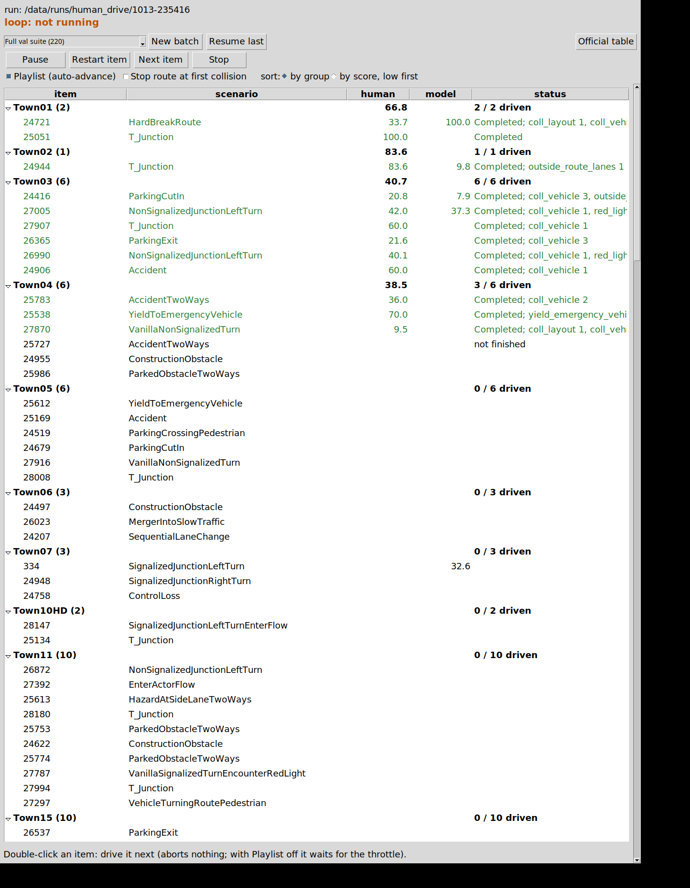

# phone_wheel: the phone as steering wheel and pedals

status: live
decisions: none
index: phone page -> Tokyo daemon -> UDP reader -> human_agent on Bench2Drive; route 24721 driven by hand: DS 100, RC 100

**Question.** Can a phone (Galaxy Z Fold 6, open square screen and folded cover screen) serve as wheel + pedals for CARLA,
with low enough latency for manual driving on the Tokyo box?

**Conclusion.** Tooling, not a result. Headless Chrome on Tokyo checks the steering math at screen angles 0 / 90 / 270
(dead zone, expo, clamp exact), two-thumb pedals and the end-to-end path to `wheel_client` (loopback rtt 0.6 ms).
On-phone latency and the physical steering sign are measured on the phone.

Human drive (below): the user drove Bench2Drive route 24721 (Town01, HardBreakRoute) in openpilot's wide model frame, DS 100,
RC 100, IS 1.00 (20 min-speed entries, unpenalised), 2026-10-13 run `1013-174600`.

Exam on the model's failure routes (2026-10-13, run `1013-232739`, [results/b2d_exam_2026-10-13.md](results/b2d_exam_2026-10-13.md)):
human mean DS 49.5 over 10 routes (RC 100 on 9 of 10, with red lights and layout touches); on the 4 routes where the best model
(Cinque + FIX1) is scored, human 48.1 vs model 21.9 (one attempt each).

**Next.** The full 220-route val suite by hand, scored with Bench2Drive's own tools (section "The full exam"), run `1013-235416`.

## How it works

- `web/index.html` (single file, no build): steering = rotation of the gravity vector in the screen plane
  (`DeviceMotionEvent.accelerationIncludingGravity` rotated by `screen.orientation.angle`, so any orientation works;
  iOS sign flipped). "Center" stores the zero; dead zone 2 deg, linear or mild expo. The main screen holds only Center,
  Settings and two sliders: "Steering range" (tilt for full lock, 20-90 deg, default 60) and "Pedal gain" (0.5-3.0,
  default 1.3, multiplies throttle and brake on the page before sending, clamped to 1). Settings (dead zone, curve, invert, pedal hold-on-release, landscape lock, fullscreen on Start) live in
  localStorage. Pedals (default "one pedal", Tesla style): one tall track at the right thumb, neutral detent at
  mid-height (+-6 %), up = throttle 0..1, down = brake 0..1, release springs to neutral (coast). Setting "two pedals":
  left brake / right throttle tracks, absolute position (bottom 0, top 1), spring back to 0 unless "hold" is set. Both
  modes: multi-touch, 36 px grab tolerance; throttle rises at most 0.8 /s (setting 0.3-3.0) and falls at once, brake is
  never limited; the track shows the limited value and the raw thumb value (`raw_throttle`). In Settings: "Stop" = handbrake
  (sends throttle 0, brake 1, `handbrake: true`), "Reverse" a flag, "Full" fullscreen. Sends `{steer, throttle, brake, raw_throttle, reverse,
  handbrake, ts, seq, rtt}` at 60 Hz over a WebSocket; shows rtt, send rate, daemon rate, drops and the number of local consumers.
  A viewport aspect-class change or a > 1.4x area jump (fold / unfold / rotate) asks for a re-center. Layouts:
  square (open) = tracks at both edges, big wheel middle; wide (cover, landscape) = same, narrower tracks; portrait =
  wheel above, tracks side by side below. "Full" = `requestFullscreen` (optional landscape lock); `manifest.webmanifest`
  (`display: fullscreen`) + a pass-through `sw.js` make "Add to Home screen" / "Install app" launch it with no browser UI.
- `scripts/wheel_server.py` (aiohttp): serves the page and `/ws` on 127.0.0.1:8765 (optional plain-http `--lan-port`),
  keeps the latest frame, echoes `{ts}`, pushes stats every 5 s, logs connections / rate / drops / rtt, and fans every
  frame out as one JSON datagram to each UDP subscriber of 127.0.0.1:47800.
- `lib/wheel_client.py` (stdlib, Python 3.8): `WheelClient().latest() -> (steer, throttle, brake, age_s)`, non-blocking;
  `state()` adds reverse / handbrake / stale. It subscribes by sending a datagram every 0.5 s, so any number of
  consumers can read at once. No frame for 0.3 s -> stale: steer 0, throttle 0, brake 1, handbrake on.
  Steer +1 = right.

## Run (Tokyo)

```bash
# once: env (pip goes through Clash)
python3 -m venv /data/envs/wheel && /data/envs/wheel/bin/pip install aiohttp
# once, needs the sudo password: let user ujs drive tailscale serve / cert
sudo tailscale set --operator=ujs

cd ~/mycode/jev-drive
mkdir -p /data/tmp/wheel && tmux new-session -d -s wheel -n server \
  "/data/envs/wheel/bin/python experiments/phone_wheel/scripts/wheel_server.py --lan-port 8766 2>&1 | tee -a /data/tmp/wheel/log.txt"
tailscale serve --bg http://127.0.0.1:8765      # https://tokyo-devbox.tailcab48d.ts.net/ ; persists across reboots
python experiments/phone_wheel/lib/wheel_client.py   # 10 Hz console readout (any Python >= 3.8)
```

Phone: open `https://tokyo-devbox.tailcab48d.ts.net/` in Chrome (Tailscale app on), tap Start, hold straight, tap Center.
Fallback without HTTPS: `http://100.108.238.8:8766/` plus chrome://flags "Insecure origins treated as secure" = that
origin, otherwise Chrome blocks the motion sensors. Undo: `tailscale serve reset`, `tmux kill-session -t wheel`.
If the steering sign is mirrored on a device, tick "Invert steering" in Settings (a 90 deg axis error is absorbed by Center).

## Human drive: a person takes the Bench2Drive exam (Tokyo)

`lib/human_agent.py` is a Bench2Drive leaderboard agent whose control is the phone (`WheelClient.state()` every tick ->
`carla.VehicleControl(steer, throttle, brake, hand_brake, reverse)`; stale phone -> steer 0, brake 1, handbrake). Its only
sensor is openpilot's wide camera exactly as the openpilot agents mount and render it (`scripts/zeroshot_rigs`, 1928 x 1208,
focal 567 px, windshield top), and the viewer shows it warped as modeld warps it for the model (512 x 256 frame, at 2x), so the
human sees the model's input. The road camera is not rendered (never displayed; config `"road": true` adds it).

- Pedals: throttle = min(1, 1.3 * t^0.6) (`throttle_gain`, `throttle_gamma`; after the first drive the linear map felt dull),
  brake = min(1, 1.0 * b^1.0) (`brake_gain`, `brake_gamma`; the MKZ brake is already sharp: 0.05 gives about -3.2 m/s^2), on
  top of the page's pedal gain. Steer: `steer_gain` 1.0, `steer_expo` 0 (the page has its own curve). Config JSON via
  `HUMAN_CONFIG=<file>`.
- Real time: the leaderboard ticks synchronously at 20 Hz sim; the agent sleeps so sim time never runs ahead of wall time
  (`realtime` 1.0). The world is held at its first tick until the first throttle press (at most 240 s, under the
  leaderboard's 300 s agent watchdog), so the route clock starts when the driver does. Measured on route 24721 (Town01, card 0
  shared with the openpilot monitor loop and its model server): unpaced 0.62 wall s per sim s, so paced runs are exactly real
  time and no sensor had to be dropped.
- Overlays use the hero's true pose (display only; control is the phone's): route command banner, benchmark route ahead in blue
  with 10/20/40/80 m dots, ego panel, phone panel (applied steer / throttle / brake bars, input age, stale), route progress and
  sim speed. A large orange "DRIVER: HUMAN (phone)" tag tells it apart from the model's viewer window.

```bash
# Tokyo; wheel daemon running (tmux wheel), phone on the page and centred
bash ~/mycode/jev-drive/experiments/phone_wheel/scripts/human_drive.sh            # the openpilot loop's 11 routes, its order
bash ~/mycode/jev-drive/experiments/phone_wheel/scripts/human_drive.sh 24721 334  # chosen routes
```

It refuses to start with less than 8 GB free on the card (`HUMAN_MIN_FREE_MB`) or when its port is taken. tmux session `human`:
`viewer` = window "human drive (phone wheel)" on DISPLAY=:0 (`scripts/human_viewer.py`, preview dir
/data/runs/human_drive/live), `drive` = `scripts/b2d_run.py` with its own off-screen CARLA on card 0 (`HUMAN_GPU`), server
index 4 = rpc 2200 / tm 8200 (`HUMAN_SERVER_INDEX`; the openpilot monitor runs use 0 and 2); the launcher checks in nvidia-smi
that the server landed on that card and stops the run otherwise (`gpu_check.txt`). Never card 1 while its PAI chain runs.
Results: `/data/runs/human_drive/<stamp>/results.md` (and `results.json`): DS, RC, IS, status and infraction counts per route,
mean over finished routes, routes never finished; per attempt `attempts/<id>/<n>/human.jsonl` (every tick: phone input,
applied control, input age, speed, route index, sleep) and `human_summary.json` (sim s, wall per sim s, unpaced, stale ticks).
`scripts/human_results.py <run>` rebuilds the table.

## The full exam: all 220 Bench2Drive val routes by hand, scored the official way (Tokyo)

```bash
# Tokyo; wheel daemon in tmux wheel, phone page reloaded and Started (wake lock), card 0 free
bash ~/mycode/jev-drive/experiments/phone_wheel/scripts/human_drive.sh all                      # new run, 220 routes
bash ~/mycode/jev-drive/experiments/phone_wheel/scripts/human_drive.sh --resume /data/runs/human_drive/<stamp>   # continue
/data/envs/carla/bin/python ~/mycode/jev-drive/experiments/phone_wheel/scripts/human_official.py /data/runs/human_drive/<stamp>
```

- Order: `all` = the 220 routes of `bench2drive_0.0.4_val.xml` grouped by town, small towns first (01, 02, 03, 04, 05, 06,
  07, 10HD, 11, 15), then Town12, then Town13; XML order inside a town. `<run>/routes.txt` keeps the list, `--resume` reuses it
  and b2d_run skips every route with `done/<id>.json` (an interrupted route is driven again).
- Official rules: full routes (`HUMAN_STOP_ON` empty; a collision is a DS penalty and the route goes on, as on the leaderboard;
  `HUMAN_STOP_ON=collision` restores stop-at-first-collision), tm seed 0, the leaderboard's own route / scenario timeouts
  and 4000-tick cap. Our additions do not touch scoring: the sim is paced to real time, and each route holds at its first tick until
  the driver's first throttle press, with no time limit, so the driver can rest between routes. During the hold the agent resets the
  leaderboard's agent watchdog and writes `hold_beat` into heartbeat.json, which b2d_run's stall check counts as progress.
  Phone silence (no frame for `WHEEL_STALE_S` 1.0 s) ramps the brake to 1 over `WHEEL_BRAKE_RAMP_S` 1.0 s, holds the last steer,
  and sets the handbrake at the end of the ramp. The viewer shows the reason and the frame rate received from the daemon.
- Long-run safety: `--max-attempts 3` (a CARLA crash or stall restarts the server on another port and redoes that route),
  `--stall-s 600` on tick progress, `--route-timeout-s 86400` (rests count against it), and a viewer that restarts if it exits.
- Phone page (2026-10-13): sending is driven by devicemotion, requestAnimationFrame and the interval together, because Chrome
  throttles timers to about 1 Hz when the screen dims, which tripped the old 0.3 s stale rule between routes. The page
  holds a screen wake lock and shows a red "PAGE THROTTLED" banner under 20 Hz.
- Official scoring, `scripts/human_official.py <run>`, runs on a partial run too and uses Bench2Drive's own tools as shipped,
  from `$BENCH2DRIVE_ROOT`:
  1. Each finished route's leaderboard checkpoint goes to `<run>/official/routes/<id>.json`.
  2. `tools/merge_route_json.py -f <run>/official/routes` writes `merged.json`, with Driving Score = sum DS / 220 and Success
     Rate = (Completed or Perfect with no infraction except min_speed) / 220. Undriven routes count 0.
  3. `tools/ability_benchmark.py -f bench2drive_0.0.4_val.xml -r merged.json` gives the five abilities over the driven routes.
     Traffic_Signs also credits a failed route that cleared its junction with no red-light or stop infraction (offline
     OpenDRIVE maps). On a partial run with an ability that has no route, the shipped file divides by zero. A copy with only that
     division guarded (`official/ability_benchmark_partial.py`) is used instead, and the table says so.
  4. `tools/efficiency_smoothness_benchmark.py -f merged_metric.json -m <run>/official/metric` gives Efficiency (mean of the
     min-speed percentages) and Comfort (Smoothness x 100). It reads `metric_info.json`, which `lib/human_agent.py` writes from
     the Bench2Drive base agent's `get_metric_info()` on every driven tick, as the shipped agents do. Routes driven before
     2026-10-13 23:50 have no metric_info.json and are left out of these two columns.

  Output: `<run>/official/official.md` puts the human's row (/ 220, plus a row over the driven routes) next to the v0.0.4
  leaderboard rows. Those are copied from Bench2Drive `docs/v004_update.md` (LEAD 95.59 DS, SimLingo 86.55,
  Drive-pi0 69.71, DriveTransformer 60.20, DriveAdapter 54.96, ThinkTwice 52.84, TCP 51.44, UniAD 38.69, VAD 38.65,
  ADMLP 35.39; the B2D paper is arXiv 2406.03877, but its own tables are v0.0.3 and on another route set). Logs: `official/tools.log`.

## Desktop panel (Tokyo): batches, resume, pause, route list

Double-click "B2D human exam" on the Tokyo desktop (`scripts/human_panel.sh`; install or refresh the icon with
`bash experiments/phone_wheel/scripts/human_panel.sh --install`). It opens one panel (a lock file prevents a second) and
starts the wheel daemon (tmux `wheel`) and the viewer (tmux `human:viewer`) if they are missing. The panel runs on the
system Python (`/usr/bin/python3`; envs/carla has no Tcl).

- New batch: pick Full val suite (220), Hard list (45, `results/exam_hard45.txt`), Junction turns (54) or Model failure routes
  (10). It writes a new run dir with `routes.txt` (town-grouped as in "The full exam") and starts the loop.
  Resume last: restart the loop on the latest run and skip finished routes. If a `human_drive.sh` run from a terminal is
  active, the panel offers to stop it first: SIGINT to its b2d_run, finished routes are kept, and the aborted route is
  driven again.
- Pause / Resume: holds at the next route boundary, and mid-route the agent holds the current tick (watchdog reset, as
  in the start hold) until Resume. Restart item, Next item (abort and skip for this session) and Stop (abort and end the
  loop) abort the running route; an aborted route is not finished.
- Route list: grouped by town with per-town mean human DS and driven counts, or sorted by score, low first (the human's DS if
  driven, else the best model's from `results/model_scores.json`, unscored last). Columns: route, scenario, human DS, model DS,
  status (leaderboard status and infractions). Double-click a row to drive it next, even if it was already driven.
  Playlist on: the next unfinished row in the current order loads when a route ends. Playlist off: the loop waits for a
  double-click or a throttle press on the phone.
- "Stop route at first collision" (off by default = official): applies from the next route. "Official table" runs
  `human_official.py` on the run.
- Drive side: `scripts/human_loop.py --run <dir>` in tmux `human:loop`. It runs one b2d_run Runner per route on one kept
  off-screen CARLA server (card 0, server index 4, GPU placement checked as in human_drive.sh), with a full `load_world` every
  route as the leaderboard ships. After every route it runs `human_results.py` and, in the background, `human_official.py`.
  The loop takes commands from `<live>/control.json` and reports in `<live>/loop.json`; the protocol is in `lib/exam_panel.py`.
- Generic: `lib/exam_panel.py` is the panel and the protocol over a `Backend` (items with id / group / scenario / human /
  model / status; batch sets, new batch, resume, takeover of a foreign run, official table, side processes).
  `lib/b2d_exam.py` is the Bench2Drive backend; an AlpaSim backend plugs in the same way.
- Status 2026-10-14 00:05: the panel was rendered on the live run (`figs/panel_b2d.png`). The loop has not yet run a route
  end to end with CARLA, because card 0 was in use by the user's 220-route run. The agent's pause and hold logic is unit-tested.



`figs/panel_b2d.png`: the panel on the running 220-route exam (rendered off-screen). Look at the town groups: the bold rows
carry the human's mean DS and the driven count. Driven routes are green with their leaderboard status; the model column is filled only
where the best model has a score (24721, 24944, 24416, 27005, 334).

<!-- files:begin -->
## Files

- `wheel_server.py` (scripts): Phone steering wheel daemon
- `wheel_client.py` (lib): Non-blocking reader for the phone wheel …
- `human_agent.py` (lib): Bench2Drive agent driven by the phone, openpilot wide camera view
- `human_drive.sh` (scripts): launcher: own CARLA, tmux `human`, results table
- `human_viewer.py` (scripts): the "human drive (phone wheel)" window
- `human_results.py` (scripts): per-route DS / RC / infractions of a run
- `index.html` (web): 
- `manifest.webmanifest` (web): 

[lib/](lib/) 2 libraries · [scripts/](scripts/) 4 entry points
<!-- files:end -->
