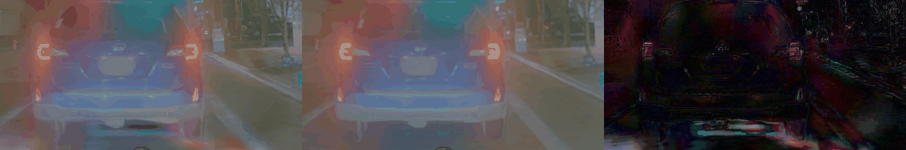
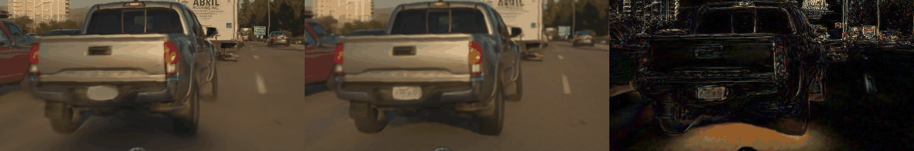
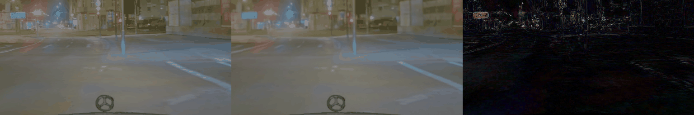
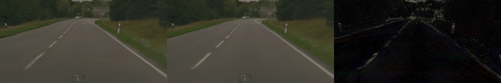
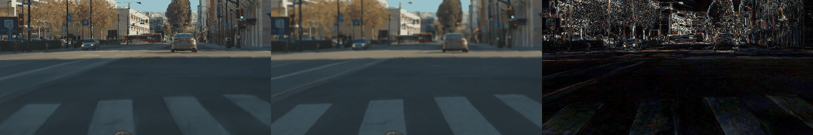

# Harmonizer open-loop check: same PAI states rendered OFF / OFF / ON

Plan and registered lines: [plans/2026-10-21-harmonizer-check.md](../plans/2026-10-21-harmonizer-check.md) (written before any render).
Code: [scripts/harm.sh](../scripts/harm.sh), [scripts/harm.py](../scripts/harm.py). Raw numbers: [harmonizer_cmp.json](harmonizer_cmp.json).
Box run dir: `$DATA_DIR/runs/round7/harm/` (rows, caches, `cmp_states.npz` per-state plans; pools `on1_HARM{OFFA,OFFB,ON}` in op_parity/cache).

**Verdict: not "small". Flag for the closed-loop paired read (and augmentation planning).** Lateral is under the line (pooled 4 s lateral median
0.083 m NTV0 / 0.067 m R5LC < 0.2), but the longitudinal 2 s / 4 s medians (0.19 / 0.46 m NTV0, 0.18 / 0.43 m R5LC) exceed the registered
absolute lines (0.15 / 0.3 m). The re-render floor is exactly zero, so the absolute fallback applies. The stratum to watch is junction turns:
4 s lateral median 0.55 / 0.54 m, a systematic shift (ON plans turn tighter by about 0.5 / 0.3 m at 4 s).

## Tables

300 states (60 per stratum) from 39 train scenes of `on1_PAIH`. Each state was rendered 3 times along the human log (pai_rows' H path: `onp_log_driver.py`,
A0 serve, NTV0-L18-s0 in the loop) and encoded by the normal cache path (`onp_cache build`). Matched in all three renders: 300 / 300.

| Render pair | Model-input frame: mean abs grey diff | Bytes differing | States bit-identical | Ego input max diff |
|---|--:|--:|--:|--:|
| OFF-B vs OFF-A (floor) | 0.000 | 0 % | 300 / 300 | 0 |
| ON vs OFF-A | 2.56 | 75.5 % | 0 / 300 | 0 |

The renderer is deterministic, so the floor is 0 for frames, tokens and plans of every checkpoint. The registered fallback lines are therefore used:
0.05 / 0.15 / 0.3 m at 0.5 / 2 / 4 s, with lateral 4 s < 0.2 m unchanged.

**Plan |delta| ON vs OFF-A, pooled 300 states, median (p90) in m** (floor 0.000 everywhere; lat = rear-axle y, lon = rear-axle x):

| Checkpoint | lat 0.5 s | lat 2 s | lat 4 s | lon 0.5 s | lon 2 s | lon 4 s | Verdict |
|---|--:|--:|--:|--:|--:|--:|---|
| NTV0-L18-s0 | 0.004 (0.015) | 0.024 (0.126) | **0.083** (0.629) | 0.039 (0.157) | **0.186** (0.598) | **0.460** (1.473) | not small (lon 2 s, 4 s over) |
| R5LC-L18-s0 | 0.004 (0.017) | 0.022 (0.110) | **0.067** (0.616) | 0.039 (0.145) | **0.176** (0.639) | **0.429** (1.564) | not small (lon 2 s, 4 s over) |
| P0 shipped Cinque (reference) | 0.003 (0.014) | 0.020 (0.131) | 0.063 (0.627) | 0.049 (0.225) | 0.251 (1.061) | 0.664 (2.573) | (not judged) |
| NTV0 as served by the driver (cross-check) | 0.004 (0.015) | 0.024 (0.126) | 0.084 (0.624) | 0.039 (0.158) | 0.185 (0.599) | 0.463 (1.449) | (same as the fwd path) |
| Registered line (floor 0 -> absolute) | 0.05 | 0.15 | 0.3, and median < 0.2 | 0.05 | 0.15 | 0.3 | |

Pooled 4 s medians, 95 % bootstrap CI: NTV0 lat [0.063, 0.105], lon [0.401, 0.532]; R5LC lat [0.051, 0.080], lon [0.375, 0.480].

**Per stratum, 4 s median |delta| (lat / lon) in m, ON vs OFF-A**. Stratum flags per the plan: lat 4 s >= 0.2, or lon 4 s > 0.3 m (floor 0):

| Stratum (n = 60 each) | NTV0 lat | NTV0 lon | R5LC lat | R5LC lon | P0 lat | P0 lon | Flag |
|---|--:|--:|--:|--:|--:|--:|---|
| launch | 0.031 | 0.387 | 0.035 | 0.357 | 0.011 | 0.449 | lon |
| stop | 0.046 | 0.423 | 0.033 | 0.315 | 0.018 | 0.519 | lon |
| turn | **0.547** | 0.349 | **0.535** | 0.463 | 0.510 | 0.603 | **lat** + lon |
| curve | 0.148 | 0.622 | 0.112 | 0.550 | 0.179 | 1.068 | lon |
| straight | 0.054 | 0.584 | 0.048 | 0.529 | 0.063 | 1.127 | lon |

**Signed shifts at 4 s, median [95 % CI]** (lon: ON - OFF, + = ON plans go further; lat: toward the side the OFF plan turns to, + = ON turns tighter):

| Stratum | NTV0 lon | NTV0 lat toward turn | R5LC lon | R5LC lat toward turn |
|---|--:|--:|--:|--:|
| all | +0.06 [-0.04, +0.16] | +0.015 [+0.003, +0.028] | -0.12 [-0.21, -0.04] | +0.011 [-0.004, +0.024] |
| launch | +0.03 [-0.15, +0.28] | +0.02 | -0.16 [-0.32, +0.19] | +0.02 |
| stop | +0.03 [-0.25, +0.15] | -0.02 | -0.08 [-0.28, +0.13] | -0.01 |
| turn | -0.01 [-0.15, +0.13] | **+0.50 [+0.31, +0.63]** | -0.25 [-0.42, -0.11] | **+0.33 [+0.22, +0.55]** |
| curve | +0.33 [+0.06, +0.55] | +0.00 | +0.09 [-0.11, +0.39] | +0.02 |
| straight | +0.05 [-0.29, +0.34] | -0.00 | -0.22 [-0.46, -0.02] | -0.02 |

**Tokens** (frozen encoder, newest image pair, 32 x 512): ON vs OFF-A median 1 - cos 0.041 (p90 0.069) and relative L2 0.29 (p90 0.37). The mean
over the 8 slots is 0.28; the floor is 0. The spread across strata is small (relative L2 0.25 for turn to 0.31 for straight).

**Render cost** (box, RTX 6000D shared with round 6; ALPASIM_FAST=1, CONC 4, chunks of 9 scenes, runtime per scene):

| Variant | Runtime per scene | Peak renderer VRAM | Stack peak (all services) |
|---|--:|--:|--:|
| OFF (A / B) | 45.4 / 46.8 s | 14.0-14.8 GiB | 17.6 GiB |
| ON | 99.2 s (2.2x) | 16.7 GiB | 19.6 GiB |

On Tokyo (3090, full camera set) the 10-09 measurement was 7.1x. Here only the driver's camera is rendered at full size (ALPASIM_FAST), which
explains most of the difference. A closed-loop paired read ON costs about 2.2x an OFF read per scene. Lost rollouts: a transient renderer RPC
error ("tensors on cuda:0 and cpu") lost one scene each in OFF-A c003 and OFF-B c002 (both OFF, not ON). Those chunks were re-rolled; row files and
route messages were then rebuilt from the same roll (harm.sh `refix`).

## R6DAG-L18-s1 (added 10-21, decision 439 follow-up)

Same 300 states, same three renders and pools (`on1_HARM{OFFA,OFFB,ON}`), no new renders; only `rf_recov.py fwd` for the R6DAG-L18-s1 checkpoint
on each pool, then `harm.py compare` over all tags (`harm.sh addtag R6DAG-L18-s1`) and `harm.py signed` for the table below. NTV0 / R5LC numbers are
unchanged by the re-run (same cmp.json values); the CIs below are re-drawn by `harm.py signed` (seed 0), so they differ in the last digit from the CIs above.
Matched 300 / 300; floor 0 again, so the same absolute lines apply (R6DAG: not small, lon 2 s 0.181 m and lon 4 s 0.425 m over the line, lat 4 s 0.070 m under it).

**Signed longitudinal shift ON - OFF at 4 s, median [95 % CI] in m** (+ = ON plans go further; n = 60 per stratum):

| Stratum | NTV0 lon 4 s | R5LC lon 4 s | R6DAG-s1 lon 4 s | R6DAG-s1 lon 2 s | R6DAG-s1 lon 0.5 s |
|---|--:|--:|--:|--:|--:|
| all (300) | +0.06 [-0.04, +0.15] | -0.12 [-0.21, -0.06] | **-0.10 [-0.21, -0.04]** | -0.03 [-0.06, +0.00] | -0.01 [-0.02, -0.00] |
| launch | +0.03 [-0.12, +0.29] | -0.16 [-0.32, +0.17] | -0.07 [-0.31, +0.18] | +0.03 [-0.02, +0.05] | -0.00 [-0.00, +0.00] |
| stop | +0.03 [-0.27, +0.14] | -0.08 [-0.26, +0.13] | -0.11 [-0.33, +0.10] | -0.02 [-0.10, +0.04] | +0.00 [-0.02, +0.02] |
| turn | -0.01 [-0.14, +0.14] | -0.25 [-0.45, -0.11] | **-0.21 [-0.43, -0.07]** | -0.02 [-0.07, +0.07] | -0.01 [-0.02, +0.03] |
| curve | +0.33 [+0.06, +0.57] | +0.09 [-0.12, +0.39] | +0.06 [-0.08, +0.33] | +0.01 [-0.13, +0.08] | -0.01 [-0.05, +0.01] |
| straight | +0.05 [-0.29, +0.32] | -0.22 [-0.46, -0.02] | **-0.24 [-0.47, -0.08]** | -0.19 [-0.26, -0.10] | -0.07 [-0.09, -0.04] |

**Signed lateral shift ON - OFF at 4 s toward the side the OFF plan turns to, median [95 % CI] in m** (+ = ON turns tighter):

| Stratum | NTV0 lat 4 s | R5LC lat 4 s | R6DAG-s1 lat 4 s | R6DAG-s1 lat 2 s | R6DAG-s1 lat 0.5 s |
|---|--:|--:|--:|--:|--:|
| all | +0.02 [+0.00, +0.03] | +0.01 [-0.00, +0.02] | +0.02 [+0.01, +0.03] | +0.00 [-0.00, +0.01] | -0.00 [-0.00, -0.00] |
| launch | +0.02 [+0.01, +0.04] | +0.02 [+0.00, +0.03] | +0.02 [+0.01, +0.04] | +0.01 [+0.00, +0.01] | +0.00 [-0.00, +0.00] |
| stop | -0.02 [-0.03, -0.00] | -0.01 [-0.03, +0.00] | -0.01 [-0.02, +0.01] | -0.00 [-0.01, +0.01] | +0.00 [-0.00, +0.00] |
| turn | **+0.50 [+0.30, +0.64]** | **+0.33 [+0.21, +0.53]** | **+0.34 [+0.20, +0.55]** | +0.04 [+0.00, +0.08] | -0.01 [-0.01, -0.01] |
| curve | +0.00 [-0.04, +0.08] | +0.02 [-0.01, +0.07] | +0.03 [-0.02, +0.08] | -0.00 [-0.01, +0.01] | -0.00 [-0.00, -0.00] |
| straight | -0.00 [-0.02, +0.02] | -0.02 [-0.04, -0.00] | -0.00 [-0.02, +0.02] | -0.00 [-0.02, +0.01] | -0.00 [-0.00, +0.00] |

R6DAG-s1 |delta| ON vs OFF-A, median (p90) in m, pooled: lat 0.5 / 2 / 4 s 0.004 (0.015) / 0.022 (0.110) / 0.070 (0.605); lon 0.040 (0.141) / 0.181 (0.592) / 0.425 (1.613);
pooled 4 s median CI lat [0.055, 0.089], lon [0.386, 0.485]. Per stratum 4 s lon: launch 0.390, stop 0.379, turn 0.422, curve 0.538, straight 0.526; turn lat 0.496. The full R6DAG table is in the appendix.

**Does "ON makes this family plan shorter, especially at launch" hold for R6DAG-s1?** Partly. R6DAG-s1 plans shorter with the Harmonizer ON, pooled
(-0.10 m at 4 s, CI [-0.21, -0.04], the same size as R5LC's -0.12 and opposite in sign to NTV0's +0.06), and the shift is concentrated on straights
(-0.24 [-0.47, -0.08], already -0.07 m at 0.5 s and -0.19 m at 2 s) and junction turns (-0.21 [-0.43, -0.07]); the junction turn also tightens laterally
by 0.34 m, as for R5LC (0.33) and NTV0 (0.50). The launch part does not hold: the launch point estimate is shorter (-0.07 m, less than R5LC's -0.16) but
its CI [-0.31, +0.18] spans zero and the 2 s shift is +0.03 m, so open loop gives no evidence that ON shortens launch plans for this checkpoint. The
open-loop shifts are small next to the plan-to-plan spread of the same state (median |delta| 0.4 m at 4 s with either sign), so a -0.1 m mean shift
cannot by itself account for the closed-loop loss of launches (35 -> 32) or the rear-hit partials; if the closed-loop launch loss is real it comes
from how a tiny, consistent shortening interacts with the stop/go decision and the follower (compounding over a rollout), which this single-state
check does not measure. Open loop therefore shows the same family-level direction as R5LC (shorter on straights and turns), without a launch-specific effect.

## Images

OFF-A | ON | 4 x |diff| of the newest model-input frame (driver camera, 512 x 256), one state per stratum plus the state with the largest NTV0 4 s lateral
delta: [harmonizer_png/](harmonizer_png/) (`list.json` gives scene, k and delta). What to look at: ON is sharper. Lane markings, crosswalk
stripes and pole edges are crisp where OFF smears them, and the colour shifts slightly. The diff is almost entirely edges and texture, not geometry.

| Image | Stratum | NTV0 lat 4 s delta |
|---|---|--:|
|  | launch | 0.007 m |
|  | stop | 0.020 m |
|  | turn | 0.306 m |
|  | curve | 0.040 m |
|  | straight | 0.037 m |
|  | curve, largest | 3.259 m |

## Reading

- The Harmonizer is not a small perturbation for the frozen encoder. Tokens move by about 29 % relative L2, against an exact-zero re-render floor.
  The plans move mainly along the path (median 0.4-0.6 m at 4 s, p90 1.5 m) and mostly without a consistent sign. The exceptions are NTV0 curves
  (+0.33 m further) and R5LC overall (-0.12 m, turn -0.25 m).
- Lateral is small everywhere except junction turns. There both checkpoints turn about 0.3-0.5 m tighter at 4 s, a systematic shift with CIs
  clear of 0. Shipped P0 shows the same shift (+0.38 m), so it comes from the encoder's view of sharpened images, not from our adapters.
- Not measured: how much of this survives the closed loop, e.g. whether tighter turns help or hurt route-turn / offroad zeros, and whether the
  longitudinal jitter changes launches. Per the plan this goes to the closed-loop paired read (NTV0 and the current best arm on PAI-FIX TARGET 60
  + LAUNCH-37, ON / OFF), at about 2.2x the cost of an OFF read. Augmentation (part of the training rows rendered ON) goes into round-7 planning.
- Own-state rows (MV-family rollouts) were not done. They need a driver that replays a recorded trajectory so that the three renders see the same
  poses. The human-state result does not depend on them.

## Appendix: full tables (generated by `harm.py report`)

States matched in all three renders: 300 / 300. Overall verdict: **closed-loop paired read**.
| Render pair | Mean abs grey diff (newest frame, model input) | Share of bytes differing | States bit-identical |
|---|--:|--:|--:|
| OFFB vs OFFA | 0.000 | 0.0000 | 300 |
| ON vs OFFA | 2.563 | 0.7553 | 0 |

Ego input max abs difference vs OFFA: OFFB 0.00e+00, ON 0.00e+00. NTV0 fwd path vs the plan the driver served, max per render: {'OFFA': 0.09166646748781204, 'OFFB': 0.09166646748781204, 'ON': 0.1064254567027092}.

### NTV0-L18-s0: NOT small
Plan |delta| median (p90) in m, ON vs OFFA against the floor OFFB vs OFFA. Lat = rear-axle y, lon = rear-axle x.
| Stratum | n | lat 0.5 s ON / floor | lat 2 s ON / floor | lat 4 s ON / floor | lon 0.5 s ON / floor | lon 2 s ON / floor | lon 4 s ON / floor |
|---|--:|--:|--:|--:|--:|--:|--:|
| all | 300 | 0.004 (0.015) / 0.000 (0.000) | 0.024 (0.126) / 0.000 (0.000) | 0.083 (0.629) / 0.000 (0.000) | 0.039 (0.157) / 0.000 (0.000) | 0.186 (0.598) / 0.000 (0.000) | 0.460 (1.473) / 0.000 (0.000) |
| launch | 60 | 0.003 (0.005) / 0.000 (0.000) | 0.013 (0.026) / 0.000 (0.000) | 0.031 (0.130) / 0.000 (0.000) | 0.012 (0.041) / 0.000 (0.000) | 0.079 (0.254) / 0.000 (0.000) | 0.387 (0.959) / 0.000 (0.000) |
| stop | 60 | 0.004 (0.014) / 0.000 (0.000) | 0.020 (0.068) / 0.000 (0.000) | 0.046 (0.169) / 0.000 (0.000) | 0.042 (0.138) / 0.000 (0.000) | 0.173 (0.539) / 0.000 (0.000) | 0.423 (1.354) / 0.000 (0.000) |
| turn | 60 | 0.008 (0.021) / 0.000 (0.000) | 0.095 (0.219) / 0.000 (0.000) | 0.547 (1.102) / 0.000 (0.000) | 0.058 (0.159) / 0.000 (0.000) | 0.228 (0.564) / 0.000 (0.000) | 0.349 (1.222) / 0.000 (0.000) |
| curve | 60 | 0.006 (0.019) / 0.000 (0.000) | 0.033 (0.141) / 0.000 (0.000) | 0.148 (0.499) / 0.000 (0.000) | 0.066 (0.175) / 0.000 (0.000) | 0.238 (0.695) / 0.000 (0.000) | 0.622 (1.602) / 0.000 (0.000) |
| straight | 60 | 0.003 (0.007) / 0.000 (0.000) | 0.022 (0.048) / 0.000 (0.000) | 0.054 (0.168) / 0.000 (0.000) | 0.059 (0.179) / 0.000 (0.000) | 0.235 (0.704) / 0.000 (0.000) | 0.584 (1.814) / 0.000 (0.000) |

Pooled 4 s median, 95 % bootstrap CI: ON lat [0.06324183940887451, 0.10517469048500061], lon [0.4005775451660156, 0.5321998596191406]; floor lat [0.0, 0.0], lon [0.0, 0.0].
Verdict cells: lat 0.5 s 0.004 vs line 0.050 (abs) ok; lat 2 s 0.024 vs line 0.150 (abs) ok; lat 4 s 0.083 vs line 0.300 (abs) ok; lon 0.5 s 0.039 vs line 0.050 (abs) ok; lon 2 s 0.186 vs line 0.150 (abs) OVER; lon 4 s 0.460 vs line 0.300 (abs) OVER; lateral 4 s median 0.083 < 0.2 ok. Stratum flags: launch: longitudinal 4 s median 0.387 m > 2 x floor 0.000 and > 0.3; stop: longitudinal 4 s median 0.423 m > 2 x floor 0.000 and > 0.3; turn: lateral 4 s median 0.547 m >= 0.2; turn: longitudinal 4 s median 0.349 m > 2 x floor 0.000 and > 0.3; curve: longitudinal 4 s median 0.622 m > 2 x floor 0.000 and > 0.3; straight: longitudinal 4 s median 0.584 m > 2 x floor 0.000 and > 0.3.

### R5LC-L18-s0: NOT small
Plan |delta| median (p90) in m, ON vs OFFA against the floor OFFB vs OFFA. Lat = rear-axle y, lon = rear-axle x.
| Stratum | n | lat 0.5 s ON / floor | lat 2 s ON / floor | lat 4 s ON / floor | lon 0.5 s ON / floor | lon 2 s ON / floor | lon 4 s ON / floor |
|---|--:|--:|--:|--:|--:|--:|--:|
| all | 300 | 0.004 (0.017) / 0.000 (0.000) | 0.022 (0.110) / 0.000 (0.000) | 0.067 (0.616) / 0.000 (0.000) | 0.039 (0.145) / 0.000 (0.000) | 0.176 (0.639) / 0.000 (0.000) | 0.429 (1.564) / 0.000 (0.000) |
| launch | 60 | 0.002 (0.008) / 0.000 (0.000) | 0.012 (0.028) / 0.000 (0.000) | 0.035 (0.094) / 0.000 (0.000) | 0.010 (0.036) / 0.000 (0.000) | 0.060 (0.241) / 0.000 (0.000) | 0.357 (1.042) / 0.000 (0.000) |
| stop | 60 | 0.005 (0.014) / 0.000 (0.000) | 0.019 (0.047) / 0.000 (0.000) | 0.033 (0.113) / 0.000 (0.000) | 0.041 (0.124) / 0.000 (0.000) | 0.159 (0.503) / 0.000 (0.000) | 0.315 (1.324) / 0.000 (0.000) |
| turn | 60 | 0.009 (0.024) / 0.000 (0.000) | 0.083 (0.212) / 0.000 (0.000) | 0.535 (1.190) / 0.000 (0.000) | 0.050 (0.126) / 0.000 (0.000) | 0.196 (0.540) / 0.000 (0.000) | 0.463 (1.032) / 0.000 (0.000) |
| curve | 60 | 0.005 (0.017) / 0.000 (0.000) | 0.030 (0.111) / 0.000 (0.000) | 0.112 (0.520) / 0.000 (0.000) | 0.074 (0.219) / 0.000 (0.000) | 0.273 (0.867) / 0.000 (0.000) | 0.550 (1.844) / 0.000 (0.000) |
| straight | 60 | 0.003 (0.007) / 0.000 (0.000) | 0.019 (0.043) / 0.000 (0.000) | 0.048 (0.123) / 0.000 (0.000) | 0.079 (0.219) / 0.000 (0.000) | 0.240 (0.710) / 0.000 (0.000) | 0.529 (1.876) / 0.000 (0.000) |

Pooled 4 s median, 95 % bootstrap CI: ON lat [0.05072161555290222, 0.08026164025068283], lon [0.37450599670410156, 0.48005199432373047]; floor lat [0.0, 0.0], lon [0.0, 0.0].
Verdict cells: lat 0.5 s 0.004 vs line 0.050 (abs) ok; lat 2 s 0.022 vs line 0.150 (abs) ok; lat 4 s 0.067 vs line 0.300 (abs) ok; lon 0.5 s 0.039 vs line 0.050 (abs) ok; lon 2 s 0.176 vs line 0.150 (abs) OVER; lon 4 s 0.429 vs line 0.300 (abs) OVER; lateral 4 s median 0.067 < 0.2 ok. Stratum flags: launch: longitudinal 4 s median 0.357 m > 2 x floor 0.000 and > 0.3; stop: longitudinal 4 s median 0.315 m > 2 x floor 0.000 and > 0.3; turn: lateral 4 s median 0.535 m >= 0.2; turn: longitudinal 4 s median 0.463 m > 2 x floor 0.000 and > 0.3; curve: longitudinal 4 s median 0.550 m > 2 x floor 0.000 and > 0.3; straight: longitudinal 4 s median 0.529 m > 2 x floor 0.000 and > 0.3.

### R6DAG-L18-s1: NOT small
Plan |delta| median (p90) in m, ON vs OFFA against the floor OFFB vs OFFA. Lat = rear-axle y, lon = rear-axle x.
| Stratum | n | lat 0.5 s ON / floor | lat 2 s ON / floor | lat 4 s ON / floor | lon 0.5 s ON / floor | lon 2 s ON / floor | lon 4 s ON / floor |
|---|--:|--:|--:|--:|--:|--:|--:|
| all | 300 | 0.004 (0.015) / 0.000 (0.000) | 0.022 (0.110) / 0.000 (0.000) | 0.070 (0.605) / 0.000 (0.000) | 0.040 (0.141) / 0.000 (0.000) | 0.181 (0.592) / 0.000 (0.000) | 0.425 (1.613) / 0.000 (0.000) |
| launch | 60 | 0.002 (0.008) / 0.000 (0.000) | 0.013 (0.032) / 0.000 (0.000) | 0.036 (0.105) / 0.000 (0.000) | 0.010 (0.038) / 0.000 (0.000) | 0.073 (0.244) / 0.000 (0.000) | 0.390 (0.997) / 0.000 (0.000) |
| stop | 60 | 0.004 (0.011) / 0.000 (0.000) | 0.019 (0.043) / 0.000 (0.000) | 0.032 (0.122) / 0.000 (0.000) | 0.037 (0.096) / 0.000 (0.000) | 0.159 (0.502) / 0.000 (0.000) | 0.379 (1.407) / 0.000 (0.000) |
| turn | 60 | 0.008 (0.024) / 0.000 (0.000) | 0.081 (0.247) / 0.000 (0.000) | 0.496 (1.042) / 0.000 (0.000) | 0.051 (0.118) / 0.000 (0.000) | 0.197 (0.521) / 0.000 (0.000) | 0.422 (0.972) / 0.000 (0.000) |
| curve | 60 | 0.004 (0.016) / 0.000 (0.000) | 0.030 (0.120) / 0.000 (0.000) | 0.116 (0.539) / 0.000 (0.000) | 0.069 (0.213) / 0.000 (0.000) | 0.276 (0.897) / 0.000 (0.000) | 0.538 (1.891) / 0.000 (0.000) |
| straight | 60 | 0.003 (0.007) / 0.000 (0.000) | 0.020 (0.043) / 0.000 (0.000) | 0.051 (0.129) / 0.000 (0.000) | 0.077 (0.181) / 0.000 (0.000) | 0.247 (0.722) / 0.000 (0.000) | 0.526 (1.777) / 0.000 (0.000) |

Pooled 4 s median, 95 % bootstrap CI: ON lat [0.05496745556592941, 0.08855672180652618], lon [0.3862771987915039, 0.4852258265018463]; floor lat [0.0, 0.0], lon [0.0, 0.0].
Verdict cells: lat 0.5 s 0.004 vs line 0.050 (abs) ok; lat 2 s 0.022 vs line 0.150 (abs) ok; lat 4 s 0.070 vs line 0.300 (abs) ok; lon 0.5 s 0.040 vs line 0.050 (abs) ok; lon 2 s 0.181 vs line 0.150 (abs) OVER; lon 4 s 0.425 vs line 0.300 (abs) OVER; lateral 4 s median 0.070 < 0.2 ok. Stratum flags: launch: longitudinal 4 s median 0.390 m > 2 x floor 0.000 and > 0.3; stop: longitudinal 4 s median 0.379 m > 2 x floor 0.000 and > 0.3; turn: lateral 4 s median 0.496 m >= 0.2; turn: longitudinal 4 s median 0.422 m > 2 x floor 0.000 and > 0.3; curve: longitudinal 4 s median 0.538 m > 2 x floor 0.000 and > 0.3; straight: longitudinal 4 s median 0.526 m > 2 x floor 0.000 and > 0.3.

### P0 (reference, not judged): NOT small
Plan |delta| median (p90) in m, ON vs OFFA against the floor OFFB vs OFFA. Lat = rear-axle y, lon = rear-axle x.
| Stratum | n | lat 0.5 s ON / floor | lat 2 s ON / floor | lat 4 s ON / floor | lon 0.5 s ON / floor | lon 2 s ON / floor | lon 4 s ON / floor |
|---|--:|--:|--:|--:|--:|--:|--:|
| all | 300 | 0.003 (0.014) / 0.000 (0.000) | 0.020 (0.131) / 0.000 (0.000) | 0.063 (0.627) / 0.000 (0.000) | 0.049 (0.225) / 0.000 (0.000) | 0.251 (1.061) / 0.000 (0.000) | 0.664 (2.573) / 0.000 (0.000) |
| launch | 60 | 0.001 (0.003) / 0.000 (0.000) | 0.003 (0.015) / 0.000 (0.000) | 0.011 (0.106) / 0.000 (0.000) | 0.003 (0.032) / 0.000 (0.000) | 0.061 (0.365) / 0.000 (0.000) | 0.449 (2.398) / 0.000 (0.000) |
| stop | 60 | 0.003 (0.012) / 0.000 (0.000) | 0.008 (0.067) / 0.000 (0.000) | 0.018 (0.243) / 0.000 (0.000) | 0.051 (0.225) / 0.000 (0.000) | 0.253 (1.392) / 0.000 (0.000) | 0.519 (3.308) / 0.000 (0.000) |
| turn | 60 | 0.009 (0.025) / 0.000 (0.000) | 0.101 (0.255) / 0.000 (0.000) | 0.510 (1.287) / 0.000 (0.000) | 0.049 (0.199) / 0.000 (0.000) | 0.233 (0.871) / 0.000 (0.000) | 0.603 (2.185) / 0.000 (0.000) |
| curve | 60 | 0.006 (0.013) / 0.000 (0.000) | 0.045 (0.182) / 0.000 (0.000) | 0.179 (0.645) / 0.000 (0.000) | 0.084 (0.216) / 0.000 (0.000) | 0.389 (0.913) / 0.000 (0.000) | 1.068 (2.235) / 0.000 (0.000) |
| straight | 60 | 0.004 (0.008) / 0.000 (0.000) | 0.023 (0.046) / 0.000 (0.000) | 0.063 (0.142) / 0.000 (0.000) | 0.076 (0.345) / 0.000 (0.000) | 0.336 (1.449) / 0.000 (0.000) | 1.127 (2.952) / 0.000 (0.000) |

Pooled 4 s median, 95 % bootstrap CI: ON lat [0.05268546938896179, 0.08322739601135254], lon [0.5677270889282227, 0.8482707738876343]; floor lat [0.0, 0.0], lon [0.0, 0.0].
Verdict cells: lat 0.5 s 0.003 vs line 0.050 (abs) ok; lat 2 s 0.020 vs line 0.150 (abs) ok; lat 4 s 0.063 vs line 0.300 (abs) ok; lon 0.5 s 0.049 vs line 0.050 (abs) ok; lon 2 s 0.251 vs line 0.150 (abs) OVER; lon 4 s 0.664 vs line 0.300 (abs) OVER; lateral 4 s median 0.063 < 0.2 ok. Stratum flags: launch: longitudinal 4 s median 0.449 m > 2 x floor 0.000 and > 0.3; stop: longitudinal 4 s median 0.519 m > 2 x floor 0.000 and > 0.3; turn: lateral 4 s median 0.510 m >= 0.2; turn: longitudinal 4 s median 0.603 m > 2 x floor 0.000 and > 0.3; curve: longitudinal 4 s median 1.068 m > 2 x floor 0.000 and > 0.3; straight: longitudinal 4 s median 1.127 m > 2 x floor 0.000 and > 0.3.

### served (reference, not judged): NOT small
Plan |delta| median (p90) in m, ON vs OFFA against the floor OFFB vs OFFA. Lat = rear-axle y, lon = rear-axle x.
| Stratum | n | lat 0.5 s ON / floor | lat 2 s ON / floor | lat 4 s ON / floor | lon 0.5 s ON / floor | lon 2 s ON / floor | lon 4 s ON / floor |
|---|--:|--:|--:|--:|--:|--:|--:|
| all | 300 | 0.004 (0.015) / 0.000 (0.000) | 0.024 (0.126) / 0.000 (0.000) | 0.084 (0.624) / 0.000 (0.000) | 0.039 (0.158) / 0.000 (0.000) | 0.185 (0.599) / 0.000 (0.000) | 0.463 (1.449) / 0.000 (0.000) |
| launch | 60 | 0.003 (0.005) / 0.000 (0.000) | 0.013 (0.026) / 0.000 (0.000) | 0.031 (0.126) / 0.000 (0.000) | 0.013 (0.041) / 0.000 (0.000) | 0.079 (0.254) / 0.000 (0.000) | 0.390 (0.956) / 0.000 (0.000) |
| stop | 60 | 0.004 (0.013) / 0.000 (0.000) | 0.020 (0.068) / 0.000 (0.000) | 0.046 (0.170) / 0.000 (0.000) | 0.042 (0.138) / 0.000 (0.000) | 0.165 (0.536) / 0.000 (0.000) | 0.411 (1.362) / 0.000 (0.000) |
| turn | 60 | 0.007 (0.021) / 0.000 (0.000) | 0.096 (0.217) / 0.000 (0.000) | 0.544 (1.101) / 0.000 (0.000) | 0.056 (0.159) / 0.000 (0.000) | 0.226 (0.559) / 0.000 (0.000) | 0.354 (1.233) / 0.000 (0.000) |
| curve | 60 | 0.006 (0.019) / 0.000 (0.000) | 0.032 (0.141) / 0.000 (0.000) | 0.150 (0.497) / 0.000 (0.000) | 0.064 (0.177) / 0.000 (0.000) | 0.238 (0.689) / 0.000 (0.000) | 0.613 (1.614) / 0.000 (0.000) |
| straight | 60 | 0.003 (0.007) / 0.000 (0.000) | 0.022 (0.048) / 0.000 (0.000) | 0.054 (0.168) / 0.000 (0.000) | 0.059 (0.179) / 0.000 (0.000) | 0.234 (0.712) / 0.000 (0.000) | 0.584 (1.845) / 0.000 (0.000) |

Pooled 4 s median, 95 % bootstrap CI: ON lat [0.06349998712539673, 0.10510000586509705], lon [0.39350032806396484, 0.52349853515625]; floor lat [0.0, 0.0], lon [0.0, 0.0].
Verdict cells: lat 0.5 s 0.004 vs line 0.050 (abs) ok; lat 2 s 0.024 vs line 0.150 (abs) ok; lat 4 s 0.084 vs line 0.300 (abs) ok; lon 0.5 s 0.039 vs line 0.050 (abs) ok; lon 2 s 0.185 vs line 0.150 (abs) OVER; lon 4 s 0.463 vs line 0.300 (abs) OVER; lateral 4 s median 0.084 < 0.2 ok. Stratum flags: launch: longitudinal 4 s median 0.390 m > 2 x floor 0.000 and > 0.3; stop: longitudinal 4 s median 0.411 m > 2 x floor 0.000 and > 0.3; turn: lateral 4 s median 0.544 m >= 0.2; turn: longitudinal 4 s median 0.354 m > 2 x floor 0.000 and > 0.3; curve: longitudinal 4 s median 0.613 m > 2 x floor 0.000 and > 0.3; straight: longitudinal 4 s median 0.584 m > 2 x floor 0.000 and > 0.3.

### Tokens (newest pair, 32 x 512)

| Stratum | n | 1 - cos ON | 1 - cos floor | rel L2 ON | rel L2 floor | rel L2 ON, mean of 8 slots | rel L2 floor, mean of 8 |
|---|--:|--:|--:|--:|--:|--:|--:|
| all | 300 | 0.0413 (0.0689) | 0.0000 (0.0000) | 0.2860 (0.3686) | 0.0000 (0.0000) | 0.2770 | 0.0000 |
| launch | 60 | 0.0425 (0.0640) | 0.0000 (0.0000) | 0.2919 (0.3541) | 0.0000 (0.0000) | 0.2720 | 0.0000 |
| stop | 60 | 0.0457 (0.0876) | 0.0000 (0.0000) | 0.3030 (0.4182) | 0.0000 (0.0000) | 0.2956 | 0.0000 |
| turn | 60 | 0.0310 (0.0479) | 0.0000 (0.0000) | 0.2495 (0.3090) | 0.0000 (0.0000) | 0.2528 | 0.0000 |
| curve | 60 | 0.0377 (0.0518) | 0.0000 (0.0000) | 0.2737 (0.3190) | 0.0000 (0.0000) | 0.2601 | 0.0000 |
| straight | 60 | 0.0485 (0.0801) | 0.0000 (0.0000) | 0.3110 (0.3953) | 0.0000 (0.0000) | 0.2980 | 0.0000 |

