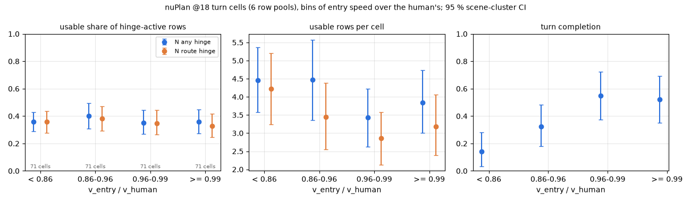
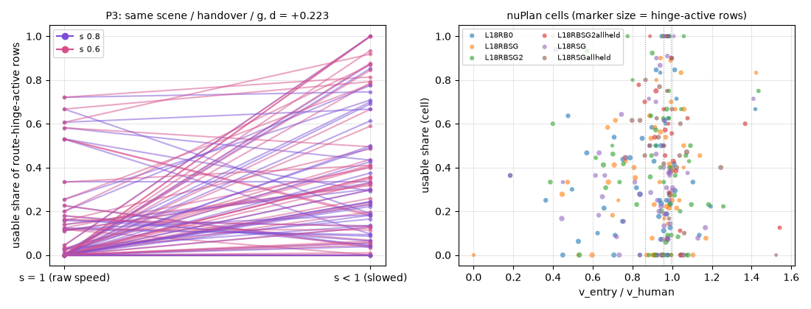

# ENTRY-SPEED ROWS: are the hinge rows of fast turn entries waste? (2026-10-14, decision 295)

Prereg: [../../plans/2026-10-14-entry-speed-rows-prereg.md](../../plans/2026-10-14-entry-speed-rows-prereg.md) (075a2406, committed
before any statistic; no amendment). Script [rf_entryspeed.py](../../scripts/rf_entryspeed.py) (+ [.sh](../../scripts/rf_entryspeed.sh)).
CPU only: no training, no GPU, no new rollouts. Files here: `tables.md` (every table below and more), `entry_speed.json`, `cells_nup.csv`,
`cells_p3.csv`, `p3_pairs.csv`.

**Question.** The speed-cap idea assumes this: at a high entry speed a lateral error turns into a terminal zero within 1-2 s, so the hinge rows
near it sit in waste states. At a low entry speed the same error stays small and the rows are recoverable. If so, the usable share of
hinge-active rows should rise as entry speed falls.

**Verdict by the registered rule: flat. The speed cap is dropped.** On nuPlan the usable share is the same in the slowest and the fastest
entry-speed bin: D = +0.000 [-0.112, +0.110], against a line of +0.20. The P3 within-scene contrast is positive (+0.223 [+0.129, +0.329]),
but the rule needs both. Against the cap, as registered: the slowest bin completes fewer turns, 0.14 against 0.52 (-0.38 [-0.59, -0.16]).

## Data

- **N (nuPlan @18, primary).** Six on-policy row pools with route labels:
  - train, 64 strict turns each: L18RB0, L18RSG, L18RBSG, L18RBSG2;
  - held, 24 turns each: L18RSGallheld, L18RBSG2allheld.
  - That is 304 cells over 88 scenes, with 4527 pool rows inside the cell windows. Another 287 decisions in the windows are pool
    exclusions (overlap, > 4 m corridor) and are not rows.
  - Turns, stations and the first zero event k_z come from rf_follow, unchanged. RB0 uses the stored `report/follow_train_rb`. The other
    labels were read for this note (box `runs/route_follow/entry_speed/follow{,2}`), from the same roll dirs as the rows.
  - The turn scenes are the same 64 / 24 under every label.
- **P (PAI, P3 archive, Tokyo).** 192 rollouts: 12 scenes x 2 handovers x 8 transforms, 18 510 decisions in the windows at 10 Hz. Strict
  turn and route grid from `p4_self/pool_dev/plan_p3.json`.
- **Hinge-active** uses the trainers' own values:
  - N: `active.npz` agent / road, plus `on_route.loss` on the served plan with the pool's `route.npz`;
  - P: `on_route.loss` on `poses_model`, with `rm_build.label`'s polyline and dz 1.0.
- **Gates.**
  - N: the anchor's distance to the label polyline (`on_route.near`) equals rf_follow's route `lat` (median |diff| 0.6 mm, p90 1 cm).
  - P: in the d0 identity cells, v_entry equals the human's entry speed (the handover is at the entry), and the anchor is 0.37 m from the
    route at the first window decision.
- **Bins.** The fixed edges 0.9 / 1.1 / 1.3 failed the registered size rule: 11 and 7 cells above 1.1. So, as registered, the pooled N
  quartiles of v_entry / v_human were used: **0.86 / 0.96 / 0.99**. 20 cells have v_human < 2 m/s and therefore no ratio.

## 1. Bins (N, primary; any hinge; T 3 s, L 1 m, H 20 deg)

| v_entry / v_human | cells | scenes | hinge-active rows | usable share | usable rows / cell | turn completion |
|:--|--:|--:|--:|:--|:--|:--|
| < 0.86 | 71 | 24 | 886 | 0.358 [0.290, 0.430] | 4.46 [3.58, 5.36] | 0.141 [0.033, 0.281] |
| 0.86-0.96 | 71 | 32 | 791 | 0.402 [0.307, 0.493] | 4.48 [3.35, 5.57] | 0.324 [0.179, 0.482] |
| 0.96-0.99 | 71 | 30 | 697 | 0.350 [0.271, 0.445] | 3.44 [2.62, 4.22] | 0.549 [0.375, 0.722] |
| >= 0.99 | 71 | 29 | 764 | 0.357 [0.274, 0.447] | 3.85 [3.00, 4.73] | 0.521 [0.351, 0.694] |
| **D (low - high)** | | | | **+0.000 [-0.112, +0.110]** | +0.62 [-0.62, +1.84] | **-0.380 [-0.587, -0.161]** |

CIs are scene-cluster bootstrap, B 10 000. The share is the ratio of sums over hinge-active rows.

The usable share is flat in every view of N:

- **Each hinge alone:**
  - route only: D +0.031 [-0.086, +0.144];
  - road only: -0.148 [-0.351, +0.034];
  - agent only: **-0.408 [-0.765, -0.135]**. Agent rows are more usable at the fast end.
- **Absolute v_entry bins** (< 3 / 3-5 / 5-7 / >= 7 m/s): 0.31 / 0.39 / 0.32 / 0.36.
- **Train and held scenes:** train +0.016 [-0.108, +0.138]; held +0.164 [-0.019, +0.352], from 4 cells in its slow bin.
- **Per pool:** the point D runs from -0.10 (RB0) to +0.37 (RBSG2 held, which has 1 cell in its slow bin). No pool's D is >= 0.20 with
  more than 3 cells in its slow bin.
- **Binomial GLM of the cell's usable share on the ratio:** pooled slope +0.08 [-0.82, +0.95]; with scene fixed effects +1.70
  [-2.60, +4.95]. Both are null.

**Where the waste is.** These are the hinge-active rows by bin, slow to fast:

| | < 0.86 | 0.86-0.96 | 0.96-0.99 | >= 0.99 |
|:--|--:|--:|--:|--:|
| after termination | 80 | 126 | 77 | 42 |
| within T before the zero | 180 | 118 | 120 | 79 |
| off L / H only | 309 | 229 | 256 | 370 |
| cells with a zero | 33 / 71 | 27 / 71 | 28 / 71 | 14 / 71 |

Rows near a termination are most common in the **slowest** bin. Across all bins most of the waste is "off the route by > 1 m or > 20 deg"
without any termination nearby.

## 2. P3 within-scene contrast (designed slowing, route hinge only)

The contrast is s < 1 minus s = 1, with the same scene, handover and g (g 1 and 1.5), over 96 pairs in 12 scenes:

| set | d usable share | d usable rows | d hinge-active rows | d mean speed entry..exit (m/s) | d completion |
|:--|:--|:--|:--|:--|:--|
| pooled | **+0.223 [+0.129, +0.329]** | +18.9 [+12.9, +25.0] | +11.4 [+1.6, +22.2] | -1.89 [-2.43, -1.18] | -0.052 [-0.135, +0.021] |
| s 0.8 | +0.169 [+0.084, +0.273] | +14.6 | +11.2 | -1.95 | -0.042 |
| s 0.6 | +0.277 [+0.162, +0.395] | +23.2 | +11.7 | -1.83 | -0.062 |
| handover d10 | +0.308 [+0.194, +0.427] | +23.7 | -0.1 | -0.34 [-1.06, +0.62] | +0.021 [-0.146, +0.188] |
| handover d0 | +0.138 [+0.003, +0.272] | +14.1 | +22.9 | -3.38 [-3.91, -2.82] | **-0.125 [-0.271, -0.021]** |

Per arm, in `tables.md`: identity d10 gives 0.17 and d0 gives 0.10. The s 0.6 arms give 0.44-0.46, except d0@g1.5s0.6 at 0.09. g 2 gives
0.00-0.05.

In the designed experiment the slowed cells do keep more usable rows, which is the hypothesis' mechanism: after-termination rows fall from
466 to 129 at d10 g1. They do not complete more turns, though. At d0 the slowed cells complete fewer turns: they crawl and pivot on the
spot (decision 293) and get rear-ended.

**Not registered: the rear-end caveat.** read.json has no rear-end time, so the rows after a rear-end count as recoverable. 35 of the 96
slow cells in the pairs were rear-ended. Dropping those pairs, the contrast falls to **+0.107 [+0.012, +0.185]** (d10 +0.20, d0 +0.05).
So about half of the P3 effect may be rows of a stopped car that the log's traffic has already hit.

## 3. Floor (turn completion by speed band)

The pooled completion on N is 0.384. The registered floor is the lowest bin whose completion CI reaches that rate: **v_entry / v_human
>= 0.86** (bin 0.86-0.96: 0.32 [0.18, 0.48]). Below 0.86, completion is 0.14 [0.03, 0.28].

In absolute speed the floor is the 3-5 m/s band (0.46). Below 3 m/s completion is 0.19 [0.05, 0.36]. Above 7 m/s there are 12 cells in 3
scenes and none completes.

On P3, slowing to a near stop at the entry (d0) costs completion (-0.125). Slowing during the approach (d10) does not change it.

Any cap must therefore stay at or above about 0.86 x the human's entry speed on these turns. The cap has little room: on N the policies
already enter at a median 0.95 x the human's speed, and only 18 of 284 cells are faster than 1.1 x.

## 4. Sensitivity (T 1.5 / 3 / 5 s x L 0.5 / 1 / 2 m x H 10 / 20 / 30 deg)

- **N, D low - high:** between -0.154 and +0.065. No setting reaches +0.20, and none has a CI above 0. At L 2 m with T 5 s the D is
  negative with its CI clear of 0 (-0.15): the fast bin is more usable.
- **P3, pooled d:** between +0.10 and +0.26, positive in every cell of the grid.
- The verdict does not depend on T, L or H.

## Figures

`figs/entry_speed_rows_bins.png`: N bins, any hinge (blue) and route hinge (orange). What to look at:

- **Left panel:** the share is level at 0.35-0.40 across the bins.
- **Right panel:** completion climbs from 0.14 to 0.52 with speed. The slow end is where the policy fails the turn, not where the rows are
  clean.

`figs/entry_speed_rows_cells.png`. What to look at:

- **Left panel, P3:** each line joins one scene's s = 1 cell to its s < 1 cell. Most lines rise, but many start at 0 (identity cells that
  zero early).
- **Right panel, every N cell:** the cells crowd at a ratio of 0.8-1.0, with no trend across them.

## What the data said that the hypothesis did not expect

1. **Slow entries are failure cases.** On nuPlan the slowest quartile (< 0.86 x the human's speed) has the most zero events (33 / 71 cells
   against 14 / 71 at the fast end) and the most rows within 3 s of a zero. Slowness is a symptom of a confused turn (decision 285's
   ratchet, the "short" outcomes), not a protective regime.
2. **Most waste is not near a termination.** It is lateral (> 1 m) or heading (> 20 deg) error in rollouts that never zero there, in every
   bin.
3. **Agent-hinge rows are more usable at higher speed** (0.12 slowest bin vs 0.53 fastest): only 14 of the slowest bin's 118
   agent-active rows are usable. What kind of contact these are was not looked at.
4. **P3 does not find "same error, slower, so recoverable", because the speed push does not change the error.** It mostly removes
   terminations (or replaces them with rear-ends), and completion does not follow.

## Not measured

- **Fast entries on nuPlan.** Only 18 cells (8 scenes) enter faster than 1.1 x the human. On these turns the regime the hypothesis is
  about barely exists, so the registered contrast is "slower than human vs at human speed".
- **PAI with natural variation.** PAI is where fast entries happen (decision 285: up to 12 m/s), but its only stored row-ready set here is
  P3: 12 scenes with designed variation from the handover.
- **Road and agent hinges on P3.** They need the simulator replay (`onp_rows.scene_rows`). P3 uses the route hinge only.
- **Rear-end times on P3.** read.json has none. See the caveat in section 2.
- **Zero type per nuPlan cell.** rf_follow's k_z does not record it.
- **N's decision-level waste.** The pool already excludes overlap and > 4 m corridor states, so N's waste share is a lower bound.

## Evidence

Low. One lineage (RB0 and its S / route children), seed 0, archive only, association on N. P3 has 12 scenes and one seed.

## Run notes

The first rf_follow run (8 workers, all 1021 + 452 scenes) grew to ~18 GB per worker. At 13:51 the platform's kill line took one of its
workers: only this job's own process was killed, and no pool job. The rerun used 4 workers on the 88 turn scenes (`turn_scenes.txt`).
The box keeps `runs/route_follow/entry_speed/{follow,follow2,nup,turn_scenes.txt}`. RSG / RBSG come from `follow` (all scenes);
RBSG2 and the held labels come from `follow2`. Tokyo keeps `/data/runs/route_night/entry_speed/p3.pkl`.
