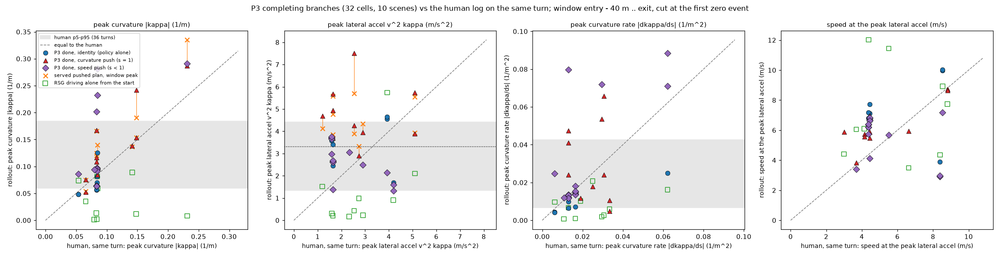

# P3 turn shape vs the human: numbers for a demonstration-row shape gate (2026-10-14)

The question: would training on P3's pushed branches teach a turn that is steeper or less smooth than a human's? This is a CPU read of
stored rollouts only. Nothing was trained or rolled out. Script [rf_shape.py](../../scripts/rf_shape.py) (definitions in its docstring).
`extract-p3` ran on Tokyo (plain python3) over `/data/runs/route_night/p3/arms`. `report` ran on the Mac over rf_pai_follow's
`r281.pkl`, the same extract as [pai_follow](../pai_follow/) (md5 e242bd10). Files here: `shape.json` (everything below, plus the per-cell
rows of the completing branches), `shape_tables.md` (p5 / p25 / median / p75 / p95 for every group and quantity), `shape_turns.csv` (human
and RSG per turn), `shape_p3.csv` (all 192 P3 rollouts).

## Definitions

- **Turn.** rf_pai_follow's strict turn, measured on the AlpaSim route the evaluator saw: net heading change >= 60 deg within 30 m,
  entry / exit at 10 % / 90 % of that change, and exit + 10 m inside the log. A turn of >= 150 deg counts as a U-turn. The topo class
  comes from rf_pai_follow's `topo`, with the **human log** as the ego: the human's lane at entry - 10 m and its successor chains.
- **Window.** Route stations from entry - 40 m to exit. Every track is cut at its first zero-score event. Many clips start inside
  entry - 40 m, so v at -40 m exists for only 15 of the 36 human turns.
- **Track.** Human: the logged rig path (10 Hz). Rollouts: the controller trace (10 Hz, measured vx).
- **Curvature.** The track is resampled every 0.25 m of its own arc length. Heading is taken from a chord over +-0.5 m. kappa is the
  heading difference over +-1 m, so it is smoothed over about 3 m. dkappa/ds uses the same +-1 m difference.
- **Lateral and longitudinal acceleration.** a_lat = v^2 kappa at the same arc point. v is the speed averaged over 5 samples
  (rf_pai_follow's v_log for the human). The deceleration is the 1 s central difference of that speed.
- **Peaks.** Every reported peak is the max |.| inside the window.
- **Deceleration start.** The first point after entry - 40 m where v < 0.9 x v(-40 m).
- **Checks on the operator.** It returns 0.100 / m on a sampled 10 m radius arc. Log and controller traces are equally smooth: the
  3-point sagitta has a median of 0.7 / 0.5 mm.
- **Served plan.** The plan the MPC received (8 poses at 0.5 s, after the push), measured with the same kappa operator on its pose yaws.
  We report its peak over the 30 window decisions.

## Gate on this read: reproduction of rf_pai_follow

The read reproduces rf_pai_follow exactly:

- **Turns.** The same 36 strict turns on the same scenes, with identical entry / exit stations.
- **Speed at entry, all 36 turns.** The human speed at the entry matches rf_pai_follow's `v_log_entry` to 1e-15 (median 4.58 m/s).
- **Speed at entry, rf_pai_follow's 20-turn figure.** That figure is the log speed at the turn of each RSG route zero where the ego got
  there. Here it is 5.07 m/s median on n = 20, the same value, with max |diff| 0.

Turn counts:

| split | turns | left | right | U |
|:--|--:|--:|--:|--:|
| all | 36 | 14 | 21 | 1 (302c5c99, 163 deg) |
| hard_exam | 18 | | | |
| rest | 18 | | | |

| topo class | turns |
|:--|--:|
| straight_exit | 16 |
| curve_single | 10 |
| straight_road | 5 (includes the U-turn) |
| no_straight_exit | 4 |
| other_no_lane | 1 |

## 1. Human distribution (36 strict PAI turns)

| quantity | n | p5 | p25 | median | p75 | p95 |
|:--|--:|--:|--:|--:|--:|--:|
| peak curvature (1/m) | 36 | 0.060 | 0.069 | 0.091 | 0.123 | 0.184 |
| peak lateral accel (m/s^2) | 36 | 1.35 | 1.85 | 2.38 | 2.96 | 4.42 |
| peak curvature rate (1/m^2) | 36 | 0.0067 | 0.0127 | 0.0194 | 0.0298 | 0.0425 |
| peak deceleration (m/s^2) | 36 | 0.00 | 0.32 | 1.06 | 1.93 | 2.97 |
| v at entry - 40 m | 15 | 2.1 | 6.3 | 9.1 | 10.5 | 15.2 |
| v at entry - 20 m | 23 | 4.0 | 5.1 | 6.8 | 8.7 | 11.1 |
| v at entry - 10 m | 27 | 2.5 | 4.8 | 5.4 | 7.1 | 8.7 |
| v at entry | 36 | 1.9 | 3.5 | 4.6 | 5.9 | 8.3 |
| min v in the junction | 36 | 2.0 | 3.2 | 4.3 | 5.4 | 7.9 |
| deceleration start (m from entry) | 12 | -33.8 | -32.6 | -26.3 | -15.3 | -6.9 |
| station of peak curvature (m from entry) | 36 | -5.3 | 2.7 | 4.7 | 7.7 | 15.5 |
| v at the peak lateral accel | 36 | 3.4 | 4.4 | 5.6 | 6.7 | 8.4 |

Per group (median / p95). The p5 / p25 / p75 for every group are in `shape_tables.md`.

| group | n | peak kappa | peak a_lat | peak dkappa/ds | peak decel | v -20 m | v -10 m | v entry | min v junction |
|:--|--:|--:|--:|--:|--:|--:|--:|--:|--:|
| left | 14 | 0.076 / 0.185 | 2.66 / 4.51 | 0.019 / 0.056 | 0.56 / 2.50 | 7.0 / 10.5 | 6.9 / 8.5 | 5.9 / 8.5 | 5.4 / 8.5 |
| right | 21 | 0.093 / 0.143 | 2.34 / 3.36 | 0.019 / 0.035 | 1.56 / 3.14 | 7.1 / 11.1 | 5.4 / 8.8 | 4.5 / 6.2 | 4.1 / 5.5 |
| U-turn | 1 | 0.231 | 2.91 | 0.030 | 0.55 | 5.0 | 4.9 | 3.7 | 3.4 |
| hard_exam | 18 | 0.085 / 0.196 | 2.51 / 5.11 | 0.022 / 0.040 | 0.86 / 2.94 | 7.6 / 11.3 | 6.6 / 8.9 | 5.1 / 8.4 | 4.6 / 8.4 |
| rest | 18 | 0.095 / 0.153 | 2.35 / 3.45 | 0.017 / 0.041 | 1.26 / 2.98 | 6.1 / 10.5 | 5.2 / 8.5 | 4.5 / 6.7 | 4.2 / 5.8 |
| straight_exit | 16 | 0.101 / 0.159 | 2.31 / 3.68 | 0.019 / 0.036 | 1.37 / 2.87 | 6.8 / 9.4 | 5.4 / 8.1 | 4.6 / 7.0 | 4.1 / 6.9 |
| curve_single | 10 | 0.091 / 0.164 | 2.35 / 5.13 | 0.025 / 0.046 | 0.45 / 2.91 | 6.1 / 12.0 | 3.2 / 9.9 | 3.9 / 8.3 | 3.6 / 7.8 |
| straight_road | 5 | 0.067 / 0.202 | 2.62 / 2.87 | 0.010 / 0.026 | 1.00 / 2.08 | 7.9 / 10.6 | 6.5 / 8.5 | 5.3 / 6.4 | 5.3 / 5.8 |
| no_straight_exit | 4 | 0.085 / 0.134 | 3.39 / 4.16 | 0.027 / 0.058 | 1.42 / 3.04 | 7.1 / 9.9 | 7.0 / 7.1 | 4.6 / 7.8 | 4.7 / 7.4 |

Three things stand out:

- **Right turns are tighter and slower than left turns.** Right turns have a median kappa of 0.093 against 0.076 for left turns, and an
  entry speed of 4.5 m/s against 5.9 m/s.
- **Human lateral acceleration often exceeds 3.3 m/s^2.** It is above 3.3 m/s^2 on 8 of the 36 turns: p75 2.96, p95 4.42.
- **The human brakes early.** Where the clip covers entry - 40 m and the human enters it above 2 m/s, the deceleration starts at a median
  of 26 m before the entry (n = 12).

## 2. RSG alone and P3, against the human

Median / p95 over the entry - 40 m .. exit window, each track cut at its zero event. "Curvature push" means the cells with g > 1, s = 1.
"Speed push" means the cells with s < 1.

| track | peak kappa (1/m) | peak a_lat (m/s^2) | peak dkappa/ds (1/m^2) | v at peak a_lat | v -20 m | v -10 m | v entry | min v junction | peak decel | station of peak kappa (m) |
|:--|--:|--:|--:|--:|--:|--:|--:|--:|--:|--:|
| human (36 turns) | 0.091 / 0.184 | 2.38 / 4.42 | 0.019 / 0.043 | 5.6 / 8.4 | 6.8 / 11.1 | 5.4 / 8.7 | 4.6 / 8.3 | 4.3 / 7.9 | 1.06 / 2.97 | 4.7 / 15.5 |
| RSG alone (35 turns) | 0.059 / 0.100 | 1.04 / 3.64 | 0.010 / 0.021 | 6.0 / 12.1 | 5.8 / 12.5 | 5.4 / 12.0 | 4.9 / 12.1 | 3.8 / 12.2 | 0.75 / 2.55 | 3.4 / 20.3 |
| P3 completing, all (32 cells) | 0.094 / 0.284 | 3.61 / 5.71 | 0.014 / 0.075 | 6.3 / 9.3 | 5.1 / 7.3 | 4.9 / 7.7 | 4.8 / 8.6 | 4.7 / 8.6 | 1.87 / 2.96 | 6.2 / 12.7 |
| P3 completing, identity (7) | 0.057 / 0.112 | 3.59 / 4.63 | 0.007 / 0.022 | 7.2 / 10.0 | 5.1 / 5.2 | 5.4 / 7.4 | 5.6 / 8.6 | 5.6 / 8.7 | 0.20 / 1.87 | 10.1 / 12.7 |
| P3 completing, curvature push (10) | 0.128 / 0.267 | 4.47 / 6.71 | 0.024 / 0.060 | 5.9 / 8.7 | 6.2 / 8.4 | 5.5 / 7.9 | 5.5 / 8.6 | 5.3 / 8.5 | 0.99 / 3.13 | 5.0 / 17.2 |
| P3 completing, speed push (15) | 0.094 / 0.284 | 2.65 / 3.73 | 0.015 / 0.082 | 6.2 / 6.9 | 5.1 / 6.3 | 2.9 / 6.2 | 4.5 / 5.9 | 4.5 / 5.9 | 1.98 / 2.96 | 3.2 / 10.1 |
| P3 failing, pushed (143) | 0.097 / 0.262 | 2.19 / 10.5 | 0.025 / 0.071 | 5.2 / 8.7 | 6.2 / 10.8 | 6.3 / 8.9 | 4.4 / 8.6 | 3.4 / 7.9 | 2.11 / 4.38 | 2.2 / 15.8 |
| P3 failing, identity (17) | 0.055 / 0.087 | 1.57 / 3.29 | 0.010 / 0.024 | 6.1 / 8.6 | 7.8 / 10.8 | 6.5 / 9.0 | 5.4 / 8.9 | 5.4 / 8.1 | 0.96 / 3.37 | 0.9 / 20.4 |

Two notes on the reference rows:

- **RSG alone.** Its low curvature is the known failure, not smoothness. It mostly does not turn before its zero event; on the U-turn it
  drives straight (kappa 0.008). Its entry-speed p95 of 12 m/s is the "charging into the junction" case.
- **Speed-push completions.** At d10, the 3 s window ends before the junction: realized kappa inside the window is 0.009. These cells
  are the policy's own turn after a slowed approach.

Push window alone (the 3 s from the handover; median / p95), with the served pushed plan next to the realized track:

| cells | realized kappa | realized a_lat | realized dkappa/ds | realized decel | served plan kappa | served plan a_lat | raw plan kappa |
|:--|--:|--:|--:|--:|--:|--:|--:|
| completing, curvature push (10) | 0.128 / 0.267 | 4.47 / 6.71 | 0.023 / 0.060 | 0.51 / 1.21 | 0.138 / 0.270 | 4.23 / 5.65 | 0.110 / 0.180 |
| completing, speed push (15) | 0.009 / 0.284 | 0.11 / 2.25 | 0.004 / 0.075 | 1.98 / 2.96 | 0.110 / 0.420 | 1.23 / 2.50 | 0.102 / 0.294 |
| failing, pushed (143) | 0.088 / 0.262 | 1.61 / 10.5 | 0.022 / 0.071 | 1.81 / 4.38 | 0.161 / 0.409 | 2.13 / 10.3 | 0.123 / 0.256 |

**The MPC barely smooths the push.** The table below is the ratio of the realized window peak kappa to the served plan's window peak
kappa (p5 / median / p95):

| handover | push | cells | realized / served |
|:--|:--|--:|:--|
| d0 | curvature | 7 | 0.68 / 1.00 / 1.01 |
| d10 | curvature | 3 | 0.94 / 0.96 / 1.24 |
| d0 | speed | 6 | 0.58 / 0.69 / 0.80 |

- **Curvature push.** The car drives the curvature it is served. The exceptions are 94c1d722 (served 0.140, realized 0.084) and the
  U-turn (0.335 -> 0.287). One cell overshoots: a174faed d10@g1.5s1 is served 0.190, realizes 0.242 and reaches a_lat 7.5.
- **Speed push.** The served plan bends sharply at near-standstill (up to 0.46 / m) and the vehicle rounds it to about 0.7x.
- So a training row built from the realized track carries essentially the pushed curvature. Only the slow pivots are rounded.

## 3. Paired: each completing branch against the human on the same turn

The completing branches are 32 cells over 10 scenes: 7 identity, 25 pushed. A cell is "inside the band" when it lies within the human
[p5, p95] of its topo class. For classes with fewer than 5 turns, the all-turn band is used. Ratios are rollout / human on the same turn
(median):

| cells | kappa inside band | a_lat inside band | dkappa/ds inside band | all three inside | ratio kappa | ratio a_lat | ratio dkappa/ds |
|:--|--:|--:|--:|--:|--:|--:|--:|
| all completing (32) | 21 | 17 | 18 | 12 | 1.13 | 1.60 | 0.92 |
| pushed (25) | 18 | 13 | 15 | 10 | 1.15 | 1.61 | 1.04 |
| curvature push (10) | 7 | 3 | 4 | 2 | 1.20 | 1.96 | 1.30 |
| speed push (15) | 11 | 10 | 11 | 8 | 1.14 | 1.59 | 1.04 |
| identity (7) | 3 | 4 | 3 | 2 | 0.90 | 1.49 | 0.68 |

Identity cells fall "outside" mostly on the low side: below the human's p5 curvature or curvature rate.

How many completing branches are steeper than the human on that very turn:

| criterion | all 32 completing | pushed 25 |
|:--|--:|--:|
| ratio > 1, kappa | 19 | 18 |
| ratio > 1, a_lat | 25 | 19 |
| ratio > 1, dkappa/ds | 14 | 14 |
| ratio > 1, any of the three | 31 | 24 |
| ratio > 1.25, kappa | 10 | 9 |
| ratio > 1.25, a_lat | 21 | 17 |
| ratio > 1.25, dkappa/ds | 9 | 9 |
| ratio > 1.25, any of the three | 27 | |

**Most of the excess is speed through the junction, not path geometry:**

- The speed at the peak lateral acceleration is 1.33x the human's on the same turn (median). 1.33^2 = 1.77, which is about the a_lat
  ratio.
- The P3 completer's curvature peaks later in the junction: median +6.2 m after the entry, against +3.2 m for the human on the same turns.
- The policy alone shows the same pattern when it completes. The 7 identity completions have a_lat 1.49x the human's, with peak curvature
  0.90x.

**Where the shape itself is not human:**

- **Curvature push (s = 1).** Peak curvature is 1.20x the human's and the curvature rate 1.30x. Two cells are geometrically far out:
  2f227f2c d0@g1.5s1 (kappa 2.0x, dkappa/ds 3.7x) and a174faed d10@g1.5s1 (kappa 1.6x, a_lat 7.5 m/s^2).
- **d0 speed cuts.** These turn nearly on the spot. 2f227f2c d0@g1.5s0.6, fd01e9ab d0@g1.5s0.6 / g1s0.8 and 302c5c99 d0@g1.5s0.8 have
  kappa 0.20-0.29 at 1-2 m/s: 1.3-3.3x the human's curvature and up to 6x the curvature rate, but low a_lat.

Per-cell values (rollout, with the human on the same turn in brackets) are in `shape.json` `done_rows`.

## 4. Proposed shape gate for demonstration rows, and entry-speed targets

Each gate below is applied to the realized track from entry - 40 m to exit. "p95c" is the human p95 of the cell's topo class.
"Human turns passing" is how many of the 36 human turns the same gate keeps.

| gate | completing kept (of 32) | pushed kept (of 25) | human turns passing (of 36) | new scenes kept (not completed by identity) |
|:--|--:|--:|--:|:--|
| A: kappa <= p95c, dkappa/ds <= p95c, a_lat <= 3.3 | 10 | 8 | 23 | 94c1d722, f9e361aa |
| **B: kappa <= p95c, dkappa/ds <= p95c, a_lat <= 4.4 (human p95, all turns)** | **20** | **15** | **28** | 94c1d722, a174faed, e37aa159, f9e361aa |
| C: as A, but a_lat <= max(3.3, the human's a_lat on the same turn) | 11 | 9 | 30 (trivially; geometry only) | 94c1d722, e37aa159, f9e361aa |
| D: geometry only (kappa, dkappa/ds <= p95c) | 24 | 17 | 30 | 3ce13eed, 94c1d722, a174faed, e37aa159, f9e361aa |

The p95c values used (1/m and 1/m^2). The no_straight_exit and other_no_lane classes have fewer than 5 turns and use the all-turn values.

| class | p95 kappa | p95 dkappa/ds |
|:--|--:|--:|
| straight_exit | 0.159 | 0.036 |
| curve_single | 0.164 | 0.046 |
| straight_road | 0.202 (set by the U-turn) | 0.026 |
| all turns | 0.184 | 0.043 |

- **Gate A, the example cap.** It keeps 10 cells. Only 1 of the 10 curvature-push completions survives (94c1d722 d0@g1.25s1), and the
  gate rejects 13 of the 36 human turns itself. As a "no steeper than a human" gate it is too strict. As a comfort cap on rows that keep
  the policy's own speed it is defensible: it is the same 3.3 m/s^2 the CFTv synthesis uses.
- **Proposal, gate B.** Use B for the realized shape: class p95 on peak kappa and peak dkappa/ds, and a_lat <= 4.4 m/s^2. It keeps 20 / 32
  completing cells, 15 / 25 pushed. It removes:
  - the four d0 speed-cut pivots (2f227f2c d0@g1.5s0.6, fd01e9ab d0@g1.5s0.6 and d0@g1s0.8, 302c5c99 d0@g1.5s0.8);
  - 302c5c99 d0@g1.5s1 (the U-turn pushes exceed the straight_road kappa p95);
  - 2f227f2c d0@g1.5s1 and d10@g1.25s1 (curvature rate; a_lat 4.9 / 5.7);
  - a174faed d10@g1.5s1 (all three);
  - on a_lat alone:
    - 3ce13eed d0@g1.25s1: the human's kappa, but a_lat 4.7 against the human's 1.2;
    - e37aa159 d0@g1.25s1: a_lat 5.7, where the human's is 5.1;
    - the two 382a7247 identity cells: a_lat 4.6 / 4.7, where the human's is 3.9.
  - Kept new-completion cells: 94c1d722 d0@g1.25s1, a174faed d0@g1.25s1, e37aa159 d10@g1.25s1 and f9e361aa d10@g1s0.8. The other 11
    kept pushed cells are on 2f227f2c / eaba3f6a / 382a7247, which identity already completes.
- **Pair B with a speed target.** The remaining excess is speed: a_lat 1.6x the human's on the same turn. Rows should carry a speed target
  no higher than the human's on that class (below), rather than the realized speed. Otherwise the rows teach "the right path, 1.3x too
  fast", which is the policy's existing failure. Gate A is the fallback if the realized speed is kept.

Human entry-speed targets per topo class (median / p25, m/s; n = turns where the clip covers that station):

| class | turns | v at -20 m | v at -10 m | v at entry | v at -40 m |
|:--|--:|:--|:--|:--|:--|
| all | 36 | 6.8 / 5.1 (23) | 5.4 / 4.8 (27) | 4.6 / 3.5 (36) | 9.1 / 6.3 (15) |
| straight_exit | 16 | 6.8 / 5.3 (13) | 5.4 / 5.2 (13) | 4.6 / 4.2 (16) | 8.5 / 4.0 (9) |
| curve_single | 10 | 6.1 / 6.1 (3) | 3.2 / 2.7 (6) | 3.9 / 2.5 (10) | 13.9 / 12.7 (2) |
| straight_road | 5 | 7.9 / 5.0 (5) | 6.5 / 4.9 (5) | 5.3 / 4.4 (5) | 9.6 / 7.8 (3) |
| no_straight_exit | 4 | 7.1 / 5.6 (2) | 7.0 / 7.0 (2) | 4.6 / 3.1 (4) | 14.7 (1) |
| left / right | 14 / 21 | 7.0 / 5.7, 7.1 / 5.5 | 6.9 / 5.6, 5.4 / 4.4 | 5.9 / 4.6, 4.5 / 3.1 | |

The human minimum speed in the junction is 4.3 m/s median (p25 3.2). The deceleration starts about 26 m before the entry.

## Figure

`experiments/route_follow/figs/p3_shape.png`. Each point is one completing P3 cell, plotted against the human on the same turn. The four
panels are peak curvature, peak lateral acceleration, peak curvature rate, and the speed at the peak lateral acceleration. Markers:

- blue circles: identity;
- red triangles: curvature push;
- purple diamonds: speed push;
- green squares: RSG driving alone;
- orange crosses: the served pushed plan's window peak (curvature cells), joined to their realized point.

The grey band is the human p5-p95 over all 36 turns. The dashed line is "equal to the human".

What to look at:

- **Curvature panel.** Most red and blue points sit near the diagonal, inside the band. The exceptions are the purple pivots at the
  human's 0.085 and the U-turn at 0.23. The orange crosses sit on their red triangles: the car follows the pushed plan.
- **Lateral-acceleration panel.** Almost everything sits above the diagonal, identity included.
- **Speed panel.** Most points sit above the diagonal (1.3x). This speed is where the lateral-acceleration excess comes from.
- **Green squares** sit near zero curvature: RSG alone does not turn.

## Not claimed

The numbers come from 12 P3 scenes, 10 of them with a completion, one seed and best-of-16 cells. Several cells per scene are near
copies: 2f227f2c contributes 10 of the 32 completing cells, and eaba3f6a 7. The human bands come from 36 turns, with class p95 from 5-16
turns per class. The straight_road band includes the one U-turn. Speeds at -40 m exist for 15 turns only. kappa depends on the ~3 m
smoothing; peaks shrink with longer smoothing, equally for the human and the rollouts.
