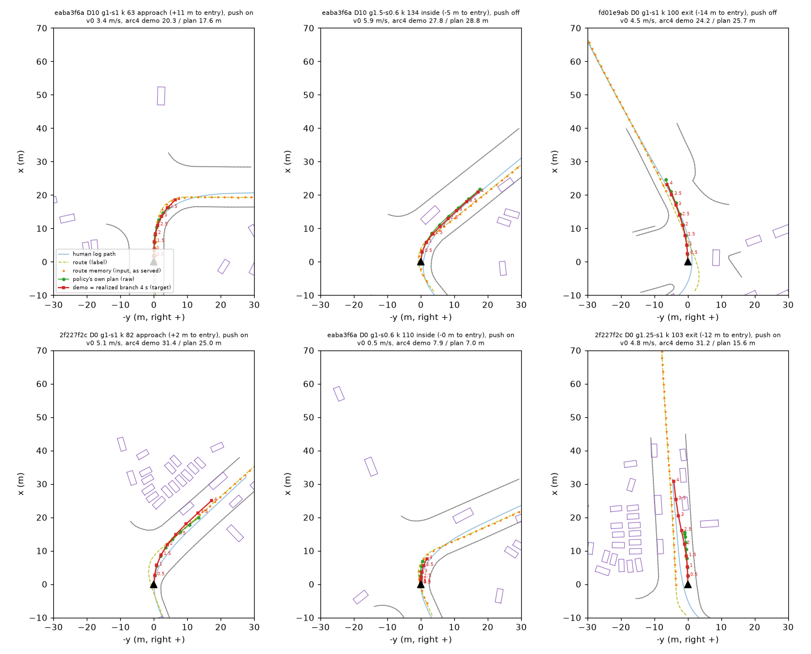

# on1_SELFdev: the self-branch row builder on the P3 archive (2026-10-14)

Builder [rf_selfpool.py](../../../scripts/rf_selfpool.py); row definition and gates in
[turning-school-rows.md, on1_SELF](../../../../../research/next-round/turning-school-rows.md#on1_self). Input: the 192 P3 rollouts
(`/data/runs/route_night/p3`, [p3_branch](../../p3_branch/README.md)). Their 32 completing cells (10 scenes) are the branches.
`plan_p3.json` is rf_p4.py `plan` on the 12 P3 scenes. It gives the route grid, the strict entry / exit, the topo class, v_e and the shape gate.
Run on Tokyo (CPU, plus card 0 for about 1 min of token encoding), code snapshot `/data/runs/route_night/p4_self/code`, work dir
`/data/runs/route_night/p4_self/dev/work`, pool `/data/runs/op_parity/cache/on1_SELFdev` (Tokyo only). The whole chain takes about 3 min.

**Dev only: never train on this pool.** 8 of the 12 P3 scenes are hard_exam scenes. Rows from 2f227f2c, 94c1d722 and fd01e9ab
(198 rows) are exam rows. The pool dir carries `EXAM_SCENES_INSIDE`, and a build without `--allow-exam` refuses these scenes.

```
rf_selfpool.py build --roots /data/runs/route_night/p3/arms --read /data/runs/route_night/p3/read.json --plan <plan_p3.json> \
    --served /data/runs/route_night/p3/code --tag on1_SELFdev --allow-exam --work <dev>/work --out <dev>/results --card 0 --fig self_bev_dev.png
```

## Gates

| gate | value | pass |
|:--|:--|:--|
| G-in: replayed model inputs = the served ones (drive.jsonl records; P3 has no PAI_DUMP files) | 6357 / 6357 decisions | yes |
| G-route: regenerated first route point vs the logged route0 <= 0.05 m on >= 99 % of rows | 97.9 % of 666 rows, max 0.10 m | **no, by the letter** |
| G-rmem: route memory input (rmem.Tracker on the logged messages) vs the served `rmem` | max 1.2e-4 (rounding of the log) | yes |
| G-road: demo crosses a road-edge segment (<= 1 %) | 0 % (the served plan also 0 %) | yes |
| G-speed: demo 4 s chord vs the controller trace, within 10 % on >= 99 % | 100 %, median ratio 1.000 | yes |
| G-r1: pool tokens, ego and features bit-identical to the cache | front 256 / 256 sampled rows, ego all, feat fp16 max 9.8e-4 | yes |
| G-shape: decision 293 on the branch's realized track | 17 / 32 branches pass. Fails: kmax 6, dk 8, alat 7, v_entry 7 (overlapping). 607 rows dropped | - |
| G-crawl: approach rows with min(v0, future speed before the entry) < 0.5 v_e | 370 rows dropped | - |

- G-shape reproduces rf_shape exactly: per-cell kmax / dk are identical and alat agrees to 0.0014 against `shape.json` `done_rows`.
  The geometry part (gate B of decision 293) keeps the same 20 / 32. The P4 entry-speed term (v_entry <= v_e + 1) drops 3 more:
  382a7247 d0 s0.8, 2f227f2c d10 identity and e37aa159 d10 g1.25.
- G-route misses because the regeneration (rf_pait.regen) takes z / roll / pitch from the human log at the same time. On the policy's
  own states late in a rollout, the log is elsewhere at that time. The 2.1 % of rows over the line are at 0.05-0.10 m (a174faed,
  fd01e9ab, f9e361aa after the turn). This affects only the route-hinge label (`route.npz` poly). The route memory input is the served
  one (G-rmem).
- The regenerated memory differs from the served memory by > 0.02 on 34 % of rows (p99 0.095). This is why the input comes from the
  logged messages (`--feat logged`, the default) and not from the regeneration.

## Coverage

666 rows, 13 branches, 6 scenes (turns).

| | rows |
|:--|:--|
| phase | approach 170, inside 316, exit 180 |
| D (handover) | D10 334, D0 332 |
| cell | g1-s1 208, g1.25-s1 136, g1-s0.6 108, g1-s0.8 103, g1.5-s0.8 58, g1.5-s0.6 53 |
| src | log 666 (P3 always hands over from the log) |
| push (served plan transformed at the decision) | on 227, off 439 |
| topo | straight_exit 468, no_straight_exit 117, straight_road 81 |
| distance to entry | 20-0 m 170, inside / exit 496; nothing beyond 20 m (P3 hands over at entry - 10 m / at the entry) |
| per scene | eaba3f6a 387, 2f227f2c 81, 94c1d722 59, fd01e9ab 58, f9e361aa 47, a174faed 34 |

Per-branch table (window, usable, crawl, rows): [coverage_SELFdev.md](coverage_SELFdev.md). Everything else:
[pool_gates_SELFdev.json](pool_gates_SELFdev.json). Branches with G-shape: [branches.json](branches.json). The 160 failing P3 rollouts per
scene, for the critic line: [failing.json](failing.json).

What the dev run shows about the P3 material:

- One scene dominates: eaba3f6a has 7 passing branches and 58 % of the rows. A pool from a branch search needs a per-scene cap in the
  draw weights (`--on-weight log=<scene>:w`).
- The speed cuts barely survive. 2f227f2c d10 s0.6 / s0.8 pass G-shape, but all their usable rows before the rear-end crawl (0 rows
  left). eaba3f6a s < 1 loses 40-50 % of its rows to G-crawl. eaba3f6a d0 s0.6 still keeps 55 rows that crawl INSIDE the junction
  (v_min 0.31 m/s). G-crawl as specified covers only the approach.
- 140 rows come from scenes that the identity cell does not complete: 94c1d722 (59) and a174faed (34), both curvature x1.25 at d0, and
  f9e361aa (47, speed s0.8). The other three new-completion scenes fail G-shape: 3ce13eed and e37aa159 too fast, the 302c5c99 U-turn too
  sharp.

## Figure



`experiments/route_follow/figs/self_bev_dev.png`: 6 rows from 6 branches, 2 per phase. Each panel is in the anchor's rig frame (forward up,
right to the right). Red is the demo, the realized branch at 0.5 .. 4 s. Green is the policy's own raw plan at that decision. Orange dots
are the route memory as served, the yellow dashes are the route label, the blue line is the human log, grey lines are road edges and purple
boxes are actors. What to look at:

- The red demo leaves along the route in every panel.
- In the approach / push panels (top left, bottom left) the red demo bends and spaces further than the green plan: the push and the speed it
  carried.
- The bottom-middle panel (eaba3f6a d0 s0.6, 0.5 m/s at the entry) is the in-junction crawl that G-crawl does not catch.
- The bottom-right exit row of 2f227f2c d0 g1.25 accelerates out of the turn (4 s arc 31 m against the policy's 16 m) and runs left of the
  route line, inside the road.
