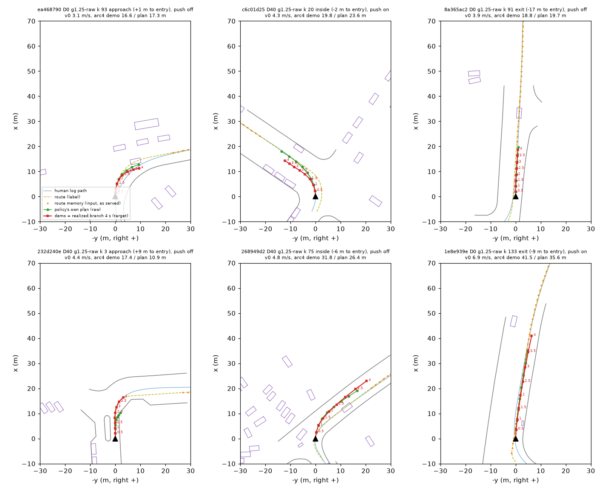

# P4 training round 1: stopped at the pool gate G-route (2026-10-14)

Prereg: [Amendment 3](../../../plans/2026-10-14-p4-self-branch-prereg.md) of the P4 self-branch prereg. Under that amendment the round runs
by the user's decision, even though the coverage verdict was inconclusive.
- Rows: gain 1.25, D40 / D0, profile raw only (the longitudinal part taken out), cells that pass G-shape.
- Arms: RSGSELF-L18-s0 / s1, and the control RSGCTL-L18-s0.

**Status: stopped before any training.** The rebuilt pool fails G-route by the letter. The brief and Amendment 3 say: stop and report, do not
loosen a gate. Nothing was merged, trained or read.

## Pool on1_SELF4R

- Built with `rf_selfpool.py build --backend box --roots $DATA_DIR/runs/route_follow/p4/run --tag on1_SELF4R --served <root>/code --cells
  g1.25-raw --d D40,D0`.
- Ran as pool job `1014-162044-69eb`: card 0, 6 GB declared, 16 cores, 2.3 min wall (16:21:01 to 16:23:19 box time).
- Outputs:
  - [pool/coverage_SELF4R.md](pool/coverage_SELF4R.md): gates and the per-branch table.
  - [pool/pool_gates_SELF4R.json](pool/pool_gates_SELF4R.json)
  - [pool/branches.json](pool/branches.json): has a `filter` field.
  - [pool/failing.json](pool/failing.json)
- On the box the pool is `$DATA_DIR/runs/op_parity/cache/on1_SELF4R` (+ `@warp`, `feat/on1_SELF4R.npz`); the work dir is
  `$DATA_DIR/runs/route_follow/selfpool_SELF4R`.

| gate | value | pass |
|:--|:--|:--|
| G-in | dumps 400 / 400, drive.jsonl records 3 979 / 3 979 | yes |
| **G-route** (regenerated first route point vs the logged route0 <= 0.05 m on >= 99 % of rows) | **98.69 % of 763 rows, max 0.055 m** | **no, by the letter** |
| G-rmem | max abs diff 1.4e-4 | yes |
| G-road (<= 1 %) | 0 % (the served plan 0.66 %) | yes |
| G-speed (>= 99 % within 10 %) | 100 %, median ratio 1.000 | yes |
| G-r1 | front 256 / 256, ego bit-identical, feat fp16 max 9.8e-4 | yes |
| G-shape | 12 / 20 completing g1.25-raw D40 / D0 cells pass. Fails: kmax 7, dk 2, alat 3, v_entry 1. 487 rows dropped | - |
| G-crawl | 391 approach rows dropped | - |

**Where G-route fails.** The 10 rows over the line are all from one branch, 8a365ac2 D0 (`8a365ac2~5a9efef8`): decisions k 87-96,
exit phase, 0.0501-0.0555 m.
- The cause is the one already known from pool_dev and on1_SELF (94.0 %). The regeneration takes z / roll / pitch from the human log at the
  same time, which is somewhere else late in the policy's own rollout.
- G-route guards only the route-hinge label (`route.npz` poly). The registered recipe has no `--on-lon`, so the label is never read in
  training. The memory input is the served one (G-rmem).
- Whether this is waived is the user's decision. The amendment does not waive it.
- The registered fallback (all three g1.25 profiles) would not help. The same check on the existing on1_SELF rows gives 98.85 % (max 0.17 m).

**Counts (the threshold of Amendment 3 is >= 500 rows and >= 6 turns; met, so the primary selection stands).**

| | rows |
|:--|:--|
| total | 763 rows, 12 branches, 8 turns |
| src | own 741, log 22 |
| D | D40 476 (7 branches), D0 287 (5 branches) |
| phase | approach 157, inside 370, exit 236 |
| distance to the entry | 20-0 m 157; inside / exit 606; **nothing farther than 20 m** (G-crawl removes the far approach rows) |
| per scene | ea468790 168, 232d240e 157, 8a365ac2 118, 268949d2 82, ddc3e8df 79, a4be61d6 77, c6c01d25 60, 1e8e939e 22 (log) |
| per scene x D | D40: 232d240e 78, 268949d2 43, 8a365ac2 55, a4be61d6 77, c6c01d25 60, ddc3e8df 79, ea468790 84; D0: 1e8e939e 22 (log), 232d240e 79, 268949d2 39, 8a365ac2 63, ea468790 84 |
| topo | curve_single 486, no_straight_exit 200, straight_exit 77 |
| push on / off | 247 / 516 |

- No two branches have identical realized tracks.
- With 8 scenes the registered per-scene cap is 0.20 (Amendment 3).

## Figure

`experiments/route_follow/figs/self_bev_SELF4R.png`: 6 rows from 6 branches, in the same layout as pool_dev. Red is the demo (the realized
raw branch), green is the policy's own plan, orange is the route memory, yellow dashes are the route label.

What to look at:
- In every panel the red demo leaves along the route.
- In the raw-profile rows the red point spacing is close to the green: there is no imposed slowing.
- 232d240e (bottom left) is the exception: its demo runs farther than its plan (17.4 vs 10.9 m arc at 4 s). The plan there is short (the
  slowness ratchet), while the car kept its speed.
