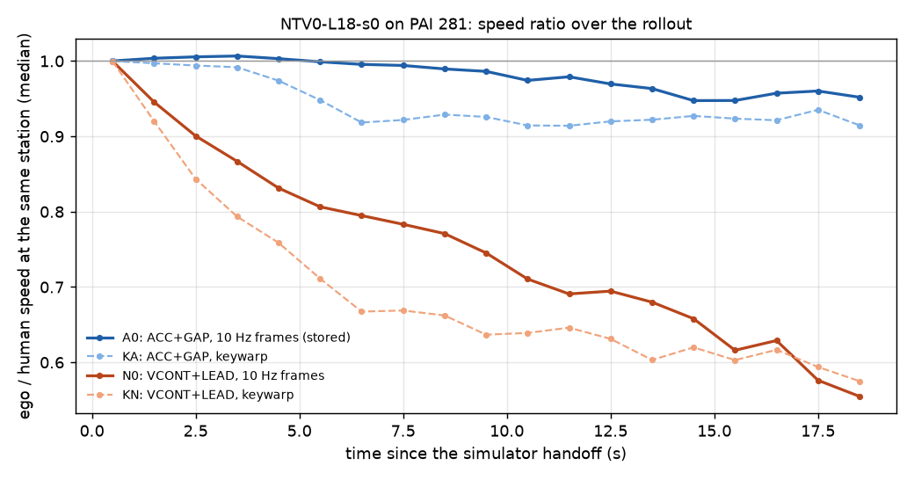

# PAI-INPUT-LOOP: NTV0-L18-s0 on PAI 281, the frame source and the speed loop (2026-10-19)

Prereg [../plans/2026-10-19-pai-input-loop-prereg.md](../plans/2026-10-19-pai-input-loop-prereg.md) (96583428, committed before any read).
Code `scripts/pai_input_loop.sh` / `pai_input_loop.py` / `pil_cf.py`. Tables [pai_input_loop/tables.md](pai_input_loop/tables.md),
paired reads `pai_input_loop/pai281_*.md`. Runs on the box: `$DATA_DIR/runs/route_follow/pai_input_loop/` ({N0,KA,KN} reads, tax/,
msgs/ (16 GB, N0's driver messages), cf/). This is a diagnostic. It promotes nothing. One seed.

Arms (all g10, CONC 4, ALPASIM_FAST=1, the stored read's 8 chunk lists): **A0** = the stored NTV0 + ACC + GAP read (10 Hz rendered frames);
**KA** = A0 + `PAI_KEYWARP=1`; **N0** = VCONT + LEAD only (no stored NTV0 no-ACC read existed, so it was read here); **KN** = N0 + keywarp.

Checks. `tests/test_pai_keywarp.py` passes on the current code (3 / 3). KA chunk c000: 7 082 / 7 082 inferences carry `keywarp`, 36 rollouts,
0 RPC errors. **Deviation:** the gate job failed to submit (a pool `--vram 0` refusal). The other KA and KN chunks therefore started without
waiting for it, and the gate was checked afterwards (PASS). One scene (1059fc66) has a driver RPC error in A0, so the A0 contrasts use 280 scenes.

## 1. Training-matched slots (keywarp) hurt on PAI

| contrast | mean J / ref | J - ref [95 % CI] | zeros | rear-hit partials | progress_rel |
|---|---|---|---|---|---|
| KA - A0 (with ACC + GAP) | 0.6747 / 0.7443 | **-0.0696 [-0.1083, -0.0312]** | 62 / 59 | 53 / 26 | 0.844 / 0.882 |
| KN - N0 (VCONT + LEAD) | 0.5721 / 0.6114 | **-0.0393 [-0.0762, -0.0018]** | 59 / 59 | 92 / 75 | 0.741 / 0.770 |
| A0 - N0 (what ACC + GAP buys, context) | 0.7443 / 0.6100 | +0.1342 [+0.0940, +0.1742] | 59 / 59 | 26 / 75 | 0.882 / 0.769 |

Under the registered line, keywarp **hurts** in both contrasts (CI high < 0), with the same sign. The frame-source effect does not depend on
the serve fix. Where it hurts, by stratum (KA - A0 / KN - N0): launch (37 scenes) -0.189 [-0.311, -0.080] / -0.079 [-0.199, +0.041]; straight
moving (172) -0.051 [-0.095, -0.008] / -0.034 [-0.075, +0.006]; turns (69-70, logged heading change > 30 deg) -0.053 [-0.147, +0.041] / -0.032
[-0.126, +0.060]. The loss comes from scored scenes losing progress: rear-hit partials double with ACC, and AF-front zeros go 3 -> 6 / 2 -> 8.
The zero count barely moves. Turns are no better with keywarp.

## 2. The speed loop

The figure plots the median ego / human speed at the same station against time since the handoff, on 0.5 s steps where the human moves
>= 2 m/s. Check two things: how far each solid line falls by 18 s, and whether the dashed (keywarp) line sits below its solid partner.

**2a. Ratio vs time.** Without ACC (N0) the ratio falls steadily with no plateau: 0.945 at 1-2 s, 0.83 at 4-5 s, 0.75 at 9-10 s, 0.66 at 14-15 s
and 0.555 at 18-19 s. By 10 s, 57 % of the steps are below 0.8. With ACC + GAP (A0) it stays at 1.00 until 6 s and then drifts down to
0.95-0.96 by 14-18 s (30 % of steps below 0.8). ACC + GAP lifts the paired per-scene ratio by +0.05 (0-3 s), +0.11 (3-8 s), +0.12 (8-13 s) and
+0.16 (13-18 s). Keywarp lowers it in both serve settings: KA - A0 is -0.064 [-0.083, -0.045] at 3-8 s and -0.053 at 8-13 s. KN falls faster than
N0 early (0.67 at 6-7 s against 0.80); the two meet near 0.6 after 15 s.

**2b. Plan-short against execution (decision 372's split, per 0.5 s step, pooled).** Execution carries almost nothing in any arm (|exec| <=
0.003 per step, except the +0.008 handoff transient). The loss is on the plan side, but **not in the model plan**:

| arm | total per step | model plan | serve fix | track ref | execution |
|---|--:|--:|--:|--:|--:|
| N0 | -0.0137 | -0.0003 | **-0.0135** | +0.0003 | -0.0002 |
| KN | -0.0091 | +0.0181 | **-0.0282** | -0.0001 | +0.0011 |
| A0 | -0.0028 | -0.0061 | +0.0035 | -0.0030 | +0.0028 |
| KA | -0.0012 | +0.0087 | -0.0111 | -0.0021 | +0.0033 |

On PAI with 10 Hz real frames, the model plan holds the current speed (N0: log(vpm / v) -0.004, -0.08 m/s). The per-step drop is the
**JEV_LEAD limit**. It cuts on 43 % of N0's decisions (src `mpc` on 21 %), by -0.040 log when it cuts, and that alone accounts for -0.017 of
the -0.011 mean fix ([tables](pai_input_loop/tables.md), last section). Because the model then plans the speed it now has, each cut is kept: a
ratchet fed by the serve-side lead limit. ACC + GAP replaces that path (cut part -0.002) and pulls the speed back toward the set speed
(`won = set` +0.033 on 57 % of decisions), which is where its +0.134 comes from (rear-hit partials 75 -> 26). Under ACC the model plan itself is
short (-0.016 log, -0.45 m/s), and the fix makes that up. Keywarp turns the model plan longer than the speed (+0.010 / +0.022). It also makes the
lead limit fire more often and harder: cut share 0.565 -> 0.645 with ACC and 0.426 -> 0.480 without; `mpc`-sourced leads 0.20 -> 0.27; cut part
-0.002 -> -0.018 and -0.017 -> -0.027. The net is slower and more rear-ended. Whether those extra cuts are real leads or phantoms was not checked.

**2c. History row or frames (open loop on N0's 55 693 stored decisions, 276 scenes).** Gate: the replayed F plan equals the stored model plan
within 0.03 m on 55 693 / 55 693 decisions. Feeding the human's speed history (A), and its positions too (B), on the same frames:

| subset | decisions | ego / log now | r_F | r_A | r_B | recovery A | recovery B |
|---|--:|--:|--:|--:|--:|--:|--:|
| registered (tau >= 3 s, r_F < 0.95) | 25 999 | 0.599 | 0.565 | 0.649 | 0.624 | +0.19 | **+0.14** |
| ego < 0.8 x log | 19 810 | 0.515 | 0.488 | 0.570 | 0.543 | +0.16 | +0.11 |
| tau 3-8 s | 7 536 | 0.727 | 0.656 | 0.737 | 0.724 | +0.23 | +0.20 |
| tau >= 8 s | 18 463 | 0.535 | 0.526 | 0.594 | 0.565 | +0.14 | +0.08 |

Under the registered line (recovery B <= 0.2), the slowdown is **not through the history row**. With the human's history, the plan recovers
only 14-19 % of its gap on PAI. The plan follows the speed it reads from the real 10 Hz frames (and the rest of the input), not the fed speed
row. This corrects a citation: decision 285's "the log history recovers 83 %" was measured on nuPlan held-452 zero rollouts
(`steer_long/scripts/sl_cf.py`), not on PAI. Decision 372 cites it as PAI. On nuPlan it is 26-44 % (d372) or 83 % (d285's zero subset). On PAI it
is 14 %. A smaller history channel on real frames fits the frames carrying the ego motion.

## Reading

- Serving PAI the way training was built (2 Hz keys + warps) costs 0.04-0.07. The 10 Hz real frames stay the PAI default, and the train /
  serve mismatch is not a lever in the direction of matching. The 10-11 33-scene read (pai_keywarp.md, P2H10 family, CI ±0.13) could not see this.
- PAI's speed loss without ACC is the serve-side lead limit cut, which the model keeps because it plans its current speed. It is not a model
  ratchet in the plan, and not the history row. With ACC + GAP the loop is mostly closed (ratio 0.95-1.0 to 18 s). The rest is an
  under-planning model (-0.45 m/s per decision) held up by the set speed. Rear-hit partials (26) remain the PAI candidate's largest partial
  type. They are the ego being slower than the human behind it, and the next PAI lever on that side is the lead limit's cut rule, which needs
  the phantom-vs-real check.
