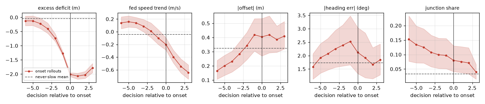
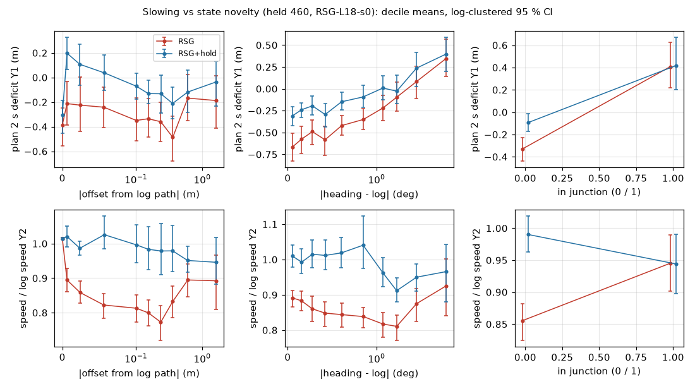

# SLOW-NOVELTY: does the residual slowing track state novelty? (held 460, RSG-L18-s0, 2026-10-14)

Prereg: [plans/2026-10-14-slow-novelty-prereg.md](../../plans/2026-10-14-slow-novelty-prereg.md) (6df8f422, committed before any statistic).
Script: [scripts/rf_slownov.py](../../scripts/rf_slownov.py) (`extract` on the box, AlpaSim venv, 12 workers, 1356 rollouts in 80 s; `analyse`),
[scripts/rf_slownov.sh](../../scripts/rf_slownov.sh). Tables: [slownov.md](slownov.md) / [slownov.json](slownov.json); per-decision rows on the
box `runs/route_follow/slownov/data/decisions.parquet`. No training, no GPU, no new rollouts. Decision [294](../../../../research/decisions/294.md).

**Hypothesis (the user's, tested, not assumed):** beyond the speed-history ratchet (decision 285, VHIST / 286), the policy slows when it is in
states it has not experienced (off the log, odd heading, inside junctions), and such states start the ratchet.

## Setup in one paragraph

Unit = one decision kept by rf_deficit's rule (speed >= 1 m/s, up to the first zero-score event); the kept sets and medians equal rf_deficit's
table exactly (RSG 7217 decisions, -0.258 m; RSG+hold 7214, -0.068; RSG+holdlead 7205, -0.069), so the ruler is the same. Outcome Y1 = plan 2 s
deficit (plan arc to 2 s - 2 x measured speed; about 2 x the plan's mean acceleration); Y2 = speed / the log's speed at the same arc position.
Novelty: `lat` = |offset of the ego from the log's rig path| (median 0.12 m, p90 0.90 m), `head` = |heading - log path tangent| (median 0.7
deg, p90 4.7), `junc` = rf_follow's turn stretch (4.7 % of kept decisions). Base block: the log's own 2 s deficit at that place (`logdef`) and
speed (`vlog`), time since the last stop, decision index, and the ratchet: fed speed `vfed`, fed speed trend `dvfed` (fed speed - its 1.5 s
history mean), `held` (hold reads). Standardised OLS, delta R^2 of the novelty block over the base block, CIs from a log-clustered bootstrap
(39 logs, 2000 draws).

## Result

| model | read | Y | n | R^2 base | delta R^2 novelty [95 % CI] | lat | head | junc |
|:--|:--|:--|--:|--:|:--|:--|:--|:--|
| **1 primary** (ratchet controls in) | RSG+hold | Y1 | 6347 | 0.784 | **+0.0011 [+0.0002, +0.0038]** | **-0.041 [-0.082, -0.008]** | +0.016 [-0.016, +0.052] | -0.004 [-0.024, +0.014] |
| 1b brief's spec (no ratchet controls) | RSG+hold | Y1 | 6347 | 0.535 | +0.0060 [+0.0026, +0.0128] | -0.096 [-0.146, -0.056] | **+0.065 [+0.017, +0.114]** | -0.002 [-0.030, +0.030] |
| 1c within-scene (scene fixed effects) | RSG+hold | Y1 | 6347 | 0.672 | +0.0010 [+0.0001, +0.0058] | -0.038 [-0.091, +0.010] | +0.019 [-0.017, +0.063] | -0.002 [-0.023, +0.020] |
| 1d speed ratio | RSG+hold | Y2 | 6319 | 0.160 | +0.0014 [+0.0003, +0.0158] | +0.039 [-0.040, +0.114] | +0.006 [-0.099, +0.083] | +0.002 [-0.040, +0.056] |
| 1r replication | RSG+holdlead | Y1 | 6502 | 0.790 | +0.0016 [+0.0004, +0.0045] | -0.049 [-0.089, -0.018] | +0.014 [-0.017, +0.051] | -0.003 [-0.019, +0.010] |
| 2 ratchet in the data and in the model | RSG | Y1 | 6659 | 0.820 | +0.0017 [+0.0007, +0.0038] | -0.048 [-0.079, -0.020] | +0.004 [-0.025, +0.038] | -0.003 [-0.018, +0.012] |
| 2b no ratchet controls | RSG | Y1 | 6659 | 0.532 | +0.0086 [+0.0042, +0.0161] | -0.113 [-0.155, -0.073] | **+0.079 [+0.022, +0.139]** | +0.009 [-0.013, +0.031] |
| 2d speed ratio | RSG | Y2 | 6635 | 0.342 | +0.0236 [+0.0068, +0.0575] | **+0.130 [+0.051, +0.224]** | +0.057 [-0.016, +0.117] | +0.019 [-0.027, +0.067] |
| 1e post-hoc: excess deficit Y1 - logdef | RSG+hold | x | 6347 | 0.217 | +0.0100 [+0.0034, +0.0226] | -0.090 [-0.154, -0.032] | +0.022 [-0.039, +0.096] | -0.064 [-0.100, -0.035] |
| 2e post-hoc: excess deficit | RSG | x | 6659 | 0.180 | +0.0277 [+0.0144, +0.0509] | -0.168 [-0.244, -0.101] | +0.019 [-0.054, +0.095] | -0.069 [-0.107, -0.037] |

Negative = more novel -> shorter plan (Y1, x) or slower than the log (Y2). Bold in the novelty columns = against the hypothesis's direction or
the registered statistic. Base coefficients (primary): `dvfed` +0.71, `vfed` -0.36, `logdef` +0.30, `vlog` +0.19, `held` +0.10 (all CIs clear of
0); full base table in [slownov.md](slownov.md).

**Verdict by the registered rule: "pure input loop", novelty a minor term.** One novelty coefficient is clear of 0 in the slower direction
(`lat`, -0.041 standardised: one SD of offset, 0.57 m, goes with a plan 5 cm shorter, against a residual median deficit of -0.068 m), but the
novelty block adds 0.11 % of variance against the registered 5 %. It is below 5 % in every variant, including the ones without the ratchet
controls (0.6-0.9 %) and the post-hoc excess-deficit outcome (1.0-2.8 %). Heading error goes the other way, and so does the speed ratio. The
hypothesis as a main driver of the residual slowing is refuted on these reads.

### Onset (RSG, analysis 3)

Excess deficit x = Y1 - logdef; threshold = its 10th percentile, -1.68 m (about 0.8 m/s^2 of braking beyond the human's at that place). 163 of 450
rollouts reach it (median onset decision 6), 131 with >= 2 kept decisions before it (32 logs); 287 never.

| at onset minus | lat (m) | head (deg) | junc | dvfed (m/s) |
|:--|:--|:--|:--|:--|
| the same rollout's preceding decisions | +0.34 [+0.24, +0.44] | +0.83 [+0.17, +1.58] | -0.006 [-0.020, 0.000] | -0.32 [-0.38, -0.25] |
| never-slow rollouts at the same decision index | +0.21 [+0.07, +0.33] | +0.77 [-0.17, +1.79] | +0.064 [+0.015, +0.121] | -0.24 [-0.33, -0.12] |

**Registered onset rule: supported by `lat`** (both contrasts clear of 0). The aligned plot qualifies it:

Look at the first three panels. The excess deficit does not jump at the onset; it ramps from about 4 decisions (2 s) before. The offset rises
over the same decisions, from 0.17 m to 0.42 m, and does not lead the ramp. At 2 Hz the two cannot be ordered: an offset that grows while the
plan shortens fits "novel state -> brake" as well as "a slowing, drifting car leaves the log path". The fed speed trend is still positive
(the car accelerating) when the ramp starts and turns negative only about 2 decisions before the onset. The first shortening is therefore not
started by a decelerating speed history. The ratchet takes over once the plan has started shortening. Onset rollouts are junction-heavy early
(15 % of decisions at -6 against 3 % for never-slow rollouts) but the onset itself is not at a junction entry. The dashed never-slow lines are
pooled over all k, not matched by k (the table is matched).

### Binned view (analysis 4)

Look at the middle column and the right column. Plans get *longer* as heading error grows, on both reads. Junction decisions have plans
*longer* than the car's speed (+0.48 m on RSG, the plan accelerating out of the turn), and the car is closer to the log's speed there (median Y2 0.98)
than off junctions (0.92). The red-blue gap is the ratchet: holding the speed history lifts Y1 and Y2 at almost every level of every
novelty measure, and it lifts most where novelty is lowest (low heading error, off junctions).

## What the data said that the hypothesis did not expect

1. **The slowness lives on the ordinary road, not in novel states.** On RSG, the relative slowness (Y2) is 0.92 off junctions and 0.98 inside
   them. The hold removes it off junctions (0.98) and leaves junctions unchanged (0.98), because the hold is released on turns.
2. **The fed speed trend predicts the plan almost by itself.** With `dvfed` and `vfed` in, R^2 is 0.78-0.82 (0.53 without them). The plan
   carries the fed acceleration forward: a standardised +0.71 to +0.86 on `dvfed`. This is the ratchet's input-side signature, and it holds in
   the hold reads too, because the hold covers only 33 % of decisions (released for a turn command on 54 %).
3. **The junction effect hides inside the human's own acceleration.** With the log's deficit as a free covariate, `junc` is 0. With it as a
   fixed offset (post-hoc 1e / 2e), `junc` is -0.064 to -0.069 [CI clear]. Through the turn stretch the human accelerates harder (log deficit
   +1.14 m) than the plan does (+0.48). That is a small "late release" in junctions, in line with decision 293's entry and exit speeds, and it
   is not a brake in novel states.
4. **Heading error goes with longer plans.** This is significant without the ratchet controls (+0.065 / +0.079) and null with them. Large
   heading errors come with acceleration phases (turn exits, recoveries), not with caution.

## What could not be measured

- **(f) feature-space novelty** (distance of the decision's frozen Cinque token to its k = 10 nearest training states): the stored reads keep
  no tokens and no frames (`drive.jsonl` holds the ego row, plan, `rmem`, `vhist`; `images.jsonl` only byte counts). The geometric measures
  above are a proxy for being off the training distribution, not that distance. Cost of the feature version: a driver flag that dumps the
  pooled frozen token per decision (code + smoke, about 1 h), then a re-read of RSG and RSG+hold on held 460 (12 chunk jobs x about 8 min, about
  1.6 card-hours; with the switch off a re-read reproduces the stored plans bit for bit, per the VHIST smoke, so decisions match one-to-one),
  then a CPU PCA (64) + kNN against the training rows' token cache (minutes). It was not done because the brief allows no GPU.
- Cause: the regressions are associations, and the onset read cannot order offset and slowing at 2 Hz. One checkpoint, one seed (evidence
  grade low). Held 460 is training-side for RSG-L18 (its rollouts are in the all-1491 pool).
