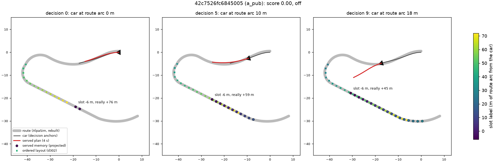

# ALIGN-AUDIT: does the route memory run ahead of the car at U-turns and junctions?

2026-10-17. Diagnosis only: no training, no serving change. Asked by the handoff `tmp/handoff-2026-10-17-losses-and-plan.md`, section 3 C
(the user's rule: the guidance must correspond to where the car is now; the example 42c7526f, where the car "saw the remembered waypoints
already turned back and drove at the planter"). Code `experiments/route_mem/scripts/rm_align.py`; generated tables
[align/align.md](align/align.md) (all strata and the full scene list), [align/align.json](align/align.json); figure
[../figs/align_42c7526f.png](../figs/align_42c7526f.png). Box data: `$DATA_DIR/runs/route_mem/align/`.

## Verdict

1. **Yes, the served memory runs ahead, and only in two geometries.** RSG-L18-s0 and V2 (RTB1ARO-L18-s0) both serve the projected layout
   (`rmem.window`): the car's arc is its projection on the merged memory polyline. When the route bends between the car and the start of
   the memory (the first message starts 42 m out), or loops back beside the car, the projection lands on the wrong leg. The slots then
   show route that lies further along than their labels say. Where the route is straight or has no turn inside the 42 m gap, the lead is
   0. Where a turn lies within 42 m, the median first-slot lead is 3.6-6.2 m and the p90 is 16.5-18.7 m. At U-turns the median is
   5.4-17.9 m, the p90 is 32-46 m and the maximum is 85 m: the return leg is shown beside the car under labels of -6 .. +20 m (figure). The
   lead is never negative.
2. **It explains few failures, and the replay says it is not what drove them.** Of the 156 zeros of the four reads (RSG / V2 on held
   460 @18 and public 1491 @10), 10 (5 distinct scenes) had near memory at least 10 m ahead within 3 s before the failure with the plan and
   the failure on the memory's side. Only 2 also meet the strict early-turn rule (memory turned at least 30 deg while the road had not).
   Across geometry strata, zero rates with and without early-turned memory do not differ.
   In an open-loop replay of those rollouts on the logged inputs, re-anchoring the memory moves the plan by a median of at most 0.1 m at
   +10 m. Emptying it does not remove the inside cut in any case.
   The one exception is the user's example 42c7526f (arm a, RTB1O-L18-s0). There, correct labels reduce the late cut from 2.06 to 1.46 m
   on average (1.5 m at most). With no memory at all, the plan cuts 2.35 m. The cut toward the U-turn comes from the policy's own lateral
   behaviour, which the misplaced memory adds to at the end.
3. **Training rows are anchored exactly like serving.** NAVSIM rows (rm_build nav) and on-policy rows (rm_build pool = the served Tracker)
   go through the same `rmem.memory`. The misalignment rates match: first-slot lead of 10 m or more on 9.8 % of 101 313 NAVSIM rows,
   against 7.5-10.3 % of closed-loop decisions. So there is no train/serve skew. In 87 % of the training rows with early-turned memory, the
   human did not turn 30 deg or more within 4 s. Training therefore teaches the policy to discount the misplaced slots, which fits the
   small replay effect.
4. **d302's fix covers the projection mislabel but none of the current lines.** In the ordered layout (`memory_o`, progress anchor) the
   same decisions read 0.00 m median and 0.00 m p90. Its three gaps:
   - no base was ever trained with it; every ordered checkpoint is a continuation of RSG-L18 of at most 2 500 steps (RV2a/b/c);
   - it inherits a `rmem.merge` bug: at loops and U-turns a newer message is appended whole, the polyline folds back 33-37 m, and the
     progress anchor jumps 46-66 m ahead (16-38 decisions per set);
   - its fixed L0 misses AlpaSim's first waypoint by one or two spacings (4.2 / 8.4 m) on sharp corners close ahead (24-67 decisions per
     set).
5. **Minimal fix: a change of the input definition, so a base retrain.** Anchor the memory at the car and advance it only by the car's
   own progress: the ordered layout, plus `merge` appending by arc and a monotone anchor. Rebuild the training rows with the same
   function (`memory_o` already serves both), then retrain from the base: RB0-F → RTB1AR-F → L18. That costs about 3.2 card-h per seed
   including the held and public reads (d339's cost line), plus PAI 281 for any submission.
   Feeding the ordered slots to the existing checkpoints at serve time is possible in format (the same 40 x 5 block), but the replay
   shows it barely changes plans. The expected gain is at most 1-3 zeros per read, so this does not justify a retrain on its own. Fold it
   (and the merge fix, which is a correctness bug in both layouts) into the next base retrain that happens anyway. The U-turn / junction
   inside cuts are lateral-policy failures (handoff 3 B).

## What is fed today

- `rmem.Tracker` keeps every route message (AlpaSim: 20 waypoints resampled every 80 / 19 m from the car's projection on the route; the
  first 40 m dropped, so about 10 valid points from 42.1 m out) and carries them into the current frame by the received poses.
  `merge` chains the batches: oldest first, each newer batch from its first point that lies beyond the memory's end along the last segment.
- Projected layout (`window`, served by RSG-L18 and the whole RTB line: sidecars without `head.order`, 200-number `rmem` in drive.jsonl):
  s_e = the car's nearest point on the merged polyline, extrapolated along the first segment when the car is short of it. The slots are
  s_e - 6 .. s_e + 72 m. The car is short of the memory for its first ~42 m of driving: near slots are empty on 95 % of decisions 0-3,
  on half of held decision 7, and on 39 % of the last public decision (9).
- Ordered layout (`memory_o`, d302 Amendment 2): s_e = arc of the newest message's first waypoint on the merged polyline - L0 (42.105 m)
  + the chord driven since. Served only by RV2* continuations.

## Method

- Data: the stored reads of RSG-L18-s0 and V2 = RTB1ARO-L18-s0 on held 460 @18 (`runs/route_mem/read/<tag>/c*/run`) and public 1491 @10
  (`runs/route_follow/guard/read10/RSG-L18-s0/b*`, `runs/wait_cap/next/cont/wide/pub/RTB1ARO-L18-s0/b*`). For the training rows: RB0-F-s0's
  1 021 training rollouts (`runs/onpol_long/roll/RB0-F-s0`, the on-policy pool on1_L18RB0 that RSG and V2 were continued on) and all 12
  navtrain shards. Arm a (RTB1O-L18-s0, public) is added only because the user's video was its 42c7526f.
- Truth: AlpaSim's own route, rebuilt per rollout by `RouteGeneratorMap` (MAP, 40 m, the run's scene config) at the logged anchors in
  decision order (rm_build.regen). The generator's full polyline after the last decision is the route R.
- Per decision: s_e = the anchor's station on R (tracked: global at decision 0, then within [s_prev - 5, s_prev + 40]). For every valid
  slot o, its point (rear-axle frame to local by the anchor) is projected on R: lead(o) = (s_point - s_e) - o.
  - early: a near slot (o <= 20 m) and the next valid one both turned >= 30 deg from the road at the car while the road at their labels has
    turned < 15 deg.
  - pull: the slot point's signed lateral from the route point at its label.
  - plan10: the served plan's lateral from the route at s_e + 10 m.
  - failure: the first 2 Hz step of the flagged zero metric; side = the car's front 3 m ahead of the rear axle at that step.
- Same decisions in the ordered layout: the same regenerated messages through `rm_build.feats_of_o`.
- Replay: every zero rollout of the five reads with an ahead decision before its failure and its rollout.asl kept (18), plus RSG's score-1
  rerun of 42c7526f (`runs/wait_cap/next/zvid2`) as a control. Each went through all three checkpoints in the real driver class, with the
  memory served, replaced by the ordered layout's point block (the same 40 x 5 slots) or empty. This was a pool job (`al-replay`).
- Lead, early, pull, plan10 and pulled were fixed in the script docstring before the full run. Added after outputs had been seen, and
  therefore exploratory: the failure side's 3 m front point (after the first test rollout, 42c7526f), the loose ahead criterion with its
  side rule, and the replay.

### Gates

| check | result |
|:--|:--|
| served memory = offline rebuild from the regenerated messages | all 60 628 read decisions, max 3.1e-4 m, masks 100 % equal (pool 2.2e-2 m: float rounding of its log) |
| NAVSIM rows rebuilt = stored feature rows (float16) | 99.4 % of 101 313 within 0.05 m |
| replay identity (own checkpoint, served memory, 4 s plan point) | 19 / 19 rollouts, every decision within 10 cm (max 4.7 cm) |
| extraction errors | 0 of 6 362 rollouts |

## How far ahead (projected layout as served; first valid slot)

| set | stratum | decisions | lead median m | p90 m | >= 10 m | >= 30 m | early turn |
|:--|:--|--:|--:|--:|--:|--:|--:|
| RSG held | all | 8 129 | 0.0 | 7.8 | 7.5 % | 0.7 % | 1.9 % (156) |
| RSG held | turn within 42 m | 2 655 | 3.6 | 16.5 | 23.1 % | 2.1 % | 5.9 % |
| RSG held | U-turn rollouts | 216 | 5.7 | 31.7 | 39.8 % | 10.6 % | 12.0 % |
| V2 held | all | 8 129 | 0.0 | 7.8 | 7.5 % | 0.7 % | 1.8 % (144) |
| V2 held | turn within 42 m | 2 599 | 3.7 | 16.8 | 23.4 % | 2.1 % | 5.5 % |
| V2 held | U-turn rollouts | 198 | 5.4 | 32.5 | 39.4 % | 11.6 % | 11.6 % |
| RSG public | all | 14 790 | 0.0 | 10.3 | 10.3 % | 0.7 % | 1.9 % (283) |
| RSG public | turn within 42 m | 4 915 | 6.2 | 18.7 | 31.0 % | 2.2 % | 5.7 % |
| RSG public | U-turn rollouts | 280 | 17.9 | 46.3 | 70.0 % | 21.8 % | 20.7 % |
| V2 public | all | 14 790 | 0.0 | 10.2 | 10.2 % | 0.7 % | 1.9 % (287) |
| V2 public | turn within 42 m | 4 914 | 6.1 | 18.7 | 30.6 % | 2.2 % | 5.8 % |
| V2 public | U-turn rollouts | 290 | 17.7 | 45.4 | 70.0 % | 21.0 % | 21.4 % |

- Turn 44-60 m ahead or none within 60 m: >= 10 m on at most 0.1 % of decisions. Straight and bend rollouts: 0. Maximum lead 75.8 m on
  held, 85.6 m on public.
- By decision index (both checkpoints): >= 10 m on 18 % of decision 0, falling to 2 % at held decision 17 and 4 % at public decision 9, as
  the car drives into the memory. The public read is all early decisions, which is why its numbers are higher.
- U-turn rollouts with early-turned memory: 14 / 28 (RSG) and 15 / 29 (V2) on public, 5 / 12 and 5 / 11 on held.
- Side cases: decisions whose served memory is empty while the received route covers the window: 13-15 held, 40 public. AlpaSim's own
  anchor offset is listed under the ordered layout below.

## The same decisions in the ordered layout (d302)

| set | first-slot lead median / p90 | lead > 1 m | of which on a folded merge | AlpaSim anchor offset |
|:--|:--|--:|--:|--:|
| RSG held | 0.00 / 0.00 m | 58 | 30 | 27 |
| V2 held | 0.00 / 0.00 m | 64 | 28 | 29 |
| RSG public | 0.00 / 0.00 m | 48 | 13 | 26 |
| V2 public | 0.00 / 0.00 m | 47 | 12 | 24 |
| RB0-F-s0 training rollouts | 0.00 / 0.00 m | 150 | 29 | 67 |

- Merge fold-back. `merge` decides "beyond the end" by the direction of the memory's last segment. When the remembered route curls back
  (U-turns, loops), that direction points at the newer batch's first points, so the whole batch is appended and the polyline doubles back
  by 33-37 m. Counts: 16-38 decisions in 2-5 rollouts per set, 1.3 % of NAVSIM rows. The ordered anchor projects the newest waypoint on
  the second copy and jumps 46-66 m ahead. Example: held fe4e5fdf, ordered slot -6 really +63 m. The projected layout samples the same
  folded polyline.
- AlpaSim anchor offset. On sharp corners close ahead (all 173 cases at turns or U-turns, turn within a median of 8 m), the first waypoint
  is exactly 4.2 m (165 cases) or 8.4 m (8 cases) further out than L0. This is consistent with `_trim_route_start` counting the chord of
  the resampled points rather than arc length. The ordered labels inherit the offset in 91 % of those decisions.

## Does it explain failures?

| set | zeros | early-turned memory <= 3 s before | + plan and failure on its side | near memory >= 10 m ahead <= 3 s before | + side |
|:--|--:|--:|--:|--:|--:|
| RSG held | 26 | 2 | 1 (e6056b57) | 4 | 3 (f9ed38d9, e6056b57, 5ddfd1fe) |
| V2 held | 31 | 1 | 0 | 4 | 3 (f9ed38d9, 5ddfd1fe, 67049536) |
| RSG public | 46 | 1 | 0 | 2 | 1 (f9ed38d9) |
| V2 public | 53 | 2 | 1 (a454e18c) | 5 | 3 (67049536, f9ed38d9, a454e18c) |
| arm a public (the video) | 51 | 2 | 1 (42c7526f) | 3 | 1 (42c7526f) |
| RB0-F-s0 training rollouts | 136 | 5 | 3 | 13 | 5 |

- Zero rate with / without early-turned memory, per geometry: none of the strata separates. Public U-turns: 1 / 14 against 1 / 14 zeros
  (RSG), 2 / 15 against 0 / 14 (V2). Held turns: 0.125 against 0.092 (RSG), 0.071 against 0.130 (V2). Every bootstrap CI includes 1
  ([align/align.md](align/align.md) T3).
- 3b4031de, a 210 deg right-hand loop and a zero in all five reads, has early memory before its failure. But the car under-turns to the
  left, away from the memory on its right: late and wide, not pulled.
- Open-loop replay (T6 in [align/align.md](align/align.md)): at the ahead decisions before the failure, the plan's lateral at +10 m toward
  the memory side, served / ordered / empty, own checkpoint:

| scene | failure | served | ordered | empty |
|:--|:--|--:|--:|--:|
| e6056b57 (RSG held, 89 deg left) | corridor | +4.59 | +4.58 | +4.66 |
| 5ddfd1fe (RSG held) | corridor | +4.04 | +4.01 | +4.07 |
| 67049536 (V2 public) | offroad | +4.57 | +4.57 | +4.65 |
| a454e18c (V2 public, left U-turn) | offroad | +2.19 | +2.14 | +2.16 |
| f9ed38d9 (V2 public) | offroad | +5.58 | +5.50 | +5.78 |
| 42c7526f (arm a, left U-turn) | offroad | +2.06 | +1.46 | +2.35 |
| 42c7526f, RSG's own score-1 rerun (control) | none | -0.39 | -0.50 | -0.51 |

  Over all decisions of these rollouts, re-anchoring changes plan10 by a median of 0.01-0.10 m (max 0.06-0.31 m). The exception is
  42c7526f, with a single-decision maximum of 1.54 m. Emptying the memory changes plan10 by a median of 0.00-0.23 m.
  On arm a's 42c7526f inputs, RSG and V2 cut too (+1.83 / +1.85 m). In its own rollout, RSG never reached that state.

### Worked example: 42c7526f (public, left U-turn, arm a offroad + wrong lane)



What to look at:
- The car (triangle) heads west, and the route U-turns about 40 m ahead.
- Circles are the served memory. At decision 0 its first point carries slot -6 m and lies 76 m along the route, on the return leg about
  20 m to the car's left. At decision 9 it is still slot -6, really +45 m.
- Squares are the ordered layout: the same received points at their true arcs (+26 .. +72 m).
- By decision 9 the plan (red) cuts left toward the circles while the road still runs west for about 12 m. The replay shows most of that
  cut survives with the circles removed.

## Training rows against serving

| rows | n | first-slot lead p90 | >= 10 m | ahead (near >= 10 m) | early turn | fold |
|:--|--:|--:|--:|--:|--:|--:|
| NAVSIM navtrain (rm_build nav, rebuilt) | 101 313 | 9.9 m | 9.8 % | 4.4 % | 1.85 % (1 872) | 1.3 % |
| on-policy pool on1_L18RB0 (RB0-F-s0 rollouts) | 18 352 | 6.5 m | 6.3 % | 2.8 % | 1.34 % (245) | 0.2 % |
| closed loop RSG / V2, held | 8 129 each | 7.8 m | 7.5 % | 4.1 % | 1.8-1.9 % | 0.4 % |
| closed loop RSG / V2, public | 14 790 each | 10.2-10.3 m | 10.2-10.3 % | 4.1 % | 1.9 % | 0.1 % |

- NAVSIM rows: the route generator runs on the 9.5 s log track, one message per 2 Hz decision at the logged pose, and `rmem.memory` at
  the row's frame. This is the serving function and anchoring; only the car follows the log, so AlpaSim's anchor never snaps.
- Pool rows: messages regenerated at the driver anchors, then `feats_of` (the served Tracker).
- Yaw-rate rows (yr1): the NAVSIM block moved rigidly into the perturbed frame; the labels are unchanged.
- Labels on early rows: 13 % turn at least 30 deg within 4 s, 1 of 1 872 at least 90 deg.

## Minimal fix and its cost

| option | what changes | class | cost | expected effect |
|:--|:--|:--|:--|:--|
| A. serve-only re-anchor | feed the ordered point block (same 40 x 5 format) to RSG / V2 | serving only | ~10 lines behind a flag in the drivers (`rmem.Tracker`); held 460 + public 1491 reads ~2.3 card-h, PAI 281 for any submission | replay: plans move a median of <= 0.1 m; 42c7526f's late cut -0.6 m; not tested in closed loop |
| B. serve-only mask | drop the slots whose projected label disagrees with the progress anchor by > 2 m (inputs stay in the training pattern "memory starts ahead") | serving only | same as A | same order as A (no replay run) |
| C. merge fold-back fix | `merge` appends a newer batch from the arc of the memory's end on that batch, not by the last segment's direction | input definition (both layouts, train + serve) | small code; rebuild features (~10 min CPU); touches 0.1-0.4 % of closed-loop decisions, 1.3 % of NAVSIM rows | correctness; required by D |
| D. anchored-at-the-car memory (the user's rule) | ordered layout + C + a monotone anchor: s_e set once from the first message (L0), then advanced only by the car's driven arc, never re-read from later messages, so AlpaSim's one-spacing offsets and fold-backs cannot move it; plus a capped `travelled` scalar (d302 spin note) | input definition: base retrain RB0-F -> RTB1AR-F -> L18, same builder for rm_build nav / yr / pool and the drivers | ~3.2 card-h per seed (base ~0.8, continuation ~0.15, held / static / stop17 ~1.3, public ~1; d339) + PAI 281; a pilot gate (G-slot, G-rely, dev ADE) first | removes the misalignment; failure gain bounded by the 1-3 attributable zeros per read |

Recommendation:
- Do not run D for alignment alone. Carry C + D into the next base retrain that happens for another reason, for example the re-mixed
  trainval round.
- If the user wants the rule checked in closed loop before then, A is the cheap, low-risk A/B. It is a serving change and was not run here.
- The U-turn and junction inside cuts belong to the lateral line (handoff section 3 B), not to the memory.

## Reproduce

```
# box, AlpaSim venv (CPU, pool jobs al-*; one per set)
python experiments/route_mem/scripts/rm_align.py extract --set rsg_held=$DATA_DIR/runs/route_mem/read/RSG-L18-s0/c*/run --out $DATA_DIR/runs/route_mem/align --workers 16
#   ... v2_held / rsg_pub / v2_pub / a_pub / pool_rb0 likewise (globs in the script's SETRUNS and this doc's Method)
python experiments/route_mem/scripts/rm_align.py nav --out $DATA_DIR/runs/route_mem/align --workers 16
python experiments/route_mem/scripts/rm_align.py msgs --out $DATA_DIR/runs/route_mem/align
# box, envs/op-train, one GPU (pool job al-replay)
python experiments/route_mem/scripts/rm_align.py replay --out $DATA_DIR/runs/route_mem/align
# Mac, after copying the outputs (parquet, geo.pkl, msgs/targets.json, replay/) to DIR
.venv/bin/python experiments/route_mem/scripts/rm_align.py report --dir DIR --res experiments/route_mem/results/align --fig experiments/route_mem/figs/align_42c7526f.png --example a_pub:42c7526f
```
