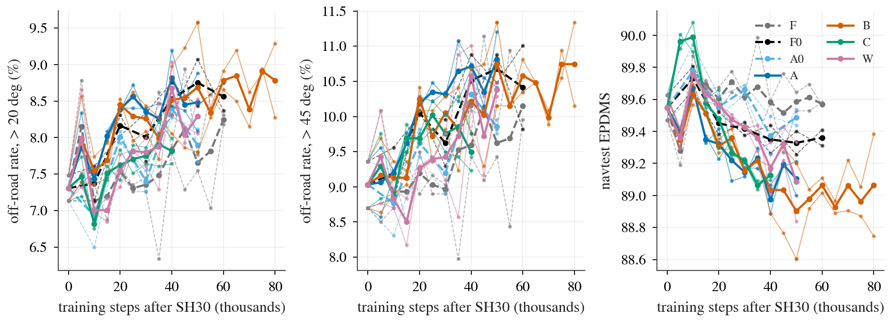

# vis_train: training Cinque's vision weights on navtrain

status: concluded (arm R run after a user override of the failed gate; W-s1 final row in)
decisions: 145, 160, 204, 248
index: VT: trained vision weights under continuation and from scratch (R), no arm lowers >45 deg off-road without cost

**Question.** Does the navtest turn off-road gap (and anything else on the boards) move when the vision weights of the driver are really
trained on navtrain, instead of staying frozen as in every method tried so far?

**Conclusion.** All arms continue an already trained policy (SH30), so everything below is a trend under continuation, not a verdict on a
final recipe (final weights must come from one joint training). Judged on navtest turn failure rates, no way of training the vision weights
tried here (branch A, branch + future loss B / B2, in place C, branch + side views W) lowered the > 45 deg off-road rate below its untrained
control without paying on the straight road, NC or comfort: A - A0 EPDMS -0.38 [-0.71, -0.05], < 5 deg -0.51, > 45 deg cut-inside +1.09
[-0.08, +2.25]; masking the branch at test time raises A by 0.75 [+0.44, +1.09] while shuffling costs 5.45 (channel read, used harmfully);
the R gate (>= +0.2 required) measured -0.75 and failed (stated as such), but the user overrode it (amendment 8: R tests exactly whether the
branch is read usefully), so R was run; C and W show early or partial turn gains that did not hold or did not beat the frozen control F (W - F
EPDMS at k50 -0.50 [-0.79, -0.23]; W - A > 45 deg cut-inside -0.69 [-1.93, +0.55], verdict undetermined). Arm R (policy trained from scratch,
frozen token bank in the memory channel, 10k steps, 2 seeds, read by flips and `:noside` / `:mshuf` against R0): RB - R0 EPDMS -1.01
[-1.36, -0.69] (seeds -0.94 / -1.09), > 45 deg cut-inside +1.88 pp [+0.93, +2.93], flips 50 fixed / 107 broken; RW0 - R0 (three untrained
views) is a null on every cell (EPDMS -0.00 [-0.20, +0.19], cut-inside flips 46 / 40); RW - RW0 EPDMS -0.73 [-1.05, -0.42], cut-inside +0.86
[+0.08, +1.68], flips 52 / 78. The pre-registered expectation that RB - R0 would be small positive to flat was wrong. In both R pairs the trained
vision makes the from-scratch policy worse than the same channel carrying untrained tokens, by more than under continuation (A - A0 -0.38, B - A0
-0.58); the policy trained on the bank reads it heavily (`:mshuf` -9.67 for RB, -7.42 for RW) and masking it at test time removes the loss. No
arm lowers > 45 deg cut-inside. No candidate. Side views and any representation change should be retested inside one joint
policy training (10k steps, 2 seeds, drop-one), read by flips (decisions 248).

**Arms** (all continue `SH30-F-s<seed>` on the same row stream, batch 64, constant learning rate after a 300-step warmup; pre-registration
and its amendments in `plans/`):

| Arm | Seeds | Vision | Control |
|:--|:--|:--|:--|
| F | 0, 1 | frozen, no branch | the same-steps baseline |
| A0 | 0, 1 | frozen; the adapter memory channel reads Cinque's own t0 token | "a channel was added" |
| A | 0, 1 | trainable copy of the vision encoder on the t0 image pair, its 32 x 512 tokens through the memory channel | A0 |
| B | 0, 1 | A + prediction of the frozen tokens 1.0 s and 2.0 s ahead (weight 0.5) | A0, A |
| C | 0, 1 | the encoder itself trained in place, no anchor rows, no distillation of the non-plan heads | F0 |
| F0 | 0, 1 | frozen, no anchor rows, no distillation | F |
| W (second wave) | 0, 1 | A with three t0 views: the shared-weight branch encodes CAM_F0 / CAM_L0 / CAM_R0 (at least +-82 deg together), 3 x 32 tokens through the memory channel; test-time `:sideoff` masks the two side views | A |
| R (prereg amendments 7 and 8; the gate failed, -0.75 against >= +0.2, and was overridden by the user; run 2026-10-11) | 0, 1 | the branch FROZEN: the policy is trained from the shipped weights with the full SH30 recipe (10 000 steps x 128, cosine, one checkpoint, labelled k10 in reads.md) and reads a precomputed token bank through the memory channel: `VTR-0` (R0) = Cinque's own t0 tokens (control), `VTR-B` (RB) = the final branch of B (step 50 000), `VTR-W0` (RW0) = the frozen shipped encoder on W's three views (no trained vision), `VTR-W` (RW) = the final 3-view branch of W (step 50 000); `VTR-A` was dropped | registered: RB - R0, RW0 - R0, RW - R0, RW - RW0, each also vs SH30; R0 - SH30 reference only |
| B2 (amendment 7; fallback picked B) | 0, 1 | B continued for 30 000 steps (to k80) under the new tag `VT-B2-s<seed>`, optimizer restarted | A0, B at k50 |

A0 / A / B / W carry the branch's own head (thin decoder on [tokens, ego]; decision 204), trained jointly, unused at inference.

**How it runs.** `scripts/vt_chain.sh <arm> <seed> <steps>` (one tmux window per arm and seed) puts the whole chain into the GPU pool:
the training job (`scripts/vt.py train`, resumable from its last snapshot), a navtest read per snapshot (`VT-<arm>-s<seed>-k<NN>`) and the
final reads (`VT-<arm>-s<seed>`: navtest, navhard on protocol W, test-time masked / shuffled memory for the memory arms, HUGSIM 64 for the plain
P2 arms F and F0), all through `python -m jevdrive.bench` (family `vt`: `vt.py plans` reads the cached slot tokens and the pixel cache).
Arm R and the continuation are one more chain, `scripts/vt_r_chain.sh all` (`scripts/vt_r.py`: token banks, the registered gate on arm A's masked-memory
drop (failed, overridden with `VT_R_SKIP_GATE=1`, persisted in `chain/R/GATE_OVERRIDE`), the choice of the continued arm (B); trainer `experiments/op_parity/scripts/pp_train.py --mem vtr_*`); its state is in `plans/state.md`, section 「R 臂」.
`scripts/vt.py ident` is the identity gate, `scripts/vt.py tokens` dumps branch tokens for the decision-160 Stage-0 probe.

**Throughput.** Pixels are rendered once into `$DATA_DIR/runs/vis_train/px/` (`scripts/vt_px.py`) and read through `lib/pixel_store.py`;
the profile, the before / after numbers and the step counts they set are in the throughput section of `plans/state.md` (the reference
is decision 145's U2: online CPU rendering, 0.7 steps per second at batch 64).

## Results

All numbers are in [results/reads.md](results/reads.md) (generated by `scripts/vt_read.py sync`; trend and full decomposition per comparison, NC classes,
weight displacement, Stage-0 probe, boards, registered verdicts, no-regression table, flips, moved up / down / did not move lists). The
decision entry (decisions 248) and the Chinese page `research/vis_train/index.html` read them.

Off-road rate (> 20 and > 45 deg) and navtest EPDMS against steps after SH30, dashed = untrained controls, thin = single seeds. Look at the dashed
controls: they drift up in off-road rate on their own, and no solid trained-vision arm separates downward from them; in the right panel A, B, B2, C and W
end below F and F0. Arm R has one checkpoint per arm and is not in the figure; it is in `results/reads.md` (sections "Arm R and the continuation", the trend,
flips, test-time options and FoV tables).

**Not produced / caveats.** The R gate failed and was overridden (stated, not hidden); R has one checkpoint per arm and no Stage-0 probe; `VTR-A` was dropped. HUGSIM for the memory arms (A0 / A / B / W / B2) has no serving path; C was read through the exported
`VTCP2-s{0,1}` (no difference from F0). WOD zero-shot has no reads in reads.md. Prereg read 5 (C on native comma1M frames) has rows only for `UF-U2-s0` and
`VT-F0-s0-k10`, none for C. W has no HUGSIM or WOD read and no W-vs-W0 continuation control. The R / continuation code edits (`pp_train.py`, `vt.py`) were not line-reviewed
by the coordinator; continuation restarts the optimizer; W is compared at equal steps.

**Read more.** `plans/2026-10-10-vis-train-prereg.md` (design, checks, reads, stop rules, amendments), `plans/state.md` (working state:
jobs, tags, run dirs, check results, how to resume).

<!-- files:begin -->
## Files

- `2026-10-10-vis-train-prereg.md` (plans): VT：在 navtrain 上真正训练视觉参数，navtest …
- `state.md` (plans): VT 工作状态（builder 与吞吐工程师共用；各写各的小节）
- `vt.py` (scripts): vis_train trainer and read-out paths
- `vt_chain.sh` (scripts): one self-advancing chain per arm and …
- `vt_px.py` (scripts): the protocol-W model frames of every …
- `pixel_store.py` (lib): Pre-rendered protocol-W pixels for …
- `pp_train.py` (experiments/op_parity/scripts): Cinque fine-tuned on navtrain with …
- `pp_unfreeze.py` (experiments/op_parity/scripts): how much of P2's 3.55 EPDMS gap to …
- `parity_adapter.py` (lib): Input-parity adapter for openpilot …
- `navsim.py` (jevdrive/bench): navtest EPDMS and navhard two-stage

[plans/](plans/) 2 live plans · [scripts/](scripts/) 5 entry points
<!-- files:end -->

Layout: `scripts/` entry points (live), `plans/` live plan notes. Refresh the file list with `python tools/topic_index.py` (currently broken; INDEX.md edited by hand).
