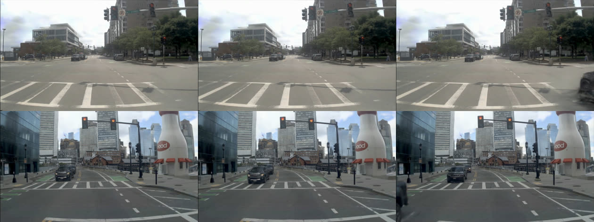

# Red-light and rear-end census (handoff 2026-10-17, section 4 step 0, items 1-2)

CPU only, no training, no new rollouts. Inputs: the stored AlpaSim reads of RSG-L18-s0 (RSG), V2 = RTB1ARO-L18-s0 (V2) and d337 arm a =
RTB1O-L18-s0 (a) on public 1491 @10 and held 460 @18 (controller CSVs, per-step metrics, summaries), the 136 raw nuPlan test logs
(ego poses, `traffic_light_status`, logged vehicle boxes) and the nuPlan maps. Code: [`scripts/nx_census.py`](../../scripts/nx_census.py)
(its docstring holds every definition, fixed before the first output). Generated tables: [census_red_rear/tables.md](census_red_rear/tables.md);
per scene and model: `census_red_rear/per_scene_model.csv.gz`, `red_scenes.csv.gz`, `rear_contacts.csv`, `window_shares.csv`. Box runs:
`$DATA_DIR/runs/wait_cap/census/{metrics/20261017-142724, scenes/20261017-144434, windows/20261017-142817}` (windows.parquet stays there).

**Alignment check.** A scene starts 30 raw frames (1.5 s) before its token (d325 amendment 1); the scene frame is the world frame shifted by
the ego's first pose, so controller poses map onto the log and the map. The logged path over the scene window matches the reads'
`gt_dist_traveled_m` within 1 m on 95.3 % of public and 90.9 % of held scenes (median difference 0.08 m). Read reproduction: 58 / 65 / 63 public
and 34 / 39 / 38 held zeros, 18 / 17 / 24 public rear contacts for RSG / V2 / a, as in decision 339.

## 1. What the scorer does (src/eval @ 0bb4c4b, the deployed commit, `~/data/third_party/alpasim`)

- **Zero** (`aggregation/scene_score.py`): `collision_at_fault`, else `offroad`, else `left_corridor_laterally`; nothing else. Otherwise
  `min(clip(progress, 0, 1) / 0.8, 1)`, and 1.0 whenever the human's path in the window is under 5 m. A rollout that fails before scoring
  (e.g. a route that folds back) scores 0.
- **At fault = front or lateral contact only** (`aggregation/processing.py`, `scorers/collision.py`). Each 0.5 s step tests the ego box
  (corner roundness 0.5, shrink 2 %) against every actor box: front if the other box touches the ego's front bumper line, else rear if it touches
  the rear bumper line, else lateral. A rear contact is never at fault. A car from behind that clips the ego's flank is lateral, i.e. at fault.
- **The first collision of any side, or the first offroad step, ends the evaluation** (`RemoveTimestepsAfterEvent(offroad_or_collision)`):
  later steps are dropped before aggregation. Progress is read at the last kept step; later failures do not count.
- **Offroad**: no lane polygon (nor their union, nor the nuPlan road areas) covers the ego box. Driving in an opposite-direction lane is not
  offroad; `wrong_lane` is computed and never used.
- **Corridor**: the ego box centroid (1.46 m ahead of the rear axle) at >= 4 m from the human's path. Past the path's end only the component
  perpendicular to its last segment counts, so driving on straight is free; but **when the human does not move, the path is a point and the
  distance is plain distance**. Checked with the scorer's own function on the trajdata rig path of 4211afd0's standstill: 3.99 m once the
  centroid is 3 m ahead of its rest position. Rolling about 3 m in a window where the human stands still is a zero.
- **Progress**: projection of the centroid on the human's full path in the window, normalised, times full / reachable length.
- **No traffic-light term anywhere.** No red-light, stop-line or light-state logic in `src/eval` or `src/runtime` (the `stop_line` map
  element only feeds the video); the driver receives no light state. Running a red light costs only through a contact (cross traffic, a lead),
  through the corridor rule when the human stayed, or not at all.
- Validation: on all 161 rear-ended rollouts of the six reads, the progress score at the contact step equals the summary score (max abs
  difference 0.0000).

## 2. D: red lights

**Light in the logs.** nuPlan gives a status per lane connector (only red / green in these logs). The light of a scene is the status of the
connector the human's route takes after the first traffic-light stop polygon ahead (match < 3 m). The label lags the switch: in 61 % (public)
to 63 % (raw logs) of launches from a red stop, the label still shows red when the human goes. It classifies scenes; it is not the rendered
lamp.

**Light in the render.** The MTGS renders do not switch the lamps in the named scenes. 
What to look at: front camera of RTB1O-L18-s0 (which never moves) at 0, 2 and 5 s; top 4211afd0, bottom d93e31df. The signal heads stay
red in all six frames while the logged human left at 2.3 s / 1.5 s and the logged traffic moves (oncoming car, bottom right). The c2790319
video shows the same; in c159f0c3 the heads are too small to read. A model that obeys the lamp can only lose in such scenes.

### 2.1 Where red lights cost us locally

A scene has a red light when the label is red at the start (line ahead, front bumper <= 80 m before it, rear axle < 1 m into it) or the
human stops while it is red. Points lost = sum of (1 - score).

| read | model | zeros | lows (0-0.5) | red-light scenes | zeros / lows with red | points lost: all / in red scenes |
|---|---|--:|--:|--:|--:|--:|
| public 1491 | RSG | 58 | 6 | 216 | 5 / 3 | 89.9 / 13.4 |
| public 1491 | V2 | 65 | 7 | 216 | 8 / 4 | 92.8 / 15.9 |
| public 1491 | a | 63 | 22 | 216 | 8 / 13 | 107.0 / 24.6 |
| held 460 @18 | RSG | 34 | 4 | 72 | 2 / 1 | 61.6 / 4.8 |
| held 460 @18 | V2 | 39 | 3 | 72 | 4 / 1 | 58.3 / 6.3 |
| held 460 @18 | a | 38 | 8 | 72 | 5 / 2 | 61.4 / 8.5 |

**By cause** (points lost in red-light scenes; "late" = launch > 1 s after the human, "slow" = progress loss without a zero or a late
launch):

| read | model | zeros (lateral / at-fault / route fold) | never launches | late launch | slow |
|---|---|--:|--:|--:|--:|
| public | RSG | 5 (3 / 1 / 1) | 0 | 1.8 | 6.7 |
| public | V2 | 8 (7 / 0 / 1) | 1.7 | 2.0 | 4.2 |
| public | a | 8 (6 / 1 / 1) | 8.6 | 4.0 | 4.0 |
| held | RSG | 2 (2 / 0 / 0) | 0 | 0 | 2.8 |
| held | V2 | 4 (3 / 1 / 0) | 0 | 0.1 | 2.2 |
| held | a | 5 (3 / 2 / 0) | 1.0 | 1.1 | 1.4 |

**The human's behaviour** in the 216 public red-light scenes: stops at the red light and launches within the window (G) 78, stops and stays
(C) 6, approaches without stopping or passing 114, passes on a red label without stopping 5, on green 9. Held: G 26, C 23. Most of the
red-light loss sits in G (public RSG 7.2, V2 8.8, a 17.4 of the 13.4 / 15.9 / 24.6 points); the approach scenes add 2.6-3.6, mostly lateral
or at-fault zeros; C costs nothing beyond one lateral zero on held.

**Launches from a standstill, red light against elsewhere** (human starts < 0.3 m/s and launches > 1 m/s in the window):

| read | model | at a red light: n / late or never / mean score | elsewhere: n / late or never / mean score | median delay |
|---|---|--:|--:|--:|
| public | RSG | 76 / 4 / 0.923 | 120 / 5 / 0.930 | 0.0 s |
| public | V2 | 76 / 6 / 0.900 | 120 / 7 / 0.891 | 0.0-0.1 s |
| public | a | 76 / 17 / 0.787 | 120 / 15 / 0.853 | 0.1-0.2 s |
| held | RSG / V2 / a | 25 / 0, 1, 3 / 0.886, 0.853, 0.783 | 39 / 1, 2, 6 / 0.776, 0.858, 0.751 | 0.0-0.1 s |

RSG and V2 launch with the human at red lights, at the same rate as at other standstills; in the scenes inspected the rendered lamp stayed
red, so the lamp did not hold them there. Only a holds (17 of 76), and it holds at other standstills too (decision 339's W-row launch delay,
removed in V2).
Early launches (> 0.5 s before the human) at red lights: 8-10 per model on public, all scored 1.0; on held one scene (5ddfd1fe, human waits
3.5 s) zeroes RSG and V2 by the corridor after a 1.3 s early launch. Where the human stops at red and stays (C), all three stop too: public
6 scenes 0.997-1.000, held 23 scenes RSG 0.996, V2 0.951, a 0.949 (the misses are one scene, 9d1d720d, where V2 and a leave the road);
V2 / a crossed the line on red in 3 scenes near the window's end, all scored 1.0.

**The four named scenes** (public; first in line at the stop line, no lead; human speed and model launch from the 10 Hz traces):

| scene | human | label | RSG | V2 | a |
|---|---|---|---|---|---|
| c159f0c3 (Las Vegas, left turn) | launches 2.4 s, passes 4.6 s | red to 2.5 s, then unknown | 1.00, launches 2.6 s | 1.00, 2.3 s | 0.08, never launches |
| 4211afd0 (Boston) | launches 2.25 s, passes 2.9 s | red all window | 0.57, 2.7 s, 2.2 m/s at 5.5 s (human 6.9) | 0.68, 2.7 s, 3.1 m/s | 0.01, never; rear-ended at 5.0 s, dv 2.7 m/s |
| d93e31df (Boston) | launches 1.55 s | green at 2.0 s | 0.39, late (2.9 s) | 0.14, crawls at <= 0.6 m/s | 0.04, never |
| c2790319 (Boston, same junction as 4211afd0) | launches 2.35 s | red to 3.7 s | 0.65, 2.6 s, 3.5 m/s at 5.5 s (6.7) | 0.61, 2.8 s | 0.13, never; rear-ended at 5.0 s, dv 2.3 m/s |

In every one the human went 1.5-2.4 s into the scene, with the label still red in three of the four, while the render showed red.
Points at stake: RSG 1.4, V2 1.6, a 3.7. The user's reading "the model stops at the red light" is exact for a; RSG and V2 go on time in
three of four and lose on weak acceleration, which is the A-class speed gap, not the light.

### 2.2 How much it matters on private

The 70 052 uniform 5.5 s windows of d325's N2 on the 136 raw test logs (same grid, same count) against the 1491 public windows; CIs
log-clustered:

| class | uniform windows [95 % CI] | public [95 % CI] (n) | ratio |
|---|--:|--:|--:|
| human stopped at a red light (any) | 0.264 [0.231, 0.298] | 0.055 [0.043, 0.069] (82) | 4.8 |
| first in line (no lead) | 0.125 [0.095, 0.157] | 0.032 [0.023, 0.043] (48) | 3.9 |
| queued behind a lead | 0.139 [0.113, 0.165] | 0.023 [0.015, 0.031] (34) | 6.1 |
| stays stopped through the window (C) | 0.240 [0.209, 0.272] | 0.004 [0.001, 0.007] (6) | 60 |
| C, static the whole window, first in line | 0.102 [0.076, 0.130] | 0 (0) | - |
| C, static the whole window, queued | 0.110 [0.088, 0.133] | 0 (0) | - |
| launches within the window (G) | 0.024 [0.021, 0.028] | 0.051 [0.040, 0.064] (76) | 0.5 |
| G, first in line | 0.013 [0.010, 0.015] | 0.031 [0.022, 0.041] (46) | 0.4 |
| passes the line on a red label without stopping | 0.006 [0.004, 0.009] | 0.007 [0.003, 0.011] (10) | 0.9 |
| human static the whole window (d325 class S) | 0.301 [0.273, 0.330] | 0.001 (1) | 449 |
| S at a red light | 0.214 [0.185, 0.243] | 0 (0) | - |
| S at a light line, not red / stop sign within 15 m / none of these | 0.051 / 0.002 / 0.035 | 0 / 0 / 0.001 | - |

**71 % of d325's static windows are red-light waits**, half of them first in line. Public is the mirror image: it holds launches from a red
stop (5.1 %, twice the uniform share) and almost no waits (0.4 %). In C windows the label is red for the whole window in 94 %.

### 2.3 Verdict D: an "ignore red light" switch would cost on private

Replay of a car that ignores the light (human for the 0.5 s force-GT, then 1.5 m/s^2 to max(8 m/s, its speed) along the human's route)
against the logged vehicles and the scorer's corridor rule, in red-stop windows without a lead; the same check on the human's own poses finds
0 contacts (no false positives):

| uniform windows | n (share of all) | at-fault contact | corridor zero | runner mean score | staying |
|---|--:|--:|--:|--:|--:|
| C, static the whole window | 7 146 (10.2 %) | 0.151 | 0.821 (median at 2.5 s) | 0.028 | 1.0 |
| C, arrives and stops | 756 (1.1 %) | 0.261 | 0.694 | 0.045 | 1.0 |
| G, human launches in the window | 879 (1.3 %) | 0.068 | 0.304 | 0.628 | about 1 if it launches with the human |
| public G (46 windows) | | 0.043 | 0.152 | 0.804 | |

- Cost: on a private-like mix the switch turns 10.2 % + 1.1 % of windows from 1.0 into about 0.03-0.05, **about -0.11 per scene**. In the
  static waits the corridor fires first in 82 % (median 2.5 s), a contact with cross traffic first in 15 % (median 4.6 s, the other car at
  7.9 m/s).
- Gain: nothing for RSG / V2, which already launch with the human at red lights (red-light launch failures: 1.8 / 3.8 public points, the same
  rate as elsewhere). For a model that held until the end it could buy at most the G windows, 2.4 % x about 0.5, about +0.01 per scene on
  private; on public (no static waits) it would look neutral to positive, so the public board would hide the cost.
- Queued waits (11-14 % of windows) are neutral only if the switched model still stops for its lead.

**Do not build the switch; drop the two-version plan.** The red-light risk on private is the opposite one: the lamp did not hold RSG / V2
in the public launches, and their open-loop wait rates on human-wait frames (RSG 0.005, decision 326; V2 0.33, decision 339) say they would
plan to go where the human waits. If they roll in first-in-line waits, the corridor rule and the cross traffic cost them up to about 0.1 per
scene on a uniform-like private mix, more if they close up on a waiting lead. The public set has no window of that kind (0 static red waits),
so this is unmeasured; it is decision 325's standstill-hold question in its most frequent form.

## 3. E: rear-end events

| read | model | rear contacts | same direction / crossing | closing speed dv median [max] | ego speed at contact | contact time median | mean score of those scenes | progress lost to the truncation | later at-fault contacts the truncation drops |
|---|---|--:|--:|--:|--:|--:|--:|--:|--:|
| public 1491 | RSG | 18 | 17 / 1 | 3.5 [7.6] m/s | 1.8 m/s | 5.0 s | 0.81 | 0.59 pt | 3 |
| public 1491 | V2 | 17 | 16 / 1 | 4.8 [7.5] | 2.5 | 5.0 | 0.83 | 0.37 | 3 |
| public 1491 | a | 24 | 24 / 0 | 3.5 [6.8] | 1.2 | 4.8 | 0.58 | 0.42 | 3 |
| held 460 @18 | RSG | 38 | 37 / 1 | 4.1 [9.2] | 2.4 | 7.3 | 0.78 | 1.94 | 16 |
| held 460 @18 | V2 | 31 | 31 / 0 | 3.3 [7.8] | 1.9 | 7.5 | 0.77 | 0.72 | 16 |
| held 460 @18 | a | 33 | 33 / 0 | 2.7 [7.3] | 2.0 | 7.5 | 0.73 | 1.40 | 18 |

Struck actor = the logged vehicle box first overlapping the ego in the 0.5 s up to the contact step; dv = its speed along the ego heading
minus the ego's. "Progress lost" = progress score at the rollout's end (raw per-step metrics, scene not otherwise failed) minus the score.

**Scoring.** A rear contact never zeroes a scene and is never at fault; it ends the evaluation. Because replayed cars neither react nor
collide physically, the car that hits the ego drives on through it: in 3 public and 16-18 held rollouts per model the raw metrics show a
later front / lateral contact that would have been an at-fault zero, dropped by the first-event rule. Being rear-ended is cheap (0.4-1.9
points of progress per read; contacts come late, median 4.8-5.0 s of 5.5 s and 7.3-7.5 s of 9.5 s) and sometimes protective. The
exception is a car from behind that clips the flank (lateral, at fault): one case in all six reads (RSG public 9d423dea).

**Causes** (rule in the script docstring; the user's three classes plus the remainder):

| read | model | slow launch | no-reason brake | stops where the log stops | slower than the log while moving | at log speed |
|---|---|--:|--:|--:|--:|--:|
| public | RSG | 1 | 7 | 0 | 8 | 2 |
| public | V2 | 0 | 0 | 0 | 15 | 2 |
| public | a | 8 | 0 | 0 | 15 | 1 |
| held | RSG | 0 | 3 | 0 | 31 | 4 |
| held | V2 | 0 | 1 | 1 | 22 | 7 |
| held | a | 3 | 1 | 0 | 24 | 5 |

- Slow launch is a's (8 public: the never-launch scenes ed82, 4211, 982b, f351, f4ee, eeba and the late relaunches e29b, c279 of
  explore_f); V2 has none.
- No-reason brakes are RSG's. Public: 5 hard drops of 2.5-2.7 m/s at 2.1-3.2 s while the human holds 7.9-10.5 m/s (0a571473, a9c6cd55,
  1c078ca2, 1893fb78, a2978bba), hit 1.3-2.9 s later, and 2 stops at 4.1-4.5 s where the human rolls at 2.1-2.3 m/s. Held: 3 (one of them,
  d0785c05, a hard brake at 2.0-2.5 s that V2 and a make too).
- Stopping where the log stops almost never gets hit (1 of 161).
- The rest is the ego slower than the human while moving, e.g. da53dac7 (ego 3.0-4.2 m/s against 8.3-8.5 when hit at 3.5-4.0 s, held
  0.34-0.38) and 517e1992 (10.4-10.7 against 12.5 m/s at 5.0 s). 94652fa0 has no rear contact in these reads (V2 held is an at-fault zero).

**Verdict E: rear contacts are a symptom of the speed gap, not a scoring trap.** They cost little on their own; the points are in the progress
the slow ego never makes (A class), with or without the contact. Use the count as a speed diagnostic; nothing in the submission needs to
avoid them.

## 4. What changes the submission plan

1. The handoff's two-version red-light plan should go: the scorer has no red-light penalty, but on a private-like mix an ignore-red car
   loses about 0.11 per scene (static waits: corridor zero after about 3 m, cross traffic) and gains nothing for RSG / V2.
2. The missing measurement is the opposite case: closed-loop behaviour where the human waits at red (24 % of uniform windows, 0.4 % public).
   A read needs such scenes, e.g. the 46 first-in-line public launch scenes with the trajdata cache rebuilt from an earlier start, so the human
   waits in the window; RSG, V2 and decision 325's standstill hold read there. GPU, through the pool; not run here.
3. Rear contacts need no submission action; the speed alignment (handoff step 2) is where those points are.

## Caveats

- One read per model and set; held 457 scenes scored. The light comes from nuPlan labels, which lag; the rendered lamp was inspected in
  the four named scenes only.
- The runner is a log replay, not AlpaSim: it follows the human's route with a fixed launch profile and no controller; contacts use the
  logged boxes (resampling differences up to 0.5 m), offroad is not checked. Its main number, the corridor zero in static waits, depends only
  on the scorer rule and the ego's motion.
- Uniform windows are d325's stand-in for private; d325 notes the LTF / DD private drops bound how waiting-rich private can be. The
  -0.11 is an upper estimate for a uniform-like mix.
