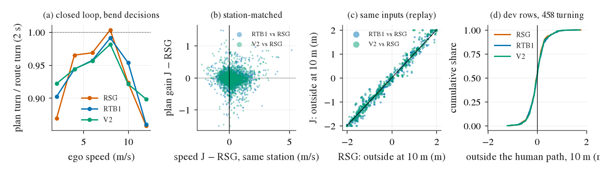
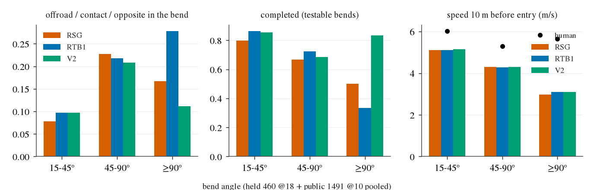
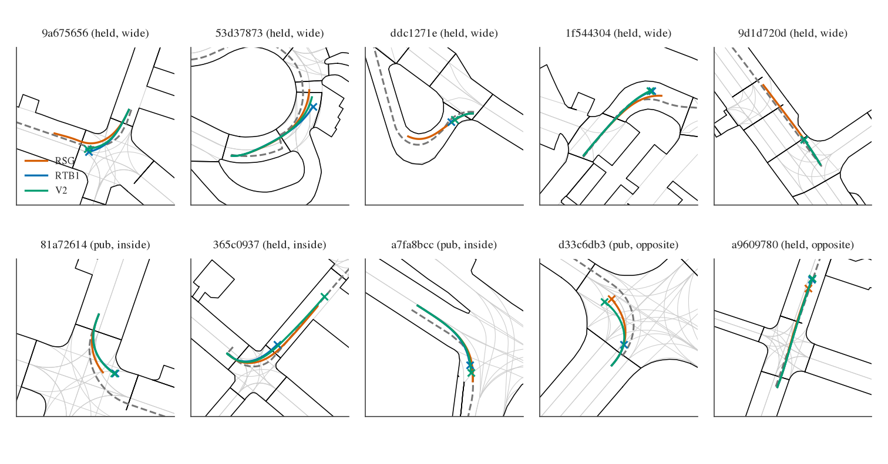
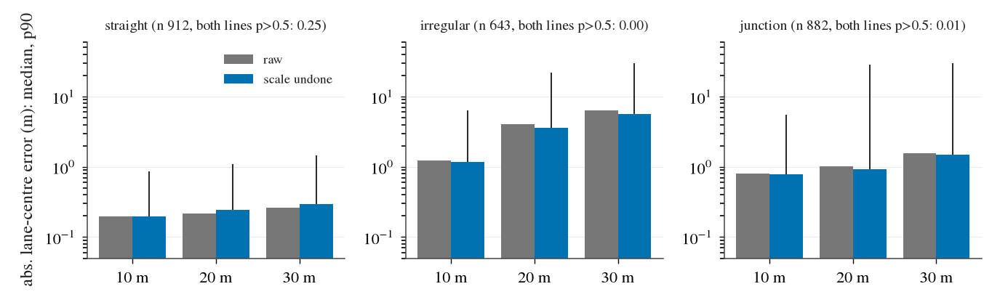

# Explore G: does the retain line track turns worse because a lateral pathway was lost, or because of speed? And how accurate are the lane lines?

Exploratory diagnosis, no training (2026-10-17). It follows decision 339 and handoff section 3 B. Compared: **V2 = RTB1ARO-L18-s0** and
**RTB1 = RTB1O-L18-s0** against **RSG = RSG-L18-s0**, plus the seed-1 pair RTB1OB1-L18-s1 vs RSG-L18-s1 (held only).
Sets: held 460 @18 (452 paired rollouts per label) and public 1491 @10 (1 472 paired). Code: `scripts/nx_turns.py` (stages and definitions
in its docstring), `scripts/nx_turns_report.py`, chain `scripts/xg.sh`. Every number below is in [explore_g.json](explore_g.json).
Box data: `$DATA_DIR/runs/wait_cap/next/explore_g/`. Dev-row plans: `$DATA_DIR/runs/wait_cap/next/hist/`.

## Answer

**Neither (a) nor (b) is a systematic cause.** The retain line does not track turns measurably worse than RSG-L18. Three findings support this.

- **The pathway is not lost.** On identical inputs the retain checkpoints plan the same turns as RSG.
  - On logged frames (458 turning dev rows, the human's own state and speed), their path at 10 m sits 0.01 m [−0.01, +0.03] further
    outside. The heading lag is 0.1° on all turns and 0.5° on turns of 45° or more.
  - On replayed closed-loop states (785 bend decisions), the s0 retain checkpoints turn 1.4–1.7 % less: turn-ratio difference
    −0.014 [−0.027, −0.001] for RTB1 and −0.017 [−0.030, −0.004] for V2. This rises to 2–3 % (+0.07 m outside at 10 m) in large
    narrow bends. The seed-1 pair shows no difference at all.
  - This is a real but tiny under-turn, one to two orders of magnitude below the deviations that decide a bend. Bends that end in a
    hard failure run 1.5–3 m off the human's lane centre (interquartile range), mostly to the inside. It also leaves no trace in the
    outcomes.
- **There is no speed effect into bends.** The speed 10 m before the bend is the same for every label. Held: 4.3 / 4.3 / 4.4 m/s
  (RSG / RTB1 / V2); V2 − RSG = +0.06 [+0.02, +0.09]. Public: 5.0 for all. All three enter at 0.75–0.87 × the human's speed.
  At the same station the retain line is 0.15–0.27 m/s faster, but the faster arm does not sit further outside (0.00 to −0.07 m per
  m/s), and it executes the planned turn as fully as RSG.
- **The outcomes do not differ.** Over all bends, offroad, contact or opposite-lane entry happens at 0.16 / 0.18 vs 0.15 (held) and
  0.13 vs 0.13 (public). The paired flips (J fails where C does not, against the reverse) are balanced:
  11 / 6, 8 / 7, 9 / 6 (held) and 11 / 10, 9 / 9 (public), all sign-test p ≥ 0.33. 59–66 % of the hard failures in bends are
  shared with RSG. On held, the retain line completes more testable bends (0.73–0.76 vs 0.68). It swings 0.05–0.09 m *less* wide and
  cuts 0.07–0.12 m further inside.

**Why the videos looked worse.** The video page sampled the retain line's own zeros: 22 zero-only, 4 zero-both and 24 low-score scenes.
By construction it shows scenes where RTB1 fails and RSG does not, never the reverse. Of the ten example scenes:
- 3 are not turns: |net heading change| < 15° in the window.
- In 5 the traces of all arms nearly coincide up to the event.
- On the same inputs, RSG plans turns within 0.05 of the retain line's turn ratio in 9a67, 1f54, 81a7 and a7fa. RSG turns more in
  53d3 (+0.06) and ddc1 (+0.10 to +0.20). The retain line turns *more* in 365c (cuts inside).

**Recommendation: no lateral work this round.**
- **Not a retention term.** There is no lost pathway to retain. A KD toward RSG-L18's lateral path would chase a 2 % / 5 cm gap that
  costs nothing.
- **Not a turn-specific speed fix.** Entry speed equals RSG's; the general speed alignment (handoff step 2) already covers speed.
- **The lateral failures that remain are RSG's too**: corner cutting into the opposite lane, offroad / contact in tight bends. Fixing them is
  the hard / soft constraint line (handoff 3b), a new turning-training line. Under the standing rule that waits until after 10-31.
- **No lane-line aid either.** The lane lines are usable only on continuous straight roads, where the plans already sit about 0.2 m
  from the lane centre (section 5).

Evidence: moderate. Two sets and three angles agree (logged frames, same-state replay, closed loop matched by speed and station).
The closed loop is one read per label; the replay covers only zero rollouts (rollout.asl is kept only there); the dev rows come from
23 logs.

## 1. Same inputs: the policy's lateral output without closed-loop drift

### 1a. Logged frames (dev rows)

Source: `nx.py hist` plans (speed history × 1) on the 1 789 gate-4 dev rows. Each checkpoint reproduces its training dev ADE exactly
(RTB1 0.5472, V2 0.5445, RTB1-s1 0.5447, RSG-s1 0.5270). The turning rows are the 458 rows (23 logs) where the human turns at least
15° within 4 s; median turn 36°. All metrics compare the plan with the human's own future at fixed arcs, so speed does not enter.
"Out" is the lateral offset outside the human path (+ = wider). "Lag" is the heading behind the human's turn (+ = turns too little).

| pair | rows | out at 10 m (m) | out at 15 m (m) | lag at 10 m (°) | cross-track at 4 s (m) | ADE (m) |
|:--|--:|--:|--:|--:|--:|--:|
| RTB1 vs RSG, turning | 458 | +0.010 [−0.008, +0.029] | +0.014 [−0.022, +0.050] | +0.09 [−0.09, +0.28] | +0.011 [−0.038, +0.060] | +0.019 [+0.005, +0.035] |
| RTB1 vs RSG, turn ≥ 45° | 152 | +0.028 [−0.016, +0.068] | +0.045 [−0.033, +0.122] | +0.46 [+0.03, +0.90] | +0.010 [−0.079, +0.095] | +0.014 [−0.014, +0.046] |
| V2 vs RSG, turning | 458 | +0.009 [−0.008, +0.023] | +0.021 [−0.012, +0.054] | +0.13 [−0.00, +0.26] | +0.014 [−0.027, +0.054] | +0.010 [−0.005, +0.029] |
| V2 vs RSG, turn ≥ 45° | 152 | +0.014 [−0.031, +0.052] | +0.051 [−0.034, +0.147] | +0.52 [+0.22, +0.88] | +0.019 [−0.083, +0.084] | +0.000 [−0.027, +0.035] |
| RTB1-s1 vs RSG-s1, turning | 458 | +0.010 [−0.008, +0.026] | +0.031 [−0.009, +0.072] | +0.15 [−0.04, +0.30] | +0.030 [−0.017, +0.081] | +0.003 [−0.019, +0.023] |

The ADE rise is not turn-specific: on straight moving rows it is +0.017 / +0.018 / +0.021 (RTB1 / V2 / RTB1-s1), the same size as on
turning rows. On sharp turns the retain line lags the human's heading by about 0.5° more than RSG does. That costs 1–5 cm of lateral
position within 15 m.

### 1b. Replayed closed-loop states (zero rollouts)

Each zero rollout whose rollout.asl survived (294 rollouts; 103 s0 rollouts with bend decisions) was replayed. Its logged driver
messages went through the real driver class with every checkpoint of the same seed, so each checkpoint planned from bit-identical
images, history and route memory. **Identity**: each label's own checkpoint reproduces its stored plans to 1.0–1.3 cm median at 4 s
(p95 3.1–3.5 cm, 98.9–99.8 % within 5 cm), and the fed route memory to 5e-6, the rounding of the log. This is the level expected from the
serve-side `torch.compile`.

The first replay of this diagnosis (the predecessor's, 12:58 CST) was invalid. It built `sh30_driver.Driver` directly, and only
`sh30_driver.main()` sets the route tracker (`RMEM`), so every L18 checkpoint got an empty route memory (stored plans missed by 0.38 m
median at 4 s). That replay is kept as `replay_emptymem/` and must not be used.

Decisions: inside [entry − 20, exit + 10] m of a bend of at least 15°, before the zero step, speed ≥ 1 m/s, and the route asking for
at least 0.15 rad. Turn ratio = plan heading change at 2 s ÷ the route's heading change over the plan's own arc, minus the current
heading error (1 = the plan turns what the lane asks).

| pair | subset | decisions / rollouts | turn ratio J / C (median) | J − C turn ratio | J − C out at 10 m (m) | J − C lag at 10 m (°) | J − C plan arc at 2 s (m) |
|:--|:--|--:|--:|--:|--:|--:|--:|
| RTB1 vs RSG | all | 785 / 103 | 0.836 / 0.860 | −0.014 [−0.027, −0.001] | +0.028 [−0.013, +0.069] | +0.28 [−0.11, +0.64] | +0.034 [−0.010, +0.087] |
| RTB1 vs RSG | held | 372 / 45 | 0.776 / 0.780 | −0.005 [−0.023, +0.012] | +0.013 [−0.063, +0.086] | +0.05 [−0.64, +0.75] | −0.007 [−0.051, +0.044] |
| RTB1 vs RSG | public | 413 / 58 | 0.917 / 0.939 | −0.023 [−0.042, −0.003] | +0.042 [+0.003, +0.082] | +0.48 [+0.13, +0.86] | +0.070 [+0.009, +0.133] |
| RTB1 vs RSG | large narrow | 323 / 42 | 0.898 / 0.911 | −0.027 [−0.045, −0.012] | +0.074 [+0.018, +0.144] | +0.58 [+0.11, +1.21] | +0.052 [−0.018, +0.126] |
| V2 vs RSG | all | 785 / 103 | 0.833 / 0.860 | −0.017 [−0.030, −0.004] | +0.037 [−0.000, +0.073] | +0.35 [−0.03, +0.69] | +0.039 [+0.005, +0.077] |
| V2 vs RSG | held | 372 / 45 | 0.779 / 0.780 | −0.004 [−0.019, +0.010] | +0.009 [−0.051, +0.071] | +0.04 [−0.46, +0.59] | +0.007 [−0.040, +0.057] |
| V2 vs RSG | public | 413 / 58 | 0.914 / 0.939 | −0.030 [−0.050, −0.007] | +0.063 [+0.023, +0.111] | +0.63 [+0.20, +1.06] | +0.068 [+0.030, +0.107] |
| V2 vs RSG | large narrow | 323 / 42 | 0.914 / 0.911 | −0.023 [−0.038, −0.010] | +0.072 [+0.023, +0.129] | +0.41 [−0.01, +0.92] | +0.052 [−0.011, +0.106] |
| RTB1-s1 vs RSG-s1 | all (held) | 234 / 29 | 0.696 / 0.715 | −0.000 [−0.011, +0.017] | +0.005 [−0.065, +0.059] | +0.15 [−0.57, +0.54] | −0.025 [−0.065, +0.014] |

The difference does not depend on whose states are replayed. On RSG's own failing states the s0 retain checkpoints differ by −0.015
(RTB1) and −0.018 (V2); on their own states by −0.010 and −0.022. The plan speed matches RSG's on the same input (+0.03 to +0.07 m of
arc at 2 s, about 0.02–0.03 m/s).

What to look at in the figure:
- **(a)** Closed-loop bend decisions: the turn ratio against speed follows the same curve for RSG, RTB1 and V2. The curve is speed
  dependent for all of them.
- **(b)** At the same station, J − RSG plan gain scatters around zero whatever the speed difference.
- **(c)** Same inputs: the plan's offset at 10 m lies on the diagonal.
- **(d)** Dev rows: the three distributions of plan-vs-human offset at 10 m coincide.

## 2. Closed loop at the same speed and bend geometry

Closed-loop decisions in the bend window (stored reads), compared two ways:
- **regression**: y2 = req2 (b0 + b1 J + b2 (v − 5) + b3 J (v − 5)) + c · outside offset, log-clustered bootstrap;
- **station matching**: every 2 m of route over [entry − 20, exit + 10], each arm's nearest decision within 3 m, speed-matched pairs
  within 0.5 m/s.

| set: pair | J's gain change at 5 m/s (regression) | J − C speed, same station (m/s) | J − C turn ratio, speed-matched | J − C outside offset, speed-matched (m) | outside offset per m/s faster (m) | J − C executed ÷ planned turn |
|:--|--:|--:|--:|--:|--:|--:|
| held: RTB1 vs RSG | −0.005 [−0.025, +0.019] | +0.27 [+0.17, +0.35] | −0.016 [−0.031, +0.001] | −0.048 [−0.092, −0.006] | −0.019 [−0.067, +0.033] | +0.006 [−0.000, +0.012] |
| held: V2 vs RSG | +0.000 [−0.014, +0.016] | +0.26 [+0.12, +0.36] | −0.006 [−0.021, +0.010] | −0.079 [−0.125, −0.042] | −0.062 [−0.125, +0.032] | +0.008 [+0.000, +0.015] |
| held: RTB1-s1 vs RSG-s1 | −0.006 [−0.019, +0.008] | +0.22 [+0.14, +0.28] | −0.022 [−0.032, −0.010] | −0.022 [−0.070, +0.023] | +0.000 [−0.076, +0.101] | +0.004 [−0.003, +0.013] |
| public: RTB1 vs RSG | −0.010 [−0.019, −0.001] | +0.21 [+0.17, +0.26] | −0.023 [−0.033, −0.014] | +0.006 [−0.009, +0.020] | −0.036 [−0.088, +0.015] | +0.006 [−0.000, +0.012] |
| public: V2 vs RSG | −0.018 [−0.030, −0.007] | +0.15 [+0.11, +0.19] | −0.024 [−0.035, −0.014] | +0.007 [−0.006, +0.022] | −0.066 [−0.118, −0.004] | +0.009 [+0.003, +0.015] |

At the same speed and station the retain line plans up to 2 % less turn (the same size as on identical inputs), but its car is not
further out. On held it is 0.02–0.08 m further in; on public it is unchanged.

Hypothesis (b) needs three things, and none holds:
- **A faster entry.** No: the entry speeds are equal (section 3).
- **Distance from speed.** No: being faster at a station does not push the car out; the slopes are negative.
- **Amplified tracking.** No: the controller executes the planned heading change as fully for J as for C. The plan arc minus 2 s × speed
  (decision 285's "plan shorter than the car") is 0.15–0.21 m *longer* for the retain line than for RSG.

## 3. Turns grouped by geometry and outcome

Outcome of each bend (first event in time; definitions in the nx_turns.py docstring):
- **offroad / contact / diverged**: the zero step falls inside [entry − 20, exit + 10];
- **opposite**: the car centre enters an opposite-direction lane where the human's lane centre at the same station is in a
  same-direction lane;
- **hard** = offroad ∪ contact ∪ opposite.

The opposite rule has a human baseline. Without it, 38 of 56 RSG / RTB1 opposite bends were shared and mostly scored 1.0 (map
artifacts). Testable = the human finished the bend inside the read.

| set / label | bends | completed | incomplete | offroad | contact | opposite | diverged | zero before | untestable |
|:--|--:|--:|--:|--:|--:|--:|--:|--:|--:|
| held / RSG | 198 | 64 | 21 | 8 | 6 | 16 | 9 | 2 | 72 |
| held / RTB1 | 198 | 74 | 16 | 7 | 11 | 17 | 9 | 2 | 62 |
| held / V2 | 198 | 80 | 15 | 8 | 6 | 17 | 10 | 2 | 60 |
| held / RSG-s1 | 198 | 61 | 23 | 6 | 7 | 17 | 9 | 2 | 73 |
| held / RTB1-s1 | 198 | 71 | 19 | 6 | 10 | 17 | 9 | 2 | 64 |
| public / RSG | 336 | 72 | 12 | 11 | 5 | 28 | 8 | 1 | 199 |
| public / RTB1 | 336 | 76 | 7 | 13 | 5 | 27 | 7 | 1 | 200 |
| public / V2 | 336 | 75 | 10 | 13 | 6 | 25 | 10 | 1 | 196 |

Paired flips. "J-only" means J fails where C does not; the p-value is an exact two-sided sign test on the two one-sided counts.

| set: pair | hard in a bend: J-only / C-only / both (p) | opposite: J-only / C-only / both | completed: J-only / C-only (p) | offroad rollout: J-only / C-only (p) | zero rollout: J-only / C-only (p) |
|:--|--:|--:|--:|--:|--:|
| held: RTB1 vs RSG | 11 / 6 / 24 (0.33) | 5 / 4 / 12 | 9 / 5 (0.42) | 4 / 6 (0.75) | 12 / 8 (0.50) |
| held: V2 vs RSG | 8 / 7 / 23 (1.00) | 3 / 2 / 14 | 10 / 3 (0.09) | 6 / 7 (1.00) | 12 / 7 (0.36) |
| held: RTB1-s1 vs RSG-s1 | 9 / 6 / 24 (0.61) | 2 / 2 / 15 | 9 / 2 (0.07) | 5 / 4 (1.00) | 14 / 9 (0.40) |
| public: RTB1 vs RSG | 11 / 10 / 34 (1.00) | 4 / 5 / 23 | 5 / 0 (0.06) | 12 / 7 (0.36) | 17 / 12 (0.46) |
| public: V2 vs RSG | 9 / 9 / 35 (1.00) | 2 / 5 / 23 | 3 / 1 (0.62) | 12 / 7 (0.36) | 20 / 12 (0.22) |

The public offroad excess of decision 339 (36 vs 31) is 12 vs 7 one-sided flips (p 0.36). It is not concentrated in bends: offroad
inside a bend is 13 vs 11.

By geometry, columns RSG / RTB1 / V2. Differences are V2 − RSG with log-clustered CIs. Outside / inside = largest lateral offset from
the human's lane centre in the bend window, signed toward the outside / inside of the bend. Every bin of every pair is in
[explore_g.json](explore_g.json) `bins`.

**Held 460 @18**

| bin | bends (testable) | hard: RSG / RTB1 / V2 | V2 − RSG hard | completed: RSG / RTB1 / V2 | max outside, median (m) | V2 − RSG outside (m) | V2 − RSG inside (m) | entry speed RSG / V2 / human (m/s) |
|:--|--:|--:|--:|--:|--:|--:|--:|--:|
| all bends ≥ 15° | 198 (91) | 0.15 / 0.18 / 0.16 | +0.01 [−0.02, +0.03] | 0.68 / 0.73 / 0.76 | 0.28 / 0.27 / 0.30 | −0.08 [−0.15, −0.03] | +0.12 [+0.05, +0.18] | 4.3 / 4.4 / 5.7 |
| 15–45° | 81 (43) | 0.06 / 0.06 / 0.07 | +0.01 [−0.03, +0.06] | 0.74 / 0.81 / 0.84 | 0.30 / 0.33 / 0.30 | −0.03 [−0.12, +0.08] | +0.10 [+0.01, +0.21] | 5.5 / 5.6 / 6.5 |
| 45–90° | 99 (42) | 0.22 / 0.25 / 0.23 | +0.01 [−0.03, +0.04] | 0.64 / 0.69 / 0.67 | 0.24 / 0.17 / 0.32 | −0.08 [−0.17, −0.00] | +0.13 [+0.04, +0.21] | 3.6 / 3.7 / 5.0 |
| ≥ 90° | 18 (6) | 0.17 / 0.28 / 0.11 | −0.06 [−0.18, +0.00] | 0.50 / 0.33 / 0.83 | 0.61 / 0.35 / 0.34 | −0.32 [−0.68, −0.04] | +0.16 [−0.16, +0.44] | 3.0 / 3.1 / 5.7 |
| r_bend < 10 m | 46 (20) | 0.22 / 0.28 / 0.22 | +0.00 [−0.09, +0.07] | 0.60 / 0.60 / 0.75 | 0.67 / 0.46 / 0.48 | −0.11 [−0.36, +0.05] | +0.10 [−0.07, +0.24] | 3.1 / 3.1 / 5.0 |
| r_bend 10–20 m | 73 (32) | 0.18 / 0.19 / 0.19 | +0.01 [−0.03, +0.06] | 0.91 / 0.81 / 0.81 | 0.58 / 0.42 / 0.44 | −0.13 [−0.22, −0.06] | +0.12 [+0.02, +0.24] | 3.1 / 3.1 / 4.0 |
| r_bend 20–40 m | 56 (26) | 0.12 / 0.12 / 0.09 | −0.04 [−0.09, +0.00] | 0.54 / 0.73 / 0.73 | 0.04 / −0.04 / 0.01 | +0.02 [−0.06, +0.12] | +0.18 [+0.03, +0.31] | 5.5 / 5.5 / 5.6 |
| r_bend ≥ 40 m | 23 (13) | 0.00 / 0.04 / 0.09 | +0.09 [+0.00, +0.23] | 0.54 / 0.69 / 0.69 | 0.08 / 0.05 / 0.01 | −0.12 [−0.24, −0.01] | +0.02 [−0.06, +0.07] | 7.8 / 8.0 / 8.3 |
| lane < 3.3 m | 42 (25) | 0.12 / 0.10 / 0.12 | +0.00 [−0.10, +0.10] | 0.64 / 0.80 / 0.76 | 0.23 / 0.23 / 0.30 | −0.05 [−0.20, +0.10] | +0.12 [−0.02, +0.28] | 5.2 / 5.3 / 6.3 |
| lane 3.3–4.0 m | 58 (26) | 0.14 / 0.14 / 0.12 | −0.02 [−0.09, +0.05] | 0.65 / 0.69 / 0.73 | 0.26 / 0.19 / 0.19 | −0.12 [−0.21, −0.04] | +0.18 [+0.08, +0.31] | 4.8 / 4.8 / 6.3 |
| lane ≥ 4.0 m | 96 (38) | 0.17 / 0.23 / 0.19 | +0.02 [−0.03, +0.07] | 0.74 / 0.71 / 0.79 | 0.38 / 0.35 / 0.33 | −0.08 [−0.20, +0.03] | +0.08 [−0.04, +0.18] | 3.6 / 3.6 / 5.0 |
| large narrow (≥ 60°, r_bend < 15 m) | 61 (21) | 0.28 / 0.34 / 0.30 | +0.02 [−0.04, +0.06] | 0.76 / 0.67 / 0.81 | 0.71 / 0.36 / 0.48 | −0.18 [−0.34, −0.05] | +0.10 [−0.06, +0.22] | 2.6 / 2.6 / 4.7 |

**Public 1491 @10** (5 s reads: most bends are not finished in the window)

| bin | bends (testable) | hard: RSG / RTB1 / V2 | V2 − RSG hard | completed: RSG / RTB1 / V2 | max outside, median (m) | V2 − RSG outside (m) | V2 − RSG inside (m) | entry speed RSG / V2 / human (m/s) |
|:--|--:|--:|--:|--:|--:|--:|--:|--:|
| all bends ≥ 15° | 336 (78) | 0.13 / 0.13 / 0.13 | +0.00 [−0.02, +0.02] | 0.82 / 0.88 / 0.85 | 0.23 / 0.25 / 0.25 | +0.02 [−0.01, +0.04] | −0.01 [−0.05, +0.03] | 5.0 / 5.0 / 5.8 |
| 15–45° | 228 (66) | 0.08 / 0.11 / 0.11 | +0.02 [+0.00, +0.04] | 0.83 / 0.89 / 0.86 | 0.26 / 0.22 / 0.26 | +0.00 [−0.03, +0.03] | +0.02 [−0.04, +0.09] | 5.0 / 5.0 / 5.8 |
| 45–90° | 108 (12) | 0.23 / 0.19 / 0.19 | −0.05 [−0.10, +0.01] | 0.75 / 0.83 / 0.75 | 0.16 / 0.26 / 0.24 | +0.06 [+0.01, +0.11] | −0.08 [−0.16, −0.01] | 4.9 / 4.9 / 5.9 |
| r_bend < 10 m | 52 (4) | 0.15 / 0.15 / 0.12 | −0.04 [−0.09, +0.00] | 0.50 / 0.50 / 0.50 | 0.34 / 0.32 / 0.40 | −0.01 [−0.13, +0.09] | +0.02 [−0.10, +0.15] | 3.8 / 3.8 / 5.4 |
| r_bend 10–20 m | 152 (32) | 0.20 / 0.21 / 0.21 | +0.01 [−0.03, +0.06] | 0.91 / 0.94 / 0.91 | 0.33 / 0.32 / 0.27 | −0.00 [−0.04, +0.04] | −0.02 [−0.10, +0.04] | 4.1 / 4.1 / 5.4 |
| r_bend 20–40 m | 103 (30) | 0.06 / 0.05 / 0.06 | +0.00 [−0.03, +0.03] | 0.83 / 0.90 / 0.90 | 0.09 / 0.01 / 0.06 | +0.07 [+0.02, +0.13] | −0.02 [−0.07, +0.03] | 6.1 / 6.1 / 5.4 |
| lane < 3.3 m | 62 (18) | 0.08 / 0.11 / 0.11 | +0.03 [−0.03, +0.10] | 0.78 / 0.89 / 0.78 | 0.53 / 0.54 / 0.51 | +0.06 [+0.01, +0.11] | −0.06 [−0.15, +0.03] | 5.6 / 5.6 / 5.6 |
| lane 3.3–4.0 m | 124 (29) | 0.15 / 0.13 / 0.11 | −0.04 [−0.08, −0.01] | 0.90 / 0.90 / 0.90 | 0.19 / 0.15 / 0.22 | +0.04 [−0.00, +0.08] | −0.07 [−0.16, +0.01] | 4.8 / 4.8 / 5.6 |
| lane ≥ 4.0 m | 149 (30) | 0.13 / 0.15 / 0.15 | +0.02 [−0.01, +0.06] | 0.77 / 0.87 / 0.83 | 0.16 / 0.17 / 0.16 | −0.01 [−0.06, +0.04] | +0.06 [−0.00, +0.13] | 4.8 / 4.8 / 6.0 |
| large narrow (≥ 60°, r_bend < 15 m) | 43 (4) | 0.35 / 0.21 / 0.21 | −0.14 [−0.24, −0.05] | 1.00 / 1.00 / 1.00 | 0.20 / 0.25 / 0.23 | −0.01 [−0.08, +0.06] | −0.14 [−0.31, −0.01] | 4.3 / 4.3 / 6.2 |

No geometry bin shows the retain line failing more at a resolvable level. The worst point estimate is held ≥ 90° for RTB1 (5 / 18
against 3 / 18), but V2 is 2 / 18 there. The class the user named, the large narrow bend, is level on held and favours the retain line
on public (−0.14 [−0.24, −0.05]).

Hard failures do rise with geometry for every arm: 0.06–0.11 at 15–45° against 0.19–0.35 at 45–90° and in large narrow bends. In the
failing bends the car is mostly *inside* the human's line: median largest inside offset 1.87 m against 0.15 m outside; opposite-lane
entries run 2.7 m off. Every arm slows to 0.55–0.8 × the human's speed before tight bends. That is the shared lateral weakness
(corner cutting), not a retention loss.

What to look at in the figure: the three bars per bin (held and public pooled) are level in all three panels: hard-failure rate,
completion and entry speed. The black dots in the right panel are the human's entry speed; all arms are below it. The ≥ 90° bin holds
only 18 held bends.

## 4. The ten example scenes

Each example is shown on the set where the retain line failed. The turn ratio and outside offset are measured on the same inputs: the
failing label's own zero-rollout states, replayed through each checkpoint (in-bend medians). Score 0 = the rollout's zero.

| scene (user's class) | set | RSG | RTB1 | V2 | bend (°) / r_bend (m) / lane (m) | entry speed RSG / RTB1 / V2 (m/s) | max outside / inside: RSG; RTB1; V2 (m) | same inputs: turn ratio RSG / RTB1 / V2 | same inputs: outside at 10 m RSG / RTB1 / V2 (m) |
|:--|:--|:--|:--|:--|:--|:--|:--|:--|:--|
| 9a675656 (wide) | held | 1.00 | 0, opposite | 0, contact | −78 / 8.7 / 5.0 | 1.9 / 1.9 / 1.9 | −0.49 / 1.56; 1.22 / 1.15; 0.48 / 1.19 | 0.82 / 0.82 / 0.83 (V2's) | 0.86 / 0.82 / 0.73 |
| 53d37873 (wide) | held | 1.00 | 0, diverged | 1.00 | 100 / 5.8 / 3.9 | 1.8 / 1.8 / 1.8 | 1.87 / 2.75; 3.19 / 2.89; 2.67 / 2.84 | 0.63 / 0.57 / 0.57 (RTB1's) | 0.95 / 1.00 / 0.94 |
| ddc1271e (wide) | public | 1.00 | 0, offroad | 0, offroad | 25 / 5.8 / 7.2 | 1.4 / 0.5 / – | 0.11 / 0.72; −0.52 / 0.56; – | 0.74 / 0.64 / 0.54 (V2's) | – |
| 1f544304 (wide) | held | 1.00 | 0, offroad | 0, offroad | −62 / 10.1 / 7.5 | 3.6 / 3.5 / 3.7 | 1.48 / 0.50; 2.17 / 0.28; 2.22 / 0.28 | 0.52 / 0.48 / 0.48 (V2's) | 0.16 / 0.35 / 0.43 |
| 9d1d720d (wide) | held | 1.00 | 0, offroad | 0, offroad | −1 (no bend) | – | – | – | – |
| 81a72614 (inside) | public | 1.00, opposite | 0, opposite | 0, opposite | 16 / 12.4 / 5.3 | 0.3 / 0.3 / 0.3 | −0.06 / 1.70; −0.07 / 3.60; −0.07 / 3.45 | 1.11 / 1.13 / 1.10 (V2's) | −2.77 / −3.19 / −3.10 |
| 365c0937 (inside) | held | 1.00, completed | 0, contact | 1.00, completed | 115 / 5.2 / 5.7 | 0.2 / 0.2 / 0.2 | 0.26 / 1.42; 0.26 / 2.55; 0.26 / 2.23 | 1.05 / 1.15 / 1.16 (RTB1's) | −1.71 / −1.86 / −1.77 |
| a7fa8bcc (inside) | public | 1.00 | 0, contact | 0, contact | −47 / 11.8 / 4.5 | 6.0 / 6.0 / 6.0 | 1.82 / 0.09; 1.82 / 0.53; 1.82 / 0.55 | 1.17 / 1.16 / 1.16 (V2's) | −0.18 / −0.20 / −0.27 |
| d33c6db3 (opposite) | public | 0.66 | 0, contact | 0.70 | 13 (no bend) | – | – | – | – |
| a9609780 (opposite) | public | 1.00 | 0, diverged | 0, diverged | 0 (no bend) | – | – | – | – |

Speed does not separate the arms in any example: RSG and the retain line enter each bend at the same speed. The examples split three
ways.

**Turns where RSG plans more turn on the same inputs (2 of 10).** ddc1271e: RSG plans 0.74 against 0.54–0.64. 53d37873: 0.63 against
0.57, but all three arms end 2–3 m outside the roundabout.

**Turns where the plans agree (4 of 10).** Here the outcome flipped on trajectory differences or traffic, not on the plan's turn:
- 9a67 and 1f54: the plans agree within 0.05 of turn ratio.
- 81a7: RSG too cuts 1.7 m inside, into the opposite lane.
- a7fa: the plans agree within 0.01.

**A turn where the retain line plans more turn (1 of 10).** 365c0937: 1.15–1.16 against RSG's 1.05; RTB1 cuts inside and is hit,
while V2 completes the bend.

**Not turns (3 of 10).** 9d1d720d is a straight-road offroad at 1.5 s (explore_f: purely lateral, at the human's speed).
d33c6db3 and a9609780 are opposite-lane / corridor events on near-straight stretches.

What to look at in the figure:
- **Drawing.** Controller traces up to the zero step (× marks the event) for RSG (vermillion), RTB1 (blue) and V2 (green). The grey
  dashed line is the route (the human's lane centres). Black lines are the road boundary; light grey lines are lane edges.
- **What the traces show.** In most panels the three traces overlap until the event. 53d3 and 81a7 show the shared failure: every arm
  ends outside the roundabout route, or cuts the left turn.

## 5. Lane lines: continuous straight, interrupted at junctions, irregular

The shipped policy's lane-line heads (P0), run on the same vision tokens, are compared with the map's own-lane centre at 10 / 20 / 30 m
ahead of the camera. "Scale undone" divides lateral offsets about the camera by decision 104's 0.689 (the camera-height scale).

The decisions come from two sources:
- 2 000 closed-loop decisions of eyes_vs_head's 200 public ctrl scenes;
- the replayed zero rollouts, at least 3 s before their zero step.

The three segment classes:
- **continuous straight**: no junction; lane and route heading change under 10° over 40 m; the own lane reaches 30 m and its width
  changes by less than 0.5 m;
- **junction**: the car, or its lane 10–20 m ahead, sits in two lane polygons more than 30° apart;
- **irregular**: everything else (curved, merging / splitting / tapering, or the lane ends).

| segment | decisions (scenes) | both ego lines p > 0.5 | centre error at 10 / 20 / 30 m, median (m) | p90 (m) | share within 0.5 m | confident decisions: median (m) | lane width read ÷ map (raw; scale undone) | lane heading error median / p90 (°) |
|:--|--:|--:|--:|--:|--:|--:|--:|--:|
| continuous straight | 912 (135) | 0.25 | 0.20 / 0.24 / 0.29 | 0.9 / 1.1 / 1.4 | 0.80 / 0.76 / 0.69 | 0.12 / 0.14 / 0.17 | 0.76; 1.10 | 0.5 / 2.5 |
| junction | 882 (124) | 0.01 | 0.77 / 0.93 / 1.51 | 5.5 / 28.8 / 30.2 | 0.37 / 0.28 / 0.25 | 0.23 / 0.20 / 0.14 (n ≈ 5) | 0.72; 1.05 | 3.2 / 47.4 |
| irregular | 643 (120) | 0.00 | 1.16 / 3.63 / 5.65 | 6.4 / 21.7 / 30.0 | 0.35 / 0.17 / 0.10 | – | 0.73; 1.06 | 13.0 / 48.2 |
| no map lane | 14 (6) | 0.00 | – | – | – | – | – | – |

Earlier verdicts (decisions 104 / 165 / 179 / 192) said "not read accurately". The split refines that:
- **Continuous straight roads.** The heads read the ego-lane centre to 0.2–0.3 m (median; p90 about 1 m). The lane width is read at
  0.76 of the map, which is decision 104's scale; undoing it gives 1.10. The model is confident (both ego lines p > 0.5) on only 25 %
  of these decisions on rendered frames. When it is confident, it is good: 0.12–0.17 m, 84–92 % within 0.5 m.
- **Junctions.** The lines are interrupted: 0.8–1.5 m median, with a 5–30 m p90 tail.
- **Irregular roads.** 1.2–5.7 m median, growing with distance. The head draws a straighter lane than the map's.

In both of the last two classes the model itself calls the lines absent (confidence 0–1 %). The ctrl sample alone gives the same
picture: straight 0.18 / 0.22 / 0.30, junction 0.44 / 0.46 / 0.57, irregular 0.83 / 2.51 / 3.89 m.

So a lane-line keeping aid could only work on continuous straight roads. There the plans already sit 0.14–0.21 m (median, 20 m ahead)
from the lane centre, toward the road centre; that offset is the same for every label (`route_bias` in the JSON), while the fed route
memory is centred. The aid would add nothing where turns fail.

What to look at in the figure: the log-scale bars. Continuous straight sits near 0.2 m; junction and irregular sit at 1–6 m with p90
whiskers reaching tens of metres. Undoing the camera-height scale (blue against grey) barely changes the centre error; it fixes only the
width.

## Notes

- **Definitions added after the first read.** The outcome classes, the opposite-lane rule with its human baseline, the bend lane width,
  r_bend, the three-way segment split and the replay route-memory fix were all added after the predecessor's first read (nx_turns.py
  docstring, "Added 2026-10-17"). The bend, plan-turn and lane-reference rules are unchanged from fa255dfd / 94841533. This is a
  diagnosis, not a registered test.
- **Coverage.** 21 public rollouts are missing for every label (7 scenes): AlpaSim's route generator rejects their route as folding
  back.
- **Box incidents.**
  - The geo stage's scene loader caches every data source per worker. A 32-worker run reached 322 GB RSS; one worker died, the run
    failed by design, and it resumed from the per-rollout cache. The loader is now dropped every 20 rollouts.
- **Rerun.** `bash experiments/wait_cap/scripts/xg.sh launch` runs the whole chain through the pool: geo, msgs, replay (one GPU job per
  checkpoint), olg, lanes, `nx.py hist` and the report. The report lands in `$DATA_DIR/runs/wait_cap/next/explore_g/report/`; the
  report step takes about 25 s.
- **What would change the verdict.**
  - A second read per label, or PAI 281, that shows one-sided hard-failure flips (J-only beyond C-only, sign test p < 0.05) in bends
    of 45° or more.
  - A same-input turn-ratio gap above about 0.1 on non-zero rollouts. These would need rollout.asl kept, which the current reads prune.
