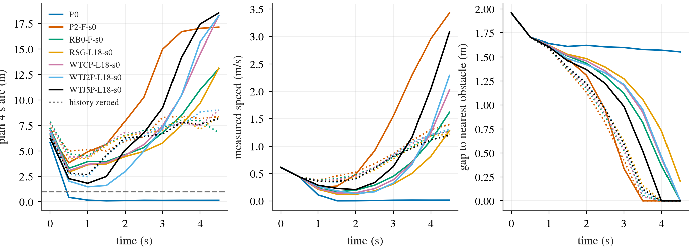
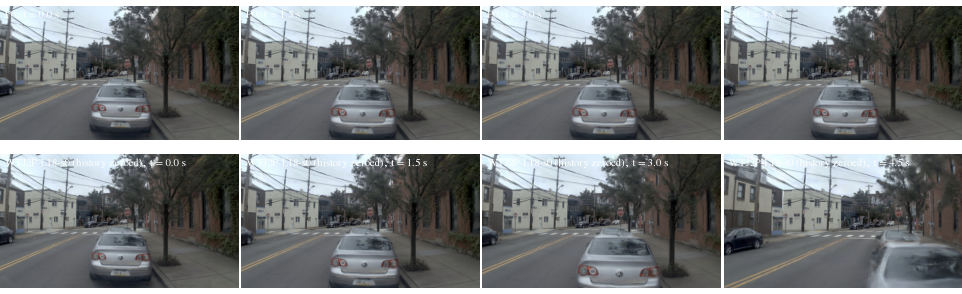
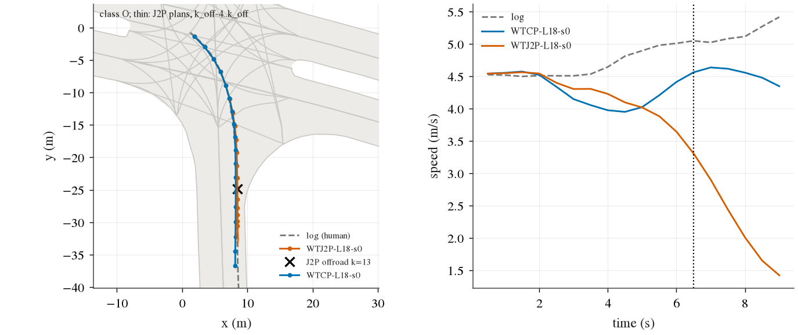
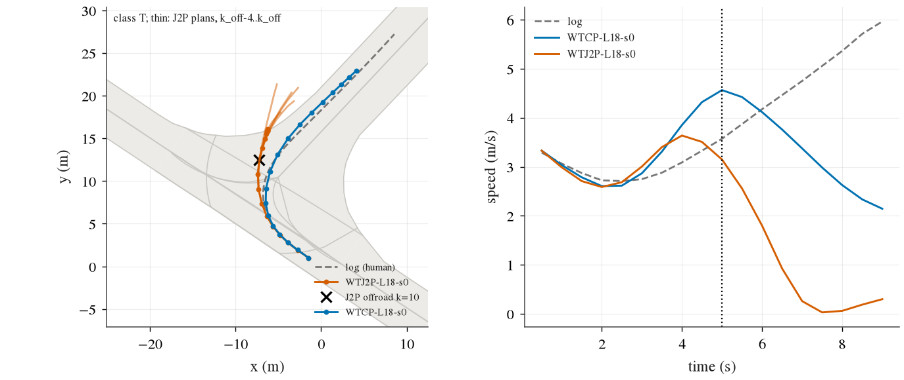
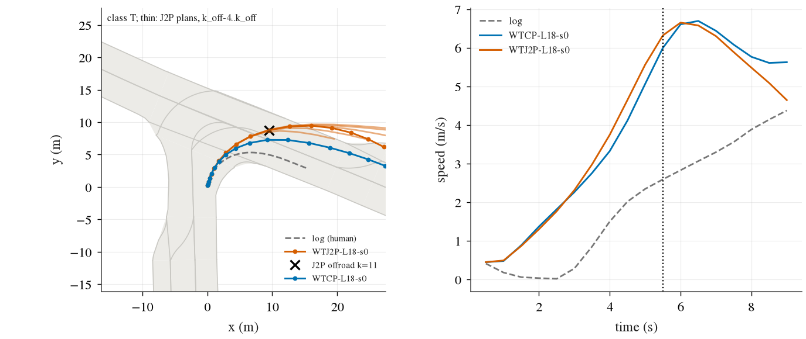

# WAIT-TRAIN 补记 E: can the closed loop show waiting? (2026-10-17, 02:55-04:40 CST)

Diagnostics only: no training, no new arm, no formal, no registered verdict file touched (the pilot STOP of decision 335 stands). The three
questions and the description lines were pushed before any of these reads (prereg 补记 E, b4c622ba). Every closed-loop read is the 补记 D
instrument: the public static scene @10 (`ol_chain.sh readlist`), PAI stop17 in the PAI submission config (`pai_box.sh`), held 460 @18
(`rm_chain.sh read`). P0 (shipped Cinque, no adapter) runs through the same sh30 driver; the only code change was to let the tag `P0` past
the arm assert and the checkpoint-file checks (a9380ddd).

Code: `wt.sh explore-e` / `xe-*` (job bodies) and `scripts/wt_xe.py` (`static`, `xreplay`, `stages`, `offroad`). Box: `runs/wait_cap/train/explore_e/`.
Files here: [explore_e/static.md](explore_e/static.md) (every run per decision), `static.json`, `xreplay.json`, [explore_e/stages.md](explore_e/stages.md),
[explore_e/offroad.md](explore_e/offroad.md), `offroad.json`, `figs/`.

## Verdict

**The closed loop can show waiting. Shipped Cinque waits in it, and the WAIT-trained adapters would too, but they never get to a standstill.**

- **P0 stops.** On the static scene P0 comes to rest 0.48 m after the handoff (the human: 0.50 m), 1.55 m behind the lead, score 1. Every
  adapter stage drives into the lead (P2-F, RB0, RSG, WTCP, WTJ2P, WTJ5P: 2.3-2.7 m, contact at 3.5-5.0 s).
- **The scene, the instrument and the controller are fine.** The lead is in full view in every frame
  ([static_frames.png](explore_e/figs/static_frames.png)), and the controller follows a stopping plan to rest (P0).
- **J2P / J5P wait once the car stands.** Replayed on the exact inputs P0 saw in its own run (a standing car from 1.5 s), J2P plans
  0.2-0.4 m over 4 s and J5P 0.1-0.3 m, the same as in open loop on the real frames of this log (0.1-0.2 m). CP, RSG, RB0 and P2-F plan
  3.8-4.6 m on the same inputs.
- **What fails is the arrival.** The car is handed over at 0.61 m/s, still rolling. At 0.5 s (0.44 m/s, identical state in every run) P0
  plans 0.43 m over 4 s, J2P 2.0 m, J5P 2.3 m, the go-stages 2.9-3.8 m. J's plans never ask for zero, so the car keeps creeping
  (0.13-0.29 m/s). On those creeping inputs J2P plans 1.5-3 m, and from 2 s its plans grow with the speed (5, 7, 10, 16 m) into the lead.
- **The numeric speed history is not the lever.** Feeding the adapter a standing car's speed history (`JEV_VHIST=zero`) in closed loop
  does not stop any stage (2.1-2.6 m, contact), and in replay it makes the early plans longer, not shorter (J2P at 0.5 s: 3.1 vs 2.3 m).
  For the adapter stages "standing still" in the ego row reads as "launch" (decision 326). Inference, not isolated by a read: what keeps J going is the
  creep itself, visible in the frames, which P0 also sees and still stops on.

**Static-scene mechanism, in one sentence:** the WAIT-trained adapters hold a stop but cannot make one, so a car that arrives rolling
never reaches the standstill on which their wait would fire; the creep then grows through the own-motion trend (decision 315), while P0,
reading the same frames, plans a stop at the first decision after the handoff.

## Q1: waiting across the stages, closed loop

| stage | open-loop wait W | static: distance (m) / contact (s) | static, history zeroed: distance (m) | PAI stop17 zeros | held 460 @18: scenes | zeros | mean | offroad | at-fault | mean distance (m) |
|---|--:|--:|--:|--:|--:|--:|--:|--:|--:|--:|
| P0 | 0.978 | 0.48 / - | - | 14 / 17 | 460 | 213 | 0.405 | 98 | 24 | 36.3 |
| P2-F-s0 | 0.015 | 2.67 / 3.5 | 2.11 | 16 / 17 | 460 | 93 | 0.752 | 39 | 15 | 45.5 |
| RB0-F-s0 | 0.006 | 2.35 / 4.5 | 2.52 | 16 / 17 | 460 | 59 | 0.822 | 29 | 7 | 46.2 |
| RSG-L18-s0 | 0.005 | 2.61 / 5.0 | 2.41 | 16 / 17 | 460 | 34 | 0.866 | 17 | 4 | 45.9 |
| WTCP-L18-s0 | 0.007 | 2.40 / 4.5 | 2.55 | 16 / 17 | 460 | 41 | 0.852 | 14 | 6 | 45.9 |
| WTJ2P-L18-s0 | 0.861 | 2.45 / 4.5 | 2.51 | 16 / 17 | 460 | 53 | 0.739 | 28 | 7 | 40.9 |
| WTJ5P-L18-s0 | 0.905 | 2.30 / 4.0 | 2.43 | 17 / 17 | 460 | 58 | 0.624 | 39 | 6 | 36.4 |
| RSG-L18-s0 archive (PAI config, d328) | | | | 16 / 17 | | | | | | |

- Open-loop W = waitcap_test wait share where the human waits (decision 326 rows; seed 0 of each stage).
- Static = the one public scene where the human stays put (lead 1.6 m ahead). "History zeroed" = the same run with `JEV_VHIST=zero`.
- Stored reads reused: held 460 @18 of RB0-F-s0 and RSG-L18-s0 (`runs/route_mem/read/`), and of the three 补记 D tags; PAI stop17 of the
  three 补记 D tags. New: static for P0 / P2-F / RB0 / RSG and all six history-zeroed runs; held for P0 and P2-F-s0; stop17 for P0,
  P2-F-s0, RB0-F-s0 and RSG-L18-s0 (in 补记 D's PAI config, beside the d328 archive).

- **P0 is the only stage that waits in the closed loop.** It stops in the static scene, and it is the only stage with fewer than 16 stop17
  zeros (14 / 17: it ends 3 of the PAI "human stopped, car did not" scenes in time, against at most 1 for every other stage).
- **P0 is unusable as a driver here.** Held 460: 213 zeros, mean 0.405. The zeros are mostly lateral: 98 offroad, 83 corridor, 24 at-fault. It
  stays within 2 m of its start in 46 held scenes, where RSG does so in none; held has no scene where the human stays put (decision 326).
  So its waiting is partly unconditional (open-loop "waits where the human goes" 0.334, decision 326).
- **Along the lineage, held zeros fall** (P0 213 -> P2-F 93 -> RB0 59 -> RSG 34). Waiting is lost at P2-F (static 2.67 m into the lead,
  stop17 16 / 17) and never comes back, the WAIT pilots included.
- **Zeroing the speed history fed to the adapter changes no static outcome** (2.1-2.6 m, contact for every adapter stage).
- RSG-L18-s0 in 补记 D's PAI config reproduces the d328 archive's stop17 (16 / 17, the same scene `cbd87234` scored).

## Q2: why the static scene fails

What to look at: left, P0's plan (blue) drops below the 1 m wait line at the first decision after the handoff and stays there; every other
stage dips to 1.5-3.8 m and climbs. Middle, only P0's speed reaches zero. Right, only P0 keeps its gap. Dotted (history zeroed) lines do not
separate from the solid ones.

Per decision (served plan 4 s arc in m / measured speed in m/s):

| t (s) | P0 | WTJ2P | WTJ5P | WTCP | RSG | WTJ2P history zeroed |
|--:|--:|--:|--:|--:|--:|--:|
| 0.0 | 5.81 / 0.61 | 6.68 / 0.61 | 6.24 / 0.61 | 7.03 / 0.61 | 7.01 / 0.61 | 7.12 / 0.61 |
| 0.5 | 0.43 / 0.44 | 2.03 / 0.44 | 2.27 / 0.44 | 3.06 / 0.44 | 2.91 / 0.44 | 2.74 / 0.44 |
| 1.0 | 0.15 / 0.11 | 1.46 / 0.26 | 1.82 / 0.29 | 3.69 / 0.22 | 3.64 / 0.21 | 2.47 / 0.35 |
| 1.5 | 0.09 / 0.00 | 1.60 / 0.18 | 2.48 / 0.23 | 3.84 / 0.14 | 3.72 / 0.12 | 4.51 / 0.35 |
| 2.0 | 0.11 / 0.00 | 2.96 / 0.13 | 5.11 / 0.21 | 4.58 / 0.15 | 4.45 / 0.12 | 6.13 / 0.40 |
| 2.5 | 0.14 / 0.01 | 5.01 / 0.17 | 6.79 / 0.33 | 5.63 / 0.22 | 4.96 / 0.18 | 6.45 / 0.60 |
| 3.0 | 0.13 / 0.01 | 7.25 / 0.33 | 9.21 / 0.63 | 7.43 / 0.38 | 5.78 / 0.31 | 7.51 / 0.84 |
| 3.5 | 0.14 / 0.01 | 10.46 / 0.66 | 14.18 / 1.16 | 10.43 / 0.69 | 7.54 / 0.50 | 7.48 / 1.08 |
| 4.0 | 0.14 / 0.01 | 15.69 / 1.30 | 17.44 / 2.04 | 14.52 / 1.24 | 9.66 / 0.82 | 8.81 / 1.21 |
| 4.5 | 0.14 / 0.01 | 18.26 / 2.29 | 18.54 / 3.08 | 18.27 / 2.02 | 13.11 / 1.28 | 9.01 / 1.30 |

Replay on P0's own closed-loop inputs (`xreplay.json`; open loop, the exact frames and ego row P0 was served; P0 reproduces its logged plans
to 0.007 m), plan 4 s arc (m):

| t (s) | P0's speed (m/s) | P0 | P2-F-s0 | RB0-F-s0 | RSG-L18-s0 | WTCP-L18-s0 | WTJ2P-L18-s0 | WTJ5P-L18-s0 |
|--:|--:|--:|--:|--:|--:|--:|--:|--:|
| 0.0 | 0.61 | 5.81 | 6.57 | 7.20 | 7.02 | 7.05 | 6.69 | 6.23 |
| 0.5 | 0.44 | 0.43 | 3.83 | 3.30 | 2.90 | 3.06 | 2.04 | 2.26 |
| 1.0 | 0.11 | 0.15 | 4.33 | 3.70 | 3.56 | 3.56 | 1.19 | 1.20 |
| 1.5 | 0.00 | 0.08 | 4.14 | 4.10 | 3.97 | 3.98 | 0.41 | 0.31 |
| 2.0 | 0.00 | 0.11 | 3.93 | 4.26 | 4.19 | 4.15 | 0.31 | 0.17 |
| 2.5 | 0.01 | 0.13 | 3.81 | 3.95 | 3.91 | 3.88 | 0.19 | 0.10 |
| 3.0 | 0.01 | 0.13 | 3.92 | 3.97 | 3.93 | 3.91 | 0.21 | 0.13 |
| 3.5 | 0.01 | 0.14 | 3.91 | 4.03 | 4.01 | 3.95 | 0.25 | 0.18 |
| 4.0 | 0.01 | 0.14 | 3.90 | 4.06 | 4.04 | 3.97 | 0.25 | 0.16 |
| 4.5 | 0.01 | 0.14 | 4.38 | 4.66 | 4.59 | 4.55 | 1.07 | 1.60 |

With the speed history zeroed on the same inputs, every stage plans the same from 1.5 s, when P0's car already stands. At 0.5 s the plans are longer: J2P 2.73 vs 2.04 m, CP 4.41 vs 3.06 m. At 4.5 s J2P / J5P rise to 1.1 / 1.6 m while P0 stays at 0.14 m.

What to look at: the lead fills the lower middle of every frame, for P0 (top, the car stands from 1.5 s) and for J2P with the history
zeroed (bottom, the car closes in and touches at 4 s). Visibility is not the difference.

Against the description lines of 补记 E:

- zero history, plan < 1 m and the car stops: **no** for every stage. Zero history still gives plans >= 2 m: **not the history**.
- the plan stops and the car still hits (controller / handoff): **no**. P0's plan stops and so does the car.
- what remains is the plan at the arrival: at 0.5 s the J plans are 2.0-2.3 m where P0 plans 0.43 m.
- The scene geometry is the right one. The lead is in view, and the same log's real frames give the same open-loop answers (P0 / J wait,
  the others go; [static.md](explore_e/static.md), last table).

A caveat on the replay of a stage's own run (c1_replay; `replay off` in static.md): it does not reproduce the logged plans exactly (up to
0.7 m of 4 s arc for J2P). The served path is compiled fp16 with the GPU frame warp; the replay path is uncompiled with the CPU warp. The J
models sit near their wait boundary, so the comparisons inside a replay (off vs zero) are the ones to read. The P0-input replay uses the
same path for every stage.

## Q3: the J2P offroad doubling (14 -> 28)

The J2P-only offroad scenes are offroad in WTJ2P and not in WTCP: 16 of them, against 2 the other way. The classes were fixed in
`wt_xe.py`'s docstring before any per-scene output was read. Per-scene features are from the cap_audit collect (measures unchanged, 452
held scenes; `runs/cap_audit/collect-held/20261017-025620`). Table: [explore_e/offroad.md](explore_e/offroad.md).

| class (registered rule) | scenes | what they are |
|---|--:|---|
| T turn not completed | 5 | 3 are slow under-turns: J2P at 0.5-0.7x CP's speed turns too little in a right turn and leaves the outside (1.1-3.1 m off the log path). One (#11) is a wide right turn at CP's own speed, J2P 1.5 m wider than CP, and both run about 2.4x the human's speed. One (#13) is a graze within 0.06 m of CP's path. |
| S slow-speed curvature tracking (speed deficit -> steering) | **0** | no scene meets the rule (slower, shortened plans, sideways growth) |
| O other | 11 | **8 boundary grazes**: J2P drives CP's path to within 0.07-0.24 m at the same station (`|J2P - CP|` lateral), and the evaluator's offroad flips on that difference. 2 left curves cut inside, shared with CP (#1 0.4 m more, #3 2.0 m more). 1 late swerve at k = 17 (#0). |

- **Concentration.** 11 of the 16 scenes come from one log (`2021.10.06.08.16.17_veh-52`, 113 of the 452 held scenes). There J2P has 19
  offroad scenes against CP's 7 (YR10m10-F 18). In the other 339 scenes it is 9 against 7.
- **A small closed-loop drift to the left.**
  - Over all held decisions, J2P sits +0.081 m [0.060, 0.103] left of CP (per-scene mean of the signed offset from the log path,
    bootstrap over 452 scenes; 78 % of scenes positive).
  - The drift is absent in the first 2 s (k <= 4: +0.005 m) and in open loop (dev rows, J2P - CP signed y at 2 s: -0.001 m).
  - So it builds up in closed loop. The 8 grazes and #13 are this drift meeting a drivable-area edge that the path already touches.
- **Reading.** Most of the doubling is not a new failure. It is a closed-loop lateral drift of about 0.1 m, applied to paths that are
  already at the edge. The slowdown adds 3 slow under-turned right turns. The d285 / d307 mechanism (speed deficit turned into steering)
  does not appear.

Figures, one per scene: `explore_e/figs/offroad_<i>_<class>.png`. Left: road area (grey), log path (dashed), both drives (dots every
0.5 s), J2P's plans in the 2 s before the event (thin), the event (x). Right: speed against time; the dotted line marks the event. Examples:

What to look at: J2P (vermillion) and CP (blue) drive the same line at the road edge. J2P is flagged where it slows down, 0.24 m left of CP.

What to look at: J2P slows from 3.6 to 0 m/s through a right turn and goes straight off its outside. CP speeds up to 4.6 m/s and follows the turn.

What to look at: both arms take this right turn about 2.4x faster than the human and wide; J2P's line is 1.5 m wider and crosses the edge.

## What this means for the morning choice

Evidence only; the choice is the user's.

- **(iii) Rebuild the base and keep P0's conditional pathway: now has closed-loop support, with a sharper target.**
  - The key unknown is answered: a model that waits in open loop does wait in the closed loop. P0 stops on the static scene, which
    rules out the instrument, the scene and the controller.
  - What P0 keeps and the adapters lost is not the hold at standstill: WAIT rows restored the hold, and J waits once standing. It is the
    **stop on arrival**: from a rolling state behind a stopped car, P0 plans 0.43 m at the first decision, J 2.0-2.3 m. This is
    decision 331's S_L cell (stop behind a stopped car, flat history: P0 0.845 -> P2-F 0.406), which WAIT-TRAIN did not target as a
    closed-loop capability.
  - Retention should therefore cover P0's longitudinal behaviour on approach frames (rolling, stopped lead or stop line ahead) as well as
    standing frames.
  - P0 itself is not the target. It drives badly laterally (213 held zeros, mostly offroad / corridor) and stays put where it should go
    (46 held scenes under 2 m).
- **(iv) Anti-copycat / inverse dynamics: not supported as the fix for waiting.**
  - Removing the numeric speed history does not stop any adapter stage in closed loop. For these adapters a standing car's history even
    reads as "launch" (zeroed-history plans are longer at the arrival).
  - The creep that kills the wait is carried by the frames as much as by the ego row, and P0 shows those same frames can be read as
    "stop".
  - (iv) may still matter for the open-to-closed-loop amplification of a longitudinal bias (decision 315; J2's -2.8 % -> -11 %). It is not
    tested here.
- **The WAIT-TRAIN cost, re-read.** The offroad doubling is mostly not slow-speed steering. It is a +0.08 m closed-loop left drift on
  edge-hugging paths (one log carries 11 of 16), plus 3 slow under-turned right turns. The registered verdict does not change, and neither
  does decision 335's reading of the held cost.

## Cost

- 36 pool jobs: 10 static runs, 12 held chunks, 4 PAI stop17 chunks, 5 c1_replay jobs, 1 cross-stage replay, 3 CPU jobs, and 2 failed
  bookkeeping jobs.
  - `xe-logs` failed: P0 scored 1, so readlist pruned its asl. The analysis reads the run dirs directly instead.
  - `xe-done` failed through its dependency on `xe-logs`.
- 3.3 GPU job-hours, about 0.8 card-hours at 4 reads per card. Reads ran 02:55-03:20 CST.
- Job ids: `runs/wait_cap/train/explore_e/jobs.txt`.
