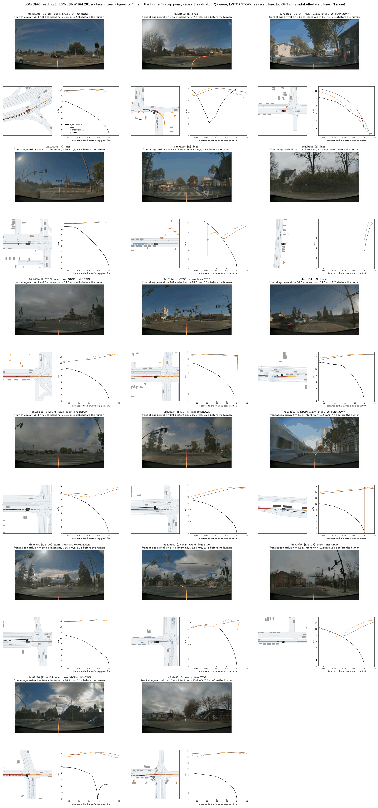
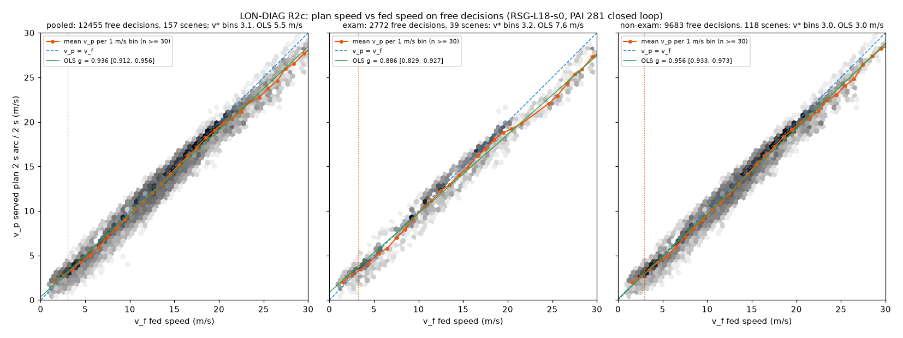
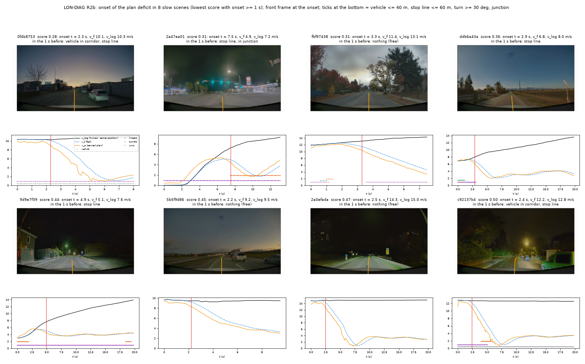
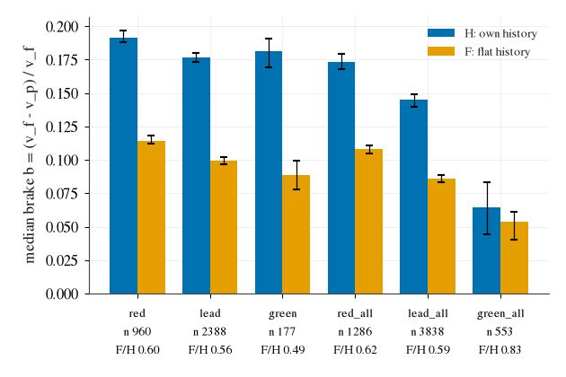
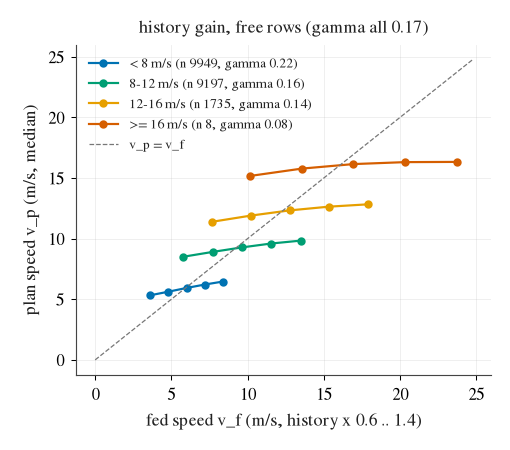

# 纵向诊断：PAI 上「人停了车没停」与「无故开慢」是同一个机制的两面

**日期** 2026-10-15。**对象** RSG-L18-s0，PAI 281 存档（gains 20，旧 serve 路径，与 [zero-taxonomy](zero-taxonomy.md) 同一份）+ 盒上一个开环反事实 job。
**登记** [experiments/route_follow/plans/2026-10-15-longitudinal-diag-prereg.md](../experiments/route_follow/plans/2026-10-15-longitudinal-diag-prereg.md)。**决定** [315](decisions/315.md)。
**读数** [experiments/route_follow/results/lon_diag/](../experiments/route_follow/results/lon_diag/)。不训练、不起新仿真。
**回放页（2026-10-16，gains 10 的提交底座 g10，281 scene）** [route-follow/lon-clips-g10.html](route-follow/lon-clips-g10.html)：纵向各类的丢分表 + 32 段前视回放（视频在 Tokyo 桌面 `lon_review_1016/`，本页不含视频）；纵向合计 23.0 / 43.1 点。
**回放页（2026-10-16，ACC 读数 pai_g10/acc，281 scene）** [route-follow/lon-clips-acc.html](route-follow/lon-clips-acc.html)：纵向各类丢分表（与 g10 并排）+ 15 个 ACC 新造零分 + 各类最多 5 段丢分回放（共 43 段，视频在 Tokyo 桌面 `acc_review_1016/`，本页不含视频）；纵向合计 12.5 / 32.6 点（g10 23.0 / 43.1）。

## 0. 一句话

- **考场上最大的单项是「该停没停」，不是转弯、也不是慢**：考题 72 的 38 个零分里 11 个是 `cor_route_end`，这 17 个场景里车到人停车点时速度比全部 ≥ 1.0。慢的 31.7 分主要在 209 个非考题场景（考题只 6.5 分）。
- **车不读「该停」**：14 个非评估器场景里 13 个在停车点前 3 s 没有任何减速意图，以 12–17 m/s 开过人停下的灯口；模型自己的 plan 同样。
- **慢从交接那一步就开始**：67 个起点里 45 个在交接（历史还是日志的），这些场景日志车速中位 21 m/s；训练 store 的行速 p99 12.8 m/s、最高 17.1，≥ 16 m/s 只有 8 行。plan 一上来就短 13 %，回路再把它拖到 3–4 m/s（不动点）。
- **开环上纵向通道是自身运动的趋势跟随者**：红灯前刹车量与同样在减速的绿灯前一样（0.19 对 0.18），把历史抹平后灯只贡献 0.025；前车同样。人类行里「该停」永远已经写在历史和帧里，模型从没需要看灯。
  往快调（dropout / both / hold）就把这一点暴露出来，所以每个慢修法都多零分。

## 1. 考题 72 上的账

| 主因 | 全 281：个数 / 丢分 | 考题 72：个数 / 丢分 |
|:--|--:|--:|
| `cor_route_end` | 17 / 17.0 | **11 / 11.0** |
| `low_slow_free` | 73 / 31.7 | 17 / 6.5 |
| `low_slow_behind_lead` | 12 / 6.4 | 1 / 0.6 |
| `low_late_start` | 3 / 2.4 | 2 / 1.5 |

## 2. 17 个「人停了车没停」

每格：车到人停车点那一刻的前视帧、BEV（绿 X = 人停车点）、速度对「到人停车点的距离」曲线（黑 = 人，橙 = served plan，灰 = 喂入车速）。
看：黑线从 40 m 外刹到 0，橙线平着 12–16 m/s 开过去；画面上方多数是信号灯头（054b5901、35e082a4 能看到红灯），7d994ed3 是轻轨道口，4ecc114d 旁道有车队。

| 原因类（地图线规则） | 个数 | 车有减速意图 |
|:--|--:|--:|
| E 评估器口径（095cf563、cbd87234 人没停；3fe2bac8 人没动） | 3 | — |
| L-STOP（STOP 类 wait line，PAI 地图里灯口线也是这一类） | 10 | 1（127c4f85） |
| L-LIGHT（68c3be44） | 1 | 0 |
| Q 排队（fc9fde87） | 1 | 0 |
| N（2d10a08d、35e082a4、4ecc114d） | 3 | 0 |

10 个 L-STOP + 1 个 Q 全在考题 72。**请看图定**：14 个非 E 里红灯几个、道口 / 让行几个（规则分不出灯口与 stop sign）。

## 3. 慢的 73 个

自由决策（走廊 40 m 内无车、60 m 内无停止线 / 转弯、不在路口）上 served plan 速度对喂入速度：斜率 0.936 [0.912, 0.956]，3–19 m/s 常数偏移 −0.3 到 −0.5 m/s，20 m/s 以上 −1 到 −2 m/s，
曲线在 3 m/s 处穿过对角线。看：右端往下弯，就是训练里没见过的速度段。

| 日志车速箱 | 交接处（k 0–2）plan / 喂入 |
|:--|--:|
| < 8 m/s | 1.010 |
| 8–12 | 0.972 |
| 12–16 | 0.945 |
| ≥ 16 | **0.867** |

起点：67 / 73 有，45 个在交接；交接起点的日志车速中位 21.1 m/s，晚起点 10.4。触发物（车辆、停止线、转弯、路口、serve lead）在可比的 6 个场景上无一 RR ≥ 2：第一下变短没有画面原因。
跟车 12 个：时距中位 4.3 s 对人 2.25 s，跟得远，不是前车慢。

8 个起点场景的前视帧 + 速度曲线。看：起点处前方空着、直路、没有东西。

## 4. 开环：纵向通道读什么

| 格子 | 行 | b_H（人自己的历史） | b_F（匀速历史） |
|:--|--:|--:|--:|
| 红灯线 10–40 m、人 ≥ 6 m/s 且在减速 | 960 | 0.192 | 0.114 |
| 绿灯线、同样在减速 | 177 | 0.181 | 0.089 |
| 前车 ≤ 30 m 接近 | 2 388 | 0.177 | 0.100 |
| 绿灯线、不限减速 | 553 | 0.064 | 0.054 |

b = (喂入速度 − plan 速度) / 喂入速度。看：红绿两行几乎一样，差别全在「人在不在减速」；灯本身的贡献是 F 列的红绿差 0.025。
数值历史增益 γ 0.17（帧不动时数值项的权重；闭环 d294 的 0.71–0.86 是帧与历史一起变慢时的量，不可比）。

训练 store 行速：p50 4.4、p90 9.3、p99 12.8、max 17.1 m/s；≥ 12 m/s 占 2.1 %。

## 5. 分桶

| 桶 | 内容 | 依据 |
|:--|:--|:--|
| 只改训练输入 | (a) 速度覆盖：加 PAI train160 的人类行与 on-policy 行（帧在，考题永不进），对准 45 个交接起点；(b) `--ego-drop-speed`：已知账 短 −75 %、公开零分 +8.5、GT +0.056 | 读数 2 R2a/R2b + store 速度分布；allrows |
| 要讨论 | 「该停」的信号：人类行教不会（标签可由运动学预测），要**历史平、灯红、标签刹**的行 = 策略自己到达灯口的 on-policy 状态上的后果标签；或反事实历史增广（上限 = F 格子 0.114）；stop sign / 道口 nuPlan 无标签 | 读数 3 (ii)、d256、traffic-light-probe |
| 自己先查 | serve 侧 lead 限速的时距参数（跟车 1.84 × 人） | 读数 2 R2d |
| 不做 | 评估器口径 3 个 | 读数 1 |
| 请看片 | 14 个非 E 场景的原因（红灯 / 道口 / 让行）；8 个起点帧 | 第 2、3 节的图 |

## 6. 局限

PAI 1 seed；原因类靠地图线 + 规则，灯态 PAI 没有；触发物检验只有 6 个可比场景；≥ 16 m/s 开环只有 8 行；γ 与闭环系数不是同一个量；跟车配对 11 / 12。
