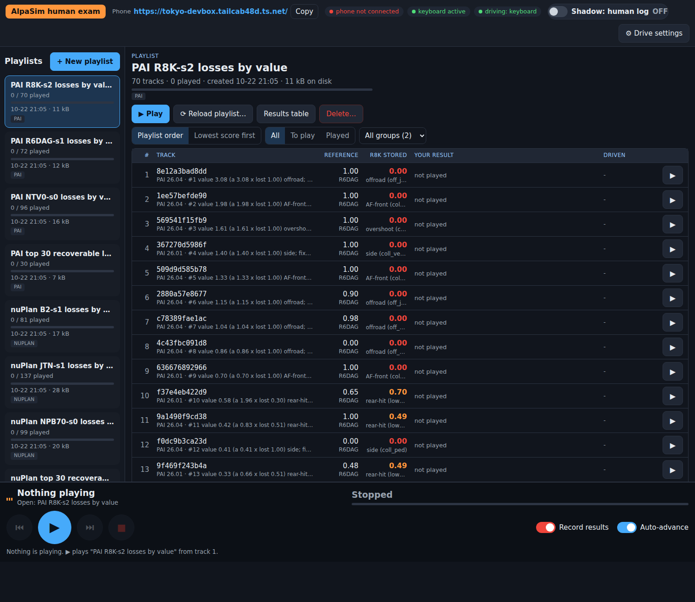

# 失分播放列表（Tokyo 面板，2026-10-22）

面板 `http://100.108.238.8:8770/` 左栏的 8 个播放列表，从上往下看就是按失分价值从高到低。每个场景的副行写着
`#名次 value 价值 (a 区分度 x lost 失分) 类别; fixed by <哪个读数满分>`；"<tag> stored" 列是该模型自己的存档分和 why
（播放列表钉在该 checkpoint 上，不随 Driver 选项变）。生成：`experiments/alpasim_human/scripts/loss_playlists.py`（命令在文件头），
逐场景全表 `tmp/lossplay/rows.csv`（Mac，未提交）。

| 播放列表 | 场景数 | 读数（"stored" 列的来源） |
|---|--:|---|
| PAI R8K-s2 losses by value | 70 | PAI 281 ACC + GAP，Harmonizer 关（pai_fix facts） |
| PAI R6DAG-s1 losses by value | 72 | 同上 |
| PAI NTV0-s0 losses by value | 96 | 同上（已提交 p1021a） |
| nuPlan B2-s1 losses by value | 81 | held 460 @18 原生（`route_mem/read/STANDFMXH-L18-s1`） |
| nuPlan JTN-s1 losses by value | 137 | held 460 @18 原生（已提交 native） |
| nuPlan NPB70-s0 losses by value | 99 | held 460 @18 原生（读数已落地） |
| PAI top 30 recoverable losses (all candidates) | 30 | 三个 PAI 模型合并，每场景取价值最高的那个模型；stored 列钉在副行写的模型上 |
| nuPlan top 30 recoverable losses (all candidates) | 30 | 三个 nuPlan 模型合并，同上 |

`experiments/alpasim_human/figs/panel_loss_playlists.png`：面板（同一代码、只读副本实例，Tokyo headless Chrome）打开 "PAI R8K-s2 losses by value"。
看 "R8K STORED" 列（R8K 自己的存档分与 why）、副行开头的 `#名次 value`，以及 Reference 列（面板原有的 R6DAG 参照分）。

面板一个播放列表只能放一条赛道，所以"两赛道合并 top 30"拆成两个。

## 顺序怎么算

- **PAI**：价值 = a x (1 - score)，a = 第 434 / 436 条 paimix 2PL 的题目区分度（`experiments/round7/results/loss_map.csv`；6 个没拟合的场景用中位 a 0.58）。
  注意强带是我们自己的族：a 高 = "我们族都会、这个模型丢了"（第 429 条），所以 NTV0 的列表价值普遍低（它丢的多是全族一起挂的题）。
  可收回（fixed by）：另一个 ACC + GAP 281 存档读数满分（stored_scores 的其他 tag、loss_map best_ag），否则别的 serve（best_any），否则 garage。
- **nuPlan**：面板只能重放公开场景，所以列表 = held 460 公开场景（onpol held split）里该模型 held 460 @18 读数 < 1 的场景；
  价值 = a_bm x (1 - score)，a_bm = 冻结配池（board-mix，第 382 / 387 条）里同一资产上起点离公开场景起点最近的大考场 held 窗的区分度
  （295 / 317 行有这样的窗，偏移中位 1.0 s、最大 40 s；另 22 行用中位 a 1.79）；副行 `easy` = garage 在那个窗满分。
  8 个路线检查在开车前就失败的场景（所有模型都 0）已剔除。可收回 = 我们 204 个 held 460 @18 读数里任一满分（括号里是另外几个读数满分）。
- **面板播放的是什么**：PAI 就是 281 场景本身（20 s）。nuPlan 播的是公开场景从它的起点开始，和 held 460 @18 读数同一场景、同一起点；
  大考场窗是同一段日志上另切的起点，面板播不了，只用来定权重。面板的模型模式与人驾是前相机、未调速的读法，分数不必与存档相同。

## 每条赛道前 10

PAI R8K-s2：e1c6ae9f 出路（转弯）3.08、dbfd6c72 前撞 1.98、51242b4d 冲过停车点 1.61、fce18b62 侧撞 1.40、382a7247 前撞 1.33、a1b166cc 出路（起步）1.15、
94c1d722 出路（转弯）1.04、ea468790 出路（起步）0.86、0feb3afa 前撞 0.70、d90fe123 被追尾 0.70 分 0.58；全部有读数满分。

PAI R6DAG-s1：ea468790 出路、b680a689 出路、d90fe123 被追尾、bbc53aa8 偏慢、268949d2 侧撞、de9db5dc / 4e4a2a51 / 68e53160 出路、bd97de34 被追尾、b661da67 出路。

PAI NTV0-s0：095cf563 冲过停车点、f18c6340 起步被追尾（无人解）、2c0ef536 前撞、4e4a2a51 冲过停车点、68e53160 路线转、9f393c8a / bd97de34 / d641893f 被追尾、b661da67 出路、09528162 前撞。

nuPlan B2-s1：ea0cc0d75583 出路 3.37、8998fecb50a5 走廊 3.27、edea36205814 慢 3.22、59f78d995d9c 起步不走 3.19、ce68acb7562c 起步慢 3.13、2fa0c64d5846 前撞 2.46、
a96cae965e88 前撞 2.42、79f2edce5c73 出路（无人解）2.27、a23cfee25d4e 走廊 2.16、d49214315cd6 出路 2.06。

nuPlan JTN-s1：d56c05ba594b 出路、15c9f6cf54eb / 6cfc4f135e50 前撞、3b6810995466 / e644db6d5546 出路、5675e4585611 走廊、799dac8d5aa2 出路、d1fe80af5ceb 走廊、02f6e9a559af / 186ab49b5cdc 出路（无人解）。

nuPlan NPB70-s0：ea0cc0d75583 出路、3ae387e752fa 前撞、d56c05ba594b 出路、edea36205814 慢、66c4cf785eab 前撞、8998fecb50a5 走廊、720d0e2e511e 出路、19739f215995 / 59f78d995d9c / ce68acb7562c 慢。

## 按类价值（价值和；括号 = 场景数）

| 类 | R8K-s2 | R6DAG-s1 | NTV0-s0 |
|---|--:|--:|--:|
| 出路 offroad | 7.9 (14) | 4.3 (12) | 2.3 (12) |
| 冲过停车点 overshoot | 4.8 (20) | 3.2 (19) | 4.5 (23) |
| 前撞 AF-front | 4.4 (5) | 0.6 (3) | 0.9 (3) |
| 被追尾 rear-hit（部分分） | 3.2 (18) | 3.2 (21) | 3.3 (26) |
| 路线转 route-turn | 0.4 (2) | 0.4 (2) | 2.8 (15) |
| 侧撞 / 其他零分 / 偏慢 | 2.9 | 2.4 | 2.2 |
| 合计价值 / 原始失分 | 23.5 / 54.5 | 14.1 / 51.6 | 15.4 / 71.6 |

| 类 | B2-s1 | JTN-s1 | NPB70-s0 |
|---|--:|--:|--:|
| 慢 / 起步不走（部分分） | 24.9 (48) | 26.9 (109) | 30.5 (58) |
| 出路 offroad | 22.6 (19) | 17.2 (16) | 27.4 (20) |
| 侧向出走廊 | 10.9 (9) | 3.9 (5) | 10.0 (12) |
| 前撞 at-fault | 5.0 (3) | 5.7 (7) | 10.0 (8) |
| 合计价值 / 原始失分 | 63.6 / 59.8 | 53.8 / 53.4 | 78.0 / 71.2 |

## 反复出现的固定场景类型（初稿，用户看完再改）

1. **出路**：PAI 转弯切内侧 / 起步出路，nuPlan 出路是 B2 和 NPB70 价值第二的一类；两条赛道都排在最前，几乎都有我们的读数满分（可示范）。
2. **停 / 走时机**：PAI 冲过人停车的位置（原始失分最大但 a 低，全族一起挂）；nuPlan 起步不走 / 慢部分分（B2 价值第一，JTN 109 个场景）。
   同一能力的两面：该停的停不住，该走的不走。
3. **被追尾 / 前撞**：PAI 被追尾部分分在三个模型上价值都约 3.2；nuPlan 前撞零分少但每个都在高 a 题上。
4. 每个模型和赛道里都有少数场景我们没有任何读数满分（PAI R8K 29 个、nuPlan B2 4 个），在副行里没有 "fixed by"。
