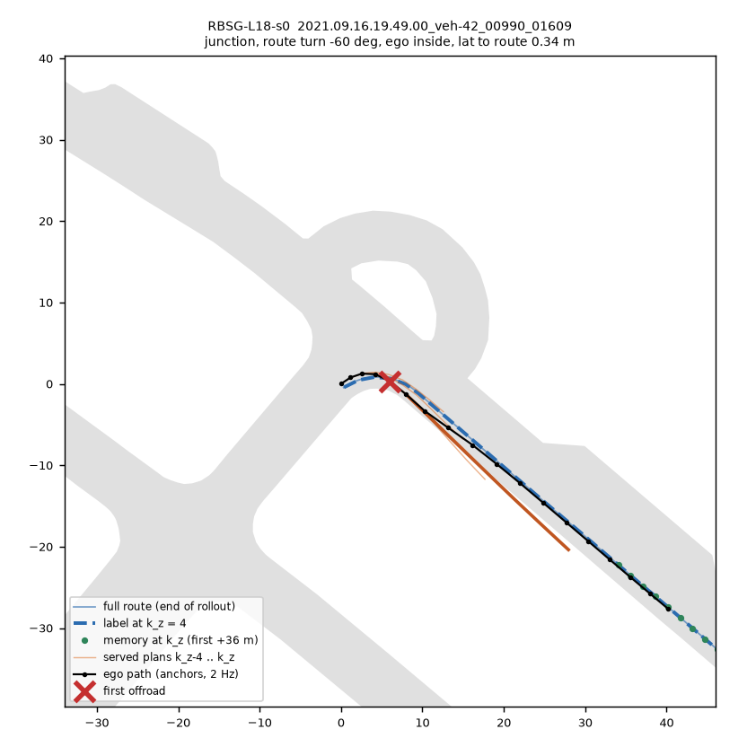
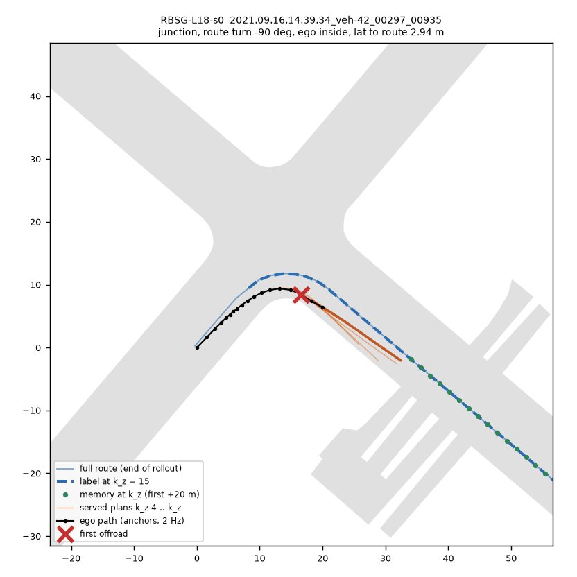
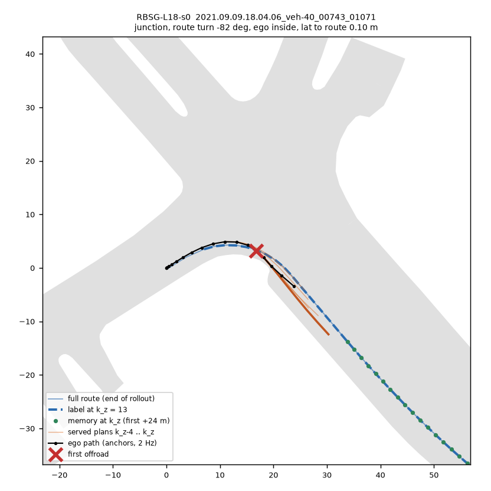
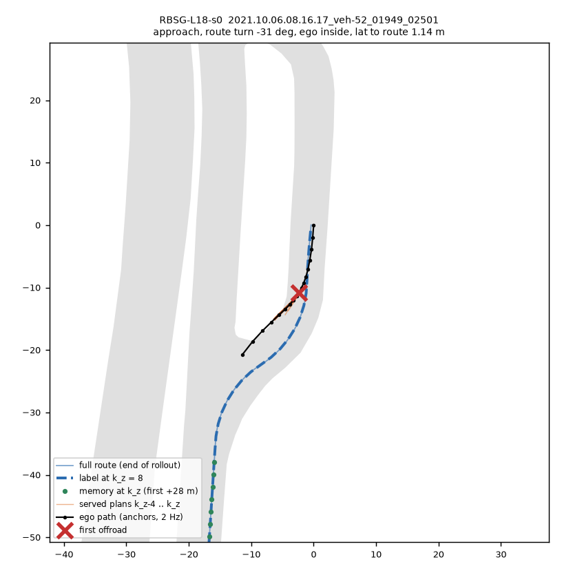
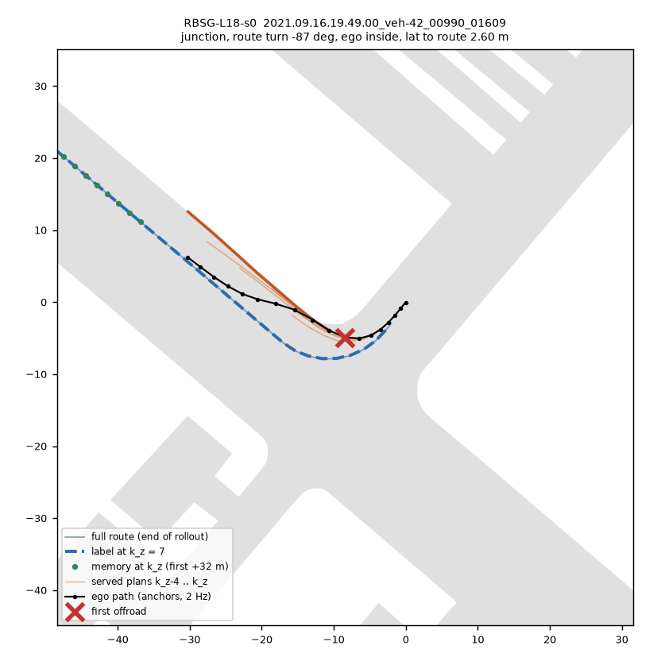
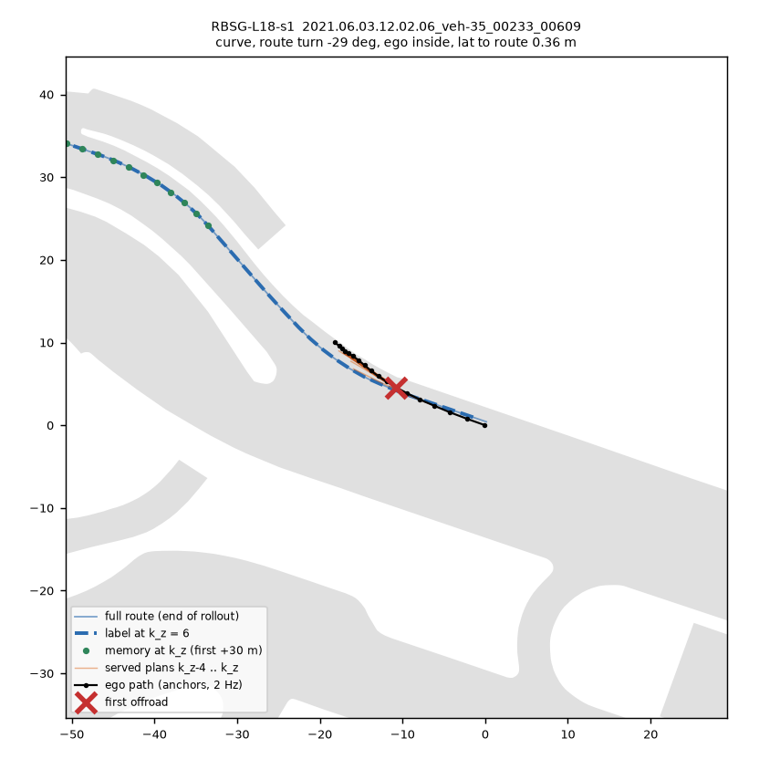

# 路线 hinge 臂的 offroad 零分诊断（2026-10-13 夜，route-night 线）

问题：凡是在非日志行上带路线 hinge（`experiments/onpol_nuplan/lib/on_route.py`）训的臂，held 460（18 决策）上 offroad 零分都比底座多，
而 left-corridor 零分降、到 GT 的横向距离变好。本稿只回答「多出来的 offroad 从哪来」。全部为 CPU 只读复算，**测**。
脚本 `experiments/route_follow/scripts/rf_offroad.py`（held / pool / fig），盒上输出 `$DATA_DIR/runs/route_follow/offroad/`，
数字汇总 [offroad_diag.json](../experiments/route_follow/results/offroad_diag.json)。

方法要点：可行驶面 = 评测器自己的车道多边形（`eval.scorers.offroad._get_lane_polygon`）∪ road area，坐标为 rollout 局部系（与 driver anchor 同系）；
「放得下车」= 点到可行驶边界的内距 ≥ 1.0 m（车宽 2.3 m）。零分点 = 评测器第一个 offroad 时刻的自车位置（anchor 插值）；用同一时刻的
Pacifica 车身多边形复核：**96.5–100 % 的零分在这张面上判 offroad**（车身未被覆盖），说明坐标系和可行驶面跟评测器对得上。
路线 / 标签 = `rm_build.regen` 在每个 anchor 重建的完整路线、`rm_build.label` 切出的 51 点标签（与 pool 的 route.npz 同一函数）。
路口分类：零分点在路线上的投影落在 ≥ 2 条航向差 ≥ 25° 的车道内，或落在分叉车道出来的转弯连接段内 = junction；前方 30 m 内有 junction = approach；
其余按路线 ±15 m 横跳（jog）/ ±20 m 航向变化 ≥ 20°（curve）/ straight。转弯「内侧」= 自车在路线的转弯一侧。

## 1. 数字

**表 1　held 460 的 offroad 零分，每个 checkpoint**（turn = 零分点处路线 ±20 m 航向变化 ≥ 20°；过转 = 自车航向比路线航向更偏向转弯方向 > 5°）

| tag | offroad 零分 | junction / approach / curve / straight | turn 零分 | **右转内侧** | 左转内侧 | 过转份额 | 零分点到路线 中位 (m) | k_z 中位 |
|:--|--:|:--|--:|--:|--:|--:|--:|--:|
| RB0-F-s0（底座）| 29 | 5 / 4 / 12 / 6 | 19 | **1** | 7 | 0.11 | 0.84 | 10 |
| RB0-F-s1 | 37 | 13 / 8 / 11 / 5 | 28 | **2** | 10 | 0.18 | 0.71 | 10 |
| RNONEG-L18-s0（温和续训、无行）| 31 | 10 / 2 / 12 / 5 | 21 | **1** | 9 | 0.14 | 0.81 | 10 |
| RBSG-L18-s0 | 40 | 20 / 9 / 7 / 1 | 31 | **19** | 8 | 0.71 | 0.81 | 8.5 |
| RBSG-L18-s1 | 43 | 18 / 10 / 11 / 2 | 36 | **21** | 7 | 0.58 | 0.73 | 8 |
| RB-F-s0（反事实行）| 49 | 19 / 12 / 11 / 7 | 39 | **17** | 14 | 0.54 | 0.84 | 10 |
| RBS-L18-s0（全程续训）| 71 | 18 / 19 / 20 / 12 | 50 | **20** | 18 | 0.60 | 0.67 | 7 |
| RBS-L18-s1 | 64 | 20 / 16 / 16 / 10 | 48 | **21** | 19 | 0.58 | 0.68 | 8 |

**整个差就在这一列**：右转内侧的 offroad 从无 hinge 三个 checkpoint 的 1 / 2 / 1 涨到所有带 hinge 的臂的 17–21，两个种子、两种行来源（on-policy 行、反事实行）、
两种步数都一样。RBSG 比 RB0-s0 多 11 / 14 个 offroad，右转内侧多 18 / 20 个，其余类别反而少了一点。RBS 另外在 curve / straight / 左转也涨，那部分是全程续训本身的伤（RNONE 已见）。

**表 2　按 scene 跟 RB0-F-s0 配对**

| tag | 与 RB0 同为 offroad | RB0 因别的原因零分 | **新增**（RB0 该 scene 不是零分）| RB0 offroad、这里不是 | 新增里 junction+approach | 新增里转弯内侧 | 新增：本臂到路线 / RB0 同 k 到路线（中位 m）| 新增里 H2 满足 / 不满足 |
|:--|--:|--:|--:|--:|:--|:--|:--|:--|
| RBSG-L18-s0 | 12 | 2 | **26** | 17 | 21 / 26 | 18 / 21 turn | 0.81 / 0.49 | 2 / 20 |
| RBSG-L18-s1 | 12 | 3 | **28** | 17 | 19 / 28 | 18 / 24 | 0.73 / 0.55 | 7 / 19 |
| RB-F-s0 | 14 | 4 | 31 | 15 | 20 / 31 | 19 / 24 | 0.84 / 0.31 | 9 / 17 |
| RBS-L18-s0 | 14 | 6 | 51 | 15 | 25 / 51 | 25 / 36 | 0.67 / 0.43 | 9 / 39 |
| RBS-L18-s1 | 14 | 4 | 46 | 15 | 26 / 46 | 27 / 34 | 0.71 / 0.43 | 9 / 34 |
| RB0-F-s1（种子对照）| 23 | 2 | 12 | 6 | 7 / 12 | 2 / 8 | 0.47 / 0.41 | 3 / 5 |

RBSG 的 offroad 大多是**新 scene**：RBSG 的 40 个里只有 12 个和 RB0 重合，RB0 的 29 个里有 17 个 RBSG 开过去了。两个 RBSG 种子共有 34 个 offroad scene，
其中 22 个在两个 RB0 种子里都不是 offroad（RB0 两种子共有 23 个）。所以这是换了一种失败，不是同一批 scene 的噪声。
新增零分的那一步，RBSG 离路线 0.73–0.81 m，RB0 同一 scene 同一 k 离路线 0.49–0.55 m；但在这 92 个 scene 的所有零分前决策上，RBSG 离路线更近
（中位 0.34 vs 0.40 m，p90 1.74 vs 2.09 m，1709 对）。**跟路线跟得更好，只是在右转里转过头。**

**表 3　训练池 on1_L18RB0（RBSG / RBS 的 on-policy 行，17 427 行，RB0 自己 serve 的 plan）**

| 量 | 值 |
|:--|:--|
| 标签 0–40 m 有点落在路外 / 放不下车 | 0 / 0.04 % 的行 |
| hinge 激活（1–2 s 位姿离标签 > 1 m）| 26.7 %；转弯行 43.4 %，非转弯 20.6 % |
| hinge 把放得下车的位姿往放不下车的标签点拉（pull_off）| 0.03 % |
| RB0 plan 1–2 s 有位姿放不下车（S 道路项能起作用的行）| **1.3 %**（hinge 激活行 3.6 %）|
| 右转行（2000）：激活 / 激活且全在外侧（hinge 说「再往右」）/ 全在内侧 | 38.7 % / **22.2 %** / 16.4 % |
| 左转行（2668）：激活 / 外侧 / 内侧 | 47.0 % / 15.5 % / **31.3 %** |
| 记忆覆盖 +20 m（cov20）/ +10 m；最近有效偏移中位 | 46 % / 26 %；22 m |
| hinge 质量（W_T 加权）落在记忆还没覆盖的近段 | **72 %** |
| H5：hinge 激活率，cov20 真 / 假 | 27.1 % / 26.4 %；转弯行 42.9 % / 43.7 %；激活行里 53 % 是 cov20 假 |
| 各 k 的 cov20（k = 0..4 / 8 / 12 / 17）| 3 % / 53 % / 72 % / 92 % |

## 2. 各假设的判词

**H1 标签出路：否。** 每个 checkpoint 的每个 offroad 零分，标签在零分点 ±30 m 内的点**全部**在路上且放得下车（离边界最小内距中位 1.67–1.76 m，
就是半个车道宽）；训练池 17 427 行里只有 7 行有一个放不下车的点。路线生成器给的是车道 / 连接段中心线，没有切过路口、没有贴错道。
「标签离路就遮掉 hinge」这条修法什么都遮不到。

**H2 hinge 压过道路：基本否。** 零分前 2 s 内出现「plan 的 1–2 s 位姿在死区内（hinge 满足）但放不下车」的零分：RBSG 12.5 % / 25.6 %，RB0 20.7 % / 29.7 %，RNONEG 9.7 %——
带 hinge 的臂并不比底座多。主导的是「既离标签 > 1 m 又放不下车」（RBSG 72.5 % / 65.1 %；新增零分里 20 / 26、19 / 28）：车没有在跟路线，
它转过头了。标签在这些 plan 位姿上的投影点也全都放得下车（`h2_labproj_nofit` = 0）。路线和道路没有冲突，策略也没有「跟着路线开出路」。

**H3 记忆漂移：否（作为「输入错」）。** 记忆里有的点跟当场重建的路线一致：最大偏差中位 4–6 cm，> 1 m 的只有 0–2.5 % 的零分；+20 m 点偏差中位 < 2 cm。
输入不是错的，是**短**：零分那一步 +10 m 有覆盖的只有 14–32 %，+20 m 38–59 %，最近有效点中位 20–25 m。这一点各臂相同（RB0 也一样），解释不了差异。

**H4 路口内切弯：是，且更具体——右转内侧、过转。** 新增零分 65–81 % 在 junction / approach（RB0 自己的 offroad 是 31 %，以 curve 为主）；
转弯零分里过转（自车航向比路线更往里）的份额 54–71 %，三个无 hinge 的 checkpoint 是 11–18 %，中位过转角 +6.5…+9.6° 对 −5.7…−8.8°。
右转（美国城市里的小半径转弯）内侧压路缘是唯一大量新增的类别。图 1–5 都是这种：plan 在入弯前已经朝出口方向偏，车身前角压到转角的路缘；
图 3 车在路线上（0.1 m）照样出路——过转的车身斜着扫出去。左转在 RBSG 里没有变多（7–8 对 7–10），因为左转半径大、内侧还有对向车道的路面。

**H5 记忆没覆盖时 hinge 教「朝看不见的路线转」：作为零分位置的解释，否；作为训练信号的构成，是事实但没有区分度。**
零分位置：RBSG 新增零分那一步 cov20 = 50 %（RB0 自己的 offroad 是 38 % / 46 %），2 s 前 39–42 %（RB0 24 % / 38 %）；k_z 中位 9.5–10，跟 RB0 的 10 一样
（k ≤ 5 的份额 28–30 % 对 17–21 %，略早一点）。RBS 新增零分 cov20 54–57 %。也就是说新增零分**不**集中在记忆空的决策上，覆盖反而比底座的零分还好一点。
训练池：hinge 在 cov20 真 / 假两半激活率一样（27.1 % / 26.4 %，转弯行 42.9 % / 43.7 %），激活行一半多（53 %）没覆盖 +20 m，按位姿算 72 % 的 hinge
质量落在记忆还没到的近段。这是事实：大部分路线 hinge 都在教「从远点和画面补近处」，跟设计（route-night.md 第 2 节）一致。但仅凭这一点
不能把它定为原因：在没覆盖的决策上，新臂并没有更常出路。

另试过「plan 直线瞄记忆第一个点（弦）」的说法：零分那一步 plan 离弦比离路线近的份额，hinge 臂 0.33–0.44、无 hinge 臂 0.42–0.48，**不区分**，放弃。

**合起来的机制（推断，有上面的数撑，但没有做因果干预）：** on-policy 行来自 RB0 自己的 rollout。RB0 在右转里偏外（右转行激活的位姿 22 % 全在外侧，
只有 16 % 在内侧），hinge 在这些行上的意思就是「右转再早一点、再急一点」；而训练池里**几乎没有转过头的状态**：RB0 的 plan 放不下车的行只有 1.3 %，
S 道路项和 hinge 自己（它是对称的，在内侧状态上会往外拉）在「转过头」这一侧拿不到样本。策略学到的是单方向的「路口里往转弯方向多打」，
到 held 上就在小半径右转里转过头压内侧路缘。反事实行（RB-F，日志状态 + 0.5 m 死区）也一样：日志状态都在路上，道路栅格 hinge 同样不起作用，
同样是右转内侧 17 个。RBS 全程续训把它放大。

## 3. 建议的修法（一条）

**第二轮 on-policy 行：用 RBSG-L18-s0 自己在训练 1020 scene 上滚 18 决策，按 `rm_build pool` 打标签（同一路线 hinge，死区 1.0 m，S 两项），
跟 on1_L18RB0 合成一个池，从 RB0-F-s0 起用同样的温和 schedule（`--steps 2500 --lr-scale 0.1`）训 RBSG2-L18-s{0,1}。**

道理：缺的是「转过头」那一侧的状态。RBSG 在 held 上的右转内侧零分是 19 / 21，训练 scene 上大概率同样会转过头；把这些状态放进池子，
路线 hinge（这时位姿在路线内侧，会往外拉）和 S 道路栅格项（这时会真正触发）都会把它往回推，而左转、left-corridor 那部分已经学到的东西不动。
`--init` 仍是 RB0-F-s0，不违反今晚的硬约束。
- **预期（估）**：右转内侧 offroad 回到 ≤ 6（底座 1–2），offroad 回到 30–34，left corridor 保持 8–10，零分 ≈ 57–62（RB0 59，RBSG 65 / 66）。
  判定线建议：两个种子的右转内侧 offroad 都 ≤ 6，且 offroad ≤ 34、left corridor ≤ 11。
- **成本（估）**：1020 个训练 rollout 走 GPU pool（同 L18RB0 那一轮的量，约 1 h），行 + `rm_build pool` 约 20 min CPU，两种子 2500 步约 40 min，
  held 460 两个读数约 1 h；合计约 3 h 墙钟。

没选的：「标签离路就遮 hinge」（H1 否，遮不到东西）；「路口内死区放到 1.5 m」或「给 hinge 的 lam 封顶」（只是把单向的推力变小，左转和 corridor 的收益一起变小，
而且治不了缺样本）；「on-policy 行加道路栅格 hinge 权重 x」（RBSG 已经有 S 道路项，问题是它在 RB0 的状态上只在 1.3 % 的行起作用，加权重不增加样本）；
「cov20 假的行遮掉 hinge」（H5：新增零分不集中在没覆盖的决策，而且会遮掉 54 % 的行、72 % 的 hinge 质量，基本等于关掉 hinge）。

## 4. 图

每张图是一个新增 offroad 零分（RB0-F-s0 在该 scene 不是零分），以零分点为中心 ±40 m。灰 = 可行驶面（评测器的车道 + road area）；蓝细线 = rollout 结束时的完整路线；
蓝粗虚线 = 零分那一步 k_z 的标签；绿点 = k_z 时 serve 的记忆（标题里的数字是最近有效偏移）；橙细线 = k_z−4 … k_z−1 的 serve plan，橙粗线 = k_z 的 plan；
黑线 = 自车 anchor 轨迹（2 Hz）；红叉 = 第一个 offroad 时刻。要看的：plan 在哪里开始偏向弯心、车相对蓝虚线在弯的哪一侧、标签本身是否都在灰色里（都在）。

1.  RBSG-L18-s0 `…00990_01609-7956c9ed`：路口右转 −60°，内侧，过转 22°，离路线 0.3 m（s1 同 scene 同样出路）。记忆只从 +36 m 起。
2.  RBSG-L18-s0 `…00297_00935-b474c793`：路口右转 −90°，整段在路线内侧，转角处压路缘，离路线 2.9 m。
3.  RBSG-L18-s0 `…00743_01071-1b183271`：右转 −82°，自车就在路线上（0.1 m），但航向过转 19°，车身扫出转角。
4.  RBSG-L18-s0 `…01949_02501-667ea4f7`：右弯进口，过转 24°，直接朝弯心开过中央隔离带。
5.  RBSG-L18-s0 `…00990_01609-e31131de`：路口右转 −87°，过转 34°，plan 比路线早转，内侧路缘。
6.  RBSG-L18-s1 `…00233_00609-5b61b907`：少数的 H2 情形——右弯，plan 在死区内（0.4 m），车照样压到内侧边。

## 5. 局限

- 路口分类是车道图启发式（重叠车道 / 分叉后的转弯连接段），RB0 的一些 offroad 被分到 curve，可能其实是路口里的连接段；各臂用同一分类，比较成立，绝对比例不精确。
- 「过转」只在零分那一步量一次航向差；没有逐步回放车身（rollout.asl 已裁剪）。
- 机制是推断：没有做「把转过头的状态加回池子」的干预，这正是第 3 节的臂要回答的。
