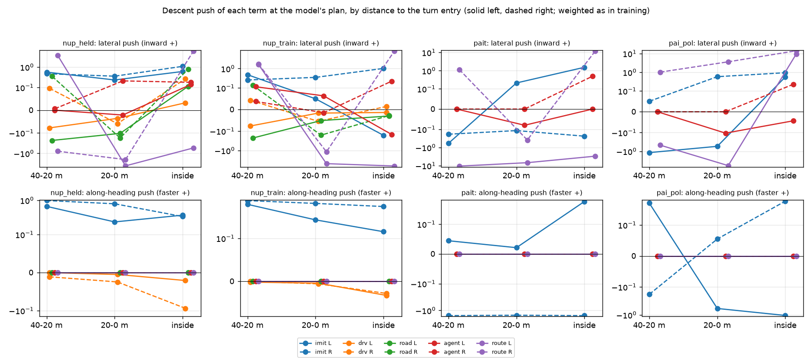
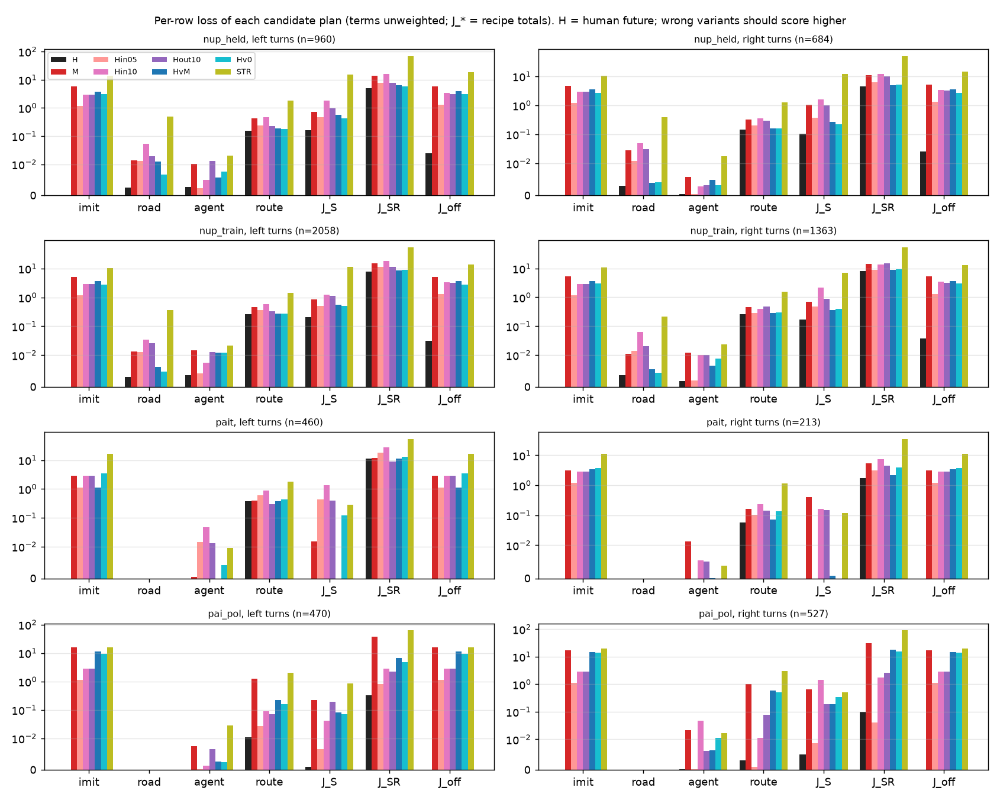

# 转弯的训练目标审计：人自己的转弯在我们的 loss 下是不是最优（2026-10-13）

**判词：目标为主，不是表示。** 冻结的编码器 token 上，RB0-F-s0 的 adapter + 路线支路单独拟合 held 460 上 2 138 个转弯行（211 个 scene，只用模仿项），
训练行 ADE 0.32 m、FDE@4 s 0.67 m，内切（1–2 s 向弯心偏 > 0.3 m）2.3 %，4 s 弧长与人差 +0.04 m；同一批行上 RSG-L18-s0 是 2.22 m / 4.61 m / 10.8 % / −1.50 m，
PAI 的 957 个转弯行拟合到 0.08 m。正确的弧线和减速**表示得出来**，没见过的 scene 上也比 RSG 好（ADE 1.37–1.57 对 2.30；PAI 0.77–0.85 对 1.16）。
做不出来的原因在目标：RSG / RBSG 的 on-policy 行（`--on-mode self`）上只有道路、agent（和路线）三个 hinge，全是 shape-only，**沿航向的梯度恰好是 0**，
所以 on-policy 状态上没有任何一项奖励减速；道路 + agent 两项在转弯行上对错的方案基本打平（不减速的人路径与人同分 78–84 %，0.5 m 内切同分 58–75 %），
RSG 训完在这些行上的 ADE 跟底座一样（2.215 对 2.245）。**点名的项：路线 hinge**（`on_route.py`）——它的标签是车道中心线，路口里人不沿中心线开：
人自己的日志未来在弯内 20–27 % 的行上离路线 > 1 m（多在内侧），行的模仿目标在弯内 45–56 % 的行上要付这项 hinge；于是「外扩 1 m」在 16–30 %（PAI 左转 43 %）、
「内切 0.5 m」在 10–20 % 的行上拿到比人更低的路线 hinge；按训练权重（×30）它在模型 plan 上的横向推力是模仿项的 5–20 倍，入口前 20–0 m 平均往外推、
右转弯内往里推（先外后内）。模仿项是唯一一个在 100 % 的行上把人排第一、又有纵向梯度的项，但它只在离线日志行上，不在 on-policy 行上，PAI 状态上一行都没有。
**修法**：on-policy 行改成带人锚定目标的 `both`（池里的 `fut` 已有）；路线 hinge 在有日志的行上换成到 `fut` 路径的管道（loss43 的 R 项），没日志的行在路口内
放宽死区并把权重降到不超过模仿；hinge 保持 shape-only，纵向信号交给模仿或弧长项。表示只在「泛化到没见过的 scene」上还差（见第 3 节），不是能力问题。

脚本 [experiments/route_follow/scripts/rf_loss_audit.py](../../experiments/route_follow/scripts/rf_loss_audit.py)（`pai-extract` / `collect` / `plans` / `audit` / `fit` / `fig`，
规则写在 docstring）。结果 [experiments/route_follow/results/loss_audit/](../../experiments/route_follow/results/loss_audit/)：`tables.md` / `tables_moving.md`（逐项、逐方案、逐分箱），
`plugin_cmp*.csv`、`plugin_bins*.csv`、`grad_bins*.csv`、`route_offsets_moving.md`、`route_geometry_logfuture.txt`、`fit_s600.*`、`fit_s3000.*`、`states.json`。
盒上 `$DATA_DIR/runs/route_follow/loss_audit/`（逐行的 `plugin.csv.gz`、`grad.csv.gz`、states、拟合出的 plan）。全部**测**，标了「推断」的除外。

## 0. 方法

**状态**（`collect`）：行的标签折线（`route.npz` 的 `poly`；PAI 在线行用日志路径做代理）上找转弯：曲率 > 1/50 m⁻¹（7 m 平滑）、净转角 ≥ 45° 的一段，
出口在前、入口在 40 m 内；分箱 40–20 m / 20–0 m / 弯内（入口在身后、出口在前）。一个转弯 = 一个 (scene, 方向)。表里默认只取**在动的行**（v0 ≥ 3 m/s，
`*_moving`；全部行的表也在）。

| 集合 | 来源 | H（人） | M（模型 plan） | 转弯行 | 转弯 左 / 右 |
|:--|:--|:--|:--|--:|:--|
| nup_held | `on1_L18RSGallheld`（RSG-L18-s0 开 held 460，18 决策） | 行的 `fut`（on_rows Amendment 2 的人锚定恢复目标，训练用的就是它） | 当时 serve 的 plan | 2 652 | 130 / 96 |
| nup_held2 | `on1_L18RBSG2allheld`（RBSG2） | 同上 | 同上 | 2 617 | 133 / 99 |
| nup_train | `on1_L18RSG`（RSG 开 train 1 020） | 同上 | 同上 | 5 549 | 267 / 208 |
| pait | `on1_PAIT80`（PAI 日志回放态） | `fut`（日志路径 + 人的时机） | RSG-L18-s0 在行 token 上的 plan（`plans`；行自带的 `served` 是日志） | 1 249 | 9 / 5 |
| pai_pol | Tokyo `rows/pol`（RB0-F-s0 开 PAI train160，10 Hz） | `imit` | serve 的 `poses` | 1 615 | 12 / 11 |

**PAI 不够 30 / 30**：现在带 token 和人未来的 PAI 行只有这两份（合起来 21 左 / 16 右）；104 个 scene 的 PAIT 链还在 Tokyo 滚，r281 的 dump 没有行标签，
建行要在 Tokyo 跑 onp_rows + 路线生成，按规矩没起。PAI 的结论按「方向一致、样本少」读。

**候选方案**：H；M；H 沿每个位姿的法向**向弯心平移 0.5 / 1.0 m**（Hin05 / Hin10）与**向外 1.0 m**（Hout10），航向不变；**H 的路径 + M 的弧长**（HvM：几何对、
不减速）；**H 的路径 + 恒速 v0**（Hv0）；**直行**，弧长取 H 的（STR）。

**各项**（每个值都是训练器自己的函数）：`imit` = pp_train `dist`（x、y、yaw 各自除以 σ = 0.3+0.2t / 0.1+0.1t / 1°+1°t 后 Huber，8 个位姿平均；`imit_x` 只取 x 部分）；
`drv` = P2H10 可行驶 hinge（drivable 栅格，margin 0.3，非 shape-only，训练里只在离线模仿行上）；`road` = S 的道路车道栅格 hinge；`agent` = S 的 agent hinge
（margin 0.3，side 0）；`route` = 路线 hinge（行的死区 1.0 m），`route05` = 死区 0.5 m。后三项 shape-only。训练里每行的相对权重：imit 1、drv 10、
road / agent / route 各 10 × ho_w 3 = 30。配方合计：J_S = 30(road+agent)（RSG 的 on-policy 行）、J_SR = J_S + 30 route（RBSG / RBSG2）、
J_both = imit + 30(road+agent)（PAIT 行）、J_off = imit + 10 drv（离线模仿行）。`--label-bank` 只改栅格存储（数值相同），`--yr-mass` 是行配比，不是逐行项。

**梯度**：在 M（和 H）处对每个位姿 (x, y) 求导，shape-only 项走训练器的 `shape_only`；下降方向（−权重 × 梯度）分到「向弯心」（+）和「沿航向向前 = 更快」（+）。

## 1. 代入测试：错的方案在哪一项上比人低

**表 1　每个错误方案「比 H 低 + 与 H 同分」的行份额（在动的行；左 / 右）**。完整均值见 `tables_moving.md`；模仿项、J_off、J_both 上所有方案在所有集合都 0 % 低、0 % 同分（略）。

| 集合 | 项 | M | 内切 0.5 | 内切 1.0 | 外扩 1.0 | 不减速 HvM | 恒速 Hv0 | 直行 |
|:--|:--|:--|:--|:--|:--|:--|:--|:--|
| nup_held | J_S（RSG 行） | 78 / 82 % | 69 / 76 | 56 / 48 | 70 / 69 | **85 / 89** | 83 / 92 | 33 / 45 |
| nup_held | J_SR（RBSG 行） | 45 / 56 | 37 / 46 | 15 / 20 | 41 / 28 | 68 / 70 | 65 / 69 | 15 / 29 |
| nup_held | route 低于 H | 13 / 13 | 12 / **14** | 10 / 13 | **25** / 16 | 19 / 15 | 19 / 14 | 2 / 7 |
| nup_train | J_S | 81 / 80 | 80 / 64 | 69 / 39 | 67 / 76 | 85 / 86 | 82 / 85 | 43 / 54 |
| nup_train | J_SR | 47 / 51 | 43 / 44 | 21 / 24 | 41 / 25 | 65 / 68 | 59 / 65 | 20 / 29 |
| nup_train | route 低于 H | 18 / 16 | 15 / **20** | 14 / 18 | **30** / 17 | 22 / 17 | 19 / 16 | 7 / 7 |
| nup_held2 | route 低于 H | 20 / 17 | 10 / 11 | 8 / 9 | 25 / 20 | 18 / 18 | 18 / 16 | 3 / 6 |
| pait | J_S | 99 / 92 | 90 / 100 | 90 / 93 | 89 / 93 | 100 / 99 | 97 / 100 | 95 / 97 |
| pait | route 低于 H | **42** / 19 | 12 / 2 | 10 / 2 | **43** / 22 | 19 / 13 | 27 / 6 | 2 / 0 |
| pai_pol | J_S | 91 / 92 | 99 / 99 | 98 / 78 | 94 / 87 | 93 / 95 | 93 / 92 | 81 / 87 |

读法：

- **J_S（RSG 的 on-policy 行）基本是瞎的**：不减速的人路径 85–89 % 的行与人同分或更低，0.5 m 内切 64–80 %，模型自己的 plan 78–82 %；PAI 上 90–100 %。
  道路 hinge 只在出了车道栅格 margin 才有值，agent hinge 只在压到他车才有值；转弯里错的方案大多两样都不碰。H 自己也有 10–16 % 的行付道路 / agent hinge
  （人贴边 < 0.3 m），这部分行上平移方案反而更低（3–9 %）。
- **路线 hinge 是唯一一个系统性地把错的几何排在人前面的项**：nuPlan 上外扩 1 m 在 16–30 % 的行比人低（左转最多），内切 0.5 m 在 10–20 % 的行比人低（右转多）；
  PAI 左转外扩 43 %、模型 plan 42 %。原因见第 1.1 节。
- **模仿项正确**：每个错误方案在 100 % 的行上都比 H 高；量级上不减速并不便宜：nuPlan HvM 3.6–3.8 > 内切 1.0 m 的 2.9 > 内切 0.5 m 的 1.2，直行 10–14。
  所以「时间权重把 2–4 s 打折、看不见减速」**不成立为主因**（4 s 位姿的权重约是 0.5 s 的 1/3，但纵向误差大，`imit_x` 仍占 M 的模仿损失的 1/3 左右）。
- PAI 的 pai_pol 里路线代理就是日志路径，所以 H 的路线 hinge 几乎为 0，那一行不说明标签问题（只用它的梯度）。

### 1.1 路线 hinge 的几何：标签是车道中心线，人不沿中心线转

`route_geometry_logfuture.txt`（行里存的**日志自己的未来** `logfut`，不是恢复目标）与 `route_offsets_moving.md`：

| 集合 | 分箱 | 日志未来 1–2 s 离路线 > 1 m | 其中在内侧 / 外侧 | 中位偏移（内 +） | 行的模仿目标 H 付路线 hinge 的份额 |
|:--|:--|--:|:--|--:|--:|
| nup_held 左 | 弯内 | 20 % | 17 / 2 % | +0.45 m | 46 % |
| nup_held 右 | 弯内 | 27 % | 24 / 3 % | +0.25 m | 46 % |
| nup_train 左 | 弯内 | 26 % | 17 / 9 % | +0.34 m | 56 % |
| nup_train 右 | 弯内 | 21 % | 14 / 7 % | +0.02 m | 49 % |
| nup_train 左 | 20–0 m | 21 % | 17 / 3 % | +0.17 m | 49 % |
| pait 左 | 40–20 / 20–0 m | 35 / 25 %（H） | 全在内侧 | +0.81 / +0.67 m | 41 / 75 % |

- 人在路口里比车道连接段的中心线切得紧（左右都是，左转更明显），在弯内 20–27 % 的行上超过死区；路线 hinge 在这些行上要人**往外**开。
  这就是「外扩 1 m 比人低」的来源。
- 在模型开宽了的 on-policy 状态上（右转弯内 M 在外侧 > 1 m 的份额 18–39 %），恢复目标 H 也在外侧（8–24 %），路线 hinge 要求在 1–2 s 内（W_T 在 1–2 s 是 2）
  回到中心线 1 m 内，比恢复目标的指数回归更急、更早：这就是「内切 0.5 m 比人低」的行（右转 14–20 %），也是 RB* 臂右转压内侧路缘的直接来源（**推断**：
  与 [route-follow-offroad.md](../route-follow-offroad.md) 的「过转、右转内侧」一致，这里没有做因果干预）。
- 死区 0.5 m（反事实行用的）更糟：外扩比人低 19–37 %，H 付 hinge 的份额更高。

## 2. 梯度方向（在模型 plan M 处，按训练权重；在动的行）

图 [figs/loss_audit_grad_moving.png](../../experiments/route_follow/figs/loss_audit_grad_moving.png)：上排横向（向弯心 +），下排沿航向（更快 +），实线左转、虚线右转；
看紫线（路线）在 20–0 m 往下、在弯内往上，以及下排除了蓝线（模仿）之外全部贴在 0 上。

**表 2　路线 hinge 与模仿项的推力（均值；括号 = 往外 / 往慢推的行份额）**

| 集合 | 方向 | 项 | 40–20 m 横 | 20–0 m 横 | 弯内 横 | 40–20 m 纵 | 20–0 m 纵 | 弯内 纵 |
|:--|:--|:--|--:|--:|--:|--:|--:|--:|
| nup_held | 左 | route | +3.8（10 %） | **−4.1（38 %）** | −0.5（34 %） | 0 | 0 | 0 |
| nup_held | 右 | route | −0.8（14 %） | **−2.0（29 %）** | **+6.1（22 %）** | 0 | 0 | 0 |
| nup_held | 右 | imit | +0.5（39 %） | +0.4（38 %） | +1.1（29 %） | +1.0（10 %） | +0.8（23 %） | +0.3（39 %） |
| nup_train | 左 | route | +1.7 | −4.8（44 %） | −6.3（51 %） | 0 | 0 | 0 |
| nup_train | 右 | route | +1.7 | −1.2（27 %） | **+8.1（21 %）** | 0 | 0 | 0 |
| pait | 左 | route | −10.6（53 %） | −6.9（54 %） | −3.0（33 %） | 0 | 0 | 0 |
| pait | 右 | route | +1.2 | −0.4 | **+12.2** | 0 | 0 | 0 |
| pait | 右 | imit | −0.2 | −0.1 | −0.2 | **−1.6（100 %）** | **−1.5（95 %）** | **−1.6（89 %）** |
| pai_pol | 右 | route | +1.0 | +3.6 | **+14.0** | 0 | 0 | 0 |
| pai_pol | 左 | imit | −1.2 | −0.5 | +0.6 | +0.6（26 %） | −0.6（65 %） | −1.1（71 %） |

- **有没有项在入口前往外推？有：路线 hinge**，20–0 m 平均往外（nuPlan 左右都是，−1.2…−4.8，27–44 % 的行往外），右转进弯后大幅往里（RSG 的状态 +6…+8，PAI +12…+14；RBSG2 自己的状态上只剩 +0.4——它已经被这一项拉进去了）。
  这跟「入口前偏外、进弯后急打」的笨拙形状同向。道路、agent、drv 的推力小一个到两个量级（|·| ≤ 0.85）。
- **有没有项缩短弧长 / 奖励减速？只有模仿项**（和数值可忽略的 drv：弯内 −0.02…−0.09）。路线、道路、agent 的纵向推力**恰好为 0**（shape-only 的设计）。
  PAI 右转模型比人快（4 s 弧长 19.8 对 17.1 m、pai_pol 21.7 对 17.3 m），模仿项在 89–100 % 的行往慢推——可这一项在 on-policy 行上不存在，RSG 也没有 PAI 行。
  nuPlan 上反过来：RSG 的 plan 比恢复目标慢（4 s 弧长少 0.5–4 m），模仿项往快推；nuPlan 的问题主要是横向，PAI 的问题主要是纵向。
- 量级：路线 hinge ×30 后的横向推力是模仿项的 5–20 倍；一个 batch 里 13 个 on-policy 行的 hinge 与 ~100 个离线模仿行同一个分母（n_imit），所以在转弯状态上
  路线 hinge 说了算。

## 3. 可达性：冻结表示能不能拟合人的转弯

`fit`：RB0-F-s0 起，**只用模仿项**、只用转弯行、没有 on-policy 行；A = 只训 adapter + 路线支路（net 冻结），B = 训配方训的全部张量（编码器本来就冻结）；
按 scene 留 20 % 不训。`fit_s3000.txt`（3 000 步，batch 48；600 步的 `fit_s600.txt` 同向，训练行还没收敛）。

**表 3　拟合结果（ADE / FDE@2 s / FDE@4 s，m；内切 = 1–2 s 向弯心偏 > 0.3 m 的行份额；Δ弧长 = 4 s 弧长 − 人）**

| 集合 | 模型 | 训练行 ADE / F2 / F4 | 内切 | Δ弧长 | 留出 scene ADE / F2 / F4 | 内切 | Δ弧长 |
|:--|:--|:--|--:|--:|:--|--:|--:|
| nup_held（2 138 / 514 行，211 scene） | RB0-F-s0 | 2.25 / 1.77 / 4.67 | 10.6 % | −1.47 | 2.33 / 1.85 / 4.84 | 14.0 % | −0.88 |
| | RSG-L18-s0 | 2.22 / 1.75 / 4.61 | 10.8 % | −1.50 | 2.30 / 1.82 / 4.77 | 14.6 % | −0.91 |
| | **A 只训头** | **0.32 / 0.28 / 0.67** | 2.3 % | +0.04 | 1.57 / 1.14 / 3.50 | 19.1 % | +0.03 |
| | B 全部可训 | 0.16 / 0.15 / 0.34 | 0.2 % | +0.01 | 1.37 / 1.00 / 3.03 | 18.7 % | +0.01 |
| pait（957 / 292 行，12 scene） | RSG-L18-s0 | 1.54 / 1.10 / 3.45 | 2.9 % | +2.15 | 1.16 / 0.68 / 2.96 | 0 % | +1.54 |
| | **A 只训头** | **0.08 / 0.06 / 0.16** | 0 % | +0.01 | 0.77 / 0.39 / 2.11 | 5.1 % | +0.69 |
| | B 全部可训 | 0.04 / 0.03 / 0.07 | 0 % | 0.00 | 0.85 / 0.43 / 2.32 | 3.8 % | +1.05 |

- **头单独就拟合得了**：训练行上的弧线、内外侧、减速全对（内切 2.3 % 对 RSG 10.8 %，弧长差 +0.04 m 对 −1.50 m），PAI 上几乎完美。按登记的判法，这是「目标的问题」。
- 留出 scene 上 ADE 比 RSG 低 0.9 m（nuPlan）/ 0.4 m（PAI），主要是纵向（弧长差 −0.9 → 0）；**横向内切份额没有变好**（19 % 对 15 %）。也就是说，
  只在 170 个 scene 的转弯行上拟合，学到的横向形状泛化不到新路口——横向泛化要更多转弯行（数据），但这不是表示能力的上限。
- 对照：RSG 的 on-policy 训练在这批行上把 ADE 从 2.245 动到 2.215，几乎没动；同样的状态加上人锚定目标，600 步就到 0.9（训练）/ 1.54（留出）。

## 4. 每个点名项的修法

| 项 | 问题（证据） | 修法 |
|:--|:--|:--|
| **路线 hinge**（`on_route.py`，死区 1.0、W_T 1–2 s ×2、×30、只横向） | 标签 = 车道中心线，人在路口不沿它开：人日志未来弯内 20–27 % 的行越死区（多在内侧），H 付 hinge 45–56 %；外扩 1 m 低于人 16–30 %、内切 0.5 m 10–20 %；入口前外推、右转弯内猛内推，量级是模仿的 5–20 倍 | 有日志的行：换成到 `fut` 路径的管道（loss43 `route_band` 的 R 项，`lib/route.path_dist`，带宽 ~0.5 m），不用车道中心线；没日志的行（反事实）：路口段死区 ≥ 1.5 m、λ × ho_w 从 30 降到 ≤ 10，或路口段 mask；死区 0.5 m 不要用 |
| **S 的道路 / agent hinge**（on-policy 行唯一的项） | 转弯行上错方案与人同分或更低 64–89 %（PAI 78–100 %），不区分内切、不减速、模型自己的 plan | 保留作约束，但 on-policy 行必须带正目标：`--on-mode both`（`fut` 模仿 + 两个 hinge），池里 `fut` 现成；RSG 的池 on1_L18RB0 不用重建 |
| **shape_only**（路线 / 道路 / agent） | 纵向梯度恰为 0，on-policy 行上没有任何项奖励减速 | hinge 保持 shape-only（不让安全约束改速度），纵向交给 `both` 的模仿项，或在 `--on-lon` 里加弧长项：Huber(弧长_k − 人的 D_k)，2–4 s |
| **模仿项的时间权重**（σ 随 t 线性变大） | 不是主因：不减速 3.6–3.8 > 内切 1 m 2.9；它是唯一 100 % 把人排第一、带纵向梯度的项 | 不必改；可选在转弯行把 σ_x 封顶 0.5 m，让 2–4 s 的弧长误差不打折（小改，登记后再试） |
| drv（P2H10 可行驶 hinge） | 数值小、打平 57–87 %，弯内有很小的往慢推 | 不动 |
| `--label-bank` / `--yr-mass` / `--ho-w` | bank 只是存储；yr-mass 是行配比；ho_w 3 放大的是 hinge（含路线）对模仿的比例 | ho_w 随路线 hinge 一起降；其余不动 |

**没验证的**（**推断**，要闭环读数）：`both` 改法在闭环上是否变好。RPAIT80（PAI 人行上 `both`）在 held 上不如 RSG、公开集护栏失败
（[pait80/summary.md](../../experiments/route_follow/results/pait80/summary.md)），那是 12 个 PAI scene 的示范行，不是 RSG 自己状态上的恢复目标，不能直接否定这里的修法；
下一步应是 RSG 的配方只把 `self` 换成 `both`（同池、同 schedule）对 RSG 配对读 held 460 + 公开护栏，路线 hinge 换管道作第二臂。

## 5. 图

- [figs/loss_audit_variants_moving.png](../../experiments/route_follow/figs/loss_audit_variants_moving.png)：每个集合、左 / 右转，每个候选方案在各项和配方合计上的均值（对数轴）。
  要看的：imit 和 J_off 上黑柱（H）为 0、其余都高；J_S 上 H 与不减速（深蓝 HvM、青 Hv0）、内切（粉）几乎一样高；route 上 H 本身就不为 0，外扩（紫）不比 H 高多少，PAI 左转更低。

- [figs/loss_audit_grad_moving.png](../../experiments/route_follow/figs/loss_audit_grad_moving.png)：见第 2 节。
