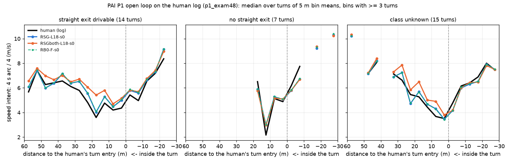
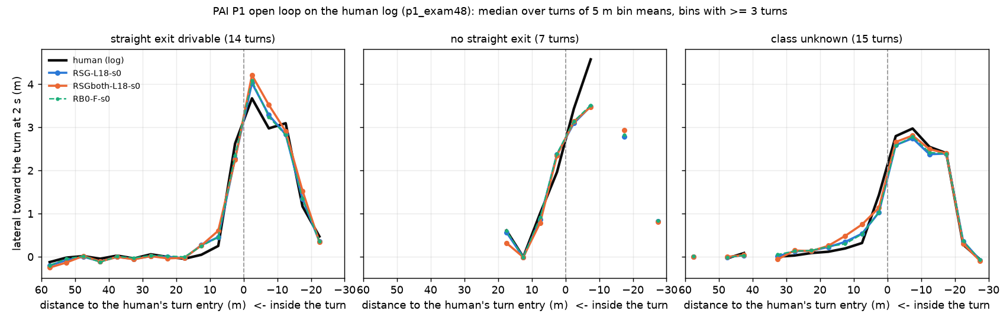

# P1 开环读数：在人类日志状态上，策略会不会为转弯减速、何时开始转（2026-10-13）

**对象** RSG-L18-s0（渲染时实际喂的、实际记录的 checkpoint）、RSGboth-L18-s0、RB0-F-s0。**数据** Tokyo P1 渲染
（`/data/runs/route_night/r281/p1_rsg_log`，20:39 JST 落地）：48 个 exam-hard 转弯 scene，`onp_log_driver` 让自车沿人类日志开，RSG 照常推理并记录。
拷到盒子 `$DATA_DIR/runs/route_follow/p1_openloop/rsg_p1/`（drive.jsonl 43 MB + dump 1.7 GB，只拷了 driver 目录，没拷 sim 帧）。
**脚本** [experiments/route_follow/scripts/rf_pai_openloop.py](../../experiments/route_follow/scripts/rf_pai_openloop.py) 的 `--p1` 模式（全部规则写在 docstring 里，
原来的 `--cache` 模式没动）。**结果** [experiments/route_follow/results/pai_openloop/](../../experiments/route_follow/results/pai_openloop/)：
`p1_exam48.md`（全部表、逐转弯表、配对表）、`<tag>.json`（每个决策的 plan、逐转弯指标、逐决策轨迹）、`p1_exam48_pairs.json`。
盒上用一个 pool GPU 作业重放（`p1ol-read`，约 2 分钟）。

## 0. 判词

1. **不会。RSGboth 在 PAI 人类状态上的开环行为不比 RSG 更早减速，也不比 RSG 更早开始转。** 和 RSG 配对（同一批转弯，均值 [95 % CI]）：
   入口处 4 s 速度意图 +0.04 m/s [−0.00, +0.09]；入口前 20 m 反而**快** +0.43 m/s [+0.19, +0.73]（在人减速的 12 个转弯上是 +0.72 [+0.38, +1.21]），
   也就是说它刹得更晚，到入口时和 RSG 一样快；开始转的位置差 −0.01 m [−0.02, 0.00]（1 Hz 的决策网格上完全相同）。
   唯一的方向一致的差别在横向：2 s 横向缺口少 0.06 m [0.02, 0.11]，主要在右转（−0.13 m [−0.18, −0.08]，4 s 终点更靠内 +0.16 m），
   左转 4 s 终点反而更靠外（−0.18 m [−0.34, −0.07]）。幅度都在分米级，没有一项改变转弯的性质。
2. **更重要的是，RSG 自己在人类状态上就已经会减速、会按时转。** 人在入口前减速的 12 个转弯里，RSG 的 plan 从入口前 40 / 20 m 到入口的速度降
   2.53 m/s，人 2.62 m/s，12 个里 11 个减速；36 个转弯开始转的位置比人早 1.2 m [−1.0, +3.7]（CI 含 0）；入口处速度意图比人快 0.13 m/s [−0.13, +0.37]。
   RB0-F-s0 和 RSG 几乎重合（入口速度差 +0.04 m/s，开始转位置 +0.6 m [−0.5, +1.7]）。10 Hz 的原始记录（`RSG-L18-s0@log`）给出同样的数。
   所以 [pai-follow.md](pai-follow.md) 里闭环看到的「入弯前从不减速、到入口 9.0 对 5.1 m/s」在这个开环读数里**看不到**：喂进人类的历史（帧和 ego 速度历史）时，
   plan 跟着人的减速走。**推断**（没测）：闭环的失败来自策略自己的状态（自己的速度历史、已经偏离的位置），不是「在人的状态上没有减速意图」。
   这一点与 VHIST hold 在 held 上去掉 86 % 的短开一致（[results/vhist/](../../experiments/route_follow/results/vhist/)）。
3. **对转弯学校选择梯子的含义**：这个 P1 开环读数**分不开**三个 checkpoint 的速度和开始转的时机（差值 < 0.5 m/s、< 1 个决策），不能当速度 / 时机的选择读数，
   只能看横向的小差别。要选的话，读数得让策略自己的状态进来：闭环（PASS1），或者把 ego 速度历史改成「保持接近速度」的反事实开环（plan 自己会不会减速）。
4. **剩下的残差，按地图类**（RSG；三个 checkpoint 在这些项上都一样，除非另注）：
   - **前方有直路可开**（14 个转弯）：入口处速度意图比人快 **+0.56 m/s [+0.34, +0.77]**，4 s 弧长是人的 1.12 倍（RSGboth 1.19），
     4 s 终点在人路径**外侧 0.70 m [0.21, 1.24]**，14 个里 2 个到出口都没开始转（RSGboth 1 个）；2 s 横向缺口 ≈ 0（0.04 m）。
     直行先验在开环里也看得到：不是不转，而是转得稍晚、稍宽、稍快。
   - **前方没有直路**（7 个，只能转弯的车道 / T 型）：入口速度和人一样（−0.14 m/s），弯中**比人慢** −1.08 m/s [−2.17, −0.31]，
     2 s 横向缺口 0.34 m [−0.12, 0.88]（`fd01e9ab` 一个就是 1.8 m），开始转比人晚 1.2 m [0, 3.2]：转向执行不足，不是速度问题。
   - **类别未知**（15 个，rf_pai_follow 只在 RSG / RBSG2 在转弯处出走廊时才分类）：速度和人一致，2 s 横向缺口 0.23 m [0.10, 0.37]，开始转早 3.8 m [0.8, 7.8]。

## 1. 方法

- **重放**：dump（每 1 s 一个决策，k = 0, 10, ...；共 960 个）里存着 8 个槽的帧 `cur` 和 ego 行，drive.jsonl 存着每个决策实际喂的路线记忆 `rmem`
  （pai_driver 用 `rmem.Tracker` 在本 run 自己的路线消息上算出的那 200 个数）。所以路线记忆不用重建，直接取记录。重放 = `pai_core.plan`（帧 → Cinque 编码器 → adapter + 路线支路），
  ego 行换成 dump 里的那一行，右侧通行。只有 dump 的决策能重放（1 Hz）；RSG 的 10 Hz 原始记录另作 `RSG-L18-s0@log` 列出，作为分辨率的敏感性。
- **转弯**：在人类路径上（每个决策的 anchor ∘ log_now，加最后一个决策的 log_poses），第一个 30 m 内航向变化 ≥ 45° 的窗口；入口 / 出口取 [a − 10, a + 40] m 内变化的 10 / 90 %。
  48 个里 36 个有人类转弯（左 15 / 右 21）；另外 12 个日志在片段里没转够（路线在日志结束之后才转，大致对应 [turning-school-checks.md](../turning-school-checks.md) 第 1 节 48 里不在日志口径的那 13 个），没有人类参照，去掉。
- **口径**：plan 是模型 poses（后轴，自车系）；人的未来 = log_poses 换到 log_now 的坐标系里（自车跟日志的偏差 ≤ 0.5 m，两者都从自己的原点起算）。
  站点 = 沿日志到人类入口的距离（入口前为正），取 40 / 20 / 0 m 和弯中最近的决策（4 m 内）。
  (a) 速度意图 v4 = 4 s 弧长 / 4；「减速」= 入口处比 40 / 20 m 两者较高者慢 1 m/s 以上。(b) 2 s 横向朝转弯方向的位移，缺口 = 人 − plan（窗口内人需要 ≥ 0.5 m 的决策的中位）。
  (c) 4 s 终点到人路径的有符号距离（+ = 内侧），> 0.5 m 内、< −0.5 m 外。(d) 开始转 = 时间顺序上第一个 4 s 航向朝转弯方向 ≥ 20° 的决策（d ≤ 60 m），
  人用同一批决策；如果第一个合格决策就已经满足（入口紧挨片段开头），记为截尾，不算超前量（17 %）。窗口 = 人到入口前 6 s 到出口。
- **地图类**：[pai-follow](pai-follow.md) 的 `results/pai_follow/scenes.csv` `topo`（先 rsg 行，后 rbsg2 行）；只有在转弯处出过走廊的 scene 才有，所以 15 个是未知。
- CI：`jevdrive.stats`，按转弯（一个 scene 一个）bootstrap；配对差对 RSG。

## 2. 等价性检查（重放 RSG 自己，对记录的 poses_model）

| 对比 | 决策 | 中位 | p99 | 最大 | > 1 cm | > 3 cm |
|:--|--:|--:|--:|--:|--:|--:|
| RSG 重放 vs RSG 记录 | 960 | **1.1 cm** | 4.8 cm | 6.3 cm | 52 % | 9.9 % |
| 对照：RB0-F-s0 重放 vs RSG 记录 | 960 | 17 cm | 97 cm | 1.7 m | 100 % | 99 % |
| 对照：RSGboth 重放 vs RSG 记录 | 960 | 65 cm | 8.5 m | 16 m | 100 % | 100 % |

**任务定的 1 cm 线不过**（最大 6.3 cm），onp_cache 跨机器 G-id 线（≤ 1 % 的决策超过 3 cm）也不过（9.9 %）。查了原因（96 个决策的小作业，scratch 脚本没提交）：
ego 行 dump 与记录差 5e-6（输入一致）；模型原始输出 `mu` 与 dump 里的差 1–4 个 fp16 步长（0.03–0.125，量级 29）；
把 ego 行加 1e-4，plan 中位就动 1.2 cm、最大 4.8 cm；把 rmem 从 5 位小数改成 4 位，动 0.8 cm；关 TF32、开 cudnn deterministic，结果逐位不变。
所以这是 fp16 输出在 Tokyo 3090 与盒子显卡之间的舍入噪声（与第 215 条「换硬件差 1 个 fp16 步长」同一现象），输入是对的；噪声比最近的对照（RB0，17 cm）小 15 倍，
对本文用到的量（速度意图 0.0025 m/s 级、横向 1 cm 级）可以忽略。逐位 1 cm 只能在 Tokyo 同卡上重放才可能做到（今晚的规矩不允许 Tokyo GPU 作业）。

## 3. 图

速度意图（4 s 弧长 / 4）随离人类入口的距离，三列 = 地图类，每个 5 m 箱先在转弯内平均、再取转弯间的中位（少于 3 个转弯的箱不画）；黑 = 人，蓝 = RSG，橙 = RSGboth，绿虚线 = RB0
（蓝线基本被绿线盖住：RSG 与 RB0 几乎重合）。**看**：左列三条彩线都在黑线上方，入口前 20–0 m 高出约 0.5–1 m/s（直行先验），而且橙线在 25–10 m 段最高（RSGboth 刹得晚）；
三条彩线都跟着黑线一起往下走（会减速），到入口处与人的差不超过 1 m/s。

2 s 横向朝转弯方向的位移，同样的布局。**看**：三列里彩线都在入口前 10 m 左右与黑线一起起跳（开始转的时机与人一致）；中列（没有直路）入口后彩线低于黑线（转得不够）；
左列入口后彩线略高于黑线，但 4 s 终点仍在外侧（表里 −0.70 m），说明是转得晚而不是转得不够。

## 4. 局限

- 只有 1 Hz 的决策能重放；站点 40 / 20 / 0 m 取 4 m 内最近的决策，慢速时没问题，速度 > 8 m/s 时箱可能空（40 m 站点只有 15 个转弯有数，很多转弯的入口离片段开头不到 40 m）。
- 开始转的位置分辨率 = 一个决策的行程（约 5 m），超前量的 CI 因此宽；17 % 截尾。
- 地图类只有 21 个转弯有；类别未知的 15 个不能并入任何一类。
- 状态是人的，速度历史也是人的：这个读数测的是「给定人的状态，plan 想怎么开」，不是闭环里策略自己的状态；判词 2 的因果解释是推断。
- 一个 seed（s0），36 个转弯。
