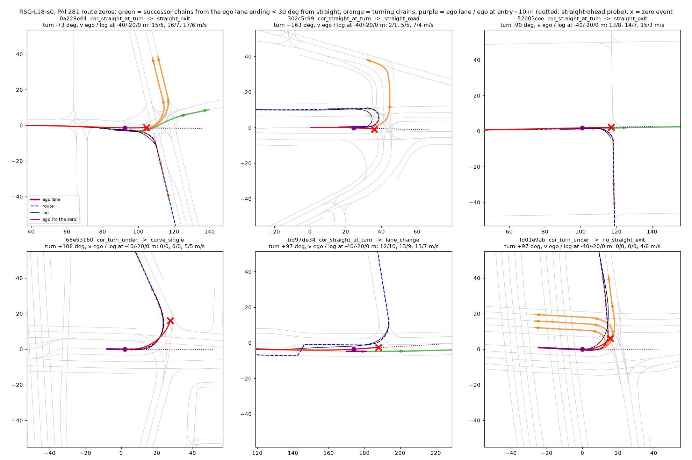

# PAI 281 上用真路线读转弯完成率，以及每个走廊零分的地图拓扑

**日期** 2026-10-13。**对象** RSG-L18-s0（`/data/runs/route_night/r281/rsg`）与 RBSG2-L18-s0（`r281/rbsg2`），Tokyo，gains 20。
**只读、CPU**：Tokyo 容器 alpasim-base:0.89.0 里 4 核 nice 抽事实（281 scene，约 3 分钟），Mac 上分类出表。
**脚本** [experiments/route_follow/scripts/rf_pai_follow.py](../../experiments/route_follow/scripts/rf_pai_follow.py)（`extract` / `report`，全部规则写在 docstring），
Tokyo 入口 [rf_pai_follow.sh](../../experiments/route_follow/scripts/rf_pai_follow.sh)。
**结果** [experiments/route_follow/results/pai_follow/](../../experiments/route_follow/results/pai_follow/)：`turns.md`（转弯完成率 + 逐 scene）、`zeros.md`（零分拓扑 + 逐 scene）、
`pai_follow.json`、`scenes.csv`（每 label × scene 一行，含 `@bend` / `@open` 两个口径）、`s48_turn_scenes.txt`（48 个 scene 的来源）。

## 0. 结论

- **直行先验这个机制成立**：RSG 的 22 个路线零分里 **14 个（64 %）在转弯处有直行可开的路**（11 个是自车所在车道自己就有直行后继，3 个是自车在只能转弯的车道、但旁边车道一直往前通），
  7 个前方没有直行的路，1 个需要先变道。分类学里的「该转没转」11 个里 **10 个前方有直路**；「转了但不够」11 个里只有 4 个前方有直路，另外 7 个是只能转弯的车道、
  车也转了但转得宽、转得晚（多为静止起步，车速 2–5 m/s），这一半是执行 / 转向问题，不是直行先验。RBSG2 在转弯处的 23 个走廊零分里 17 个（74 %）前方有直路，结论一样。
- **策略在转弯前确实不减速，而且是在加速**：22 个路线零分里，人从入口前 40 / 20 m 到入口的中位速度 4.0 / 6.2 / 5.1 m/s（20 个里 10 个减速 > 1 m/s），
  自车 4.9 / 5.7 / **9.0** m/s，**20 个里一个都没有减速**，到入口时中位比人快 41 %。前方有直路的 14 个更明显：入口处自车 11.2 对人 4.9 m/s。
- **真路线下的转弯完成率**（rf_follow 口径移植）：PAI 281 里 36 个转弯 scene，RSG 完成 **5 个 = 13.9 %** [3, 25]，RBSG2 **9 个 = 25.0 %** [11, 39]。
  放宽成「日志可以在转弯中途结束」（51 个转弯）是 13.7 % / 21.6 %；放宽成缓弯（45° / 60 m，46 个）是 19.6 % / 23.9 %。之前的 6 % / 26 % 两个代理数都不对。
- **对反事实行的含义**：反事实行要专门造「前方有路、路线要转」的状态（直行车道 + 路线转弯 + 入口前减速的速度标签），这占路线零分的大头；
  「只能转弯的车道转不进去」是另一类，要的是转向执行（起步大角度转弯），不是路线信号。

## 1. 转弯完成率（真路线）

路线 = AlpaSim 自己的 RouteGenerator（MAP，40 m）：日志投影到它的车道中心，再沿 rollout 实际触发的后继车道延伸，与评估器 / driver 收到的是同一条。
转弯 = 路线上 30 m 内净转角 ≥ 60°（±5 m 弦向），且 exit + 10 m 落在日志自己的行程内（rf_follow 原样；PAI 片段 20 s，窗口用日志全程而不是 18 个决策）。
完成 = 自车（控制器 10 Hz 轨迹）在第一次零分事件之前越过 exit + 10 m，且越过时离路线 ≤ 2.5 m。

| | RSG-L18-s0 | RBSG2-L18-s0 |
|:--|--:|--:|
| 转弯 scene（左 / 右） | 36（15 / 21） | 36（15 / 21） |
| 完成 | **5（13.9 %，CI 3–25）** | **9（25.0 %，CI 11–39）** |
| 　左转 / 右转 | 4 / 15，1 / 21 | 3 / 15，6 / 21 |
| 零分事件在先（走廊 / 碰撞 / 出路） | 21（15 / 3 / 3） | 21（12 / 4 / 5） |
| 离开路线（越过时 > 2.5 m，或最后在路线外） | 6 | 1 |
| 没开到（慢：到结束仍在路线上 / 被追尾截断） | 4（2 / 2） | 5（4 / 1） |
| 转弯 scene 均分 | 0.287 | 0.326 |
| 入口处自车 / 人速度中位比 | 1.10 | 1.05 |
| 宽口径：日志可在转弯中途结束（51 个） | 7（13.7 %） | 11（21.6 %） |
| 宽口径：缓弯 45° / 60 m（46 个） | 9（19.6 %） | 11（23.9 %） |

- 「离开路线」里有 3 个分数是 1.0（`268949d2`、`b40f4729`、`e0f6ebe1`）：转得比路线宽 2.5 m 以上，但评估器的走廊放过了。2.5 m 是 rf_follow 的容差，比评估器严。
- **按 +20 m 记忆覆盖分（逐决策 L5 的 PAI 版）**：覆盖的 22 个 RSG 完成 4.5 %，没覆盖的 14 个 28.6 %（RBSG2 4.5 % / 57.1 %）。这个差是构造出来的：没覆盖的几乎都是
  入口离起点 < 25 m 的转弯（决策 0 时还没有路线消息进入记忆，而这类转弯多是低速起步），不是记忆有害。逐决策配对（RBSG2 − RSG，路口段 |横向| 中位）：覆盖半
  −0.10 m [−0.26, +0.03]（1 308 对，31 个 scene），没覆盖半 −0.01 m [−0.19, +0.05]；两个 CI 都含 0。
- **和 P1 的 48 个 scene（route-follow 2.4 的转弯零分 scene，见 [turning-school-checks.md](../turning-school-checks.md) 第 1 节）的重合**：严格口径 36 个里 28 个在 48 里；
  48 里另外 20 个不在严格口径里，其中 11 个是日志在转弯中途就结束了（宽口径收进来，宽口径重合 39 / 48），其余 9 个是缓弯（`00fabf60`）、45–60° 的弯和路线在日志结束之后才转的。
  严格口径里不在 48 的 8 个（`132ae6cb`、`1e8e939e`、`302c5c99`、`3c2822d9`、`6fd8cf30`、`8a143cb2`、`c4a58f83`、`e5e47fd2`）是参照 arm 没在转弯处零分的转弯。

## 2. 走廊零分的地图拓扑

失败点 = 自车最后一次在路线 2.5 m 以内的位置（`s_reach`）。相关的转弯 = 第一个 exit + 10 m 在 `s_reach` 之后、入口不晚于 `s_reach` + 40 m 的路线转弯（严格口径找不到时用缓弯）。
在自车到达入口前 10 m 时取它所在的车道（中心线 ≤ 2.5 m、方向差 ≤ 45°），从那一点枚举全部后继链到 (exit − entry) + 20 m，算每条链的净转角：

| 类 | RSG 全部走廊零分（47） | RBSG2 全部走廊零分（38） | RSG 路线零分（22） |
|:--|--:|--:|--:|
| **前方有直路：自车车道自己有直行后继（< 30°）** | 14 | 14 | **11** |
| **前方有直路：自车车道只能转，但另一条车道沿车头方向一直往前** | 3 | 3 | **3** |
| 前方没有直路：多条后继都转弯（T / 强制转） | 1 | 1 | 1 |
| 前方没有直路：只能转弯的车道、只有一条链 | 7 | 4 | 6 |
| 需要先变道（自车车道没有任何一条链能转到路线那边） | 1 | 1 | 1 |
| 不在转弯处：开过日志终点 | 12 | 13 | 0 |
| 不在转弯处：其他（漂移、高速、变道） | 8 | 2 | 0 |
| 在转弯处但找不到自车车道 | 1 | 0 | 0 |

分类学主类 × 拓扑（RSG）：「该转没转」11 = 直行后继 7 + 旁边车道直行 3 + 变道 1；「转了但不够」11 = 只能转弯的车道 6 + 直行后继 4 + T 1；
「开过日志终点」17 = 不在转弯处 13 + **直行后继 3**（`095cf563`、`cbd87234`、`fc9fde87`：日志在路口转弯中途结束，自车直行冲过去，其实也是路线零分）+ 只能转弯 1；
漂移 6、转错出口 1、没变道 1 都不在转弯处（「没变道」`e904e9c0` 的路线弯在日志结束之后）。

**转弯前的速度**（中位，m/s；「减速」= 入口处比入口前 40 / 20 m 两者中较高的慢 > 1 m/s）：

| | 入口前 40 m 自车 / 人 | 入口前 20 m | 入口 | 减速的个数 自车 / 人 |
|:--|:--|:--|:--|:--|
| RSG 路线零分（22） | 4.9 / 4.0 | 5.7 / 6.2 | **9.0 / 5.1** | **0 / 20 对 10 / 20** |
| 　其中前方有直路（14） | 5.6 / 6.3 | 7.3 / 6.6 | **11.2 / 4.9** | |
| 　其中前方没有直路 / 变道（8） | 2.2 / 1.3 | 2.2 / 1.3 | 4.4 / 5.3 | |
| RSG 转弯处全部走廊零分（27） | 5.5 / 6.8 | 5.9 / 6.2 | 10.7 / 5.0 | 0 / 23 对 12 / 23 |
| RBSG2 转弯处全部走廊零分（23） | 8.6 / 7.8 | 9.8 / 6.7 | 11.5 / 5.5 | 0 / 21 对 14 / 21 |

读法：入口前 40 m 自车和人差不多快，人进弯前减速，自车反而加速；前方有直路的那一类在入口处是人的两倍多。前方没有直路的那一类是另一种失败：
静止或 2 m/s 起步，速度和人一样，转了但转得宽（看片：`68e53160`、`a1b166cc`、`fd01e9ab`）。逐 scene 表见 `zeros.md`（scene、分类学主类、拓扑类、转角、各条后继链的转角、40 / 20 / 0 m 的两个速度）。

## 3. 图

RSG 的 6 个路线零分（`0a228e44`、`52003cee` 直行后继；`302c5c99` 只能转的掉头车道、旁边车道直行；`bd97de34` 需要变道；`68e53160` 只能转弯的车道；`fd01e9ab` T 型）。
灰 = PAI 地图全部车道中心线，蓝虚线 = 路线，黑 = 日志，红 = 自车（到零分为止），红叉 = 零分事件，紫 = 自车所在车道与入口前 10 m 时的自车位置，紫点线 = 沿车头方向的直行探针；
绿 = 从自车车道出发、终点离直行 < 30° 的后继链，橙 = 转弯的后继链。**看**：上排三个和 `bd97de34` 里红线是不是顺着绿线 / 点线冲出去而蓝线在转；
下排 `68e53160`、`fd01e9ab` 里只有橙色链，红线是跟着转了、但转在外侧。

## 4. 局限

- 「前方有直路」只看车道图：中心线 2.5 m、方向 30°、链长 ≥ 25 m（地图边界截断的链按它自己的终点算）；没看可行驶面多边形、灯态、禁行标志。
  「另一条车道一直往前」用沿车头的直线探针（15 m 到 10 + min(转弯长度, 40) m 的点有 80 % 落在同向车道上），宽一点的路口内部可能漏判。
- 路线零分的 22 个沿用 [zero-taxonomy.md](../zero-taxonomy.md) 的主类（RSG）；RBSG2 没有分类学，用「失败点附近有路线转弯」代替，两列口径不完全一样。
- 严格口径（rf_follow 原样）在 PAI 上只收 36 个转弯：PAI 片段常在转弯出口附近结束，exit + 10 m 落在日志之外就不算；宽口径的两列给了敏感性。
- 速度是控制器的纵向速度对日志位置差分（5 点平滑），按路线站点对齐，不是按时间；入口处 NaN 的是自车在到达入口前已离开路线。
