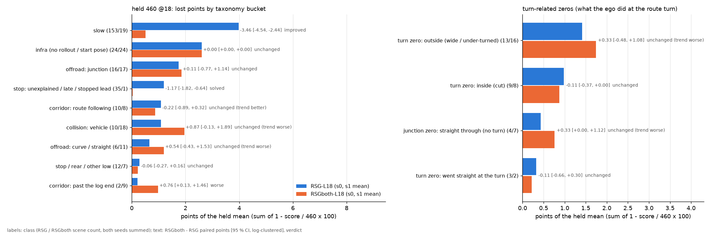
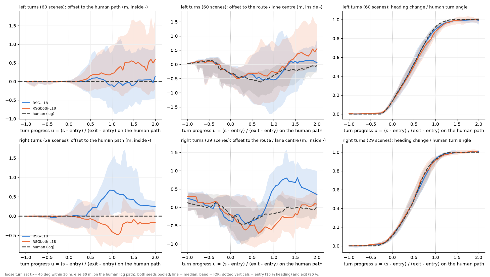

# RSGboth 对 RSG：已解决 / 未解决台账，以及每个转弯开得怎么样（2026-10-13）

**对象** held 460 @18 上的 RSG-L18-s0/s1 与 RSGboth-L18-s0/s1（`$DATA_DIR/runs/route_mem/read/<tag>/c*/run`），按 scene 配对，两个种子先各自配对、再按 scene 取均值（组配对）。
**只读、CPU**：箱上 `rf_tax.py extract`（4 × 9 核，约 2 分钟），Mac 上 `rf_tax.py report` 分类 + `rf_ledger.py report`。多出来的零分（RSGboth 的 +7 / +12）归另一个 agent（`results/rsgboth_v/`），这里只记账、不诊断。
**脚本** [experiments/route_follow/scripts/rf_ledger.py](../../experiments/route_follow/scripts/rf_ledger.py)（全部规则写在 docstring）。
**结果** [experiments/route_follow/results/ledger/](../../experiments/route_follow/results/ledger/)：`ledger.md`（按桶 / 转弯零分 / rf_tax 主类 / 24 个严格转弯的结局）、`turns.md`（严格 24 个、宽口径 89 个、左 / 右分开）、
`ledger.csv`、`ledger_pairs.csv`、`turns.csv`（label × 转弯一行）、`turn_summary.csv`、`turn_vs_human.csv`、`turn_pairs.csv`、`tax/`（四个 label 的 rf_tax 逐 scene 分类）。
数字全部是**测**的，标了「推断」的除外。CI 均为按 log 聚类的 95 % bootstrap。

## 0. 判词

**解决了的：慢。** 「无因的慢」与「跟车慢」−3.46 分 [−4.54, −2.44]（两种子合计 153 → 19 个 scene），「无故停车 / 迟起步」−1.17 分 [−1.82, −0.64]（35 → 1，判 solved），
≥ 0.9 的 scene +77。转弯里也是同一件事：过弯速度回到人的水平（弯中 RSG 比人慢 0.6–0.75 m/s，RSGboth 与人差 +0.01…+0.09、CI 含 0），
到 exit + 10 m 的时间从比人晚 0.2–0.5 s 变成与人持平（配对 −0.60 s [−0.89, −0.32]），所以严格 24 个转弯的「没开到」（short）16 → 2、完成率 +27 pp [+10, +48]，宽口径 89 个 +30 pp [+18, +40]。
**这次的「转弯变好」几乎全是纵向的：车开到了，弯的形状没有变好。**

**没解决的：转弯的形状，而且出现了一个新的、有方向的偏差。**

1. **左转偏晚、偏宽，右转偏早、切内**（新）。RSGboth 对 RSG（宽口径，组配对）：左转外侧峰值 +0.22 m [+0.09, +0.35]、外扩 > 1 m 的份额 +13 pp [+5, +23]、切内 −9 pp；
   右转内侧峰值 −0.32 m [−0.41, −0.21]、切内 > 1 m +14 pp [+3, +23]、出弯时偏内 0.74 m [0.50, 1.04]。航向到 50 % 的位置：左转比人晚 0.4–0.5 m，右转早 0.06–0.24 m（RSG 反过来）；
   非转弯 scene 上 RSGboth 的平均横向偏移也略往右（−0.065 对 −0.03 m）。**汇总的「内切份额不变」是左右两个方向的变化互相抵消。**
2. **「内切 54 %」大半是人自己的线**：以车道中心线（AlpaSim 路线）为参照，人自己在 46 % 的转弯里进到中心线内侧 > 1 m；以人的路径为参照，自车切内 > 1 m 只有 16–19 %，RSG 与 RSGboth 一样。
   rf_inside 的指标把人的正常走线也算成了内切；**不该把车往车道中心线上修。**
3. 转弯相关零分没动：外侧（出路外侧 / 转不够）1.41 → 1.74 分（+0.33 [−0.48, +1.08]，倾向变差），内侧 0.98 → 0.87，在转弯处直行 0.33 → 0.22，路口直行段出路 0.43 → 0.76。合计 RSGboth 仍丢约 3.6 分，其中同一批难 scene 四个 label 都零分（`4d2f5000`、`a50958e2`、`b4775cc1`、`ac8d5aa2`……）。
4. **入弯时机在 held 上测不出**：held 的日志从 rollout 开始、约 9 s 后结束，严格转弯的入口中位只在起点之后 5 m，入口前 40 / 20 m 根本不在 rollout 里；起转点与人差 −0.06 m [−0.20, +0.08]。入弯减速的问题在 PAI 上（见第 3 节）。
5. 出弯车道：exit + 10 m 正确车道 86 % 对 86 %，不变；exit + 20 m 的横向误差 +0.25 m [+0.08, +0.50]（只有 14 个转弯够得着），是左转外扩的延续。
6. 抖动不是问题：峰值横摆角速度比 RSG 高 2.0 °/s [1.05, 2.84]，但与人持平（+0.1 / +1.2，CI 含 0）；横摆角速度反向次数与人相同。

**下一步，按能拿回的分排序**（理由与证据见第 3 节）：

1. **PAI 上的 `both` 行**（PAI 的 on-policy 状态 + 人锚定目标）：RSGboth 证明了「on-policy 行上的模仿项」能修纵向；PAI 缺的正是入弯减速（路线零分里自车到入口 9.0 m/s 对人 5.1，20 个里没有一个减速），
   路线跟随在 PAI 上值 10.7 分（该转没转 3.9 + 转不够 3.9 + 漂移 2.1 + 其他 0.8）。held 上约 0 分。
2. **左右偏差**：先做 CPU 审计（池 `on1_L18RB0` 的 `fut` 恢复目标按左右分的横向 / 航向滞后、左右行数，served plan 与执行轨迹的航向差），定位是目标还是执行；
   held 上转弯相关零分（内 + 外）≤ 2.6 分，PAI 路口出路 1.8 分 + 转不够里只能转弯车道的 7 个中的一部分。
3. **人停了车没停 / 开过日志终点**：held +0.76 分 [+0.13, +1.46]（变差，RSGboth 开得更远），PAI 6.0 分；这是停止信号的问题，不属于转弯，归停止线那条线。
4. **路线 hinge 的车道中心线标签**：RSGboth 的配方里**没有**路线 hinge（`--on-lon on_route` 只在 RB / RBSG 里），所以它不是 RSGboth 左右偏差的原因；
   但第 2 条判词说明，凡是再加回路线 hinge 的臂，都要按 loss-audit 的修法换成人路径的管道（日志行 0.5 m 带）、反事实行死区 1.5 m 且权重 ≤ 10。held 上直接分数约 0。
5. 出弯车道 / 记忆覆盖：held 上 < 0.3 分；严格转弯 24 个里只有 1 个在入口前 20 m 被记忆覆盖（转弯就在起点），held 测不了，放到 PAI 上读。

## 1. 台账（held 460，RSGboth − RSG，组配对）

图 [figs/ledger_bars.png](../../experiments/route_follow/figs/ledger_bars.png)：左边按分类学的桶，右边是转弯相关零分；蓝 = RSG，橙 = RSGboth（两种子均值），文字 = 配对差 [CI] 与判词。
要看的：最上面「慢」的蓝条几乎消失；右边「外侧」橙条比蓝条长、「内侧」基本一样长。

| 类（桶） | 个数 RSG / RSGboth（两种子合计） | 丢分 RSG / RSGboth | 差 [CI] | 判词 |
|:--|:--|:--|:--|:--|
| 慢（无因 / 跟车） | 153 / 19 | 3.98 / 0.52 | −3.46 [−4.54, −2.44] | improved |
| 停：无故 / 迟起步 / 静止前车 | 35 / 1 | 1.20 / 0.03 | −1.17 [−1.82, −0.64] | **solved** |
| 评估器 / 基础设施 | 24 / 24 | 2.61 / 2.61 | 0 | unchanged（改不了） |
| 出路：路口内 | 16 / 17 | 1.74 / 1.85 | +0.11 [−0.77, +1.14] | unchanged |
| 走廊：路线跟随 | 10 / 8 | 1.09 / 0.87 | −0.22 [−0.89, +0.32] | unchanged |
| 碰撞：车辆 | 10 / 18 | 1.09 / 1.96 | +0.87 [−0.13, +1.89] | unchanged（倾向变差） |
| 出路：弯道 / 直路 | 6 / 11 | 0.65 / 1.20 | +0.54 [−0.43, +1.53] | unchanged（倾向变差） |
| 走廊：开过日志终点 | 2 / 9 | 0.22 / 0.98 | +0.76 [+0.13, +1.46] | **worse** |
| 其他停 / 追尾 / 低分 | 12 / 7 | 0.29 / 0.23 | −0.06 [−0.27, +0.16] | unchanged |
| ≥ 0.9 的 scene | 652 / 806 | | +77 个 [CI > 0] | improved |

转弯相关零分（`ledger.md` 的 turn-related 表）：外侧（路口外侧 / 弯道外侧出路、走廊转不够）13 / 16 个、1.41 / 1.74 分；内侧（路口内侧 / 弯道内侧出路）9 / 8、0.98 / 0.87；
转弯处直行 3 / 2、0.33 / 0.22；路口直行段出路 4 / 7、0.43 / 0.76。逐个看（`tax/*.csv` 对 `turns.csv`）：走廊「转不够」在人路径参照下几乎都是**外扩 3.7–4.1 m**，不是转得晚；
内侧零分里只有 `e4585611`（右转 95°）与 `9acc5c9b`（左转 60°）在人路径参照下真的切内 > 1 m，其余在宽口径之外（日志在弯里就结束了）。
24 个严格转弯的分数本来就接近 1：结局类加起来只占 0.3 分，「short」16 → 2 是 improved，但分数上只值 −0.10 分 [−0.19, −0.03]。

## 2. 转弯质量

定义（`rf_ledger.py` docstring）：几何全在**人的日志路径**上算（站位 s、带符号横向、内侧为负）；自车 = 控制器 10 Hz 轨迹，截到第一个零分事件。
严格 = rf_follow 的 24 个路线转弯；宽口径 = 人路径上第一个 30 m 内（不行再 60 m）净转角 ≥ 45° 的弯，89 个（左 60 / 右 29）；入口 / 出口 = 转角的 10 % / 90 %。

图 [figs/ledger_turn_shape.png](../../experiments/route_follow/figs/ledger_turn_shape.png)：上排左转、下排右转；左列 = 到人路径的偏移，中列 = 到车道中心线（路线）的偏移（黑虚线 = 人自己），右列 = 航向进度。
线 = 中位，带 = 四分位。要看的：左上橙线（RSGboth）在 u > 0.5 之后往外（正）走、到出口后 0.5 m；左下橙线在弯里往内（负）走到 −0.5 m，而蓝线（RSG）右转是往外 0.7 m；
中列黑虚线在弯中到 −0.5 m（人本来就在中心线内侧）；右列三条线几乎重合（起转时机没有差别）。

**表　宽口径 89 个转弯（两种子组配对；人 = 日志）**

| 指标 | RSG（s0 / s1） | RSGboth（s0 / s1） | 人 | RSGboth − RSG [CI] |
|:--|:--|:--|:--|:--|
| (a) 完成率（宽口径规则） | 33.7 / 30.3 % | 61.8 / 61.8 % | | +29.8 pp [+18.4, +39.5] |
| 　结局 完成 / 事件 / 离开 / 没开到 | 30/5/4/50，27/7/4/51 | 55/9/5/20，55/8/6/20 | | |
| (b) 入口速度（m/s） | 4.73 / 4.68 | 5.04 / 4.99 | 5.01 | +0.29 [+0.10, +0.47] |
| 　弯中 50 % 速度 | 4.99 / 4.75 | 5.56 / 5.49 | 5.49 | +0.75 [+0.43, +1.07] |
| 　exit + 10 m 时间滞后（s，正 = 比人晚） | +0.18 / +0.17 | −0.08 / −0.12 | 0 | −0.60 [−0.89, −0.32] |
| (c) 起转点 − 人（m，负 = 早） | −0.03 / +0.14 | −0.01 / +0.09 | 0 | −0.06 [−0.20, +0.08] |
| (d) 外侧峰值（m） | 0.82 / 0.84 | 0.90 / 0.91 | 0 | +0.07 [−0.04, +0.19] |
| 　内侧峰值（m） | −0.51 / −0.45 | −0.49 / −0.46 | 0 | 0.00 [−0.11, +0.12] |
| 　切内 > 1 m / 外扩 > 1 m | 16 / 19 %，33 / 29 % | 16 / 16 %，39 / 39 % | | −1.7 [−7.9, +3.6]，+8.4 [+0.6, +18.0] pp |
| 　在中心线内侧 > 1 m（rf_inside 式） | 54 / 52 % | 53 / 54 % | **46 %** | +0.6 [−4.2, +5.9] pp |
| (e) exit + 10 m 正确车道 | 87 / 89 % | 86 / 84 % | 100 % | 0.0 [−8.3, +11.1] pp |
| 　exit + 20 m 横向误差（m，n = 14） | 0.52 / 0.53 | 0.91 / 0.80 | 0 | +0.25 [+0.08, +0.50] |
| (f) 峰值横摆角速度（°/s） | 20.0 / 20.1 | 20.1 / 21.7 | 20.4 | +1.96 [+1.05, +2.84] |
| 　横摆角速度反向次数 | 1.11 / 1.06 | 1.06 / 1.13 | 1.09 | 0.00 [−0.09, +0.11] |

**左 / 右分开**（`turns.md` 的 loose L / loose R）：

| 指标（RSGboth − RSG） | 左转 60 个 | 右转 29 个 |
|:--|:--|:--|
| 外侧峰值 | **+0.22 [+0.09, +0.35]** | −0.24 [−0.47, −0.07] |
| 内侧峰值 | +0.16 [+0.04, +0.27]（没那么内） | **−0.32 [−0.41, −0.21]** |
| 切内 > 1 m | −9.2 pp [−14.9, −3.5] | **+13.8 pp [+2.8, +22.7]** |
| 外扩 > 1 m | **+13.3 pp [+5.1, +22.9]** | −1.7 [−18, +13] |
| 出口（100 %）偏移 | +0.17 [−0.01, +0.31] | −0.74 [−1.04, −0.50] |
| 完成率 | +25 pp [+15, +35] | +40 pp [+19, +56] |

航向到 50 % 的位置 − 人（m）：左转 RSG −0.07 / +0.23，RSGboth +0.41 / +0.54；右转 RSG +0.43 / +0.27，RSGboth −0.06 / −0.24。即 RSGboth 的航向整体偏顺时针（左转转得慢、右转转得快），
RSG 右转偏晚、偏宽（右下蓝线出口处 +0.66 m），RSGboth 把它修过了头。

严格 24 个转弯（`turns.md` 第一节）同向：完成率 +27 pp（rf_follow 口径）/ +19 pp（本脚本口径），弯中速度 +0.35 m/s，exit + 10 m 滞后 −0.59 s，外侧峰值 −0.20 m [−0.41, −0.01]（这里右转的「RSG 外扩」占主），
切内份额 17 对 21 %，中心线内侧 > 1 m 67 对 65 %（人 46 %）。

## 3. 还错在哪，修法和证据

| 残差 | 证据（本页） | 修法 | 能拿回的分：held / PAI |
|:--|:--|:--|:--|
| **PAI 入弯不减速、该转没转 / 转不够** | held 上测不出（入口在起点 5 m 内）；RSGboth 证明 on-policy 行上的模仿项修好了 nuPlan 的纵向（过弯速度 = 人，滞后 −0.6 s）；pai-follow：PAI 路线零分 20 个里自车没有一个在入口前减速，入口 9.0 对 5.1 m/s；loss-audit：PAI 上模仿项 89–100 % 的行往慢推，但 RSG 没有 PAI 的 on-policy 行 | PAI on-policy 池（Tokyo `rows/pol` 或 r281 rollout 建行）上的 `--on-mode both`，与 nuPlan 池混合；入口前减速靠人锚定目标的弧长 | ~0 / **≤ 7.8**（该转没转 3.9 + 转不够 3.9；推断，RSGboth 没在 PAI 上跑） |
| **左晚宽 / 右早切**（RSGboth 新出现） | 左外侧峰值 +0.22、外扩 +13 pp；右内侧峰值 −0.32、切内 +14 pp；50 % 航向左 +0.4–0.5 m、右 −0.06…−0.24 m；非转弯 scene 横向均值略往右；转弯外侧零分 +0.33（倾向变差）、exit + 20 m 误差 +0.25 m | 先审计再改（CPU）：(i) 池 `on1_L18RB0` 的 `fut` 对 `logfut`，按左右分的横向与航向滞后、左右行数（宽口径左 : 右 = 2 : 1）；(ii) served plan 的航向进度对执行轨迹（是 plan 还是控制器跟踪）。若是目标：日志附近（离日志 < 1 m）的行用日志路径的管道（0.5 m）代替指数回归目标；若是执行：控制器侧 | ≤ 2.6（转弯内 + 外零分）/ ≤ 1.8（PAI 路口出路）+ 转不够的一部分 |
| 「内切」（车道中心线参照） | 人自己 46 % 在中心线内侧 > 1 m；人路径参照下切内 16–19 %，两个模型相同；RSGboth 配方里没有路线 hinge | 不要往中心线修。凡加回路线 hinge 的臂：日志行用人路径管道（loss43 R 项，0.5 m），反事实行路口段死区 1.5 m、λ × ho_w ≤ 10；指标改用人路径参照（本脚本的 `cut1`） | 0.87 内侧零分里能归到真切内的只有 2 个 scene ≈ 0.4 / PAI 0.4 |
| 入弯时机（起转早 / 晚） | 起转点差 −0.06 m [−0.20, +0.08]，三条航向进度线重合；held 的转弯紧贴起点，测不了入口前 40 / 20 m | 在 PAI（20 s 片段）上用同一套定义读；不单独开臂 | — / 并入第 1 行 |
| 出弯车道 | exit + 10 m 正确车道 86 % 对 86 %；exit + 20 m 误差 +0.25 m（左转外扩的延续）；严格转弯只有 1 / 24 被记忆覆盖 | 随第 2 行；记忆覆盖在 PAI 上读（入口离起点远） | < 0.3 / 未测 |
| 开过日志终点（人停了车没停） | held +0.76 [+0.13, +1.46]（RSGboth 开得更远，2 → 9） | 停止信号（停止线 / 日志停车标签），不是转弯 | 0.98 / 6.0 |

**没验证的**（推断）：第 1 行的 PAI 分数是上限（假设 PAI 上 `both` 的效果和 nuPlan 一样把「慢 / 不减速」修掉）；第 2 行的原因（目标还是执行）没定位，CPU 审计 (i)(ii) 约 30 分钟可以做完。
RSGboth 的额外零分（碰撞 +0.87、弯道 / 直路出路 +0.54）是否与这里的「右偏」有关，交给 rsgboth_v 的诊断对照：它的 extra zeros 多在弯道（s0 的 14 个里 8 个、s1 的 19 个里 12 个）。

## 4. 局限

- 严格转弯只有 24 个、宽口径 89 个，左右分开后右转 29 个；held 的转弯几乎都从 rollout 起点附近开始，入口前的速度和起转时机在 held 上没有信息量。
- 「正确车道」用人路径 ±1.75 m 且航向差 ≤ 20° 判，没读地图车道；exit + 20 m 只在 14 个转弯里够得着（日志先结束）。
- 宽口径的完成规则：日志在 exit + 10 m 之前结束时，目标改成日志终点前 0.5 m；与 rf_follow 的严格口径（路线参照、2.5 m）不完全相同，严格 24 个两种口径差 0–13 pp。
- 转弯相关零分的「内 / 外」用 rf_tax 的规则（路线参照 ±20 m 的转角与自车在路线哪一侧），与本页人路径参照的「切内 / 外扩」不是同一把尺。
