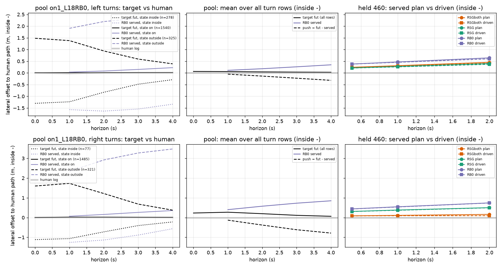

# RSGboth 的左右偏差从哪来：目标、跟踪还是行配比（2026-10-13）

## 0. 判词

**是训练目标造成的，不是跟踪，也不是行配比。更准确地说，是「池的状态分布 × 忠实的恢复目标」。** 恢复目标 `fut` 本身左右对称，
贴的是人的路径，不是车道中心线。偏的是 RB0 在池 `on1_L18RB0` 里访问到的状态：右转弯内的行里偏外 > 0.5 m 的有 27 %，偏内只有 6 %
（左转 20 % 对 21 %，基本平衡），RB0 在这些右转行上的 plan 2 s 处平均偏外 1.06 m。于是 `both` 的模仿项在右转弯内平均**往里拉 0.72 m**（2 s），
左转只拉 0.29 m。模型学到的是一个「右转就往里收」的、按方向区分的修正，而且把它泛化到了入口前：held 上 RSGboth 右转入口前 20 m 内 plan 偏内 > 1 m
的决策从 1 % 涨到 5–6 %。

- **跟踪不是原因**：held 上 plan 2 s 与车实际 2 s 的位置差只有 −0.02…−0.10 m。RSGboth 对 RSG 的右转偏内 −0.39 m（实际轨迹）里，plan 自己占 −0.33 m，
  控制器多转的只有 −0.07 m（约 18 %，可能是因为过弯更快，**推断**）。
- **行配比不是原因**：池里转弯行左 : 右 = 2 143 : 1 883，转角中位 81° 对 85°；直路行（69 %）的模仿推力 +0.03 m [−0.00, +0.07]（2 s，左正），接近 0，
  没有往右拉。RSGboth 在直路上只比 RSG 偏右 0.04 m [0.01, 0.07]。
- **左转的「晚、宽」不是这个机制**：held 上左转 plan 2 s 的横向位置 RSGboth − RSG = +0.06 m [−0.07, +0.19]，偏外 > 1 m 的份额也不变（34–38 % 对 33–35 %）。
  台账里的左转外扩 +0.22 m 在 2 s 的 plan 里看不到，更可能来自过弯速度（RSGboth 以人的速度过弯，RSG 慢）或者 2 s 以后的部分（**推断**，这里没有测 4 s）。

**修法**（按优先级）：

1. **按 (方向, 状态在路径哪一侧) 给池里的转弯行重新加权**：右转弯内的偏外行（321）对偏内行（77）现在是 4 : 1，权重配平到 1 : 1（偏内 ×2、偏外 ×0.5，
   或者按逆频率），使每个方向上模仿推力的均值接近 0；左转已经平衡，不用动。这一步在 CPU 上只改 `on_train` 的行采样权重。
2. **池跟着策略走（DAgger 下一轮）**：RSGboth 训的是 RB0 的状态，可 RSGboth 自己在右转上的 plan 已经从 +0.54 回到 +0.08…+0.25 m。
   用 RSGboth 自己开 onpol-train 重建池（on1_L18RSGboth），右转偏外的行自然会少，推力随之变小。修法 1 是这一步之前的便宜替代。
3. **不要**把 `fut` 改成车道中心线，也不必改成纯日志管道：目标本身是对的（4 s 处离人路径 0.2–0.4 m，左右衰减比相同）。缩短恢复时间（更小的 Lr）
   只会把往里拉的力变大，方向相反；如果要动 Lr，应当是变长（例如 Lr = max(4 m, 2 s × v)），但对偏外 1.6 m 的右转行，2 s 处的推力只从约 −1.7 m 降到约 −1.3 m（估算），不能代替修法 1。

## 1. 方法

脚本 [experiments/route_follow/scripts/rf_sidebias.py](../../experiments/route_follow/scripts/rf_sidebias.py)（`pool` / `held` 在箱上跑，纯 CPU；`report` 在 Mac 上跑；
定义都写在 docstring 里）。结果放在 [experiments/route_follow/results/sidebias/](../../experiments/route_follow/results/sidebias/)：`tables.md`（全部表与 CI）、`pool_side_bins.csv`、
`held_side.csv`，逐行的数据是 `pool_rows.csv.gz` 和 `held_<label>.csv.gz`。

- **转弯**：以人的日志路径为参照，30 m 窗内航向变化 ≥ 60°，自车在窗内（`in`）或在窗前 0–20 m（`pre`）；直路 = 同一组窗里最大变化 < 10°。
  没有用车道中心线，因为目标就是沿人路径建的，而台账已经说明两者在弯里不一样。
- **横向**：到人路径的带符号偏移，内侧为负。`push` = `fut` − 当时 serve 的 plan（模仿项把 plan 往哪拉）。
- **池**：`on1_L18RB0`，17 429 行（RB0-F-s0 开 onpol-train，18 个决策）。`fut` = on_rows Amendment 2 的恢复目标：沿人路径、从自车的投影弧长往前 D_k，
  横向偏移按 e(D) = (e0 + (tan ψ + e0/Lr) D)·exp(−D/Lr) 衰减，Lr = max(4 m, D_8/4)。`logfut` = 同一时刻日志自己的位姿。
- **held**：held 460 @18，用 rf_tax 的 extract（RB0-F-s0 这次在箱上重抽）加上 drive.jsonl 的 `poses`，对比控制器轨迹在 0.5 / 1 / 2 s 的位置。
  比较做两遍：在 anchor 坐标系里，和在控制器 t0 的坐标系里（`rlat`，扣掉 t0 时 anchor 与控制器的偏差，p95 0.27 m），两者结果相同。
- CI 是按 log 聚类的 95 % bootstrap（jevdrive.stats）。

## 2. 结果

图 [figs/sidebias.png](../../experiments/route_follow/figs/sidebias.png)：上排左转、下排右转。
**左列**：池里按状态分箱（点线 = 偏内、实线 = 在线上、虚线 = 偏外）的目标 `fut`（黑）、RB0 的 plan（紫）和人（灰）。看黑线：两侧都在约 1 s 后向 0 收拢，
而且左右形状一样，说明目标是对称的。
**中列**：所有转弯行的平均。看黑虚线（push）：右转在 4 s 处到 −0.8 m，左转只到 −0.3 m。
**右列**：held 上 plan（实线）和实际轨迹（虚线），三个模型。看两件事：每种颜色的实线和虚线基本重合（跟踪没有问题）；
右下橙线（RSGboth）比绿线（RSG）低约 0.35 m，左上两条线基本重合。

**表 1　池 on1_L18RB0 的转弯行：目标与人（内侧为负，m；push = fut − RB0 plan）**

| 方向 | 状态 | 行 | e0 | fut 1 s | fut 2 s | fut 4 s | 人 2 s | RB0 plan 2 s | push 2 s |
|:--|:--|--:|:--|:--|:--|:--|:--|:--|:--|
| 左 | 全部 | 2 143 | +0.06 | +0.06 | +0.04 | +0.03 | +0.01 | +0.18 | −0.14 [−0.27, −0.00] |
| 左 | 偏内 | 278 | −1.30 | −1.23 | −0.83 | −0.29 | −0.04 | −1.63 | +0.81 |
| 左 | 偏外 | 325 | +1.48 | +1.38 | +0.94 | +0.39 | +0.05 | +2.20 | −1.26 |
| 右 | 全部 | 1 883 | +0.23 | +0.27 | +0.20 | +0.07 | +0.01 | +0.58 | **−0.38 [−0.48, −0.28]** |
| 右 | 偏内 | 77 | −1.12 | −1.06 | −0.72 | −0.22 | +0.01 | −1.14 | +0.41 |
| 右 | 偏外 | 321 | +1.60 | +1.73 | +1.22 | +0.38 | +0.04 | +2.92 | −1.70 |

只看弯内（`in`）的行：左转偏外 / 偏内 20 % / 21 %，push −0.29 m；右转 27 % / 6 %，**push −0.72 m**，RB0 plan +1.06 m。

衰减的几何是对称的：|e0| > 0.5 m 的行，fut / e0 在 1 / 2 / 4 s 的中位数分别是：左内 0.96 / 0.62 / 0.14，左外 0.95 / 0.63 / 0.16，右内 0.90 / 0.58 / 0.13，
右外 1.09 / 0.77 / 0.17。右外略高，是因为这些状态的航向本身就朝外（ψ +13°，左外是 +7.5°），也就是状态的问题，不是混合公式的问题；Lr 4.0–5.4 m。
目标的弧长比人短（2 s 处左 −1.1 m、右 −2.3 m），因为速度要从自车的速度在 2 s 内过渡到人的速度，RB0 偏慢；两个方向同向，不是左右偏差的来源。

**表 2　held 460：plan 与实际轨迹（转弯决策，内侧为负；按 scene 配对，两个种子取均值）**

| 对比 | 方向 | scene | plan 2 s | 实际 2 s | 实际 − plan 2 s |
|:--|:--|--:|:--|:--|:--|
| RSGboth − RSG | 左 | 52 | +0.06 [−0.07, +0.19] | +0.05 [−0.08, +0.18] | −0.04 [−0.05, −0.03] |
| RSGboth − RSG | 右 | 34 | **−0.33 [−0.66, −0.15]** | −0.39 [−0.71, −0.22] | −0.07 [−0.09, −0.06] |
| RSGboth − RSG | 直（左正） | 263 | −0.04 [−0.07, −0.01] | −0.04 [−0.07, −0.02] | 0.00 |
| RSG − RB0 | 左 | 52 | −0.25 [−0.41, −0.11] | −0.24 | +0.01 |
| RSG − RB0 | 右 | 34 | −0.23 [−0.42, −0.06] | −0.24 | 0.00 |
| RSGboth − RB0 | 右 | 34 | −0.57 [−0.98, −0.31] | −0.63 | −0.07 |

各模型自己的数字（`tables.md`）：右转 plan 2 s 的平均偏移 RB0 +0.74，RSG +0.54 / +0.46，RSGboth +0.25 / +0.08；实际 − plan 在 RB0 / RSG 上
−0.02…−0.03 m，在 RSGboth 上 −0.06…−0.10 m。分布：右转弯内 plan 偏外 > 1 m 的份额 RB0 44 %、RSG 31–35 %、RSGboth 16–24 %；右转入口前偏内 > 1 m
的份额 RB0 2 %、RSG 1 %、RSGboth 5–6 %。左转在这些指标上 RSG 与 RSGboth 相同。

**第 4 问（基线）**：RSG（`self`，不读 `fut`）相对 RB0 是左右**对称地**往里收了 0.23–0.25 m（来自道路 / agent 的 hinge）。只有加上 `both` 之后才出现
右边单独多收 0.33 m，跟池里右转 push 是左转 2.7 倍（−0.38 对 −0.14）的方向和大小一致。所以这个偏差是 `both` 新带来的，来源是池的状态分布。

## 3. 局限

- held 的 plan 只比较到 2 s，台账里左转外扩是整段弯的峰值；左转偏差的原因（速度还是 2 s 之后的形状）这里没有定位。
- 「模型学到了按方向区分的修正」是从「池里推力的左右不对称」和「held 上 plan 偏移的左右不对称」两边同时成立推出来的，没有做干预实验
  （例如按修法 1 重新加权训一个臂），属于**推断**；修法 1 本身就是这个检验。
- 转弯是在人的路径上定义的（60° / 30 m），与台账的宽口径（45°）和 rf_follow 的路线口径不完全相同；右转只有 34 个 scene 能配对。
