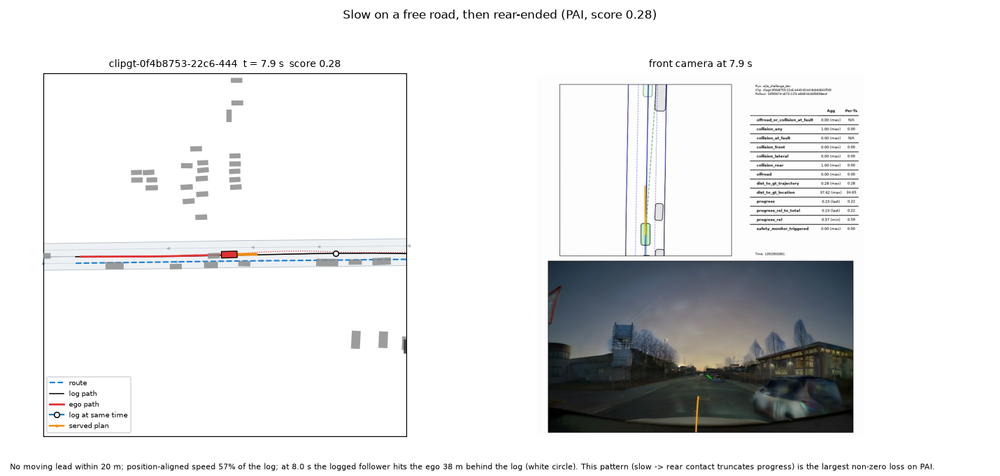
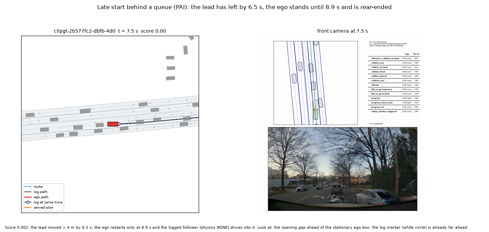
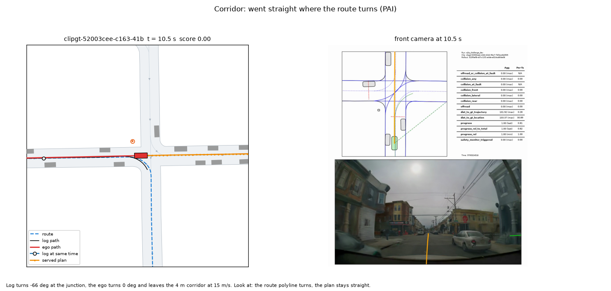
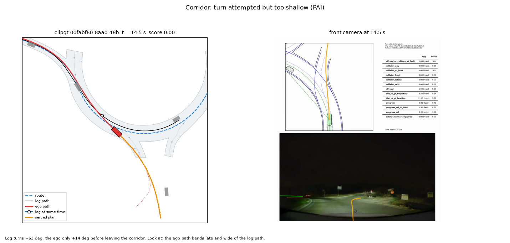
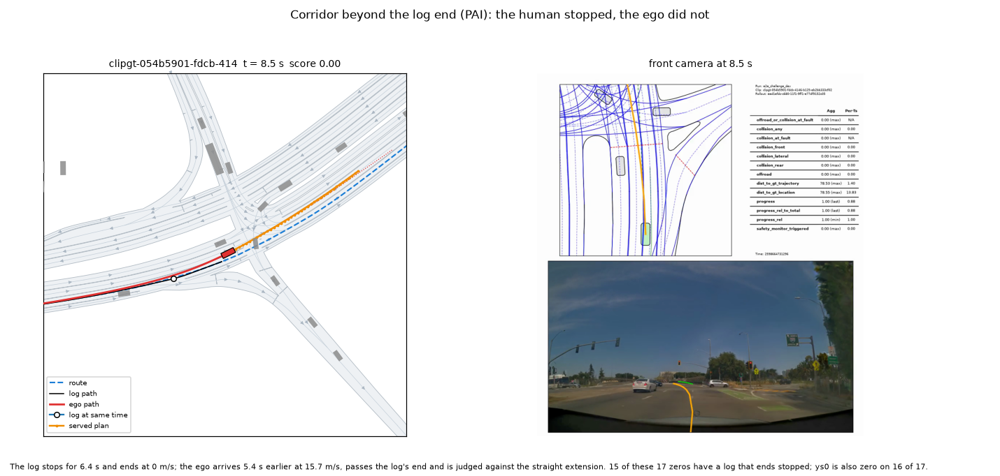
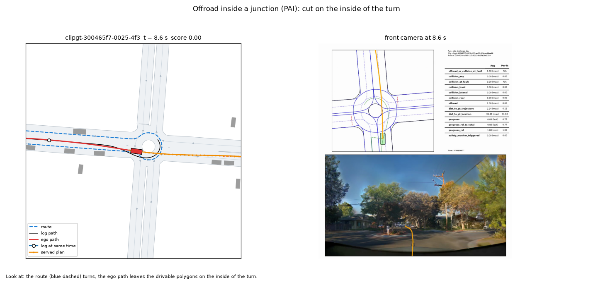
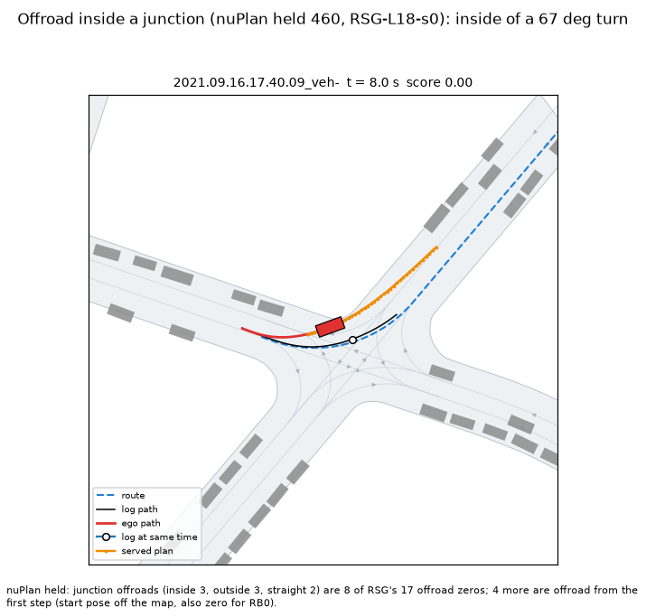
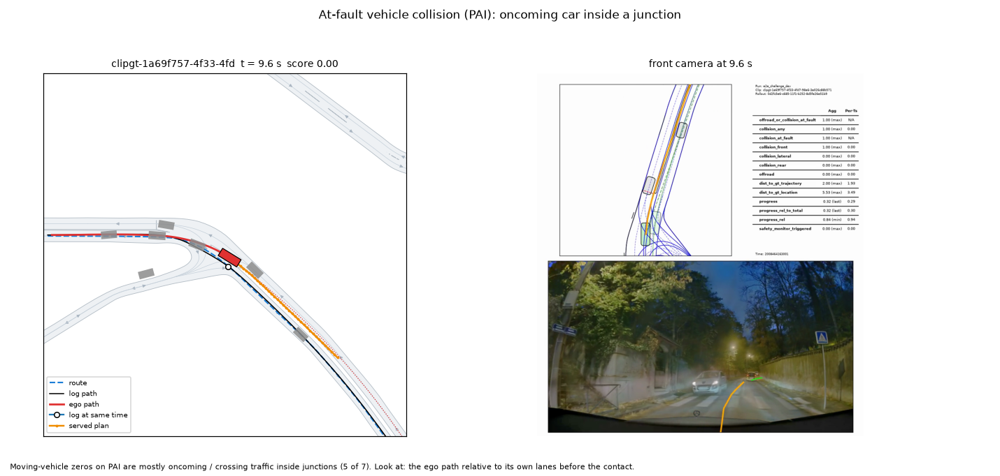
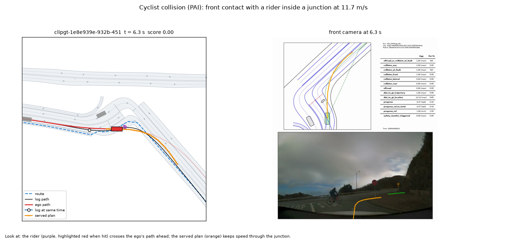
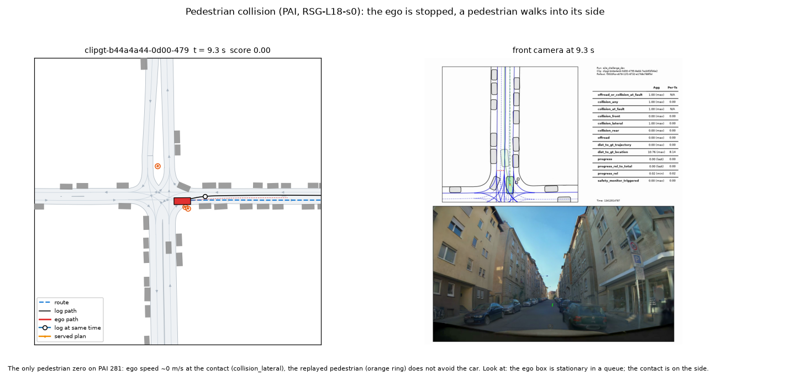

# 零分与低分分类：RSG-L18-s0 在 PAI 281 与 nuPlan held 460 上每一个零分 / 低分从哪来

**日期** 2026-10-13。**对象** 当前唯一候选 RSG-L18-s0（第 286 条）；参照 PAI 用 ys0（YS-L18-s0，存档，gains 5），held 用底座 RB0-F-s0。
**只读、CPU、不起新仿真**：PAI 读 Tokyo `/data/runs/route_night/r281/rsg`（gains 20）与 `/data/runs/onpol_long/pai281/ys0`；held 读主箱 `$DATA_DIR/runs/route_mem/read/{RSG-L18-s0,RB0-F-s0}/c0..5/run`。
**脚本** [experiments/route_follow/scripts/rf_tax.py](../experiments/route_follow/scripts/rf_tax.py)（`extract` 在箱上 / Tokyo 容器里抽事实，`waitlines` 抽 PAI 地图停止线，`report` 分类，`figs` 出图；全部判定规则写在脚本的 `RULES`）。
**逐 scene 表** [experiments/route_follow/results/taxonomy/](../experiments/route_follow/results/taxonomy/)：`pai281_rsg.csv`、`pai281_ys0.csv`、`held460_rsg.csv`、`held460_rb0.csv`（每 scene 一行：分、零分类型、主类 / 副类、事件决策 k、事件时刻与车速、涉及物体类别、停车片段、速度比……），
`*_peds.csv`（行人在路径前方的每一次相遇）、`*_blocks.csv`（静止物体在路径前方的每一次相遇）、`summary.json`。看片表 [route-follow/review-sheet-rsg.md](route-follow/review-sheet-rsg.md)（44 段，Tokyo 桌面 `rsg-errors/`）。

## 0. 一句话

- **PAI 上离 0.94 差 36.8 分，零分只占 24.9，「慢」是最大的单项**：慢 13.5 分（其中前方 20 m 没有在动的车、自车只开到日志同位置六到八成速度的 11.2 分，跟车 2.3 分），比任何一个零分类都大；
  慢的代价被评估器放大：日志里的后车按日志速度开（physics NONE），直接追尾慢下来的自车，**281 个里 70 个非零分 rollout 被追尾截断**（追尾时自车落后日志中位 27 m，4.3 对 12.7 m/s）。
- **PAI 零分 70 个里 47 个是走廊，其中 17 个是「人停了、车没停」**：日志在路口 / 停止线前停住并停到结束，自车不停、开过日志终点，被终点外的直线延长判出走廊（ys0 同样 18 个）；
  另 29 个是路线跟随（路口该转没转 11、转了不够 11、漂移 6、转错出口 1、没变道 1）。
- **行人与静止障碍不是当前的问题**：nuPlan 赛道的仿真里**根本没有行人**（460 个 scene 的回放物体全是 VEHICLE）；PAI 有行人的 scene 155 个，行人进入路径前方 10 m 内的只有 5 个 scene，
  一次也没撞上；唯一的行人零分是**自车停着、行人走上车身侧面**。日志绕过了、而自车被它卡住的静止物体每个集合约 1–2 个 scene，没有一个零分。
- **held 460 上离 0.94 只差 7.4 分**：零分 34 个里 12 个是评估器 / 基础设施（8 个 scene 没有 rollout、4 个第一步就出路，RB0 一模一样），真零分 22 个；剩下的缺口主要是 0.6–0.9 段的无因的慢（57 个 scene、2.6 分）。

## 1. 方法（短）

每个 rollout 读：summary 的分与 flag、评估器的逐步序列（`metrics.parquet`）、控制器 10 Hz 轨迹（自车）、日志路径、AlpaSim 的路线（按自车 0.5 s 位姿重建）、物体
（nuPlan：模拟器回放的日志交通，zeros_mech 的 G-act 已证明与 asl 一致；PAI：每个 rollout 的 `rollout.asl` 里的 actor 位姿与类别）、评估器的车道图（行驶方向、路口、可行驶面）。
零分类型按最早触发的 flag（ol_clips 规则）；碰撞找第一次接触时与自车框重叠最大的物体；出路按车道图的路口标记 + 路线转角与自车在路线哪一侧（rf_offroad 的内外侧规则）；
走廊按日志在自车覆盖那段的转角对自车自己的转角、日志横移、自车是否已过日志终点；低分只看进度（评估器没有任何舒适度或超速项，第 3.13 补记），按停车片段的原因（前方静止物体是否被日志绕过、
前车走后多久才走、行人、日志在同位置的速度）与位置对齐的速度比定主因，追尾作为副类。全部阈值在 `RULES`。
**数对得上**：四个集合的均分、零分数、碰撞 / 出路 / 走廊分拆与第 286 条和 `rf_pai281.py` 逐个相同（PAI RSG 0.5720 / 70 = 9 / 14 / 47，ys0 0.5165 / 96 = 13 / 26 / 57，held RSG 0.8656 / 34 = 4 / 17 / 5 + 8 个无 rollout，RB0 0.8220 / 59 = 7 / 29 / 15 + 8）。

## 2. 零分分类

每格「个数（其中参照也零分的个数） / 占均分的点数」，点数 = 这一类 scene 的 (1 − 分) 之和 / scene 数 × 100，即把这类全修好均分能涨多少。参照：PAI RSG 对 ys0，ys0 对 RSG，held RSG 对 RB0，RB0 对 RSG。

| 类别 | PAI RSG | PAI ys0 | held RSG | held RB0 |
|:--|--:|--:|--:|--:|
| 行人碰撞 | 1（1） / 0.4 | 1（1） / 0.4 | 0 / 0.0 | 0 / 0.0 |
| 骑车人碰撞 | 1（1） / 0.4 | 2（1） / 0.7 | 0 / 0.0 | 0 / 0.0 |
| 撞静止车 / 障碍（没绕过） | 0 / 0.0 | 2（1） / 0.7 | 0 / 0.0 | 1（0） / 0.2 |
| at-fault：撞同向前车 | 0 / 0.0 | 2（1） / 0.7 | 1（1） / 0.2 | 2（0） / 0.4 |
| at-fault：侧擦同向车 | 3（3） / 1.1 | 4（2） / 1.4 | 2（1） / 0.4 | 2（2） / 0.4 |
| at-fault：横穿车 | 1（1） / 0.4 | 1（1） / 0.4 | 0 / 0.0 | 0 / 0.0 |
| at-fault：对向车 | 3（1） / 1.1 | 1（0） / 0.4 | 1（0） / 0.2 | 2（0） / 0.4 |
| 出路：路口内侧切角 | 1（1） / 0.4 | 1（1） / 0.4 | 3（2） / 0.7 | 3（2） / 0.7 |
| 出路：路口外侧过宽 | 4（4） / 1.4 | 5（4） / 1.8 | 3（3） / 0.7 | 6（2） / 1.3 |
| 出路：路口内直行段 | 1（1） / 0.4 | 3（1） / 1.1 | 2（2） / 0.4 | 2（1） / 0.4 |
| 出路：弯道（非路口） | 4（4） / 1.4 | 3（2） / 1.1 | 3（2） / 0.7 | 7（2） / 1.5 |
| 出路：直路 / 车道边 | 4（3） / 1.4 | 14（2） / 5.0 | 2（2） / 0.4 | 7（2） / 1.5 |
| 出路：第一步就出路（起点位姿） | 0 / 0.0 | 0 / 0.0 | 4（4） / 0.9 | 4（4） / 0.9 |
| 走廊：路口该转没转（直行） | 11（11） / 3.9 | 18（17） / 6.4 | 1（1） / 0.2 | 2（2） / 0.4 |
| 走廊：转了但不够（晚 / 宽） | 11（9） / 3.9 | 8（5） / 2.8 | 3（2） / 0.7 | 7（3） / 1.5 |
| 走廊：转错出口 | 1（1） / 0.4 | 3（2） / 1.1 | 0 / 0.0 | 3（0） / 0.7 |
| 走廊：没变道 | 1（1） / 0.4 | 3（2） / 1.1 | 0 / 0.0 | 0 / 0.0 |
| 走廊：漂移 | 6（4） / 2.1 | 7（5） / 2.5 | 0 / 0.0 | 0 / 0.0 |
| 走廊：开过日志终点（人停了车没停） | 17（16） / 6.0 | 18（14） / 6.4 | 1（1） / 0.2 | 3（1） / 0.7 |
| 基础设施：无 rollout（route fold，8 个 scene 计 0） | 0 / 0.0 | 0 / 0.0 | 8（8） / 1.7 | 8（8） / 1.7 |
| **合计** | **70 / 24.9** | **96 / 34.2** | **34 / 7.4** | **59 / 12.8** |

副类：PAI RSG 的 70 个零分里 62 个 ys0 也零分（同一批难 scene）；走廊与碰撞零分里 25 个在路口内；高速打转 2 个（`32be03e4`、`4cb05d65`，交接后 2.2–2.3 s、34–36 m/s；ys0 16 个）。
held RSG 的 4 个碰撞里 2 个撞前 2 s 内后轴在对向车道（zeros_mech 的 H3 那一类）。

## 3. 低分分解（非零分）

主因按根因（迟起步 / 静止前车 / 行人 / 无故停 > 慢 > 合理停 > 只被追尾），格式同上。

| 类别 | PAI RSG < 0.6 | PAI RSG 0.6–0.9 | PAI ys0 < 0.6 | PAI ys0 0.6–0.9 | held RSG < 0.6 | held RSG 0.6–0.9 | held RB0 < 0.6 | held RB0 0.6–0.9 |
|:--|--:|--:|--:|--:|--:|--:|--:|--:|
| 迟起步（前车走开 > 2 s 后才走） | 3 / 0.8 | 0 | 0 | 0 | 0 | 0 | 0 | 0 |
| 停在静止前车后（日志绕过了它） | 0 | 1 / 0.1 | 0 | 0 | 1 / 0.2 | 0 | 1 / 0.1 | 0 |
| 无故停车（日志 ≥ 2 m/s、前方无物） | 2 / 0.4 | 1 / 0.1 | 1 / 0.2 | 1 / 0.1 | 2 / 0.2 | 13 / 0.7 | 3 / 0.3 | 14 / 0.9 |
| 慢：前方 20 m 没有在动的车 | **47 / 9.1** | 26 / 2.1 | 44 / 8.9 | 22 / 2.0 | 5 / 0.5 | **57 / 2.6** | 5 / 0.5 | 37 / 1.7 |
| 慢：跟在在动的车后 | 7 / 1.8 | 5 / 0.5 | 0 | 0 | 4 / 0.4 | 12 / 0.6 | 1 / 0.1 | 12 / 0.5 |
| 合理停（车队 / 日志也停 / 跟车） | 5 / 1.3 | 0 | 7 / 1.9 | 1 / 0.1 | 1 / 0.1 | 1 / 0.0 | 0 | 4 / 0.2 |
| 只被追尾截断（不慢） | 5 / 1.1 | 5 / 0.4 | 3 / 0.6 | 4 / 0.3 | 1 / 0.1 | 2 / 0.1 | 0 | 2 / 0.1 |
| 其他 | 0 | 0 | 0 | 0 | 0 | 1 / 0.0 | 0 | 1 / 0.0 |
| **合计** | 69 / 14.5 | 38 / 3.2 | 55 / 11.5 | 28 / 2.4 | 14 / 1.5 | 86 / 4.1 | 10 / 1.1 | 70 / 3.4 |

- **追尾（副类）**：PAI RSG 70 个、ys0 58 个、held RSG 24 个、RB0 22 个非零分 rollout 被 `collision_rear` 截断（PAI RSG 合计 12.8 分）。PAI RSG 的 70 个里 52 个速度比 < 0.85；
  追尾时自车落后日志中位 27.3 m、自车 4.3 对日志 12.7 m/s，撞上来的全是 automobile。读法：这是「慢」的代价，不是另一个机制——日志后车不让、按日志速度开，自车越慢越容易被撞、进度就停在那一刻。
- **慢是全族的**：非零分 rollout 的位置对齐速度比中位 PAI RSG 0.84（ys0 0.86），held RSG 0.88（RB0 0.89）；held 上连 ≥ 0.9 的 scene 也只有 0.92（PAI ≥ 0.9 的 1.03）。
- 舒适度 / 超速扣分：评估器没有这一项（AlpaSim `scene_score.py`），计 0。
- ys0 只有零分 rollout 留了 asl，非零分没有物体，所以 ys0 的「慢」两类分不开（全进了「前方无动车」），「静止前车 / 迟起步」也看不到；ys0 的低分列只读「慢 / 停 / 追尾」的总量。

## 4. 行人与静止障碍（带分母）

**行人**

| | PAI RSG | PAI ys0（只有零分 rollout 有物体） | held RSG / RB0 |
|:--|--:|--:|--:|
| 仿真里有行人的 scene | 155 / 281 | — | **0 / 460**（回放物体全是 VEHICLE；40 个 asl 的 actor 定义也只有 VEHICLE） |
| 行人曾在自车 10 m 内（任意方向）的 scene | 70 | 34（96 个里） | 0 |
| 行人进入自车路径前方 10 m 内的 scene（相遇次数） | **5（13）** | 1（8） | 0 |
| 其中自车减速（3 s 内降 ≥ max(1 m/s, 30 %)）的 scene（相遇） | 2（4） | 1（3） | — |
| 撞上路径前方的行人 | 0 | 0 | — |
| 行人零分 | 1：`b44a4a44`，自车 0 m/s 停在车队里，行人从侧面走上车身（lateral，评估器记 at-fault） | 同一个 scene | 0 |
| 骑车人零分 | 1：`1e8e939e`，路口 STOP 线前 11.7 m/s 不减速，正面撞上横穿的骑车人 | 2 | 0 |

5 个相遇 scene 里 4 个最后 ≥ 0.9 分；`b680a689` 刹到 0.2 m/s 让了行人，之后转弯不够出走廊。读法：**PAI 的行人处理没有一个真失败**——唯一的行人零分是回放行人不避让静止车，
`10_pedestrian` 那 3 段让用户确认「在路径前方」的行人是不是真在横穿（判定用自车实际路径 ±(半车宽 + 行人半宽 + 0.3 m)，可能偏宽）。**nuPlan 赛道测不到行人**：这件事要在 PAI 上练、在 PAI 上考。

**静止障碍（停着的车 / 物体在自车路径前方 15 m 内）**

| | PAI RSG | held RSG | held RB0 |
|:--|--:|--:|--:|
| 出现过的 scene | 75 | 153 | 155 |
| 其中日志在它还停着时开过去了（「人能过」）的 scene | **16** | **32** | **38** |
| 　自车也过去了 | 9 | 20 | 22 |
| 　自车停在它后面等 | 1（`b44a4a44`，之后行人零分） | 2（0.75、0.26 分） | 2 |
| 　撞上 | 1（`382a7247`：那辆车撞时已在动，记对向碰撞） | 0 | 0 |
| 　其他（减速绕开 / rollout 先结束） | 5 | 10 | 14 |
| 日志也没过（排队、红灯）：自车等 / 过 / 撞 / 其他 | 31 / 14 / 1 / 18 | 15 / 25 / 0 / 95 | 14 / 26 / 1 / 91 |

读法：「被停着的东西卡住而人能过」每个集合 1–2 个 scene、≤ 0.3 分，**不是下一轮的目标**。PAI 上更常见的是**车队里起步迟钝**：前车开走（移动 > 4 m）后 2 s 以上才走，3 个 scene 做主因（0.8 分），
其中 `2b577fc2` 站到 8.9 s 被追尾、0.002 分。

**停止线（探索，PAI 地图的 wait line）**：人在地图停止线（STOP / YIELD / 未标类型）前 0–12 m 停过 ≥ 1 s 的 scene 62 个；RSG 在人还停着时以 > 2 m/s 开到线上的 29 个（ys0 30 个），
其中 14 个零分（开过日志终点 7、转弯不够 3、碰撞 2……）、14 个仍 ≥ 0.9 分（人只是短停，评估器不罚闯线）。灯态没有读（日志里没有），「未标类型」多半是灯口的停止线。

## 5. 离 0.94 的缺口按类分解

每格「点数（占缺口的比例）」；缺口 = 0.94 − 均分（PAI RSG 36.8、ys0 42.4、held RSG 7.4、RB0 11.8 分），全部类别加起来是 1 − 均分（42.8 / 48.4 / 13.4 / 17.8），所以比例合计超过 100 %：
修好一类，均分就涨这么多；要到 0.94，只需要修掉加起来等于缺口的那几类。

| 桶 | PAI RSG | PAI ys0 | held RSG | held RB0 |
|:--|--:|--:|--:|--:|
| 慢（无因 / 跟车），含追尾截断 | **13.5（37 %）** | 10.9（26 %） | **4.2（56 %）** | 2.8（24 %） |
| 走廊：路线跟随（该转没转 / 转不够 / 转错 / 没变道 / 漂移） | **10.7（29 %）** | 13.9（33 %） | 0.9（12 %） | 2.6（22 %） |
| 走廊：开过日志终点（人停了车没停） | 6.0（16 %） | 6.4（15 %） | 0.2（3 %） | 0.7（6 %） |
| 出路：弯道 / 直路 | 2.8（8 %） | 6.0（14 %） | 1.1（15 %） | 3.0（26 %） |
| 碰撞：车辆 at-fault | 2.5（7 %） | 3.6（8 %） | 0.9（12 %） | 1.5（13 %） |
| 出路：路口内 | 2.1（6 %） | 3.2（8 %） | 1.7（23 %） | 2.4（20 %） |
| 停：迟起步 / 无故停 / 静止前车 | 1.5（4 %） | 0.2（1 %） | 1.1（14 %） | 1.3（11 %） |
| 合理停 / 只被追尾 / 其他低分 | 2.7（7 %） | 2.8（7 %） | 0.4（5 %） | 0.4（3 %） |
| 碰撞：行人 / 骑车人 | 0.7（2 %） | 1.1（3 %） | 0 | 0 |
| 评估器 / 基础设施（无 rollout、第一步出路） | 0 | 0 | 2.6（35 %） | 2.6（22 %） |
| ≥ 0.9 的残差 | 0.2（1 %） | 0.3（1 %） | 0.5（6 %） | 0.5（4 %） |

读法：**PAI 上「慢」+「路线跟随」+「人停车不停」三项就是 30.2 分，占缺口的 82 %**；出路与碰撞合起来 8.1 分。held 上能修的缺口（扣掉 2.6 分的评估器 / 基础设施）只有 4.8 分，
其中慢 4.2 分；真零分（22 个）合计 4.8 分里出路 2.9、碰撞 0.8、走廊 1.1。两条赛道的主矛盾不一样：held 已经接近饱和，PAI 才是考场。

## 6. 每一类：什么机制能把它去掉

- **慢（无因 / 跟车）**：前方空着，车只开到人的六到八成，PAI 上又因此被日志后车追尾截断。第 285 条的速度历史棘轮（速度历史反馈让 plan 越开越慢）是第一嫌疑；
  候选是去掉速度历史输入 / 给 MPC 一个不读真值的目标速度（steer-long 补记 2 的 c'），先在 PAI 上看速度比与追尾数，判据是速度比中位到 0.95 以上、追尾截断减半。
- **路口该转没转 / 转不够**：日志转 56–180°，车在路口直行或只转一半，ys0 也一样（11 / 11 参照也零分）。路线记忆底座在 held 上已经把这类压到 1 + 3，PAI 上没有：PAI 的路线消息与 nuPlan 不同分布、训练里没见过 PAI 的路口。
  机制候选：路线坐标系的 plan 头（沿路线进度 + 横向偏移，让「跟路线」成为输出的默认）、在 PAI 地图上造路口反事实行（地图检查已通过）。看片表 01 / 02 的答案决定是执行还是路线跟随。
- **人停了车没停（开过日志终点）**：17 个里 15 个日志以 0 m/s 结束（人停到 rollout 结束），自车多数比人早 2–13 s 到达、以 12–17 m/s 开过去；前视帧里能看到灯口（`054b5901`）。
  这一半是真错（不认红灯 / 停止线 / 让行），一半是评估器口径（终点外的直线延长）。去掉它要给车「该停」的信号：停止线 / 灯态输入或从日志的停车学；保守的替代是在路线终点前减速（不改模型，但会伤进度）。看片表 04 的答案决定走哪条。
- **漂移 / 没变道 / 转错出口**：PAI 8 个、held 0 个。变道在第 286 条里反事实行也没教会（G-swap 变道类 5–7 %），需要带变道的路线标签或专门的变道行。
- **出路（弯道 / 直路 / 路口内）**：PAI 14 个、held 13 个（不含第一步就出路的 4 个；RB0 25 个）。路口外侧过宽比内侧切角多（PAI 4 对 1，held 3 对 3），held 的弯道 / 直路出路 5 个。带方向的道路栅格（第 268 条臂 B）在两侧都约束，是现成的候选；PAI 没有道路栅格，要先从 PAI 地图做一份。
- **车辆 at-fault 碰撞**：PAI 7 个（对向 3、侧擦 3、横穿 1），3 个在路口内（对向 2、横穿 1）；held 4 个。路口内对向 / 横穿是让行问题，与「人停车不停」同源（`229791a5` 横穿重卡那次 RSG 也闯了停止线）；侧擦是变道 / 转弯时的横向挤压。
- **行人 / 骑车人**：PAI 各 1 个；行人那一个是评估器 + 回放行人口径（静止车被走上来），骑车人那一个是 STOP 线前不减速（与停止线同一机制）。行人让行本身没有失败样本，**现在不值得单独做**。
- **评估器 / 基础设施**（held）：8 个 scene 没有 driver 记录（route fold，在 452 配对口径里本来就去掉）、4 个第一步就出路（起点位姿在地图外）；对所有 checkpoint 一样，改不了，报数时应从缺口里扣掉。
- **迟起步 / 无故停**：PAI 迟起步 3 个、held 无故停车 15 个（多在 0.6–0.9 段、每个只丢 0.05 左右）。与「慢」同一条纵向线处理。
- **打转**：PAI RSG 只剩 2 个（gains 20 之后，ys0 在 gains 5 下 16 个），都在交接后 2.2–2.3 s、34–36 m/s；按用户要求在控制器侧 100 % 解决（spin-fix 线），不进训练。

## 7. 图

每张图左边是事件时刻的 BEV（灰 = 评估器车道图的可行驶面与车道中心线，蓝虚线 = 路线，黑 = 日志路径，白圈 = 日志同一时刻的位置，红 = 自车路径与车框，橙 = 当时的 served plan，灰框 = 车，橙圈 = 行人，紫圈 = 骑车人，红框 = 被撞物体），
右边是 PAI 前视视频同一时刻的帧（上半是评估器自己的 BEV 与逐项指标）。

-  **慢 → 被追尾**（`0f4b8753`，0.28）：前方空着，速度只有日志的 57 %，8.0 s 时落后日志 38 m 被后车追尾。看：白圈远在前面，自车框后面贴着一辆车。
-  **迟起步**（`2b577fc2`，0.002）：前车 6.5 s 已开走，自车站到 8.9 s。看：自车前方的空当与静止的自车框。
-  **路口该转没转**（`52003cee`）：日志在路口转 −66°，plan 一直是直的。看：蓝虚线转弯、橙线不转。
-  **转了但不够**（`00fabf60`）：日志转 +63°，自车只转 +14°。看：红线弯得晚而宽。
-  **人停了车没停**（`054b5901`）：日志停在灯口前 6.4 s 并以 0 m/s 结束，自车以 15.7 m/s 开过日志终点。看：前视里的信号灯，BEV 里黑线在路口前终止而红线继续。
-  **路口内出路，PAI**（`300465f7`）：转 147° 的路口里切内侧。看：红线离开可行驶面的位置在转弯内侧。
-  **路口内出路，held**（`b5155b95`）：67° 的路口里切内侧，nuPlan 上路口出路占 RSG 出路零分的 8 / 17。
-  **路口内与对向车相撞**（`1a69f757`）。看：撞前自车相对自己车道的位置。
-  **骑车人**（`1e8e939e`）：STOP 线前 11.7 m/s 不减速，撞上横穿的骑车人。看：前视里地上的 STOP 与骑车人。
-  **行人**（`b44a4a44`）：自车停着，行人从侧面走上车身。看：自车框静止，接触在侧面。

## 8. 局限

- 分类是规则做的，阈值（走廊的 30° / 10°、慢的 0.85、在路径内的横向宽度、停止线的 0–12 m）都是读数时定的，没有预登记；边界附近的 scene 会换类。看片表的 44 段就是用来校这些规则的。
- PAI 视频帧按 rollout 开始对齐（视频 20 s），没有逐帧核对时钟；ys0 非零分 rollout 没有物体，低分分解只作总量参照。
- 「人停了车没停」里有多少是红灯：日志没有灯态，停止线读数是探索，地图的「未标类型」停止线没法分灯口与让行。
- held 的物体是日志交通的重建（G-act 在 556 个 asl 上 ≤ 0.05 m），PAI 用 asl 本身；PAI 的参照 ys0 跑在 gains 5，打转数不可比（第 286 条）。
